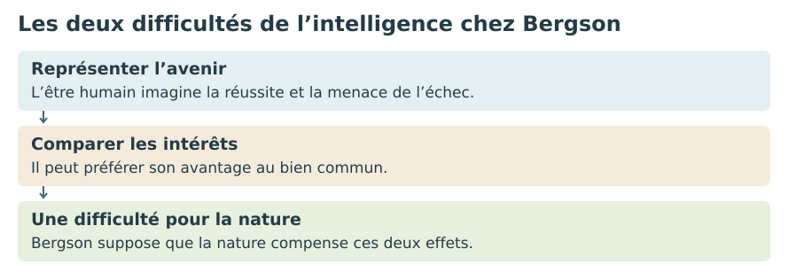

# École polytechnique FUI-FF, session 2 — Français 2023 · Corrigé brut

*Corrigé rédigé par IA, non officiel.*

**Rédaction** · modèle exact non renseigné (famille GPT-6) · effort non renseigné · vitesse non renseignée

**Révision** · modèle exact non renseigné (famille GPT-6) · effort non renseigné · vitesse non renseignée

**Révision** · GPT-6.2 Astra Ultra · vitesse non renseignée

**Révision (tour 3)** · GPT-6.2 Astra Ultra · vitesse non renseignée

L’épreuve n° 2 de la seconde session dure deux heures. L’extrait vient des *Deux Sources de la morale et de la religion* d’Henri Bergson (1932). Les trois questions de compréhension valent ensemble dix points. L’essai personnel sur les liens entre l’homme et la nature au XXIe siècle vaut également dix points, sans limite de mots. Le sujet interdit les dictionnaires et traducteurs électroniques.

## A1 · Thèse et question finale

Pour Bergson, l’intelligence humaine a une double contrepartie. Parce qu’il anticipe plusieurs avenirs, l’être humain oscille entre l’espoir de réussir et la crainte d’échouer. Parce qu’il réfléchit à son intérêt particulier, il peut aussi se détourner du bien commun. Bergson ajoute que l’intelligence est elle-même issue de la nature. Dans son raisonnement, elle se trouve au terme d’une ligne de l’évolution animale, comme l’instinct au terme d’une autre. D’où la déduction de la dernière phrase. Puisque la nature a produit cette faculté, elle a dû, selon lui, prévoir aussi un contrepoids à son pouvoir de dérégler les conduites. Le passage s’arrête à cette hypothèse, avant d’en expliquer le mécanisme.

## A2 · La part d’incertitude dans l’action

L’action humaine est « mal assurée » parce que l’être humain peut imaginer plusieurs issues, comparer les démarches possibles et craindre de se tromper. Il hésite ou procède par essais. L’expression caractérise l’incertitude vécue devant un résultat futur. Un navigateur expérimenté peut hésiter entre rentrer au port et poursuivre sa route. Sa main tient fermement la barre. C’est le fait de concevoir plusieurs suites possibles à son geste qui lui fait éprouver à la fois la crainte et l’espoir.

## A3 · Les deux différences entre l’homme et les autres animaux

Bergson oppose deux couples de traits. D’abord, les autres animaux vivent, selon lui, confiants dans le présent malgré les dangers, alors que l’homme imagine l’échec, sait qu’il peut tomber malade et qu’il mourra. Ensuite, chez les animaux vivant en société, il présente l’intérêt individuel comme spontanément accordé à celui du groupe. L’être humain peut au contraire calculer son avantage et négliger ses semblables. La promenade à la campagne sert ici d’expérience familière. Nous revenons apaisés d’avoir côtoyé des êtres que le texte décrit comme confiants dans l’instant. Cette observation prépare la distinction suivante entre l’instinct, qui accorde spontanément les intérêts, et la réflexion, qui peut les dissocier.

## B · Essai sur les humains et la nature au XXIe siècle

Dans ma ville, il suffit de tourner un robinet pour obtenir de l’eau même après plusieurs jours sans pluie. Ce geste banal donne une impression de maîtrise. Mais si l’on suit le trajet de l’eau jusqu’au réservoir, à la rivière et au bassin où elle se renouvelle, l’impression change. Nous maîtrisons une partie du trajet pour un temps donné. Nous dépendons toujours de processus qui dépassent le lieu et le moment de notre action.

La mer d’Aral en offre un exemple saisissant. Pour irriguer les cultures d’Asie centrale, on a détourné une partie de l’eau des fleuves qui l’alimentaient. Les canaux accomplissaient bien la tâche assignée par leurs concepteurs. Pourtant, la contraction du lac et la perte d’activités de pêche ont privé d’autres populations d’une ressource essentielle. Dire que la nature avait été maîtrisée aurait donc décrit le point de vue d’un bénéficiaire de l’irrigation tout en passant sous silence celui d’un pêcheur riverain. La possibilité technique d’obtenir un résultat précis ne nous dispense jamais d’en suivre les effets ailleurs.

L’histoire de l’Aral ne s’arrête pourtant pas au recul du rivage. Au Kazakhstan, le barrage de Kok-Aral, achevé en 2005, a contribué à retenir l’eau dans le bassin nord. La salinité y a baissé et des poissons y sont revenus. Ce résultat local permet aussi de mesurer ce qui demeure perdu dans d’autres parties du lac.

Le cas d’une rivière urbaine m’aide à comprendre le mouvement inverse. Une ville peut choisir de laisser une prairie inondable au bord du cours d’eau afin que la crue s’étale. Il faut des études, des décisions sur les terrains et un entretien pour que ce choix reste possible. Ici, la technique et l’action collective servent à faire de la place à un mouvement de l’eau que l’on renonce à contenir entièrement. Préserver un milieu demande parfois autant de prévoyance que le transformer.

Bergson souligne que notre intelligence nous donne à la fois la capacité d’anticiper et celle de préférer notre intérêt immédiat. C’est précisément la tension que je retrouve dans ces deux exemples. À mes yeux, la nature est aujourd’hui mise en danger lorsque la réussite locale d’un aménagement sert de prétexte pour ignorer les dépendances qu’il transforme. Notre plus grande liberté consiste peut-être à choisir comment agir après avoir reconnu ces dépendances.
