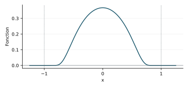
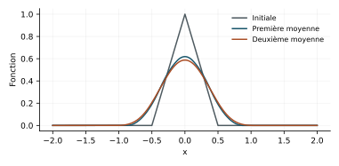

# École polytechnique, FUI-FF session 2 — Mathématiques 2023 · Corrigé brut

*Corrigé rédigé par IA, non officiel. Signalez toute erreur.*

**Rédaction** · GPT-6.2 Astra Ultra · vitesse non renseignée · 24 novembre 2026

**Révision** · GPT-6.2 Astra Ultra · vitesse non renseignée · 26 novembre 2026

L’écrit de printemps associe un exercice sur les matrices circulantes à un problème sur les fonctions lisses à support compact. Le support est la fermeture de l’ensemble des points où la fonction est non nulle.

## Exercice · Algèbre linéaire

### Question 1

La matrice $J$ envoie $e_j$ sur $e_{j-1}$ si $j\ge2$, et $e_1$ sur $e_n$. Après $n$ décalages, chaque vecteur retrouve sa place, donc $J^n=I_n$. Le polynôme annulateur $X^n-1$ est scindé à racines simples sur $\mathbb C$, d’où la diagonalisabilité de $J$.

### Question 2

Pour $\omega=e^{2\pi i/n}$ et $0\le k<n$, prenons $v_k=(1,\omega^k,\ldots,\omega^{(n-1)k})^T$. Alors $Jv_k=\omega^k v_k$ car $\omega^{nk}=1$. Ces $n$ valeurs propres sont distinctes et épuisent le spectre.

### Question 3

La matrice affichée est $P(J)$ pour $P(X)=\sum_{j=0}^{n-1}a_jX^j$ car chaque puissance sélectionne la surdiagonale cyclique correspondante. Dans la base des $v_k$, ses valeurs diagonales sont $P(\omega^k)$. Le déterminant vaut donc
$$\prod_{k=0}^{n-1}\left(\sum_{j=0}^{n-1}a_j e^{2\pi i jk/n}\right).$$

## Problème · Questions préliminaires

### Question 1

La fonction nulle a pour support l’ensemble vide. Une combinaison linéaire de deux fonctions continues à support compact est continue et n’est non nulle que dans l’union de leurs supports. Cette union est fermée bornée, donc contient également la fermeture des points de non-annulation. On obtient ainsi la stabilité par combinaison linéaire requise.

### Question 2

L’intégrale de $|\varphi|$ est finie par continuité et support compact. Elle est positive ou nulle, absolument homogène et sous-additive par les propriétés de la valeur absolue et de l’intégrale. Si $\varphi(x_*)\ne0$, la continuité donne un intervalle de longueur positive autour de $x_*$ où $|\varphi|\ge|\varphi(x_*)|/2$. Son intégrale est alors strictement positive. Ainsi $\|\varphi\|_1=0$ équivaut à $\varphi=0$.

### Question 3

Posons $p(x)=\max(1-|x|,0)$. Alors $\|p\|_1=\|p\|_\infty=1$. Pour $a>0$, $p_a(x)=p(x/a)$ vérifie $\|p_a\|_\infty=1$ et $\|p_a\|_1=a$. En faisant varier $a$ de zéro à l’infini, le quotient ne reste ni minoré par une constante strictement positive ni majoré. Les normes ne sont pas équivalentes.

## Problème, partie 1 · Fonctions lisses à support compact

### Question 4

Pour $a<x<b$, il existe $c_x\in(a,x)$ tel que $(f(x)-f(a))/(x-a)=f'(c_x)$. Quand $x\downarrow a$, $c_x\to a^+$ et le membre de droite tend vers $\ell$. Ainsi $f$ admet en $a$ une dérivée à droite égale à $\ell$.

### Question 5a

On part de $P_0=1$. Avec $s=1/x$, $s'=-s^2$ et $(e^{-1/x^2})'=2s^3 e^{-1/x^2}$. Si la formule est vraie au rang $n$, elle demeure vraie au rang suivant en posant
$$P_{n+1}(s)=-s^2P_n'(s)+2s^3P_n(s).$$
Ce sont bien des polynômes réels.

### Question 5b

Pour tout polynôme $P$, $P(s)e^{-s^2}\to0$ lorsque $s\to\pm\infty$. Donc chaque dérivée calculée hors de zéro en 5a se prolonge continûment par zéro en $0$. Pour vérifier la dérivabilité de ce prolongement, son quotient par $x$ s’écrit $sP_n(s)e^{-s^2}$ et tend lui aussi vers zéro. Par récurrence tous les prolongements sont bien les dérivées successives et $\varphi_0$ est $C^\infty$ sur la droite.

### Question 6

Définissons $\varphi_1(t)=\varphi_0(t)$ si $t>0$, et zéro sinon. Toutes les dérivées en zéro sont nulles d’après 5b, ce qui rend le raccord $C^\infty$. Sa zone de non-annulation est $]0,+\infty[$ et son support est sa fermeture $[0,+\infty[$. Posons $\varphi_2(x)=\varphi_1(1-x^2)$. Cette composée est $C^\infty$ et non nulle exactement pour $|x|<1$. Son support vaut donc $[-1,1]$.

## Problème, partie 2 · Croissance des normes des dérivées

### Question 7

Le support de $f$ est compact et non vide puisque $f\not\equiv0$. Soit $x_0=\min\operatorname{Supp}(f)$. Sur $]-\infty,x_0[$, $f$ est identiquement nulle et toutes ses dérivées le sont aussi. Par continuité de chaque $f^{(n)}$, on obtient $f^{(n)}(x_0)=0$ pour tous les $n\ge0$ simultanément.

### Question 8

La formule de Taylor intégrale à l’ordre $n$ entre $x_0$ et $x$ comporte le polynôme $\sum_{j=0}^n f^{(j)}(x_0)(x-x_0)^j/j!$. Tous ses coefficients sont nuls par 7, d’où
$$f(x)=\int_{x_0}^x\frac{(x-t)^n}{n!}f^{(n+1)}(t)\,dt.$$
Pour $x<x_0$, l’intégrale est orientée dans le sens décroissant et la formule reste valable.

### Question 9

Pour $m=n_j\ge1$, la valeur absolue de l’intégrale de 8 est au plus $M_m|x-x_0|^m/m!$ (intégrer la puissance sur le segment, quel que soit son sens). Par hypothèse, $|f(x)|\le A(B|x-x_0|)^{n_j}$. Si $|x-x_0|<1/B$, le membre de droite tend vers zéro et $f(x)=0$.

### Question 10

Fixons $B>0$. Si $M_n/(B^n n!)$ ne tendait pas vers $+\infty$, il existerait une constante $A>0$ et une sous-suite croissante d’indices $n_j$ avec $M_{n_j}\le AB^{n_j}n_j!$. Par 9, $f$ serait nulle dans un voisinage de $x_0$. Or $x_0$ appartient à la fermeture de l’ensemble des points où $f$ est non nulle. Cette contradiction prouve la limite demandée pour chaque $B>0$.

## Problème, partie 3 · Construction par moyennes successives

### Question 11

L’expression $T_\mu\varphi(x)=(2\mu)^{-1}\int_{-\mu}^{\mu}\varphi(x+s)\,ds$ établit la linéarité. Une primitive de $\varphi$ est continue, donc sa différence aux bornes mobiles donne une fonction continue. Si $\operatorname{Supp}\varphi\subset[a,b]$, l’intégrale est nulle pour $x\notin[a-\mu,b+\mu]$. Enfin, majorer l’intégrande en valeur absolue par $\|\varphi\|_\infty$ donne $\|T_\mu\varphi\|_\infty\le\|\varphi\|_\infty$.

### Question 12

Pour $\varphi\ge0$, la moyenne est positive et son intégrale est sa norme $L^1$. Par Tonelli,
$$\int_{\mathbb R}T_\mu\varphi(x)\,dx=\frac1{2\mu}\int_{-\mu}^{\mu}\left(\int_{\mathbb R}\varphi(x+s)\,dx\right)ds=\|\varphi\|_1.$$
Le changement de variable intérieur est une translation.

### Question 13

Le théorème fondamental de l’analyse donne
$$(T_\mu\varphi)'(x)=\frac{\varphi(x+\mu)-\varphi(x-\mu)}{2\mu}.$$
Si $\varphi\in C_c^k$, ce membre est $C^k$, donc $T_\mu\varphi\in C_c^{k+1}$ avec le support contrôlé en 11. Par dérivation sous l’intégrale sur l’intervalle fixe pour $j\le k$, $(T_\mu\varphi)^{(j)}=T_\mu(\varphi^{(j)})$. La contraction de 11 appliquée à $j=k$ donne l’inégalité demandée.

### Question 14

Par 13, l’écart recherché est $T_\mu g-g$ pour $g=\varphi^{(k)}$. Le théorème des accroissements finis donne $|g(x+s)-g(x)|\le |s|\|\varphi^{(k+1)}\|_\infty$. Puisque $\int_{-\mu}^{\mu}|s|\,ds=\mu^2$, l’intégration de cette inégalité donne, indépendamment de $x$,
$$\big\|(T_\mu\varphi)^{(k)}-\varphi^{(k)}\big\|_\infty
\le\frac{1}{2\mu}\int_{-\mu}^{\mu}|s|\,ds\,\|\varphi^{(k+1)}\|_\infty
=\frac{\mu}{2}\|\varphi^{(k+1)}\|_\infty.$$
La même démonstration vaut pour $k=0$, cas utilisé en 16.

### Question 15

Par hypothèse $\psi_0\in C_c^0$. La question 13 appliquée à chaque étape entraîne par récurrence $\psi_n\in C_c^n$. Donc $\psi_n$ est de classe $C^k$ dès que $n\ge k$.

### Question 16

Par 14, pour $n\ge k+2$,
$$\|\psi_{n+1}^{(k)}-\psi_n^{(k)}\|_\infty\le\tfrac12\mu_{n+1}\|\psi_n^{(k+1)}\|_\infty
\le\tfrac12\mu_{n+1}\|\psi_{k+1}^{(k+1)}\|_\infty.$$
La dernière inégalité résulte de la contraction de 13 à l’ordre $k+1$ appliquée de proche en proche. Pour $m>n$, la somme télescopique est majorée par la même constante fois $\sum_{j=n+1}^{m}\mu_j$, qui tend uniformément vers zéro quand $n\to\infty$. La suite des dérivées est uniformément de Cauchy et converge uniformément sur $\mathbb R$.

### Question 17

Notons $g_k$ la limite uniforme de $\psi_n^{(k)}$ pour $n\ge k$. Elle est continue. Pour $a,b$ réels, passer à la limite dans $\psi_n^{(k)}(b)-\psi_n^{(k)}(a)=\int_a^b\psi_n^{(k+1)}$ donne $g_k(b)-g_k(a)=\int_a^b g_{k+1}$. Ainsi $g_k'=g_{k+1}$ et $f=g_0$ est $C^\infty$, avec $f^{(k)}=g_k$. Par contraction, $\|\psi_n^{(k)}\|_\infty\le\|\psi_k^{(k)}\|_\infty$ pour $n\ge k$. Le passage à la limite donne $\|f^{(k)}\|_\infty\le\|\psi_k^{(k)}\|_\infty$, y compris pour $k=0$. Pour $n\ge k+2$, on peut aussi faire tendre $m$ vers l’infini dans la majoration télescopique de 16, ce qui donne l’erreur après $n$ moyennes,
$$\|f^{(k)}-\psi_n^{(k)}\|_\infty\le
\tfrac12\|\psi_{k+1}^{(k+1)}\|_\infty\sum_{j=n+1}^\infty\mu_j.$$

### Question 18

En dérivant $k-1$ fois la première formule de 13 avec $\varphi=\psi_{k-1}$, on trouve
$$\psi_k^{(k)}(x)=\frac{\psi_{k-1}^{(k-1)}(x+\mu_k)-\psi_{k-1}^{(k-1)}(x-\mu_k)}{2\mu_k}.$$
Ainsi $\|\psi_k^{(k)}\|_\infty\le \mu_k^{-1}\|\psi_{k-1}^{(k-1)}\|_\infty$. En itérant jusqu’à $\psi_0$ on obtient $\|\psi_k^{(k)}\|_\infty\le\|\psi_0\|_\infty/(\mu_1\cdots\mu_k)$.

### Question 19

Si le support de $\psi_0$ est contenu dans $[a,b]$, l’estimation de 11 montre que tous les supports sont contenus dans $K=[a-S,b+S]$, où $S=\sum_{j\ge1}\mu_j<\infty$. La limite $f$ s’annule hors de ce compact. Si $\psi_0\ge0$ est non nulle, toutes les moyennes sont positives ou nulles, et $f\ge0$. Par 12, leur intégrale vaut la même constante $\|\psi_0\|_1>0$. La convergence uniforme sur $K$ permet d’intégrer la limite et donne $\int f=\|\psi_0\|_1>0$. Ainsi $f$ est non nulle.

### Question 20

Choisissons $\mu_j=M_{j-1}/M_j>0$ pour $j\ge1$. Leur somme est finie par hypothèse. Prenons $\psi_0(x)=M_0\max(1-|x|,0)$, continue, positive, non nulle et de norme infinie $M_0$. Alors $\mu_1\cdots\mu_k=M_0/M_k$. Par 17–18, $\|f^{(k)}\|_\infty\le M_0/(\mu_1\cdots\mu_k)=M_k$ pour $k\ge1$. Pour $k=0$, la contraction donne $\|f\|_\infty\le M_0$. Les questions 17 et 19 garantissent $f\in C_c^\infty(\mathbb R)$ et $f\not\equiv0$, comme demandé.
