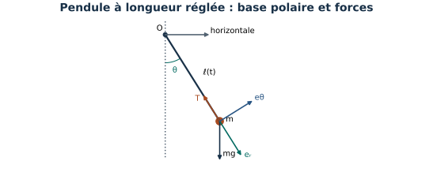
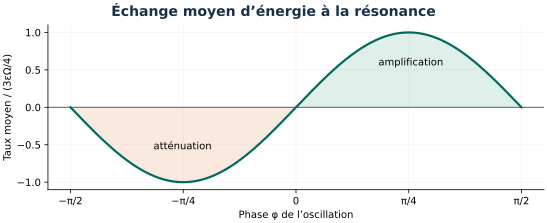
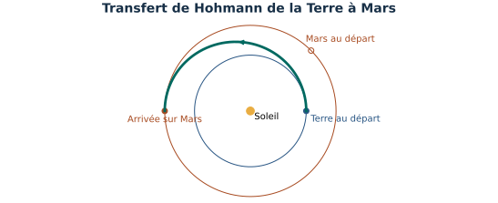
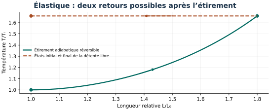
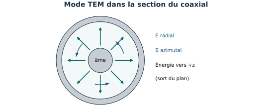

# École polytechnique, FUI-FF session 2 — Physique 2023 · Corrigé brut

*Corrigé rédigé par IA, non officiel. Signalez toute erreur.*

**Rédaction** · modèle exact non renseigné (famille GPT-6) · effort non renseigné · vitesse non renseignée

**Révision** · modèle exact non renseigné (famille GPT-6) · effort non renseigné · vitesse non renseignée

**Révision (tour 2)** · GPT-6.2 Astra Ultra · vitesse non renseignée

**Révision (tour 3)** · GPT-6.2 Astra Ultra · vitesse non renseignée · 26 novembre 2026

Formation francophone, session 2 (printemps), trois heures sans calculatrice.

## Exercice 1 — Résonance paramétrique du pendule

### Question 1

Dans le plan du mouvement, prenons l’origine au point $O$, l’axe vertical vers le bas et un axe horizontal vers la droite. L’angle $\theta$ va de la verticale descendante vers le fil. Les vecteurs $\mathbf e_r$ et $\mathbf e_\theta$ sont dirigés respectivement le long du fil, de $O$ vers la masse, et dans le sens de $\theta$ croissant. La tension est radiale. À longueur fixe $l_0$, la projection tangentielle donne $ml_0\ddot\theta=-mg\sin\theta$. Ainsi $\ddot\theta+\omega_0^2\sin\theta=0$ avec $\omega_0^2=g/l_0$. À faible angle, $\ddot\theta+\omega_0^2\theta=0$.

### Question 2

La composante tangentielle de l’accélération est $l\ddot\theta+2\dot l\dot\theta$. L’équation exacte est donc $\ddot\theta+2(\dot l/l)\dot\theta+(g/l)\sin\theta=0$. Écrivons $c=\cos(\Omega t)$, $s=\sin(\Omega t)$ et $l=l_0(1+\varepsilon c)$. En développant jusqu’au second ordre inclus, on obtient
$$\ddot\theta-2\varepsilon\Omega s(1-\varepsilon c)\dot\theta+\omega_0^2(1-\varepsilon c+\varepsilon^2c^2)\sin\theta=O(\varepsilon^3).$$
Pour l’étude linéaire en angle, remplacer $\sin\theta$ par $\theta$. À la précision du premier ordre en modulation utilisée aux questions suivantes, on garde le terme $-2\varepsilon\Omega s\dot\theta$ et le coefficient $\omega_0^2(1-\varepsilon c)$.

### Question 3

Quand $\varepsilon=0$, l’oscillation linéaire a une amplitude constante. Pour $\varepsilon\ll1$ et une excitation de l’ordre de la fréquence propre, sa variation relative pendant une période $T_0=2\pi/\omega_0$ est petite. Dans l’approximation de l’enveloppe lente, cela s’écrit $|\dot A|T_0\ll A$, soit $|\dot A|\ll\omega_0 A/(2\pi)$. On pourra donc prendre $\dot\theta\simeq-\omega_0A\sin(\omega_0t+\phi)$ pour calculer un effet déjà d’ordre $\varepsilon$.

### Question 4

Référençons l’énergie de l’oscillation au pendule vertical de même $l$ et de même $\dot l$. On obtient $E_m=ml^2\dot\theta^2/2+mgl(1-\cos\theta)$. Au premier ordre utile pour normaliser le taux de variation, $l\simeq l_0$, $1-\cos\theta\simeq\theta^2/2$ et $l_0^2\omega_0^2=gl_0$. Les termes cinétique et potentiel sont alors proportionnels à $A^2\sin^2(\omega_0t+\phi)$ et $A^2\cos^2(\omega_0t+\phi)$. Leur somme vaut $E_m\simeq mgl_0 A^2/2$.

### Question 5

L’équation tangentielle donne $\dot E_m=-ml\dot l\dot\theta^2+mg\dot l(1-\cos\theta)$. Avec $u=\omega_0t+\phi$, on obtient, au premier ordre en $\varepsilon$ et pour les petites oscillations,
$$\frac{\dot E_m}{E_m}=\frac{\dot l}{l_0}(-2\sin^2u+\cos^2u)\simeq\frac{\varepsilon\Omega}{2}\sin(\Omega t)[1-3\cos(2u)].$$
La formule produit-somme conduit à
$$\frac{\dot E_m}{E_m}\simeq\frac{\varepsilon\Omega}{2}\sin(\Omega t)-\frac{3\varepsilon\Omega}{4}\sin[(2\omega_0+\Omega)t+2\phi]+\frac{3\varepsilon\Omega}{4}\sin[(2\omega_0-\Omega)t+2\phi].$$

### Question 6

Pour $\Omega\ne2\omega_0$, la moyenne longue des trois sinus est nulle au premier ordre à phase fixée (hors voisinage résonnant de largeur d’ordre $\varepsilon\omega_0$). Pour **$\Omega=2\omega_0$**, le dernier terme devient constant. À la phase $\phi$, le taux relatif moyenné sur les oscillations rapides est $(3\varepsilon\Omega/4)\sin(2\phi)$. Pour $\varepsilon>0$, la quadrature de phase $\pi/4$ modulo $\pi$ a une phase stationnaire et son amplitude croît comme $e^{st}$, avec $s=3\varepsilon\omega_0/4$. La quadrature de phase $-\pi/4$ décroît comme $e^{-st}$. Pour une phase initiale $\phi_0$ quelconque, la projection sur ces deux oscillations en quadrature donne l’énergie moyenne

$$\frac{\overline E_m(t)}{\overline E_m(0)}=\cos^2(\phi_0-\pi/4)e^{2st}+\sin^2(\phi_0-\pi/4)e^{-2st}.$$

Toute composante initiale sur la quadrature amplifiée finit ainsi par dominer dans le domaine des petites oscillations. Le travail fourni par la modulation est à l’origine de cette résonance paramétrique.

La largeur de la résonance découle de l’équation linéarisée, sans imposer de phase fixe. Posons $w=l\theta$. On a $\ddot w+(g/l-\ddot l/l)w=0$. Près de $\Omega=2\omega_0$, le coefficient vaut $\omega_0^2+3\varepsilon\omega_0^2\cos\Omega t$ au premier ordre. En projetant sur $e^{\pm i\Omega t/2}$ et en gardant les amplitudes lentes proportionnelles à $e^{st}$, leur déterminant donne
$$s^2=\left(\frac{3\varepsilon\omega_0}{4}\right)^2-\left(\frac{\Omega-2\omega_0}{2}\right)^2.$$
La croissance exponentielle est donc possible pour $|\Omega-2\omega_0|<3|\varepsilon|\omega_0/2$, dans ce modèle sans amortissement. Au centre, $s=3|\varepsilon|\omega_0/4$ est le taux d’amplitude trouvé par le bilan énergétique pour la phase amplifiée.

## Exercice 2 — Trajectoires interplanétaires

### Question 1

Posons $\mu_T=GM_T$. À proximité de la surface terrestre de rayon $r_T$, l’équilibre centripète donne $v_1=\sqrt{\mu_T/r_T}\simeq7{,}9\,\mathrm{km\,s^{-1}}$. L’énergie spécifique nulle à l’infini donne $v_2=\sqrt{2\mu_T/r_T}\simeq11{,}2\,\mathrm{km\,s^{-1}}$. C’est le seuil d’évasion terrestre. Pour rejoindre Mars en un transfert tangentiel, il faut en outre une vitesse géocentrique résiduelle $v_\infty$ dans le sens du mouvement terrestre. La vitesse au sol dans le modèle impulsionnel sans atmosphère ni rotation est donc $\sqrt{v_2^2+v_\infty^2}\simeq11{,}6\,\mathrm{km\,s^{-1}}$ avec la valeur de la question suivante.

### Question 2

Dans le référentiel héliocentrique, $\mathbf v_{\rm sonde}=\mathbf v_T+\mathbf v_{\rm sonde/T}$. On profite de la vitesse orbitale $v_T\simeq30\,\mathrm{km\,s^{-1}}$ en partant dans le sens du mouvement terrestre. Sur l’ellipse de demi-grand axe $a=(R_T+R_M)/2$, la relation énergétique donne $v_p=\sqrt{GM_\odot(2/R_T-1/a)}=v_T\sqrt{2R_M/(R_T+R_M)}\simeq32{,}9\,\mathrm{km\,s^{-1}}$. La vitesse résiduelle demandée aux abords de la sphère d’influence terrestre est donc $v_\infty=v_p-v_T\simeq3{,}0\,\mathrm{km\,s^{-1}}$. La valeur $2{,}3\times10^8\,\mathrm{km}$ étiquetée « Terre–Mars » dans les données est interprétée comme le rayon **Soleil–Mars**, cohérent avec Mars. On utilise l’année terrestre pour obtenir $v_T=2\pi R_T/(1\,\mathrm{an})$.

### Question 3

Dans le modèle de deux orbites circulaires, coplanaires et parcourues dans le même sens, un transfert à deux impulsions tangentielles permet de modifier l’énergie sans composante radiale à supprimer aux raccordements. Pour les rayons de la Terre et de Mars, le transfert de Hohmann minimise la somme des deux impulsions dans ce modèle. Le Soleil est un foyer. Le périhélie est à $R_T$, l’aphélie à $R_M$, et $a=(R_T+R_M)/2$, $e=(R_M-R_T)/(R_M+R_T)\simeq0{,}21$.

Les lois de Kepler sont les suivantes. Une planète décrit une ellipse dont le Soleil occupe un foyer. Le rayon Soleil–planète balaie des aires égales en des temps égaux. Pour des masses orbitantes négligeables devant celle du Soleil, $T^2/a^3=4\pi^2/(GM_\odot)$ est commun aux orbites autour du Soleil.

### Question 4

Sur le schéma, le départ et l’arrivée se trouvent de part et d’autre du Soleil. La sonde rejoint Mars après une demi-révolution elliptique, donc lorsqu’elle atteint l’aphélie. Au départ Mars doit être en avance de $\pi-n_Mt_H$ sur la Terre, avec $n_M=2\pi/T_M$. Les données arrondies donnent une avance d’environ $45^\circ$.

### Question 5

Entre deux positions et pour des trajectoires directes sans révolution complète, un arc de transfert peut balayer un angle inférieur à $180^\circ$ (type I) ou supérieur à $180^\circ$ (type II). Le Hohmann tangent aux deux cercles est le cas limite à $180^\circ$ ; les deux appellations décrivent les arcs de transfert plus généraux. Sa durée est
$$t_H=\pi\sqrt{\frac{a^3}{GM_\odot}}=\frac{1\,\mathrm{an}}2\left(\frac{R_T+R_M}{2R_T}\right)^{3/2}\simeq260\,\mathrm{jours},$$
soit huit à neuf mois.

### Question 6

La force est attractive, centrale et proportionnelle à $r^{-2}$. Son moment autour du Soleil s’annule, donc le moment cinétique se conserve et le mouvement est plan. En orientant $\theta$ dans le sens du parcours, $C=|\mathbf r\times\mathbf v|=r^2\dot\theta$ est la constante des aires par unité de masse. La vitesse aréolaire est $d\mathcal A/dt=C/2$.

### Question 7

Avec $u=1/r$, un prime pour $d/d\theta$ et $\dot\theta=Cu^2$, on obtient $\dot r=-Cu'$ et $r\dot\theta=Cu$. La vitesse puis l’accélération sont
$$\mathbf v=C(-u'\mathbf e_r+u\mathbf e_\theta),\qquad \mathbf a=-C^2u^2(u''+u)\mathbf e_r.$$
On a utilisé $\mathbf e'_r=\mathbf e_\theta$ et $\mathbf e'_\theta=-\mathbf e_r$. La composante transverse de l’accélération se simplifie entièrement.

### Question 8

En posant $\mu=GM_\odot$, la loi $\mathbf a=-\mu u^2\mathbf e_r$ donne $u''+u=\mu/C^2$. La solution est
$$u(\theta)=\frac1p[1+e\cos(\theta-\theta_p)],\qquad p=C^2/\mu.$$
Pour une orbite liée $0\le e<1$, c’est une ellipse de foyer solaire, avec $p=a(1-e^2)$ et $b=a\sqrt{1-e^2}$. On retrouve la première loi. La deuxième est $d\mathcal A/dt=C/2$. Enfin, $T=2\pi ab/C$ d’après l’aire totale $\pi ab$, donc $T^2=4\pi^2a^3/\mu$, troisième loi.

## Exercice 3 — Propriétés thermodynamiques d’un élastique

### Question 1

Dans les formules du sujet, $G$ et $F$ désignent respectivement les dérivées mesurées de la tension $J$ par rapport à $T$ et à $L$. En posant $x=L/L_0$, on lit $G=a(x-x^{-2})$ et $F=(aT/L_0)(1+2x^{-3})$. Ainsi
$$\left(\frac{\partial G}{\partial L}\right)_T=\frac a{L_0}(1+2x^{-3})=\left(\frac{\partial F}{\partial T}\right)_L.$$
Sur le domaine $T,L>0$, la différentielle $G\,dT+F\,dL$ est exacte. Son intégrale définit une fonction d’état $J(T,L)$ à une constante additive près.

### Question 2

Pour les états d’équilibre, le premier principe donne $dU=T\,dS+J\,dL$. Introduisons l’énergie libre physique $\mathcal F=U-TS$ pour la distinguer de la fonction $F$ donnée dans l’énoncé. De $d\mathcal F=-S\,dT+J\,dL$ on tire $(\partial S/\partial L)_T=-(\partial J/\partial T)_L$. Avec $C_L=T(\partial S/\partial T)_L$,
$$dU=C_L\,dT+\left[J-T\left(\frac{\partial J}{\partial T}\right)_L\right]dL.$$

### Question 3

Intégrer $G$ donne $J=aT(x-x^{-2})+j(L)$. La comparaison avec $F=(\partial J/\partial L)_T$ impose $j'(L)=0$. À la longueur à vide $x=1$, la tension est nulle quel que soit $T$, donc $j=0$. L’équation d’état est
$$J(T,L)=aT\left(\frac L{L_0}-\frac{L_0^2}{L^2}\right).$$
On a $J=T(\partial J/\partial T)_L$, d’où $dU=C_L\,dT$ dans ce modèle.

### Question 4

En notant $C=C_L$ constant, on a $dS=C\,dT/T-a(x-x^{-2})dL$. Pour l’étirement adiabatique réversible, $dS=0$. Entre $x=1$ et $x_f=L_f/L_0$,
$$C\ln(T_f/T_i)=aL_0\int_1^{x_f}(x-x^{-2})\,dx=aL_0\left(\frac{x_f^2}{2}+\frac1{x_f}-\frac32\right).$$
Ainsi $T_f=T_i\exp[(aL_0/C)(x_f^2/2+1/x_f-3/2)]$. Pour $x_f>1$ et $a>0$, l’élastique s’échauffe.

### Question 5

Interprétons « on relâche » comme une détente libre, à tension extérieure nulle. Entre les deux états de repos, $Q=W_{\rm ext}=0$, d’où $\Delta U=0$. Puisque $U$ ne dépend que de $T$, la température finale reste $T_f$ et **$\Delta T=0$ pendant le relâchement**. La variation d’entropie se calcule entre états par intégration à température constante :
$$\Delta S=aL_0\left(\frac{x_f^2}{2}+\frac1{x_f}-\frac32\right)=C\ln(T_f/T_i)>0.$$
La dissipation lors du retour à l’équilibre produit cette entropie. Si le retour était imposé très lentement contre une tension extérieure ajustée, il serait adiabatique réversible et donnerait $\Delta S=0$, avec retour à $T_i$. L’absence d’échange thermique seule ne fixe pas le travail.

## Exercice 4 — Câble coaxial

### Question 1

Dans le volume des conducteurs parfaits en régime ondulatoire, le champ électrique est nul. La densité volumique de charge est donc nulle et le champ magnétique variable ne pénètre pas le métal. Les charges nécessaires au mode sont des charges surfaciques et les courants longitudinaux sont des courants de surface. L’âme et l’intérieur de la gaine portent des charges linéiques opposées et des courants de même intensité et de sens opposés pour le mode confiné.

### Question 2

Orientons la normale de chaque paroi métallique vers l’isolant. Alors $\mathbf n=+\mathbf e_r$ en $a$ et $\mathbf n=-\mathbf e_r$ en $b$. Pour les champs du mode du côté de l’isolant, la continuité de $\mathbf E$ tangentiel et de $\mathbf B$ normal donne $\mathbf n\times\mathbf E=0$, $\mathbf n\cdot\mathbf B=0$. Les autres relations de saut sont
$$\mathbf n\cdot\mathbf D=\sigma,\qquad \mathbf n\times\mathbf H=\mathbf K,$$
où $\sigma$ et $\mathbf K$ désignent la charge et le courant surfaciques libres, $\mathbf D=\varepsilon_0\varepsilon\mathbf E$ et $\mathbf H=\mathbf B/\mu_0$. Ces signes produisent des courants opposés sur les deux parois.

### Question 3

Pour la dépendance harmonique $e^{i(\omega t-kz)}$, posons $E_r=E_0(r,z)e^{i(\omega t-kz)}$ et $B_\theta=B_0(r,z)e^{i(\omega t-kz)}$. Dans le diélectrique homogène de vitesse $v=1/\sqrt{\mu_0\varepsilon_0\varepsilon}$, Faraday et Ampère-Maxwell donnent
$$\partial_z E_0-ikE_0=-i\omega B_0,\qquad \partial_z B_0-ikB_0=-i\omega E_0/v^2.$$
Pour une seule onde progressive vers $+z$ dans la ligne uniforme sans pertes, $k=\omega/v$ et $B_0=E_0/v$. On a donc $\partial_zE_0=\partial_zB_0=0$, la propagation axiale étant entièrement portée par l’exponentielle. Un choix de phase commun permet de prendre les amplitudes radiales réelles.

### Question 4

Le champ électrique est radial et le champ magnétique azimutal. Les deux sont donc orthogonaux à la direction axiale de propagation $\mathbf k=k\mathbf e_z$, et aussi orthogonaux entre eux. Cette double transversalité définit le mode TEM.

### Question 5

Puisque $\varepsilon$ est uniforme, $\nabla\cdot\mathbf D=0$ impose $r^{-1}d(rE_0)/dr=0$. Donc $rE_0(r)$ est constant. Avec $E_0(a)=E_a$, on trouve $E_0(r)=E_a a/r$ pour $a<r<b$.

### Question 6

La composante azimutale de Faraday donne $-ikE_0=-i\omega B_0$, d’où $B_0=(k/\omega)E_0=E_a a/(vr)$. Avec $\varepsilon=2{,}25$, $v=c/\sqrt\varepsilon=c/1{,}5\simeq2{,}0\times10^8\,\mathrm{m\,s^{-1}}$. Le champ $\mathbf B$ pointe vers $+\mathbf e_\theta$ lorsque $\mathbf E$ pointe vers $+\mathbf e_r$.

### Question 7

Les champs sont en phase. Avec $Z=\mu_0 v=\sqrt{\mu_0/(\varepsilon_0\varepsilon)}$ l’impédance d’onde du diélectrique, le vecteur instantané est
$$\boldsymbol\Pi=\frac{\mathbf E_{\rm réel}\times\mathbf B_{\rm réel}}{\mu_0}=\frac{E_a^2a^2}{Zr^2}\cos^2(\omega t-kz)\,\mathbf e_z.$$
Le signe exprime le transport d’énergie le long du câble dans le sens de propagation.

### Question 8

Comme $\langle\cos^2(\omega t-kz)\rangle=1/2$, l’intensité du flux électromagnétique moyen est $I(r)=|\langle\boldsymbol\Pi\rangle|=E_a^2a^2/(2Zr^2)$ en $\mathrm{W\,m^{-2}}$. Sa valeur est maximale au voisinage de la surface de l’âme.

### Question 9

L’élément d’aire est $r\,dr\,d\theta$. La puissance moyenne dans le sens $+z$ est donc
$$\overline P=\int_a^b\frac{E_a^2a^2}{2Zr^2}\,2\pi r\,dr=\frac{\pi E_a^2a^2}{Z}\ln\frac ba.$$
La puissance instantanée vaut $2\overline P\cos^2(\omega t-kz)$. Le logarithme provient de la décroissance radiale de l’énergie combinée à la surface croissante des anneaux.

Un bilan d’énergie par unité de longueur contrôle le flux axial. Les énergies électrique et magnétique moyennes sont égales car $B_0=E_0/v$. Leur somme volumique est $\varepsilon_0\varepsilon E_0(r)^2/2$. L’intégrale sur l’anneau donne $\overline{\mathcal U}=\pi\varepsilon_0\varepsilon E_a^2a^2\ln(b/a)$ en joules par mètre. Le résultat de la question 9 vérifie $\overline P=v\overline{\mathcal U}$ puisque $1/Z=v\varepsilon_0\varepsilon$.
