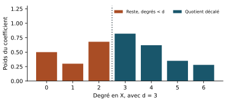
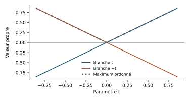

# École polytechnique, MP-MPI — Mathématiques B 2023 · Corrigé guidé

*Corrigé rédigé par IA, non officiel. Signalez toute erreur.*

**Rédaction** · GPT-6.2 Astra Ultra · vitesse non renseignée

**Révision (tour 1)** · GPT-6.2 Astra Ultra · vitesse non renseignée · 26 novembre 2026

Le sujet construit une factorisation locale pour les polynômes à coefficients développables en série entière, puis une diagonalisation locale orthogonale pour les familles de matrices symétriques réelles.

## Première partie · Fonctions développables en série entière

### Question 1

> [!INDICATION]
> Ajouter les séries coefficient par coefficient.

#### Solution

Pour $f(t)=\sum a_jt^j$ et $g(t)=\sum b_jt^j$ sur $U_\rho$, la série $\sum(a_j+b_j)t^j$ y converge absolument et représente $f+g$. En appliquant cette propriété à chaque coefficient d’un polynôme en $X$ de degré au plus $n$ et à chaque entrée d’une matrice, on obtient les trois stabilités.

### Question 2

> [!INDICATION]
> Utiliser la convergence absolue et le produit de Cauchy.

#### Solution

Sur $|t|<\rho$, les séries sont absolument convergentes. Le produit $fg$ s’y écrit $\sum_{k\ge0}(\sum_{j=0}^k a_jb_{k-j})t^k$, donc appartient à $D_\rho(\mathbb R)$. Chaque entrée du produit matriciel est une somme finie de tels produits, donc est également développable sur $U_\rho$.

### Question 3

> [!INDICATION]
> Que détermine la restriction à un voisinage ouvert de zéro ?

#### Solution

Si la restriction de $f$ à $U_r$ est nulle, toutes ses dérivées en zéro sont nulles. Les coefficients $f^{(k)}(0)/k!$ de sa série sur $U_\rho$ sont donc nuls. Comme cette série y représente $f$ en tout point, $f=0$ sur $U_\rho$. La restriction, qui est linéaire, est injective.

### Question 4

> [!INDICATION]
> Utiliser les poids positifs puis sommer toutes les paires de coefficients.

#### Solution

La somme $\sum_k|a_k|r^k$ est finie pour $0<r<\rho$. Elle est positive ou nulle et nulle exactement lorsque tous les coefficients le sont. L’homogénéité absolue et l’inégalité triangulaire passent des coefficients à la somme. Avec les coefficients de Cauchy de 2,
$$\|fg\|_r\le\sum_{j,h\ge0}|a_j|r^j|b_h|r^h=\|f\|_r\|g\|_r,$$
où les termes positifs autorisent le regroupement.

### Question 5

> [!INDICATION]
> Sommer d’abord la série double en valeurs absolues et suivre la queue des coefficients.

#### Solution

Écrivons $f_j(t)=\sum_k a_{jk}t^k$. L’hypothèse dit $\sum_{j,k}|a_{jk}|r^k<\infty$. En particulier $\sup_{U_r}|f_j|\le\|f_j\|_r$ et la convergence est normale. Pour chaque $k$, $b_k=\sum_ja_{jk}$ existe et $\sum_k|b_k|r^k<\infty$. L’interversion de séries absolument convergentes donne la somme $f(t)=\sum_k b_kt^k$ sur $U_r$, donc $f\in D_r$. Enfin la norme à la borne $r$ est définie ici car la somme pondérée est finie, et $\|f-\sum_{j=0}^N f_j\|_r\le\sum_{j>N}\|f_j\|_r\to0$. On n’a pas supposé que tout $D_r$ ait une norme finie à son rayon frontière.

### Question 6a

> [!INDICATION]
> Diviser par la constante non nulle avant de construire l’inverse.

#### Solution

La fonction $h=f/f(0)$ a pour terme constant un. Si $1/h$ est développable sur un intervalle $U_r$, alors $1/f=(1/f(0))(1/h)$ l’est aussi. On peut donc supposer $a_0=1$.

### Question 6b

> [!INDICATION]
> Identifier les coefficients de la série constante égale à un.

#### Solution

L’égalité $fg=1$ donne $a_0b_0=1$ et $\sum_{j=0}^n a_{n-j}b_j=0$ pour $n\ge1$. Puisque $a_0=1$, $b_0=1$ et $b_n=-\sum_{j=0}^{n-1}b_j a_{n-j}$.

### Question 6c

> [!INDICATION]
> Fixer un rayon strictement intérieur et absorber la constante dans la base exponentielle.

#### Solution

Prenons $r_0\in(0,\rho)$ et $M=\max(1,\|f\|_{r_0})$. Chaque $|a_n|\le Mr_0^{-n}$. Pour $n\ge1$, $M\le M^n$, donc $|a_n|\le c^n$ avec $c=M/r_0$. Pour $n=0$, l’inégalité vaut par $a_0=1$.

### Question 6d

> [!INDICATION]
> Faire une récurrence forte et sommer une progression géométrique.

#### Solution

La borne vaut pour $b_0=1$. Si elle est vraie jusqu’à $n-1$, alors
$$|b_n|\le\sum_{j=0}^{n-1}(2c)^jc^{n-j}=c^n(2^n-1)\le(2c)^n.$$
La récurrence forte conclut.

### Question 6e

> [!INDICATION]
> Construire la série réciproque sur un rayon commun positif.

#### Solution

Pour $r=\min(\rho,1/(2c))>0$, la série $g=\sum b_nt^n$ converge absolument sur $U_r$. Les calculs de 6b assurent que sa multiplication par $f$ a le terme constant un et tous les autres coefficients nuls. Ainsi $fg=1$ sur $U_r$, ce qui fournit $1/f\in D_r$.

### Question 7

> [!INDICATION]
> Identifier le premier coefficient non nul d’un produit de deux séries non nulles.

#### Solution

Les séries constantes donnent les fonctions $0$ et $1$, et changer le signe de chaque coefficient donne l’opposé d’une fonction développable. Avec la stabilité par somme et produit des questions 1 et 2, on obtient un sous-anneau commutatif unitaire des fonctions sur $U_\rho$, avec $1\ne0$. Si $f,g\ne0$ ont pour premiers coefficients non nuls $a_p,b_q$, le terme de degré $p+q$ de leur produit est exactement $a_pb_q\ne0$. Ainsi $fg\ne0$, ce qui établit l’intégrité.

## Deuxième partie · Factorisation locale d’un polynôme

### Question 8a

> [!INDICATION]
> Voir la norme comme une somme pondérée des normes des coefficients.

#### Solution

Les poids $s^i$ sont strictement positifs. Chaque $\|f_i\|_r$ est positif ou nul et leur somme pondérée ne s’annule que si tous les $f_i$ sont nuls. L’homogénéité absolue et l’inégalité triangulaire se vérifient coefficient par coefficient à l’aide de 4. La somme est finie en $i$, donc définit la norme demandée.

### Question 8b

> [!INDICATION]
> Écrire une seconde convolution, cette fois en degré de X.

#### Solution

Avec $P=\sum f_iX^i$, $Q=\sum g_jX^j$, le coefficient de degré $k$ est $\sum_{i+j=k}f_i g_j\in D_\rho$ et $\deg(PQ)\le n+m$. Par 4,
$$\|PQ\|_{r,s}\le\sum_{i,j}\|f_i\|_r\|g_j\|_r s^{i+j}=\|P\|_{r,s}\|Q\|_{r,s}.$$

### Question 9a

> [!INDICATION]
> Soustraire le terme dominant sans diviser par une fonction.

#### Solution

Si $A$ est nul ou de degré $<d$, choisir $Q=0,R=A$. Sinon, pour $aX^k$ terme dominant de $A$, $A-aX^{k-d}B$ a degré strictement inférieur car $B$ est unitaire. Une récurrence donne la division avec $\deg Q\le n-d$, $\deg R<d$, sans sortir de l’anneau des coefficients. Si $B(Q-Q')=R'-R$ et $Q\ne Q'$, le premier membre a degré $d+\deg(Q-Q')\ge d$, puisque $B$ est unitaire, et le second un degré inférieur. Donc $Q=Q'$, puis $R=R'$. Pour le diviseur constant un, le reste est nul.

### Question 9b

> [!INDICATION]
> Séparer exactement les degrés bas et hauts après avoir remplacé B par Xᵈ.

#### Solution

Abrégeons $\|\cdot\|=\|\cdot\|_{r,s}$ et posons $b=\|B-X^d\|<s^d$. Les degrés de $X^dQ$ et $R$ ne se recouvrent pas. Ainsi
$$s^d\|Q\|+\|R\|=\|X^dQ+R\|=\|A-(B-X^d)Q\|\le\|A\|+b\|Q\|.$$
Il suit $\|Q\|\le\|A\|/(s^d-b)$ et même $\|R\|\le\|A\|$. Comme $s^d/(s^d-b)\ge1$, cela implique la seconde borne demandée $\|R\|\le s^d\|A\|/(s^d-b)$.

### Question 10

> [!INDICATION]
> Évaluer l’identité de division en t = 0 et utiliser l’unicité du reste.

#### Solution

Comme $\deg R<d$, $F+R$ reste unitaire de degré $d$. En $t=0$, l’identité $P=QF+R$ devient une division par $X^d$. Or $P|_0$ est divisible par $X^d$ car $f_j(0)=0$ pour $j<d$. L’unicité du reste impose $R|_0=0$, d’où $(F+R)|_0=X^d$.

### Question 11

> [!INDICATION]
> Choisir d’abord s pour réduire les degrés hauts, puis r pour réduire les coefficients bas.

#### Solution

Fixons $0<r_*<\rho$ et posons $H=P-F_0=\sum_{j>d}f_jX^j$. Choisissons $s>0$ assez petit pour que $\sum_{j>d}\|f_j\|_{r_*}s^{j-d}\le1/12$. Cette somme tend vers zéro avec $s$. Pour ce $s$ fixé et $r\le r_*$, on a donc $h=s^{-d}\|H\|_{r,s}\le1/12$. Comme $f_j(0)=0$ pour $j<d$, la convergence dominée des coefficients pondérés à $r_*$ donne $\|f_j\|_r\to0$ quand $r\downarrow0$. On peut ainsi imposer $\alpha_0=s^{-d}\sum_{j<d}\|f_j\|_rs^j\le1/12$.

La division de $H$ par $F_0$ a quotient $Q_0-1$ et reste $R_0$. Par 9b, $\beta_0,\varepsilon_0\le h/(1-\alpha_0)\le1/11$. Donc $\alpha_0+2\varepsilon_0\le1/12+2/11<1/3$ et $\beta_0+\varepsilon_0\le2/11<1/3$.

### Question 12

> [!INDICATION]
> Écrire P à deux étapes successives en remplaçant Fᵢ par Fᵢ₊₁ − Rᵢ.

#### Solution

Les identités $P=Q_i F_i+R_i=Q_{i+1}F_{i+1}+R_{i+1}$ et $F_i=F_{i+1}-R_i$ donnent, après regroupement,
$$(1-Q_i)R_i=(Q_{i+1}-Q_i)F_{i+1}+R_{i+1}.$$

### Question 13

> [!INDICATION]
> Reconnaître la division euclidienne obtenue en 12.

#### Solution

De $F_{i+1}=F_i+R_i$, l’inégalité triangulaire donne $\alpha_{i+1}\le\alpha_i+\varepsilon_i$. Le membre de droite de 12 est la division par le polynôme unitaire $F_{i+1}$ puisque $\deg R_{i+1}<d$. Si $\alpha_{i+1}<1$, la question 9b et $\|(1-Q_i)R_i\|\le\beta_i\varepsilon_i s^d$ donnent
$$\|Q_{i+1}-Q_i\|\le\frac{\beta_i\varepsilon_i}{1-\alpha_{i+1}},\qquad
\varepsilon_{i+1}\le\frac{\beta_i\varepsilon_i}{1-\alpha_{i+1}}.$$
Enfin $\beta_{i+1}\le\beta_i+\|Q_{i+1}-Q_i\|$, d’où les trois bornes.

### Question 14

> [!INDICATION]
> Propager simultanément les trois bornes. Contrôler le quotient avant de l’appliquer à l’erreur.

#### Solution

Au rang zéro, les trois bornes sont des égalités. Supposons-les vraies au rang $i$. Alors
$$\alpha_{i+1}\le\alpha_0+[2(1-2^{-i})+2^{-i}]\varepsilon_0
=\alpha_0+2(1-2^{-(i+1)})\varepsilon_0\le1/3.$$
En outre $\beta_i\le\beta_0+\varepsilon_0\le1/3$. Ainsi $\beta_i/(1-\alpha_{i+1})\le1/2$. La question 13 donne $\varepsilon_{i+1}\le\varepsilon_i/2\le2^{-(i+1)}\varepsilon_0$ et
$$\beta_{i+1}\le\beta_i+\varepsilon_i/2\le\beta_0+(1-2^{-(i+1)})\varepsilon_0.$$
Les trois propriétés passent ensemble au rang suivant.

### Question 15a

> [!INDICATION]
> Sommer les accroissements des Fᵢ coefficient par coefficient.

#### Solution

On a $F_N=F_0+\sum_{i<N}R_i$ avec $\sum_i\|R_i\|_{r,s}\le s^d\varepsilon_0\sum_i2^{-i}<\infty$. Pour chaque degré $j$, la somme des normes des coefficients correspondants est au plus $s^{-j}\sum_i\|R_i\|_{r,s}$. Par 5 elle définit une fonction de $D_r$ et la convergence vaut pour la norme pondérée. Il n’y a qu’un nombre fini de degrés, donc $F_N\to F$ dans la norme $\|\cdot\|_{r,s}$. Les $F_N$ sont unitaires de degré $d$ et les restes ont degré $<d$, donc $F$ est unitaire de degré $d$. En évaluant les coefficients en zéro, ce qui est continu pour la norme, on garde $F|_0=X^d$.

### Question 15b

> [!INDICATION]
> Contrôler aussi la série des différences des quotients.

#### Solution

L’estimation de 13 et 14 donne $\|Q_{i+1}-Q_i\|_{r,s}\le\varepsilon_i/2$. Ces normes sont sommables. Comme en 15a, $Q_i$ converge coefficient par coefficient et en norme vers $G$ à coefficients dans $D_r$, de degré au plus $n-d$. Les $R_i$ tendent vers zéro. Par sous-multiplicativité et bornitude des suites convergentes, on passe à la limite dans $P=Q_iF_i+R_i$ et obtient $P=FG$ sur $U_r$.

### Question 16

> [!INDICATION]
> Après translation de la racine, normaliser aussi le coefficient d’ordre d avant de reprendre la construction.

#### Solution

Posons $P(t,X+\lambda)=\sum_jh_j(t)X^j$. La multiplicité exacte $d$ en zéro donne $h_j(0)=0$ pour $j<d$ et $h_d(0)\ne0$. Par 6, sur un rayon plus petit, $1/h_d$ est développable. Appliquons 10–15 à $P(t,X+\lambda)/h_d(t)$, dont le coefficient d’ordre $d$ est maintenant identiquement un. Ces étapes ont utilisé cette normalisation et la borne sur le degré, sans avoir besoin d’un coefficient dominant global égal à un. On obtient $\widetilde F\widetilde G$ avec $\widetilde F$ unitaire de degré $d$ et $\widetilde F|_0=X^d$.

Revenons à $X-\lambda$ et posons $F(t,X)=\widetilde F(t,X-\lambda)$, $G(t,X)=h_d(t)\widetilde G(t,X-\lambda)$. Alors $P=FG$, $F|_0=(X-\lambda)^d$, et $F$ est unitaire. Comme $P$ et $F$ sont unitaires, leur identité de produit force le coefficient dominant de $G$ à être un. Son degré est au plus $n-d$. Toutes ces opérations préservent le développement sur un même voisinage de zéro.

### Question 17

> [!INDICATION]
> Appliquer la factorisation au polynôme dont les racines sont les deux racines carrées.

#### Solution

Le polynôme $X^2-f(t)$ admet en zéro la racine simple $\lambda=\sqrt{f(0)}>0$. Par 16, il possède un facteur $X-g(t)$ avec $g\in D_r$ et $g(0)=\lambda$. En substituant $X=g(t)$ on obtient $g(t)^2=f(t)$. Par continuité, quitte à réduire le rayon, $g>0$, d’où $f>0$ et $\sqrt f=g\in D_{\rho_f}$.

## Troisième partie · Diagonalisation analytique des matrices symétriques

### Question 18

> [!INDICATION]
> Évaluer d’abord la famille à l’origine.

#### Solution

La matrice $M(0)$ est réelle symétrique. Le théorème spectral assure une base orthonormée de vecteurs propres réels. En particulier elle possède une valeur propre réelle pour $n\ge1$.

### Question 19

> [!INDICATION]
> Une matrice symétrique avec une seule valeur propre est scalaire. Décaler ensuite les indices de série.

#### Solution

Si $d=n$, le théorème spectral donne $M(0)=\lambda I_n$. Chaque entrée de $M(t)-\lambda I_n$ a un terme constant nul, donc sa série peut se diviser par $t$ en décalant les coefficients sans réduire le rayon. L’égalité des entrées symétriques est préservée. La matrice obtenue, prolongée en zéro par les coefficients de degré un, est la matrice symétrique $M_0\in D_{\rho_1}$ demandée.

### Question 20

> [!INDICATION]
> Observer comment chaque polynôme agit sur les sous-espaces propres de la matrice à l’origine.

#### Solution

Dans une base propre orthonormée de $M(0)$, $A_0$ agit par $(\mu-\lambda)^d$ sur $E_\mu$ et $B_0$ par $G(0,\mu)$. Comme $\chi|_0=(X-\lambda)^dG|_0$ avec multiplicité exacte, $G(0,\lambda)\ne0$ et $G(0,\mu)=0$ pour les autres valeurs propres. Ainsi $\operatorname{im}B_0=E_\lambda$, de dimension $d$, et $\operatorname{im}A_0$ est la somme des autres espaces, de dimension $n-d$. Prenons pour colonnes de $U$ et $V$ les vecteurs des bases propres correspondantes. Leurs images $B_0U,A_0V$ sont des bases des espaces respectifs. Leur juxtaposition est une base et la matrice associée est inversible. Si $d=n$, le second bloc est vide.

### Question 21

> [!INDICATION]
> Inverser localement le déterminant et écrire les cofacteurs.

#### Solution

Les entrées de $Q$ sont développables et $\det Q$ aussi par sa formule polynomiale. La question 20 assure $\det Q(0)\ne0$. D’après 6, sur $U_{\rho_2}$ assez petit $1/\det Q$ existe et est développable. La formule de l’adjugée donne $Q^{-1}=\operatorname{adj}(Q)/\det Q$, dont toutes les entrées sont développables sur ce même intervalle.

### Question 22a

> [!INDICATION]
> Lire les colonnes selon leurs deux blocs.

#### Solution

À $a\in U_{\rho_2}$, les colonnes de $Q(a)$ forment une base. Ses $d$ premières colonnes engendrent $\operatorname{im}(B_aU)$ et les $n-d$ dernières $\operatorname{im}(A_aV)$. Ces deux sous-espaces sont donc en somme directe et leur somme est $\mathbb R^n$.

### Question 22b

> [!INDICATION]
> Relier chaque image au noyau de l’autre matrice avant de comparer les dimensions.

#### Solution

Cayley–Hamilton et la factorisation donnent $A_aB_a=B_aA_a=\chi_a(M(a))=0$. Ainsi
$$\operatorname{im}(B_aU)\subset\operatorname{im}B_a\subset\ker A_a,\qquad
\operatorname{im}(A_aV)\subset\operatorname{im}A_a\subset\ker B_a.$$
Par 22a, les rangs de $B_a,A_a$ sont au moins $d,n-d$. Les noyaux de $A_a,B_a$ ont donc dimension au plus $d,n-d$ respectivement. Les sous-espaces aux deux bouts de chacune des chaînes ont finalement la même dimension, ce qui force toutes les égalités.

### Question 23

> [!INDICATION]
> Vérifier l’invariance point par point puis contrôler la dépendance analytique des blocs.

#### Solution

Comme $A_a$ et $B_a$ sont des polynômes en $M(a)$, leurs images sont stables par $M(a)$. Les colonnes de $Q(a)$ forment une base adaptée à ces deux images par 22b. Ainsi $Q(a)^{-1}M(a)Q(a)$ est diagonale par blocs de tailles $d$ et $n-d$. Les matrices $Q^{-1},M,Q$ étant développables sur $U_{\rho_2}$, leurs produits le sont aussi, donc les deux blocs $M_1,M_2$ ont la régularité demandée.

### Question 24

> [!INDICATION]
> Exploiter la symétrie de Aₐ et l’identification de son noyau.

#### Solution

La matrice $A_a$ est réelle symétrique comme polynôme réel en la matrice symétrique $M(a)$. Son image est donc l’orthogonal de son noyau. D’après 22b, ces deux espaces sont les deux termes de la somme de 22a. La somme est orthogonale pour chaque $a$.

### Question 25

> [!INDICATION]
> Appliquer Gram–Schmidt séparément à chaque famille de colonnes et contrôler tous les dénominateurs.

#### Solution

Pour une colonne $q_j(t)$ d’un bloc, soustrayons ses projections sur les colonnes déjà normalisées $u_h$ de ce bloc : $v_j=q_j-\sum_{h<j}(u_h^Tq_j)u_h$. C’est une expression développable. L’indépendance des colonnes de $Q(0)$ donne $v_j(0)\ne0$. Par 17 puis 6, sur un rayon plus petit la racine positive de $v_j^Tv_j$ et son inverse sont développables. Ainsi $u_j=v_j/\sqrt{v_j^Tv_j}$ est développable. Il n’y a qu’un nombre fini d’étapes : prenons le minimum des rayons.

Dans chaque bloc, ces opérations s’écrivent comme une multiplication à droite par une matrice triangulaire $R_i$ à coefficients développables et à diagonale non nulle en zéro. L’inverse est développable après restriction par la même preuve qu’en 21. Les colonnes de chaque bloc deviennent orthonormées et les deux blocs sont déjà orthogonaux par 24. Donc $Q\operatorname{Diag}(R_1,R_2)$ est orthogonale.

### Question 26

> [!INDICATION]
> Faire décroître la taille des blocs. Si la matrice initiale est scalaire, isoler le premier coefficient non scalaire.

#### Solution

Raisonnons par récurrence sur la taille $n$, le cas $n=1$ étant immédiat. Si $M(0)$ a au moins deux valeurs propres, choisissons l’une d’elles. Alors $0<d<n$. Par 23–25, une matrice orthogonale développable donne deux blocs invariants. Les blocs sont symétriques puisque la conjugaison par une matrice orthogonale préserve la symétrie. L’hypothèse de récurrence fournit une diagonalisation orthogonale développable dans chacun, sur le minimum des rayons obtenus. En composant l’orthogonale initiale et la matrice diagonale par blocs des deux changements de base, on conclut.

Si $M(0)$ est scalaire, posons $h(t)=\operatorname{tr}(M(t))/n$ et $L(t)=M(t)-h(t)I_n$. Si toutes les séries de $L$ sont nulles, $M$ est déjà scalaire sur son intervalle. Sinon choisissons le moindre degré $k$ dont une entrée de $L$ a un coefficient non nul. Comme en 19, $K(t)=L(t)/t^k$ se prolonge en une matrice symétrique développable. Sa valeur en zéro est non nulle et de trace nulle, donc n’est pas scalaire. Elle a au moins deux valeurs propres distinctes. Le cas précédent s’applique à $K$ en utilisant seulement la récurrence en dimensions inférieures. La même orthogonale diagonalise alors $M=hI_n+t^kK$. Ce choix du premier degré garantit que l’argument aboutit après un nombre fini d’étapes.

