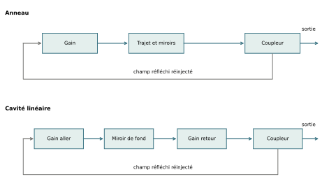
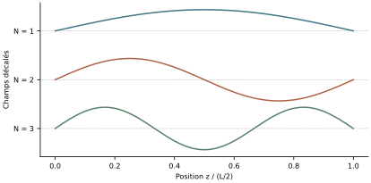
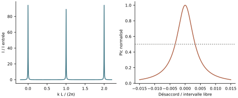
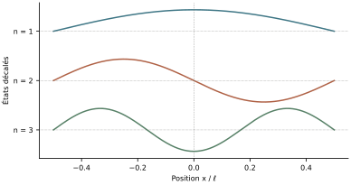
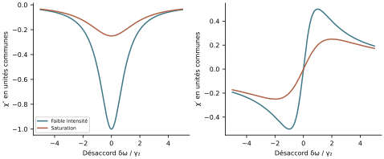
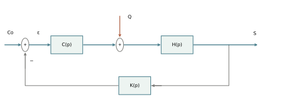

# Physique et SI — X MP 2023 · Corrigé guidé

*Corrigé rédigé par IA, non officiel.*

**Rédaction** · GPT-6.2 Astra Ultra · vitesse non renseignée

L’onde est écrite avec le facteur temporel exp(−iωt), et la longueur L désigne un tour complet de cavité. Les sous-questions conservent leurs lettres. Les grandeurs d’amplitude et d’intensité sont distinguées à chaque passage au coupleur.

## I — Fonctionnement du laser

### Question 1 — Boucle optique de l’oscillateur

> [!INDICATION]
> Suivre un champ revenant au même plan dans le même sens après un tour complet.

#### Solution

Le signal qui circule est l’amplitude complexe du champ électrique. Dans l’anneau, l’onde traverse l’amplificateur une fois par tour, se propage, est partiellement réfléchie par le coupleur et revient sur l’entrée. La sortie est le champ transmis par le coupleur. On peut injecter une onde extérieure au coupleur, dont l’amplitude transmise s’ajoute au champ intracavité. En oscillation libre, cette entrée cohérente est nulle. Le pompage fournit l’énergie au milieu, et les fluctuations, dont l’émission spontanée, peuvent amorcer le champ. Dans la cavité linéaire, un tour est un aller-retour, avec deux passages dans le milieu, deux sens de propagation et réflexion sur le miroir de fond. Le schéma donne les deux boucles et leurs points d’extraction.

### Question 2 — Ordres de grandeur et flux d’énergie

> [!INDICATION]
> Le carré du module complexe et la moyenne du carré du champ réel ne sont pas identiques.

#### Solution

**a)** Pour $\lambda_\ell=600\ \mathrm{nm}$, $\nu=c/\lambda_\ell=5{,}0\times10^{14}\ \mathrm{Hz}=500\ \mathrm{THz}$ et $T_0=1/\nu=2{,}0\ \mathrm{fs}$.
**b)** Dans l’onde plane $\boldsymbol B=\boldsymbol e_y E_{\rm réel}/c$, donc $\boldsymbol\Pi=\boldsymbol E_{\rm réel}\times\boldsymbol B/\mu_0=\epsilon_0c E_{\rm réel}^2\boldsymbol e_z$. Le vecteur de Poynting est le flux instantané d’énergie par unité d’aire, sa moyenne est l’éclairement transporté dans la direction de propagation. Puisque $I=|E_{\rm complexe}|^2$, $\langle\boldsymbol\Pi\rangle=\epsilon_0c I\boldsymbol e_z/2$. La moyenne de $\cos^2$ fournit le facteur $1/2$.

### Question 3 — Modes d’une cavité linéaire idéale

> [!INDICATION]
> La longueur entre les miroirs est la moitié de la longueur développée.

#### Solution

**a)** Aux deux miroirs parfaitement conducteurs le champ électrique tangent est nul, soit $E(0)=E(L/2)=0$. Avec $E''+k^2E=0$, la première condition retient $E_N(z)=A_N\sin(k_Nz)$ et la seconde impose $k_N L/2=N\pi$. D’où $\nu_N=Nc/L$ pour $N=1,2,\ldots$.
**b)** $E_N(z,t)=\Re[A_N\sin(2N\pi z/L)e^{-i\omega_N t}]$. Une seule phase globale multiplie chaque mode et le choix de l’origine du temps rend $A_N$ réel. Les trois premiers modes contiennent une, deux et trois demi-ondes entre les miroirs, avec respectivement zéro, un et deux nœuds intérieurs.

### Question 4 — Stabilité transverse

> [!INDICATION]
> Suivre plusieurs réflexions d’un rayon oblique avant de proposer une géométrie qui le recentre.

#### Solution

Un rayon légèrement oblique entre deux miroirs plans parallèles se décale latéralement à chaque aller-retour et finit par manquer leur ouverture. La cavité plane–plane est marginale, sans rappel transverse. Des miroirs concaves correctement espacés refocalisent les rayons et permettent un mode transverse confiné. Par exemple, dans une cavité plan–concave de séparation $d$, un rayon de courbure $R_m>d$ donne $0<1-d/R_m<1$.

### Question 5 — Amplitude intracavité avec pertes

> [!INDICATION]
> Toutes les amplitudes sont évaluées au même point du coupleur. Il faut comptabiliser la phase du trajet entier.

#### Solution

Au coupleur, le champ progressif est la somme de l’onde injectée et du retour, $E=tE_{\rm in}+rE'$. Le miroir de fond et la propagation aller-retour donnent $E'=r'e^{ikL}E$. En posant $\rho=rr'=\sqrt{RR'}$ et $t=\sqrt T$, on obtient
$$\frac{E}{E_{\rm in}}=\frac{\sqrt T}{1-\rho e^{ikL}}.$$
Les deux signes négatifs des réflexions se compensent dans le produit de tour.

### Question 6 — Fonction d’Airy de la cavité

> [!INDICATION]
> Réécrire le module carré à partir de $1-\cos u=2\sin^2(u/2)$.

#### Solution

**a)** Le rapport d’intensités est $I/I_{\rm in}=T/[(1-\rho)^2+4\rho\sin^2(kL/2)]$. Avec $R=1-T-A$, $R'=1-A'$, $T=0{,}04$, $A=A'=2\times10^{-4}$, $RR'\simeq0{,}9596$ et $\rho\simeq0{,}9796\simeq1-T/2$. Le produit $RR'$ est la fraction d’intensité subsistant après un tour passif, et $\rho$ en est le facteur d’amplitude.
**b)** Le tracé est périodique de période $2\pi$ en $kL$. Il a des pics étroits aux multiples de $2\pi$, de hauteur $T/(1-\rho)^2$, et des minima $T/(1+\rho)^2$ aux multiples impairs de $\pi$.

### Question 7 — Résonances et temps de tour

> [!INDICATION]
> Calculer d’abord l’écart de deux fréquences longitudinales successives.

#### Solution

**a)** Les pics à $kL=2\pi N$ ont les mêmes centres que les modes idéaux dans le modèle où les réflexions n’introduisent que leurs signes.
**b)** $\nu_{\rm ISL}=\nu_{N+1}-\nu_N=c/L$ est la fréquence de répétition des tours. Son inverse $\tau=L/c$ est le temps de vol sur la longueur développée.
**c)** Pour $L=1{,}5\ \mathrm m$, $N\simeq L/\lambda_\ell=2{,}5\times10^6$, $\nu_{\rm ISL}=200\ \mathrm{MHz}$ et $\tau=5\ \mathrm{ns}$.

### Question 8 — Largeur totale à mi-hauteur

> [!INDICATION]
> Les deux flancs d’un pic sont séparés de deux fois le désaccord positif à mi-hauteur.

#### Solution

L’intensité est divisée par deux si $4\rho\sin^2[(\omega-\omega_N)\tau/2]=(1-\rho)^2$. Il y a deux décalages opposés. Leur écart est
$$\Delta\omega_c=\frac4\tau\arcsin\frac{1-\rho}{2\sqrt\rho}\simeq\frac{2(1-\rho)}{\tau\sqrt\rho}\simeq\frac T\tau.$$
Numériquement cela donne environ $8\times10^6\ \mathrm{rad\,s^{-1}}$.

### Question 9 — Finesse

> [!INDICATION]
> Former un rapport de deux grandeurs toutes deux exprimées en hertz.

#### Solution

**a)** En utilisant $\nu_{\rm ISL}=1/\tau$ et $\Delta\nu_c=\Delta\omega_c/(2\pi)$, on trouve $\mathcal F\simeq\pi\sqrt\rho/(1-\rho)\simeq2\pi/T$. La longueur développée $L$ s’élimine du rapport.
**b)** Pour $T=0{,}04$, $\mathcal F\simeq157$ (environ 150 à 160 selon le traitement des petites pertes) et $\Delta\nu_c\simeq200\ \mathrm{MHz}/157\simeq1{,}3\ \mathrm{MHz}$.

### Question 10 — Décroissance libre de l’énergie

> [!INDICATION]
> Additionner l’énergie des deux sens de propagation, puis calculer la seule puissance qui s’échappe pendant un tour.

#### Solution

**a)** Une onde progressive de champ complexe $E$ a pour densité d’énergie moyenne $\epsilon_0|E|^2/2$. Les deux ondes aller et retour presque égales occupent chacune le volume $SL/2$. Ainsi $W\simeq\epsilon_0SL|E|^2/2$. Avec une amplitude de retour $\sqrt{R'}|E|$, le facteur exact dans cette approximation plane est $\epsilon_0SL(1+R')|E|^2/4$.
**b)** Après coupure de l’entrée, l’onde de retour transmet $T|E'|^2$ en intensité. En un tour, $\delta W\simeq(\epsilon_0c/2)ST|E|^2\tau\simeq TW$.
**c)** En négligeant $A,A'$ devant $T$, la perte relative est petite et $\mathrm dW/\mathrm dt\simeq-(T/\tau)W$.
**d)** Ainsi $W=W(0)e^{-t/\tau_W}$ avec $\tau_W\simeq\tau/T=\tau\mathcal F/(2\pi)\simeq125\ \mathrm{ns}$. La relation discrète donne plus exactement $\tau_W=-\tau/\ln(RR')$, soit environ $121\ \mathrm{ns}$.

## États quantiques et amplification optique

### Question 11 — État stationnaire isolé

> [!INDICATION]
> Distinguer l’état spatial et son facteur de phase temporel.

#### Solution

Un état propre de l’hamiltonien indépendant du temps a la forme $\psi_a(x,t)=\phi_a(x)e^{-iE_a t/\hbar}$. La partie spatiale est indépendante du temps et vérifie $-(\hbar^2/2m_e)\phi_a''+V(x)\phi_a=E_a\phi_a$, avec $\int_{-\infty}^{+\infty}|\phi_a(x)|^2\,\mathrm dx=1$. Sa densité de probabilité est stationnaire, même si la phase globale évolue.

### Question 12 — États du puits centré

> [!INDICATION]
> Ramener l’intervalle décalé à $[0,1]$ puis examiner la réflexion autour du milieu.

#### Solution

**a)** À l’intérieur, $\phi_n(x)=\sqrt{2/\ell}\sin[n\pi(x+\ell/2)/\ell]$ pour $n\ge1$, et zéro à l’extérieur. Les nœuds aux deux bords imposent $E_n=\hbar^2\pi^2 n^2/(2m_e\ell^2)$. Les trois premières fonctions sont tracées ci-dessous.
**b)** Elles sont réelles avec ce choix de phase et vérifient $\phi_n(-x)=(-1)^{n+1}\phi_n(x)$. Le potentiel symétrique commute avec la parité. Ses états propres non dégénérés peuvent être choisis de parité définie.
**c)** Avec $u=(x+\ell/2)/\ell$, le produit scalaire devient $2\int_0^1\sin(n\pi u)\sin(p\pi u)\,\mathrm du=\delta_{np}$, en développant le produit en différence de cosinus.

### Question 13 — Espace à deux niveaux

> [!INDICATION]
> Utiliser l’orthonormalité pour obtenir séparément les deux composantes de l’équation.

#### Solution

**a)** Avant normalisation, les combinaisons $a\phi_a+b\phi_b$ forment un espace vectoriel complexe de dimension deux. Les fonctions orthonormées forment une base et $\|\psi\|^2=|a|^2+|b|^2$.
**b)** Projeter Schrödinger sur ces deux états donne $i\hbar\dot a=E_a a$ et $i\hbar\dot b=E_b b$. L’hamiltonien a donc la matrice diagonale $(E_a,E_b)$ dans cette base. Les solutions sont $a(t)=a(0)e^{-iE_at/\hbar}$ et $b(t)=b(0)e^{-iE_bt/\hbar}$.
**c)** $a,b$ sont des amplitudes de probabilité, $p_a=|a|^2$ et $p_b=|b|^2$ les probabilités de mesurer les énergies correspondantes. Pour l’atome normalisé, $p_a+p_b=1$, puisque les deux résultats épuisent les possibilités du modèle.

### Question 14 — Couplage dipolaire

> [!INDICATION]
> Combiner la parité de l’opérateur position et celle des deux états de part et d’autre de cet opérateur.

#### Solution

**a)** Pour chaque état propre du puits centré, $x|\phi_j|^2$ est impair. Ainsi $D_{aa}=D_{bb}=0$. Les états réels donnent $D_{ab}=D_{ba}=d\in\mathbb R$. Il faut des parités opposées pour éviter l’annulation par symétrie. Dans les trois premiers états, les paires $(1,2)$ et $(2,3)$ ont un couplage non nul, tandis que $(1,3)$ est interdite.
**b)** À $z=0$, $f(t)=-dE_0\cos\omega t=-\hbar\Omega_R\cos\omega t$. La matrice d’interaction a les deux coefficients diagonaux nuls et les deux termes hors-diagonale égaux à $f$.
**c)** L’addition de la partie libre donne $i\hbar\dot a=E_a a+f b$, $i\hbar\dot b=f a+E_b b$. L’interaction transfère une amplitude d’un niveau à l’autre.

### Question 15 — Amplitude lente et approximation séculaire

> [!INDICATION]
> Effectuer les changements de phase avant de supprimer les termes rapidement oscillants.

#### Solution

Avec $\alpha=e^{iE_at/\hbar}a$, $\beta=e^{iE_at/\hbar+i\omega t}b$ et $\delta\omega=\omega-\omega_0$, les équations exactes deviennent
$$\dot\alpha=\tfrac{i\Omega_R}{2}(1+e^{-2i\omega t})\beta,\qquad \dot\beta=i\delta\omega\,\beta+\tfrac{i\Omega_R}{2}(1+e^{2i\omega t})\alpha.$$
En effet, la multiplication de $\cos\omega t$ par $e^{\mp i\omega t}$ donne $(1+e^{\mp2i\omega t})/2$. Les exponentielles à $2\omega$ s’annulent en moyenne sur un temps long devant la période optique, si les enveloppes varient lentement. Il reste alors les deux termes de couplage $i\Omega_R/2$ et le désaccord $i\delta\omega\beta$.

### Question 16 — Dipôle moyen et cohérence

> [!INDICATION]
> Dans le terme de cohérence, le facteur de phase optique n’est pas éliminé du dipôle réel mesurable.

#### Solution

**a)** $\rho(x,t)=|\psi(x,t)|^2$, $\mathrm dP=\rho\,\mathrm dx$ et $\langle D_x\rangle=\int(-ex)|\psi|^2\mathrm dx$.
**b)** Le développement donne $D_{aa}|a|^2+D_{bb}|b|^2+a^*bD_{ab}+b^*aD_{ba}$.
**c)** $|\alpha|^2=p_a$ et $|\beta|^2=p_b$ sont les probabilités, de somme un pour l’atome normalisé.
**d)** Avec les valeurs des éléments de matrice, $\langle D_x\rangle=d(b^*a+a^*b)=d(Ce^{i\omega t}+C^*e^{-i\omega t})$, où $C=\beta^*\alpha$. Les populations seules ne déterminent pas le dipôle.
**e)** En écrivant $C=(u+iv)/2$, on trouve $\langle D_x\rangle=d[u\cos\omega t-v\sin\omega t]$.

### Question 17 — État permanent avec pompage et relaxation

> [!INDICATION]
> Additionner les contributions du champ, de la relaxation et de l’alimentation de chaque niveau avant d’annuler les dérivées.

#### Solution

**a)** Ajoutons les sources $\Lambda_a,\Lambda_b$, la relaxation des populations $\gamma_1$ et celle de la cohérence $\gamma_2$. Le régime permanent impose
$$0=\Lambda_a-\gamma_1p_a-\tfrac{i\Omega_R}{2}(C-C^*),\qquad 0=\Lambda_b-\gamma_1p_b+\tfrac{i\Omega_R}{2}(C-C^*),$$
$$0=-(\gamma_2+i\delta\omega)C-\tfrac{i\Omega_R}{2}(p_a-p_b).$$
**b)** Sans champ, $p_a^0=\Lambda_a/\gamma_1$, $p_b^0=\Lambda_b/\gamma_1$ et $C^0=0$. Toute cohérence initiale décroît. Les sources incohérentes de ce modèle alimentent les populations, et le champ crée la cohérence stationnaire.
**c)** Posons $m^0=p_a^0-p_b^0$, $D=\delta\omega^2+\gamma_2^2+(\gamma_2/\gamma_1)\Omega_R^2$. Le dipôle réel vaut $-d m^0\Omega_R[\delta\omega\cos\omega t-\gamma_2\sin\omega t]/D$.
**d)** $P=n\langle D_x\rangle$ oscille à $\omega$ et son amplitude complexe, avec $e^{-i\omega t}$, est $nd(u-iv)$. En posant $B=nm^0 d^2/(\epsilon_0\hbar)$, on a $P_{\rm comp}=\epsilon_0\chi E_{\rm comp}$ et $\chi'=-B\delta\omega/D$, $\chi''=B\gamma_2/D$. L’inversion du signe de la quadrature entre le dipôle réel et l’amplitude complexe vient de la convention temporelle.

### Question 18 — Propagation et inversion de population

> [!INDICATION]
> Un indice complexe agit sur la phase par sa partie réelle et sur le module par sa partie imaginaire.

#### Solution

**a)** Avec $P=\epsilon_0\chi E$ en représentation complexe, l’équation d’onde impose $E''+(\omega^2/c^2)(1+\chi)E=0$.
**b)** En notant $k_0=\omega/c$ dans le vide et $k_m=k'+ik''$ dans le milieu, $k_m^2=k_0^2(1+\chi)$ et $k_m=k_0\sqrt{1+\chi}$ sur la branche proche du vide.
**c)** Pour $|\chi|\ll1$, $k'\simeq k_0(1+\chi'/2)$ et $k''\simeq k_0\chi''/2$. Le module du champ varie comme $e^{-k''z}$. Le milieu amplifie si $\chi''<0$, absorbe si $\chi''>0$ et conserve le module si $\chi''=0$.
**d)** Les populations volumiques sont $np_a,np_b$. Ici $\chi''<0$ exige $p_b^0>p_a^0$ et le champ réduit l’inversion sans en changer le signe dans la solution fournie. À l’équilibre thermique, pour ces niveaux non dégénérés, $p_b/p_a=e^{-(E_b-E_a)/(k_BT)}<1$ à toute température positive finie. Un pompage hors équilibre est nécessaire.
**e)** Pour une susceptibilité uniforme, $H=E_s/E_e=\exp[ik_0(1+\chi'/2)\ell_a]\exp[-k_0\chi''\ell_a/2]$ et $G_I=|H|^2=e^{-k_0\chi''\ell_a}$.

### Question 19 — Largeur de raie et saturation

> [!INDICATION]
> Faire apparaître le dénominateur commun de la dispersion et de l’absorption, puis séparer les variables dans la propagation saturée.

#### Solution

**a)** Avec inversion, $B<0$. La partie imaginaire est une lorentzienne négative, de minimum en $\delta\omega=0$. La partie réelle est impaire, négative à gauche et positive à droite. Le gain culmine en $\omega_0$.
**b)** En posant $b^2=\gamma_2^2+(\gamma_2/\gamma_1)\Omega_R^2$, la demi-hauteur est atteinte en $\delta\omega=\pm b$. D’où $\Delta\omega_S=2\gamma_2\sqrt{1+\Omega_R^2/(\gamma_1\gamma_2)}$. L’élargissement est sensible pour $\Omega_R^2\gtrsim\gamma_1\gamma_2$ et $\Delta\omega_{NS}=2\gamma_2$ à faible intensité.
**c)** Avec la convention $I=|E_0|^2$ du sujet, on factorise le dénominateur de la susceptibilité,
$$\chi_\ell=\frac{B(-\delta\omega+i\gamma_2)}{\delta\omega^2+\gamma_2^2},\qquad I_S=\frac{\hbar^2\gamma_1(\delta\omega^2+\gamma_2^2)}{d^2\gamma_2},\qquad \chi=\frac{\chi_\ell}{1+I/I_S}.$$
**d)** Séparer l’équation (17) donne $\ln(I_s/I_e)+(I_s-I_e)/I_S=-k_0\chi''_\ell\ell_a$. Si $I\ll I_S$ tout au long du trajet, $I_s\simeq I_e e^{-k_0\chi''_\ell\ell_a}$. Si $I\gg I_S$ partout, $I_s\simeq I_e-k_0\chi''_\ell I_S\ell_a$ et $G_I\simeq1-k_0\chi''_\ell I_S\ell_a/I_e$. L’inversion assure que ces gains sont positifs et supérieurs à un.

## Oscillation dans l’anneau

### Question 20 — Conditions d’oscillation de l’anneau

> [!INDICATION]
> Le retour d’un champ complexe à sa valeur initiale fixe séparément son module et sa phase.

#### Solution

**a)** Après le milieu, le trajet dans l’air est $L-\ell_a$. Les quatre réflexions introduisent quatre signes négatifs, de produit positif. En négligeant les absorptions des miroirs, $E'_e/E_s=\sqrt{1-T}\,e^{ik_0(L-\ell_a)}$. Les blocs sont la propagation, le coupleur, et les trois miroirs dont le module de réflexion est pris égal à un.
**b)** Compte tenu du passage dans le milieu, $E'_e/E_e=Ae^{i\phi}$ avec $A=\sqrt{1-T}\,e^{-k_0\chi''_S\ell_a/2}$ et $\phi=k_0(L+\chi'_S\ell_a/2)$ modulo $2\pi$.
**c)** Pour un champ non nul stationnaire, $A=1$ et $\phi=2\pi N$. On obtient $k_0\chi''_S\ell_a=\ln(1-T)$ et $(\omega/c)(L+\chi'_S\ell_a/2)=2\pi N$. Comme $\chi_S=\chi_\ell/(1+I(0)/I_S)$, ces deux équations déterminent $\omega$ et $I(0)$ sur le mode choisi, lorsque le gain non saturé dépasse les pertes.
**d)** La phase donne $\omega\simeq\omega_N[1-\chi'_S\ell_a/(2L)]$ pour un milieu mince et dilué. Le décalage vient de la dispersion qui change la longueur optique. Le module impose $(1-T)I_s=I_e$, donc $I_s-I_e=TI_s$, précisément l’intensité extraite au coupleur en négligeant les petites pertes passives. En régime constant, l’énergie cédée par le milieu pompé compense celle qui quitte l’anneau à chaque tour.

## II — Régulation de la fréquence

### Question 21 — Asservissement externe

> [!INDICATION]
> Distinguer la boucle interne optique de l’oscillateur et le retour négatif qui régule sa fréquence.

#### Solution

Le comparateur produit $\varepsilon=Co-KS$. Le correcteur $C$ transforme cette erreur en commande du procédé $H$, qui délivre $S$. Le capteur $K$ transforme la sortie en une mesure comparable à la consigne. Les trois fonctions utilisent ici la variable de Laplace $p$. La figure indique le signe du retour et le point d’injection de la perturbation qui servira à la question 25.

### Question 22 — Modèle fréquentiel du procédé

> [!INDICATION]
> Pour un passe-bas du premier ordre, la fréquence en hertz diffère de la pulsation d’un facteur $2\pi$.

#### Solution

Le temps de relaxation le plus long indiqué est $\tau_W\sim10^{-7}\ \mathrm s$ devant $\tau_1\sim10\ \mathrm{ns}$, $\tau_2<\tau_1$ et le temps de tour $5\ \mathrm{ns}$. L’oscillation optique est encore beaucoup plus rapide. Le modèle du pôle dominant donne $H(p)=H_0/(1+\tau_Wp)$, de fréquence de coupure $f_c=(2\pi\tau_W)^{-1}\sim1$ à $2\ \mathrm{MHz}$, compatible avec la largeur estimée de la cavité. Le gain statique $H_0$ dépend des unités de commande.

### Question 23 — Grandeur pilotée

> [!INDICATION]
> Différencier la condition de phase à numéro de mode fixé.

#### Solution

À ordre $N$ fixé, $\nu\simeq Nc/L$. Il faut agir sur la longueur optique du trajet, ici en déplaçant un miroir pour varier la longueur développée $L$. Au premier ordre, $\delta\nu/\nu=-\delta L/L$. Une cavité de référence extérieure, mécaniquement et thermiquement stable, fournit la comparaison de fréquence.

### Question 24 — Course du miroir et signe de correction

> [!INDICATION]
> Suivre le sens du faisceau sur la face mobile pour traduire une contraction en variation de longueur optique.

#### Solution

**a)** Balayer un intervalle spectral libre exige $|\delta L|\simeq L\nu_{\rm ISL}/\nu=\lambda_\ell$. À incidence normale le trajet aller-retour varie du double du déplacement du miroir. La course correspondante vaut donc $|\delta e|=\lambda_\ell/2\simeq300\ \mathrm{nm}$.
**b)** À droite du maximum de transmission ($\nu>\nu_0$), la pente $\epsilon=\theta'(\nu-\nu_0)$ est négative. Pour abaisser $\nu$ il faut augmenter $L$. Sur la figure 5, la lumière arrive de la droite du miroir. Lorsque la tension augmente, la cale se contracte vers le support et le trajet optique s’allonge. Il faut donc $\delta U_\epsilon>0$ lorsque $\epsilon<0$, ce qui impose $K<0$ et $\delta U_\epsilon=-|K|\,\theta'(\nu-\nu_0)$. Près de l’accord, $\theta''(0)<0$ et $\delta U_\epsilon\simeq|K|\,|\theta''(0)|(\nu-\nu_0)$. Le signe opposé éloignerait la fréquence du maximum.

### Question 25 — Transfert de la perturbation

> [!INDICATION]
> Partir du point d’injection du bruit. Le numérateur diffère de celui de la réponse à la consigne.

#### Solution

Pour la composante harmonique de bruit, la consigne est fixe et $S=H(Q-CKS)$. La boucle ouverte parcourue autour du comparateur a pour gain $L_b=CHK$. La chaîne directe de la perturbation vers la sortie, boucle ouverte, est $F_O^{(Q)}=H$ puisque $Q$ est injecté après le correcteur. Une fois le retour fermé,
$$F^{(Q)}(j\Omega)=\frac{S}{Q}=\frac{H(j\Omega)}{1+C(j\Omega)H(j\Omega)K(j\Omega)}.$$
Pour atténuer le bruit relativement au fonctionnement libre, il faut $|1+L_b(j\Omega)|\gg1$ sur la bande concernée, avec une marge de stabilité convenable à la coupure.

### Question 26 — Choix du correcteur

> [!INDICATION]
> Associer la précision statique à l’intégration et la stabilité à la phase près de la traversée du gain unité.

#### Solution

Une action intégrale donne un grand gain aux très basses fréquences. Dans une boucle stabilisée, elle annule l’erreur statique face à une consigne constante et rejette une perturbation constante injectée au procédé. Un PI combine cette précision au gain proportionnel et son zéro peut être placé pour conserver une marge de phase suffisante. Un intégrateur pur peut suffire si la bande requise est modeste, mais ajoute $90^\circ$ de retard. Si les retards et résonances mesurés réduisent trop la marge à la coupure, un PI complété par une avance de phase, ou un PID à dérivée filtrée, permet d’augmenter la marge sans perdre l’intégration. Une dérivée non filtrée accentuerait le bruit de détection. Les gains exacts dépendent de la réponse dynamique du piézoélectrique et du détecteur.

[Sujet officiel](https://www.polytechnique.edu/admission-cycle-ingenieur/sites/admission/files/content/2023%20MP%20SUJET%20DE%20PHYSIQUE%20ET%20S.I.%20(X).pdf) · [Rapport du jury](https://www.polytechnique.edu/admission-cycle-ingenieur/sites/admission/files/content/2023%20MP%20RAPPORT%20ECRIT%20PHYSIQUE%20ET%20S.I.%20(X).pdf)
