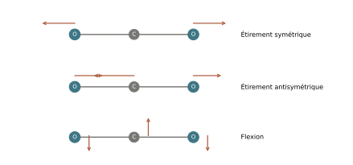
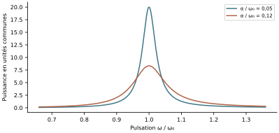
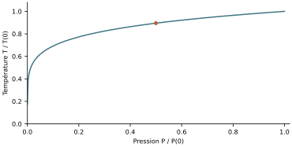
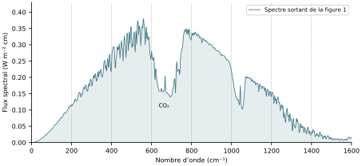

# Physique MPI — X MPI 2023 · Corrigé brut

*Corrigé rédigé par IA, non officiel.*

**Rédaction** · GPT-6.2 Astra Ultra · vitesse non renseignée

## I — Vibrations du dioxyde de carbone

### Question 1 — Trois masses et deux liaisons

Les allongements des deux ressorts sont $x_2-x_1$ et $x_3-x_2$. Les équations de Newton sont $m_O\ddot x_1=k(x_2-x_1)$, $m_C\ddot x_2=k(x_1+x_3-2x_2)$ et $m_O\ddot x_3=k(x_2-x_3)$. Les forces des deux liaisons sont internes.

### Question 2 — Centre de masse

L’addition des trois équations donne $(2m_O+m_C)\ddot X_G=0$. Le centre de masse est en mouvement rectiligne uniforme. Pour étudier les vibrations on choisit son référentiel, où il est au repos.

### Question 3 — Étirement symétrique

Posons $x_2=0$. L’équation du carbone impose $x_3=-x_1$, et celle du premier oxygène devient $\ddot x_1+(k/m_O)x_1=0$. La troisième est alors satisfaite. Ainsi $\omega_s=\sqrt{k/m_O}$ et les oxygènes se rapprochent ou s’éloignent symétriquement du carbone.

### Question 4 — Étirement antisymétrique

Posons $x_1=x_3=u$. Dans le référentiel du centre de masse, $x_2=-2m_Ou/m_C$. La première équation devient $m_O\ddot u=-k(1+2m_O/m_C)u$. D’où $\omega_a=\sqrt{k(1/m_O+2/m_C)}$. La relation entre $x_2$ et $u$ satisfait aussi l’équation du carbone. L’autre solution à oxygènes solidaires serait une translation uniforme de pulsation nulle.

### Question 5 — Pulsation et longueur d’onde

Dans le vide, $\lambda=c/f=2\pi c/\omega$. Le nombre d’onde spectroscopique est $1/\lambda$, alors que la norme du vecteur d’onde est $2\pi/\lambda$.

### Question 6 — Test du modèle à deux ressorts

Le paramètre $k$ disparaît du rapport $\omega_a/\omega_s=\sqrt{1+2m_O/m_C}$. Il faut le comparer à $n_a/n_s$ car $n=\omega/(2\pi c)$. Pour des masses atomiques de 16 et 12, le modèle donne $\sqrt{11/3}\simeq1{,}91$. Les valeurs spectroscopiques donnent $2349/1388\simeq1{,}69$. Le modèle retrouve l’ordre des fréquences mais surestime ce rapport d’environ 13 %.

### Question 7 — Troisième ressort

L’énergie mécanique est
$$E=\frac{m_O}{2}(\dot x_1^2+\dot x_3^2)+\frac{m_C}{2}\dot x_2^2+\frac k2[(x_2-x_1)^2+(x_3-x_2)^2]+\frac{k'}2(x_3-x_1)^2.$$
Chaque liaison figure une fois dans l’énergie potentielle.

### Question 8 — Généralité de l’approximation harmonique

L’invariance par translation impose une énergie fonction des deux variations de longueurs $u=x_2-x_1$, $v=x_3-x_2$. À l’équilibre les termes linéaires s’annulent. Au second ordre, l’identité des deux extrémités rend les coefficients de $u^2$ et $v^2$ égaux. L’énergie quadratique la plus générale est donc $a(u^2+v^2)/2+buv$. On la réécrit $k(u^2+v^2)/2+k'(u+v)^2/2$, avec $k'=b$, $k=a-b$. Cette raideur effective de couplage représente le terme croisé, sous les conditions de stabilité de la forme quadratique.

### Question 9 — Effet du couplage sur les modes

Dans le mode symétrique, le nouveau ressort s’allonge de $x_3-x_1=-2x_1$. L’équation d’un oxygène contient donc la raideur effective $k+2k'$, et $\omega_s=\sqrt{(k+2k')/m_O}$. Dans le mode antisymétrique, $x_3=x_1$ annule l’allongement du ressort supplémentaire et $\omega_a=\sqrt{k(1/m_O+2/m_C)}$ reste inchangée. Un $k'>0$ rapproche ainsi le rapport prédit du rapport mesuré.

## II — Interaction électromagnétique

### Question 10 — Premier ordre spatial du champ

Prenons $\boldsymbol E(\boldsymbol r,t)=\boldsymbol E_0\cos(\omega t-\boldsymbol k\cdot\boldsymbol r)$. Comme la taille $d$ de la molécule vérifie $kd\ll1$, on développe $\boldsymbol E\simeq\boldsymbol E_0[\cos\omega t+(\boldsymbol k\cdot\boldsymbol r)\sin\omega t]$. La somme des forces électriques vaut alors
$$\sum_j q_j\boldsymbol E(\boldsymbol r_j,t)\simeq\boldsymbol E_0\sin\omega t\,(\boldsymbol k\cdot\boldsymbol p),\qquad \boldsymbol p=\sum_j q_j\boldsymbol r_j.$$
Le terme uniforme s’annule car la molécule est neutre. La résultante du premier ordre est proportionnelle à la projection de $\boldsymbol p$ sur la direction de propagation.

### Question 11 — Visible et infrarouge

Une petite molécule a une taille de quelques $10^{-10}\ \mathrm m$. La lumière visible a des longueurs d’onde d’environ $0{,}4$ à $0{,}8\ \mu\mathrm m$, l’infrarouge s’étend au-delà jusqu’à des longueurs de l’ordre du millimètre. Même à l’extrémité visible de courte longueur d’onde, $2\pi d/\lambda\ll1$. La même approximation convient a fortiori dans l’infrarouge.

### Question 12 — Molécule au repos

La molécule linéaire O–C–O possède un centre d’inversion au carbone. Les deux liaisons peuvent être polaires, mais leurs dipôles ont la même norme et des sens opposés. Le moment dipolaire permanent est nul.

### Question 13 — Modes actifs dans l’infrarouge

L’étirement symétrique conserve le centre d’inversion et le dipôle reste nul. L’étirement antisymétrique crée un dipôle longitudinal variable. La flexion crée un dipôle transversal variable et sa bande se situe vers $667\ \mathrm{cm^{-1}}$. Pour les molécules diatomiques homonucléaires libres $\mathrm{N_2}$ et $\mathrm{O_2}$, l’étirement préserve l’équivalence des deux extrémités. Il est inactif dans cette approximation dipolaire électrique.

### Question 14 — Puissance et phase de l’amplitude

Avec $E$ réel, la force est $qE\cos\omega t$ et la vitesse réelle est $\Re(i\omega C e^{i\omega t})$. La moyenne sur une période du produit de deux parties réelles est la moitié de la partie réelle du produit d’une amplitude par le conjugué de l’autre. D’où $\langle P\rangle=(qE/2)\Re(i\omega C)=-qE\omega\,\Im C/2$. Le signe correspond à la convention $e^{+i\omega t}$.

### Question 15 — Équation de l’oscillateur chargé

La force excitatrice vaut $F_e=qE\cos\omega t$. Dans $m\ddot x=qE\cos\omega t-m\alpha\dot x-m\omega_0^2x$, les trois forces sont l’excitation électrique, le frottement visqueux et le rappel harmonique. Pour un amortissement passif, $\alpha>0$ et le frottement dissipe $m\alpha\dot x^2$. Le paramètre $\alpha$ a la dimension d’une fréquence.

### Question 16 — Amplitude forcée

En régime harmonique établi, substituons $x=C e^{i\omega t}$ dans l’équation complexe. On trouve $C=(qE/m)/(\omega_0^2-\omega^2+i\alpha\omega)$. La partie réelle de $C e^{i\omega t}$ est le mouvement physique.

### Question 17 — Spectre de puissance absorbée

La partie imaginaire de $C$ donne
$$\langle P\rangle=\frac{q^2E^2}{2m}\frac{\alpha\omega^2}{(\omega_0^2-\omega^2)^2+\alpha^2\omega^2}.$$
À la résonance, $\langle P\rangle=q^2E^2/(2m\alpha)$, en watts.

### Question 18 — Sens du transfert

Pour $\alpha>0$ et une excitation non nulle de fréquence positive, la puissance moyenne du champ sur la charge est positive. En régime établi l’énergie mécanique moyenne ne croît pas et cette puissance alimente la dissipation. Par conservation de l’énergie, l’onde cède de l’énergie à la matière.

### Question 19 — Limite de faible amortissement

Le régime est faiblement amorti lorsque $\alpha\ll\omega_0$. La puissance possède un pic à $\omega_0$. Au voisinage du pic, avec $D=\omega-\omega_0$,
$$\frac{\langle P\rangle}{\langle P\rangle_{\max}}\simeq\frac{1}{1+4D^2/\alpha^2}.$$
La largeur totale à mi-hauteur est $\alpha$ au premier ordre. Sur le spectre complet, la puissance tend vers zéro aux très basses et très hautes fréquences.

## Collisions et absorption

### Question 20 — Oscillateur sans amortissement entre collisions

Pour $\omega\ne\omega_0$, la substitution de $A e^{i\omega t}+B e^{i\omega_0t}$ dans l’équation sans frottement donne $A=qE/[m(\omega_0^2-\omega^2)]$. Le deuxième terme est une solution de l’équation homogène. La limite à résonance se prend après avoir imposé les conditions de remise à zéro.

### Question 21 — Remise à zéro du déplacement

Notons $t_0=t-\theta$ et $D=\omega-\omega_0$. La condition complexe $x(t_0)=0$ donne $B=-A e^{iD t_0}$. D’où $x(t)=C(\theta)e^{i\omega t}$, avec $C(\theta)=A[1-e^{-iD\theta}]$. Le coefficient $A$ est celui de la question 20.

### Question 22 — Loi de l’âge depuis la collision

L’absence de choc lors d’un intervalle additionnel $\mathrm dt$ a pour probabilité $1-\mathrm dt/\tau$. La probabilité de survie $S(\theta)$ sans collision pendant les $\theta$ dernières secondes vérifie $S'=-S/\tau$ et $S(0)=1$. Ainsi $S=e^{-\theta/\tau}$. Dans ce processus stationnaire à taux constant, la densité de l’âge est $P(\theta)=-S'(\theta)=e^{-\theta/\tau}/\tau$ pour $\theta\ge0$, et son intégrale est un.

### Question 23 — Amplitude moyennée sur l’âge

On trouve $\langle e^{-iD\theta}\rangle=\int_0^\infty e^{-(1/\tau+iD)\theta}\,\mathrm d\theta/\tau=1/(1+iD\tau)$. Ainsi
$$\langle C\rangle=A\frac{iD\tau}{1+iD\tau}=\frac{-i qE\tau}{m(\omega_0+\omega)(1+iD\tau)}.$$
La dernière expression se prolonge continûment en $D=0$.

### Question 24 — Puissance moyenne en présence de collisions

Avec la convention de la question 14,
$$\langle P\rangle=\frac{q^2 E^2}{2m}\frac{\omega\tau}{(\omega_0+\omega)[1+(\omega-\omega_0)^2\tau^2]}.$$
La puissance est positive pour $\omega>0$. La remise à zéro des oscillations permet un transfert net même sans terme visqueux entre deux chocs.

### Question 25 — Amortissement équivalent

Pour $\omega_0\tau\gg1$ et $|D|\ll\omega_0$, le résultat précédent vaut $(q^2E^2\tau/4m)/(1+D^2\tau^2)$. Le modèle visqueux conduit à $(q^2E^2/(2m\alpha))/(1+4D^2/\alpha^2)$. Les deux profils et leurs amplitudes coïncident pour $\alpha=2/\tau$.

### Question 26 — Solution homogène complète

L’équation complexe non amortie est d’ordre deux. Aux fréquences distinctes, sa solution générale comprend aussi $D_-e^{-i\omega_0 t}$, en plus du terme en $e^{i\omega_0t}$ et de la solution forcée. Les deux coefficients homogènes indépendants servent à imposer les deux conditions initiales complexes.

### Question 27 — Annulation de la position et de la vitesse

Pour $t_0=t-\theta$, la solution exacte après le choc s’écrit
$$x(t)=A e^{i\omega t}-A e^{i\omega t_0}\left[\cos(\omega_0\theta)+i\frac{\omega}{\omega_0}\sin(\omega_0\theta)\right].$$
À $\theta=0$, la position et sa dérivée à $t_0$ fixé s’annulent. Dans le crochet les coefficients de $e^{i\omega_0\theta}$ et $e^{-i\omega_0\theta}$ sont $(1+\omega/\omega_0)/2$ et $(1-\omega/\omega_0)/2$. Près de la résonance le premier est voisin de un et le second lui est inférieur d’un facteur de l’ordre de $|\omega-\omega_0|/(2\omega_0)$. Conserver la composante corotative reproduit la solution de la question 21 à l’ordre dominant.

### Question 28 — Élargissement collisionnel

Les collisions interrompent la phase du mouvement cohérent avec l’onde et limitent sa durée à l’ordre de $\tau$. Les raies de vibration acquièrent une largeur en pulsation de l’ordre de $2/\tau$. Des collisions plus fréquentes élargissent les raies et abaissent leur maximum à force d’oscillateur fixée. Le gaz peut ainsi absorber dans des bandes autour de ses résonances.

## III — Effet de serre

### Question 29 — Température et pression dans l’atmosphère

Le gaz parfait vérifie $N=P/(RT)$. La statique impose $\mathrm dP/\mathrm dz=-MgP/(RT)$, tandis que $\mathrm dT/\mathrm dz=-\Gamma$. En divisant les deux équations, $\mathrm dT/T=(R\Gamma/(Mg))\,\mathrm dP/P$. L’intégration depuis le sol donne $T/T(0)=[P/P(0)]^\beta$ avec $\beta=R\Gamma/(Mg)>0$.

### Question 30 — Valeur de l’exposant et courbe

Avec $\Gamma=6\times10^{-3}\ \mathrm{K\,m^{-1}}$ et $M=0{,}030\ \mathrm{kg\,mol^{-1}}$, $\beta=8\times0{,}006/(0{,}030\times10)=0{,}16$. Le tracé de $T/T(0)$ contre $P/P(0)$ est croissant et concave, passe par $(1,1)$ et vaut environ $0{,}90$ à demi-pression. Le tracé représente la loi simplifiée à gradient vertical constant.

### Question 31 — Température radiative effective

Le flux solaire surfacique moyen absorbé est $(1-\alpha)\Phi$ où $\alpha$ est ici la fraction réfléchie. Avec la constante de Stefan–Boltzmann $\sigma$, $\sigma T_E^4=(1-\alpha)\Phi$, soit $T_E=[(1-\alpha)\Phi/\sigma]^{1/4}$. La donnée $\Phi$ est déjà moyennée sur la surface terrestre.

### Question 32 — Colonne de dioxyde de carbone

En intégrant l’équilibre hydrostatique de $z$ au sommet où la pression est négligeable, on a $\int_z^\infty N\,\mathrm dz'=P(z)/(Mg)$. Comme $x$ est uniforme, $\mu(z)=xP(z)/(Mg)$ en moles par mètre carré. La condition de transparence à l’altitude d’émission donne $P(h)=Mg\mu_c/x$.

### Question 33 — Température de surface du modèle gris

Puisque $T(h)=T_E$, on obtient
$$T(0)=T_E\left[\frac{P(0)}{P(h)}\right]^\beta=T_E\left[\frac{x P(0)}{Mg\mu_c}\right]^\beta.$$
À flux solaire, albédo, $P(0)$ et gradient fixés, $T(0)$ croît donc comme $x^{0{,}16}$ dans ce modèle et sur le domaine où une altitude d’émission existe. Une augmentation de $x$ déplace l’émission vers une pression plus faible, donc une plus grande altitude.

### Question 34 — Aire d’un spectre de corps noir

L’aire est la puissance émise par unité de surface intégrée sur tous les nombres d’onde. La loi de Stefan–Boltzmann donne $\int_0^\infty (\mathrm d\Phi/\mathrm dn)\,\mathrm dn=\sigma T^4$.

### Question 35 — Position du maximum spectral

Pour une densité par nombre d’onde, la loi de Planck donne une forme proportionnelle à $n^3/[\exp(hcn/(k_BT))-1]$ en unités cohérentes. Le maximum est obtenu pour une valeur fixe de $hcn/(k_BT)$, voisine de $2{,}82$. Ainsi $n_{\max}\propto T$. Le coefficient dépend de la variable utilisée pour exprimer la densité spectrale.

### Question 36 — Flux terrestre lu sur le spectre

Il faut intégrer la courbe pleine de la figure 1. En partageant son domaine en huit tranches de largeur $200\ \mathrm{cm^{-1}}$, on lit des aires d’environ $9,37,62,45,59,33,15,3\ \mathrm{W\,m^{-2}}$. Leur somme vaut environ $263\ \mathrm{W\,m^{-2}}$. La précision graphique permet de retenir **environ $2{,}6\times10^2\ \mathrm{W\,m^{-2}}$** pour ce spectre, dont les extrémités contribuent peu. Une aire élémentaire associe une hauteur en $\mathrm{W\,m^{-2}\,cm}$ à une largeur en $\mathrm{cm^{-1}}$.

### Question 37 — Redistribution du rayonnement sortant

À profil de température initial inchangé, davantage de $\mathrm{CO_2}$ augmente l’opacité autour de $667\ \mathrm{cm^{-1}}$. Notamment sur les flancs de la bande, l’altitude d’émission monte vers des couches plus froides dans le modèle, ce qui réduit la radiance sortante. Le creux peut s’élargir, même si son centre est déjà optiquement épais. Pour retrouver l’équilibre avec le flux solaire absorbé, la surface et la basse atmosphère se réchauffent. La puissance rayonnée augmente alors dans les fenêtres plus transparentes, en particulier vers $800$–$1000\ \mathrm{cm^{-1}}$. Au nouvel équilibre l’aire totale est conservée, avec une autre répartition spectrale.

[Sujet officiel](https://www.polytechnique.edu/admission-cycle-ingenieur/sites/admission/files/content/2023%20MPI%20SUJET%20PHYSIQUE%20MPI%20(X).pdf) · [Rapport du jury](https://www.polytechnique.edu/admission-cycle-ingenieur/sites/admission/files/content/2023%20MPI%20RAPPORT%20ECRIT%20PHYSIQUE%20(X).pdf)
