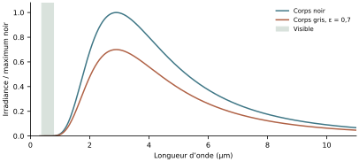
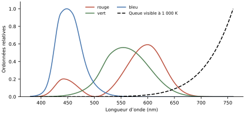
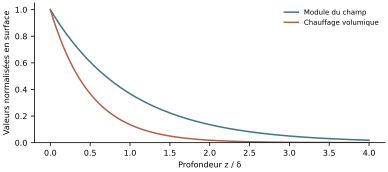
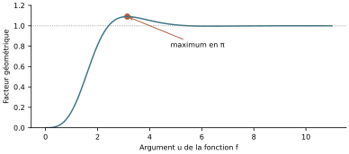
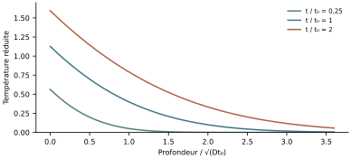
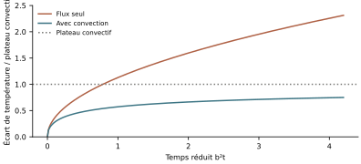

# Physique A — X PC 2023 · Corrigé guidé

*Corrigé rédigé par IA, non officiel.*

**Rédaction** · GPT-6.2 Astra Ultra · vitesse non renseignée

Le sujet utilise des puissances à la fois volumique et surfacique. Les indices et les unités permettent de comparer les expressions imprimées aux intégrales de Joule. Le flux de surface ainsi établi sert ensuite dans toutes les conditions thermiques.

## 1 · Rayonnement du métal et couleur

### Question 1 — Déplacement de Wien

> [!INDICATION]
> La substitution transforme un maximum en longueur d’onde en un maximum d’une fonction sans dimension.

#### Solution

Dans l’air pris d’indice unité, posons $x=hc/(\lambda k_BT)$. À température fixée, maximiser $L_0$ revient à maximiser $x^5/(e^x-1)$. La dérivée logarithmique s’annule pour $5/x=e^x/(e^x-1)$, donc $1-x/5=e^{-x}$. La racine positive non nulle est voisine de $4{,}965$ (environ 5 comme indiqué). D’où $\lambda_{\max}T=hc/(k_Bx)\simeq2{,}9\times10^{-3}\ \mathrm{m\,K}$.

### Question 2 — Puissance surfacique totale

> [!INDICATION]
> Les bornes de l’intégrale s’échangent car $x$ décroît avec $\lambda$.

#### Solution

On intègre $P_{\rm ray}=\int_0^\infty L_0(\lambda,T)\,\mathrm d\lambda$ avec $\mathrm d\lambda=-hc\,\mathrm dx/(k_BTx^2)$. Il vient
$$P_{\rm ray}=\frac{2\pi k_B^4T^4}{h^3c^2}\int_0^\infty\frac{x^3}{e^x-1}\,\mathrm dx
=\sigma_0T^4,\qquad \sigma_0=\frac{2\pi^5k_B^4}{15h^3c^2}.$$
La puissance obtenue est par unité de surface, en $\mathrm{W\,m^{-2}}$.

### Question 3 — Part du rayonnement dans le visible

> [!INDICATION]
> Le pourcentage fourni donne une borne, car les longueurs d’onde extérieures à son intervalle ne sont pas toutes visibles.

#### Solution

À $1\,000$ K, le maximum est à $2{,}90\ \mu\mathrm m$, dans l’infrarouge. La puissance totale est $5{,}67\times10^4\ \mathrm{W\,m^{-2}}$. Le sujet place $98\,\%$ du spectre entre $1{,}45$ et $23{,}2\ \mu\mathrm m$, entièrement hors du visible. Il en découle une **borne** de $2\,\%$, soit $1{,}1\times10^3\ \mathrm{W\,m^{-2}}$, sur la puissance visible. Le reste du spectre inclut aussi des infrarouges, donc cette borne surestime largement la puissance visible. Pour préciser l’estimation, l’intégrale de Planck sur $0{,}38$ à $0{,}78\ \mu\mathrm m$ représente environ $1{,}1\times10^{-5}$ du total, soit $0{,}63\ \mathrm{W\,m^{-2}}$ (environ $0{,}9$ pour $0{,}40$ à $0{,}80\ \mu\mathrm m$). La courbe 1 000 K de la figure 2 croît dans le visible vers le rouge, loin de son pic.

### Question 4 — Couleur vue par le forgeron

> [!INDICATION]
> Examiner la portion du spectre qui atteint les cônes, puis distinguer intensité et couleur.

#### Solution

Le maximum infrarouge est invisible à l’œil. La queue visible du spectre est faible et fortement enrichie en grandes longueurs d’onde, ce qui rend possible une teinte rouge à orangée. L’emplacement du maximum de Wien ne suffit toutefois pas à lui seul à déterminer la nuance perçue et, en particulier, à garantir un jaune-orangé précis.

### Question 5 — Corps gris à émissivité constante

> [!INDICATION]
> Multiplier la fonction entière par un facteur positif conserve l’abscisse de son maximum.

#### Solution

Si $\epsilon=0{,}7$ est indépendante de $\lambda$ et de $T$, $L=0{,}7L_0$ à chaque longueur d’onde. Le maximum garde sa position, donc la loi de Wien est inchangée. L’intégrale devient $P_{\rm ray}=0{,}7\sigma_0T^4$. Sur une échelle linéaire, chaque ordonnée est multipliée par $0{,}7$.

### Question 6 — Déplacement empirique du pic

> [!INDICATION]
> Une loi pour l’abscisse du maximum suffit-elle à fixer l’aire sous une courbe ?

#### Solution

À $1\,000$ K, $a-bT=4{,}4$ et $\lambda'_{\max}=hc/[k_BT(a-bT)]\simeq3{,}27\ \mu\mathrm m$. C’est la nouvelle position, déplacée d’environ $+0{,}37\ \mu\mathrm m$ dans l’infrarouge. La seule loi du pic ne fixe pas l’intégrale. Une émissivité moyenne dépendant de $T$ donnerait $P_{\rm ray}=\epsilon_{\rm eff}(T)\sigma_0T^4$, sans coefficient constant en général. Une émissivité strictement indépendante de $\lambda$ à chaque température ne pourrait pas déplacer le pic. Le déplacement empirique suppose donc une dépendance spectrale effective. On ne déduit toujours pas la couleur vue du seul maximum.

### Question 7 — Pondération par les cônes

> [!INDICATION]
> Pondérer la queue visible sur toute la sensibilité de chaque canal, puis appliquer la convention de température de couleur annoncée.

#### Solution

Pour chacune des trois sensibilités $S_i(\lambda)$ de la figure 3, le signal est proportionnel à $C_i=\int_{\rm visible}L(\lambda,T)S_i(\lambda)\,\mathrm d\lambda$. Dans le visible à $1\,000$ K, l’irradiance croît fortement vers le rouge. Le recouvrement avec la sensibilité aux grandes longueurs d’onde domine. Le canal moyen apporte une composante plus faible et le bleu contribue peu, d’où la teinte chaude rouge-orangée. Dans la **définition par correspondance du maximum** donnée ici, associer cette teinte à environ $0{,}60$–$0{,}65\ \mu\mathrm m$ donne $T_{\rm couleur}\simeq4{,}5$–$4{,}8\times10^3$ K par Wien. Ce nombre est une estimation selon la définition du problème. En colorimétrie usuelle, le rayonnement d’un véritable corps noir à 1 000 K a par définition une température de couleur de 1 000 K. Les courbes de sensibilité seules, sans étalonnage de l’observateur, ne fixent pas une longueur d’onde dominante exacte.

## 2 · Induction dans une plaque conductrice

### Question 8 — Loi d’Ohm locale

> [!INDICATION]
> Employer une loi locale reliant deux champs vectoriels, avec les unités appropriées.

#### Solution

Pour l’acier assimilé à un conducteur ohmique isotrope immobile, $\mathbf J=\sigma\mathbf E$. La conductivité $\sigma$ est en $\mathrm{S\,m^{-1}}=\mathrm{A\,V^{-1}\,m^{-1}}$. L’égalité concerne la densité de courant de conduction.

### Question 9 — Géométrie plane

> [!INDICATION]
> Écrire le rotationnel dans cette géométrie pour trouver la direction du courant.

#### Solution

L’interface et l’excitation sont uniformes selon $x,y$. Les champs ne dépendent donc que de $z$ et du temps. La composante excitée est $B_x$. L’uniformité tangentielle, la polarisation imposée et l’absence d’autres sources ne produisent pas d’autre composante magnétique. Puis $\nabla\times\mathbf B=(\partial_zB_x)\mathbf e_y=\mu\mathbf J$, donc le courant et le champ électrique sont dirigés selon $y$, avec $\mu=\mu_0\mu_r$.

### Question 10 — Diffusion magnétique

> [!INDICATION]
> Vérifier le signe de la dérivée temporelle dans la convention demandée.

#### Solution

En prenant le rotationnel de $\nabla\times\mathbf B=\mu\sigma\mathbf E$ et en utilisant $\nabla\cdot\mathbf B=0$ et Maxwell-Faraday, on obtient $\Delta\mathbf B=\mu\sigma\partial_t\mathbf B$. Pour la convention **$e^{-i\omega t}$** du sujet, l’amplitude vérifie $B_x''=-i\mu\sigma\omega B_x$. Le signe change si l’on change de convention temporelle.

### Question 11 — Épaisseur de peau

> [!INDICATION]
> Choisir la racine de partie réelle positive et éliminer l’exponentielle divergente.

#### Solution

Posons $\delta=\sqrt{2/(\omega\mu\sigma)}$ et $K=(1-i)/\delta$, de sorte que $K^2=-i\omega\mu\sigma$. La solution générale est $C_+e^{Kz}+C_-e^{-Kz}$. La borne à grande profondeur impose $C_+=0$ et $B_x(0)=B_s$ impose $C_-=B_s$. Ainsi $B_x(z)=B_s e^{-(1-i)z/\delta}$.

### Question 12 — Atténuation spatiale du module

> [!INDICATION]
> Le déphasage qui varie avec la profondeur ne contribue pas au module.

#### Solution

Le module est $|B_x(z)|=|B_s|e^{-z/\delta}$. Il vaut $|B_s|/e$ à une épaisseur de peau et tend vers zéro en profondeur. Puisque $\delta\propto f^{-1/2}\mu_r^{-1/2}$ à conductivité donnée, augmenter la fréquence ou la perméabilité renforce le confinement du champ près de l’interface.

### Question 13 — Chauffage volumique moyen

> [!INDICATION]
> Le carré d’une amplitude complexe doit être un module au carré avant la moyenne.

#### Solution

L’amplitude du courant est $J_y=B'_x/\mu=-K B_s e^{-Kz}/\mu$. La moyenne de Joule vaut $p_J=|J_y|^2/(2\sigma)$ pour l’amplitude crête. Comme $|K|^2=2/\delta^2$, il vient
$$p_J(z)=P_0e^{-2z/\delta},\qquad P_0=\frac{|B_s|^2}{\sigma\mu^2\delta^2}=\frac{\omega|B_s|^2}{2\mu}.$$
$P_0$ est une puissance **volumique**, en $\mathrm{W\,m^{-3}}$.

### Question 14 — Équation dans la plaque bobinée

> [!INDICATION]
> Identifier la seule direction de translation conservée avant la limite de plaque mince.

#### Solution

La plaque et l’excitation sont supposées invariantes selon $x$ et le champ axial est $B_x(y,z)$. La diffusion magnétique donne $(\partial_y^2+\partial_z^2)B_x=K^2 B_x$ avec le même $K^2=-i\omega\mu\sigma$. Les courants associés peuvent à ce stade avoir une composante selon $y$ et une selon $z$. La bobine fournit la condition aux limites, plutôt qu’un autre terme dans l’équation homogène du métal.

### Question 15 — Champ axial entre les deux faces

> [!INDICATION]
> Donner aux deux faces la même valeur et exploiter la parité.

#### Solution

Plaçons l’origine au milieu de la plaque d’épaisseur totale $h$, donc les faces en $z=\pm h/2$. En négligeant les effets de bord selon $y$, $B_x''=K^2B_x$. Les deux faces ont la même amplitude axiale $B_s$ et la solution est paire, ce qui donne
$$B_x(z)=B_s\,\frac{\cosh(Kz)}{\cosh(Kh/2)}.$$
Le champ pénètre ici par les deux faces.

### Question 16 — Densité de courant dans l’épaisseur

> [!INDICATION]
> Le courant est proportionnel à la dérivée normale du champ axial.

#### Solution

D’après Maxwell-Ampère,
$$\underline{\mathbf J}=\frac{K B_s}{\mu}\frac{\sinh(Kz)}{\cosh(Kh/2)}\,\mathbf e_y.$$
Le courant change de signe au plan médian et s’y annule. La grandeur physique est la partie réelle après multiplication par $e^{-i\omega t}$.

### Question 17 — Intégrale sur l’épaisseur et normalisation

> [!INDICATION]
> Vérifier par les unités et par la limite de deux peaux indépendantes le préfacteur de l’intégrale.

#### Solution

Avec la définition volumique de $P_0$ de la question 13, $p_J=P_0|\sinh(Kz)/\cosh(Kh/2)|^2$. Les identités $2|\sinh[(1-i)u]|^2=\cosh(2u)-\cos(2u)$ et $2|\cosh[(1-i)u]|^2=\cosh(2u)+\cos(2u)$ permettent l’intégration sur les deux demi-épaisseurs. La puissance **surfacique** déposée est
$$\int_{-h/2}^{h/2}p_J\,\mathrm dz=P_0\delta\,\frac{\sinh(h/\delta)-\sin(h/\delta)}{\cosh(h/\delta)+\cos(h/\delta)}=P_0\delta f(h/\delta).$$
C’est bien la fonction $f$ imprimée. En gardant l’épaisseur totale $h$ du croquis et $\xi=h/(2\delta)$ imprimé, le résultat est $P_0\delta f(2\xi)$. La forme demandée $P_0 f(\xi)$ n’a ni l’unité surfacique ni le bon argument avec ces définitions. Pour $h\gg\delta$, les deux faces fournissent ensemble $P_0\delta$.

### Question 18 — Lecture du maximum et fréquence

> [!INDICATION]
> Lire le maximum de la fonction sans dimension et préciser la convention utilisée pour lui associer une fréquence.

#### Solution

Pour la fonction dessinée, $f'(u)=2\sinh u\,\sin u/(\cosh u+\cos u)^2$. Le premier maximum, le plus haut, est à $u=\pi$, avec $f(\pi)=\coth(\pi/2)\simeq1{,}09$. En appliquant la **convention imprimée** $\xi=h/(2\delta)$ à cette lecture, on trouve $\delta=h/(2\pi)$ et $f_{\rm élec}=1/(\pi\mu\sigma\delta^2)=4\pi/(\mu\sigma h^2)\simeq10$ kHz pour les valeurs fournies. C’est une fréquence plausible en induction. Pour la fonction de correction issue de l’intégration sur l’épaisseur totale en question 17, son maximum correspond à $h/\delta=\pi$, soit $2{,}5$ kHz. Enfin, à $B_s$ fixé, le préfacteur $P_0\delta$ dépend de la fréquence. Le maximum de la fonction normalisée ne définit pas à lui seul un optimum de puissance absolue d’une installation.

## 3 · Diffusion de la chaleur et pertes

### Question 19 — Bilan thermique local

> [!INDICATION]
> Appliquer le premier principe à une tranche entre deux plans voisins.

#### Solution

Le flux de Fourier est $j_q=-k\partial_zT$. Par unité de volume, accumulation égale divergence entrante du flux plus chauffage interne. Ainsi $\rho c_p\partial_t T=-\partial_zj_q+p_J=k\partial_z^2T+p_J$. Chaque terme est en $\mathrm{W\,m^{-3}}$. Le terme de gauche mesure la variation de l’énergie sensible et le terme diffusif redistribue cette énergie.

### Question 20 — Dépôt superficiel

> [!INDICATION]
> Une intégration en profondeur doit multiplier l’unité volumique par une longueur.

#### Solution

Lorsque $\delta$ est petite devant l’échelle thermique, on peut remplacer le dépôt dans la peau par le flux entrant qu’il représente. D’après la question 13,
$$P_s=\int_0^\infty P_0 e^{-2z/\delta}\,\mathrm dz=\frac{P_0\delta}{2}\quad(\mathrm{W\,m^{-2}}).$$
Le sujet imprime $2P_0/\delta$, qui ne peut pas être un flux surfacique si $P_0$ désigne la puissance volumique de la question 13. Dans les questions suivantes, $P_s$ désigne le flux physiquement intégré.

### Question 21 — Conditions du demi-espace

> [!INDICATION]
> Le même dépôt de chaleur ne doit pas être compté à la fois en volume et à l’interface.

#### Solution

Avec $\widehat T=T-T_0$ et $D=k/(\rho c_p)$, la source est désormais à la frontière et l’intérieur vérifie $\partial_t\widehat T=D\,\partial_z^2\widehat T$. L’initialisation uniforme donne $\widehat T(z,0)=0$. Pour tout temps fini la perturbation tend vers zéro quand $z\to\infty$. Le flux entrant à la surface vaut $-k\partial_z\widehat T(0,t)=P_s$ pour $t>0$.

### Question 22 — Solution transformée

> [!INDICATION]
> Transformer également l’échelon de flux au bord en $P_s/s$.

#### Solution

Notons $\widetilde T$ la transformée en temps de $\widehat T$ et $q=\sqrt{s/D}$ (partie réelle positive). La condition initiale nulle donne $\widetilde T''=q^2\widetilde T$. La décroissance à l’infini conserve le terme $Ae^{-qz}$. La condition de flux transformée est $kqA=P_s/s$, donc
$$\widetilde T(z,s)=\frac{P_s\sqrt D}{k s^{3/2}}e^{-z\sqrt{s/D}}.$$

### Question 23 — Développement au voisinage de la surface

> [!INDICATION]
> L’inverse de $s^{-3/2}$ est $2\sqrt{t/\pi}$.

#### Solution

En développant l’exponentielle à l’ordre un en $z$, $\widetilde T\simeq P_s\sqrt D/(ks^{3/2})-P_s z/(ks)$. L’inversion par la table donne pour $t>0$
$$\widehat T(z,t)\simeq\frac{2P_s}{k}\sqrt{\frac{Dt}{\pi}}-\frac{P_s}{k}z,\qquad z\ll\sqrt{Dt}.$$
On retrouve exactement la pente imposée par le flux à la surface.

### Question 24 — Profil à temps fixé

> [!INDICATION]
> Le développement linéaire près du bord ne peut être prolongé en droite jusqu’à l’infini.

#### Solution

La température est maximale à la surface, de pente $-P_s/k$. Elle diminue vers zéro sur une longueur d’ordre $\sqrt{Dt}$ et s’aplatit en profondeur. Pour tracer une courbe cohérente, on peut utiliser la solution exacte
$$\widehat T=\frac{P_s}{k}\left[2\sqrt{\frac{Dt}{\pi}}e^{-\eta^2}-z\,\mathrm{erfc}(\eta)\right],\qquad \eta=\frac{z}{2\sqrt{Dt}}.$$
Sa dérivée est $-(P_s/k)\mathrm{erfc}(\eta)$, ce qui vérifie la pente au bord, la monotonie et l’aplatissement.

### Question 25 — Montée de température sans perte

> [!INDICATION]
> Résoudre l’équation de température de surface pour le premier instant où le point de fusion est atteint.

#### Solution

À $z=0$, $\widehat T(0,t)=(2P_s/k)\sqrt{Dt/\pi}$. La surface chauffe de plus en plus lentement mais la température reste non bornée à temps long. Dans ce modèle, pour $P_s>0$, la surface atteint $T_f$ à $t_f=(\pi/D)[k(T_f-T_0)/(2P_s)]^2$. Le modèle décrit l’approche du seuil et n’inclut pas la chaleur latente de la fusion.

### Question 26 — Interface avec convection

> [!INDICATION]
> Transformer le terme de perte proportionnel à la température de surface.

#### Solution

Notons $h_c$ le coefficient de convection pour le distinguer de l’épaisseur. La condition devient $k\partial_z\widehat T(0,t)=-P_s+h_c\widehat T(0,t)$. Pour $\widetilde T=Ae^{-qz}$, $-kqA=-P_s/s+h_cA$. Ainsi
$$\widetilde T(z,s)=\frac{P_s e^{-qz}}{s(h_c+kq)},\qquad q=\sqrt{s/D}.$$

### Question 27 — Limite à temps long

> [!INDICATION]
> Préciser la variable que l’on maintient fixée lors de la limite.

#### Solution

Pour $h_c>0$ et $z$ fixé, le théorème de la valeur finale donne $\lim_{t\to\infty}\widehat T(z,t)=\lim_{s\to0}s\widetilde T=P_s/h_c$. En surface le flux convectif finit donc par compenser le flux fourni. La limite à $z$ fixé coexiste avec le retour à $T_0$ à grande profondeur pour chaque temps fini, puisque la zone réchauffée s’élargit indéfiniment.

### Question 28 — Premiers instants

> [!INDICATION]
> Comparer les deux termes de la somme du dénominateur.

#### Solution

Quand $s\to\infty$, $kq$ domine $h_c$, donc $\widetilde T\simeq P_s e^{-qz}/(skq)$, la solution sans convection. Au début, $\widehat T(0,t)$ est petite et le flux convectif $h_c\widehat T(0,t)$ reste faible devant le flux fourni.

### Question 29 — Surface avec convection

> [!INDICATION]
> Positionner le point de fusion par rapport au plateau accessible.

#### Solution

La température part de $T_0$ avec le comportement en $\sqrt t$ de la question 25, puis tend par valeurs inférieures vers $T_0+P_s/h_c$. En posant $b=h_c\sqrt D/k$, le profil de surface exact s’écrit $\widehat T(0,t)=(P_s/h_c)[1-e^{b^2t}\mathrm{erfc}(b\sqrt t)]$. Il confirme la monotonie et le plateau. Pour atteindre la fusion en un temps fini, il faut $P_s>h_c(T_f-T_0)$. L’égalité ne donne que le seuil asymptotique.

### Question 30 — Échanges radiatifs et convectifs

> [!INDICATION]
> Convertir en kelvins et distinguer puissance émise et échange net avec l’environnement.

#### Solution

Dans une ambiance à $T_a=293$ K, la perte convective est $h_c(T-T_a)$. La puissance radiative **émise** est $\epsilon\sigma_0T^4$ et le milieu renvoie en équilibre $\epsilon\sigma_0T_a^4$. Pour comparer des **pertes nettes**, on emploie $q_r=\epsilon\sigma_0(T^4-T_a^4)$. Pour $\epsilon=1$, le coefficient radiatif équivalent est $\sigma_0(T+T_a)(T^2+T_a^2)$. À faible écart, il vaut environ $5{,}7\ \mathrm{W\,m^{-2}\,K^{-1}}$ contre $10$ pour la convection. Les deux sont comparables autour de $407$ K (134 °C). À 500 °C, les flux valent environ $2{,}0\times10^4$ et $4{,}8\times10^3\ \mathrm{W\,m^{-2}}$. À 1 200 °C, ils atteignent $2{,}7\times10^5$ et $1{,}2\times10^4\ \mathrm{W\,m^{-2}}$. La convection prédomine près de l’ambiante sans exclure le rayonnement. À haute température le rayonnement domine largement.

### Question 31 — Observation avant fusion

> [!INDICATION]
> Comparer la température d’apparition de l’incandescence au seuil de changement de phase.

#### Solution

À $1\,000$ K déjà, la queue du spectre excite les cônes sensibles au rouge. Le métal peut donc rougir bien avant $1\,500$ °C, température de fusion annoncée. En approchant $1\,773$ K, les pertes radiatives nettes atteignent environ $5{,}6\times10^5\ \mathrm{W\,m^{-2}}$ pour $\epsilon=1$. Le flux inductif doit compenser ces pertes et les pertes convectives tout en fournissant l’énergie d’échauffement. La température de surface sous flux imposé est donc plus basse que dans le modèle sans rayonnement.

### Question 32 — Passage à la température de Curie

> [!INDICATION]
> La même pièce peut simultanément comporter une couche au-dessus de $T_c$ et un cœur au-dessous.

#### Solution

Pour $T\ll T_c$, l’acier ferromagnétique a une grande perméabilité et une faible épaisseur de peau. À champ de surface imposé, le dépôt est très superficiel et la chaleur diffuse vers le cœur, avec une forte variation près de la surface. Pour $T\gg T_c$, $\mu_r\simeq1$ et la peau s’épaissit d’un facteur d’ordre $\sqrt{\mu_{r,\mathrm{froid}}}$ à fréquence et conductivité égales. Le courant et la source de chaleur s’étendent plus profondément, ce qui élargit la zone chauffée. Autour de $T_c$, une surface déjà paramagnétique peut recouvrir une région encore ferromagnétique. Le champ traverse plus aisément la couche chaude puis se concentre dans la région à grande perméabilité. La transition et la zone de dépôt progressent vers l’intérieur. Leur position précise demande le couplage de $\mu(T)$, du chauffage et de la diffusion, ainsi que la condition réelle d’alimentation de la bobine.

[Sujet officiel](https://banques-ecoles.fr/cms/wp-content/uploads/2023/08/23_pc_sujet_PhyA.pdf) · [Rapport du jury](https://banques-ecoles.fr/cms/wp-content/uploads/2023/12/23_pc_rap_ePhyA.pdf)
