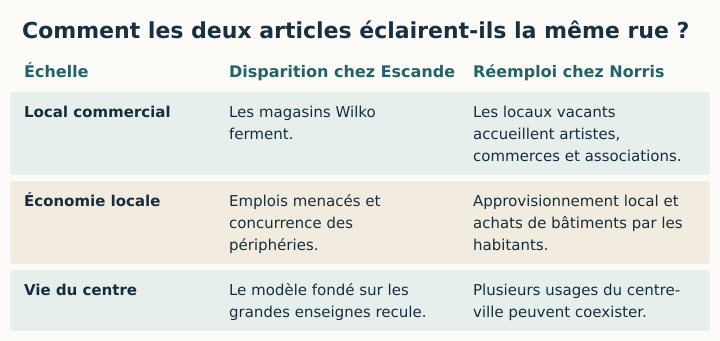

# Agro-Véto · BCPST · Anglais 2024 — Corrigé brut

*Corrigé rédigé par IA, non officiel. Signalez toute erreur.*

**Rédaction** · GPT-6.2 Astra Ultra · vitesse non renseignée

Écrit de deux heures. La comparaison est obligatoire. En expression, le candidat choisit un sujet sur les deux. Chaque réponse demande 200 mots, avec une tolérance de 10 %.

## I · Compréhension des deux articles · 10 points

Philippe Escande in Le Monde traces the disappearance of a way of shopping, while Sian Norris in The Guardian visits the places that its retreat has made available. The streets they describe can be losing familiar names and gaining new uses at the same time.

Wilko grew from a family shop in Leicester into a chain of four hundred stores. Its collapse threatened nearly twelve thousand five hundred jobs. Escande points to rising costs and supply difficulties, but also to cheaper competitors outside town, strained finances and the owners' decisions about dividends. Online competition is part of a wider shift, as the survival of the Debenhams name on the internet after its shops closed illustrates.

Norris asks what can happen to the premises themselves. A gallery in a former shop can attract neighbours who would never enter an art institution. In Plymouth, residents can buy shares in buildings and influence the activities they house. In Bristol, small traders buy from local suppliers, keeping more of their customers' spending in the area. These experiments combine shopping with meeting, making things and sharing advice. Where Escande records the cost of an established model breaking down, Norris finds people testing a more varied one.

*201 words.*

## II · Expression, sujet 1 · Online and offline activities

Online services should replace a journey when they remove a barrier without taking away something essential to the activity. A resident of a village may save half a day by renewing a permit online. For a worker with limited mobility, joining a meeting from home may be what makes participation possible in the first place.

The same change looks different from the other end of the connection. If the council closes its counter altogether, a resident who cannot read the instructions or afford reliable internet access has nowhere to turn. Nor does a video meeting always give a new colleague the chance to ask an informal question afterwards. A task can be completed efficiently while an opportunity to learn or to be heard disappears.

I would therefore distinguish access to a service from an obligation to use one channel. A council could move routine renewals online while keeping appointments for difficult cases. An employer could send documents electronically but bring trainees together regularly with people who know the job. These arrangements can be evaluated by asking who completes the task, who gives up, and why. The proportion of transactions conducted online is a poor substitute for knowing whether the people involved gained a real choice.

*205 words.*

## II · Expression, sujet 2 · Biden’s appeal to Americans

When Joe Biden called on Americans to recognise one another as compatriots in February 2023, he was asking for something more demanding than politeness. An electoral loser must accept that a winner can govern legitimately, and the winner must leave the opposition a genuine opportunity to win next time.

The attack on the Capitol on January 6, 2021 showed what happens when that relationship breaks down. Congress was meeting to certify the presidential election. Treating its members as enemies to be stopped threatened the process by which millions of people, including those absent from Washington, had expressed a choice. Holding the attackers accountable is compatible with respecting fellow citizens. Asking officials to ignore intimidation in the name of unity would undermine the common rules that make disagreement possible.

There was also evidence by 2023 that cooperation had not vanished. The infrastructure law signed in 2021 attracted votes from both parties. Legislators who disagreed about the president could see a reason to repair roads or water systems for their own constituents. Biden's appeal is relevant where it asks people to recognise such shared interests and accept electoral rules. It has less force if it merely asks opponents to suppress serious disputes over whose rights a policy protects.

*206 words.*

[Sujet officiel](https://www.concours-agro-veto.fr/sites/default/files/media/2025-10/bcpst_0924_sp.pdf) · [Rapport du jury](https://www.concours-agro-veto.fr/sites/default/files/media/2025-10/rapport_anglais_bcpst-2024.pdf) · [Bilan du concours et rattachement à l’X, p. 4](https://www.concours-agro-veto.fr/sites/default/files/media/2025-10/bilan-concours-cpge-bcpst-session-2024.pdf#page=4)
