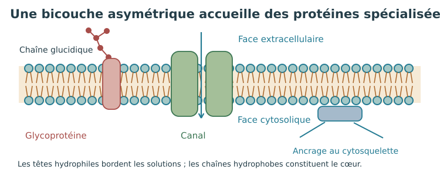
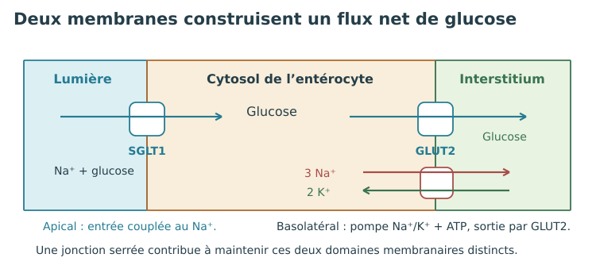
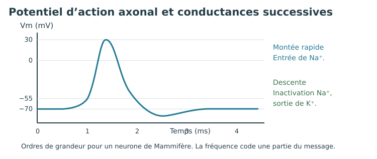
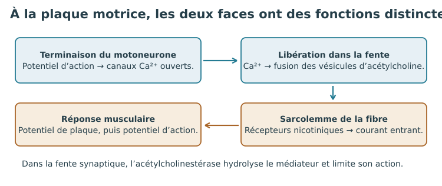

# Agro-Véto — BCPST, Biologie 2024 · Corrigé guidé

*Corrigé rédigé par IA, non officiel.*

**Rédaction (tour 1)** · GPT-6.2 Astra Ultra · vitesse non renseignée

# Membrane plasmique et spécialisation des cellules chez les êtres vivants pluricellulaires

> [!JURY]
> Le jury valorise les mécanismes étudiés dans une cellule identifiable et la relation entre l’équipement membranaire et une fonction à l’échelle du tissu. Il attire aussi l’attention sur la distinction entre membrane, matrice extracellulaire et paroi.

## Introduction

> [!INDICATION]
> **Délimiter.** Poser la frontière cytosol–milieu extracellulaire. Choisir un exemple de deux domaines membranaires qui coopèrent dans un tissu et rappeler les deux groupes d’êtres vivants du sujet.

#### Rédaction possible

Dans un fragment d’intestin, deux faces d’un même entérocyte n’effectuent pas le même travail. Du côté de la lumière, le glucose alimentaire entre dans la cellule ; du côté du tissu conjonctif, il en sort et peut rejoindre le sang. Les deux faces appartiennent pourtant à une membrane continue. La membrane plasmique est une bicouche lipidique associée à des protéines qui sépare le cytosol et le milieu extracellulaire. Une cellule spécialisée exerce une fonction particulière au sein d’un organisme pluricellulaire. Chez une Angiosperme, la paroi se trouve à l’extérieur de la membrane. Chez un Mammifère comme chez une plante à fleurs, la membrane met donc une cellule en relation avec son tissu, même lorsque celui-ci se situe loin de la surface de l’organisme.

Comment une architecture membranaire commune acquiert-elle des propriétés propres à un type cellulaire, et comment ces propriétés rendent-elles possible une fonction collective ? La membrane perçoit d’abord certains signaux de différenciation et reçoit un équipement protéique particulier. La répartition de cet équipement crée ensuite des échanges orientés. Enfin, la membrane permet à des cellules spécialisées d’adhérer, de se reconnaître et de coordonner leur activité.

## I. Une interface commune devient spécifique au cours de la différenciation

> [!INDICATION]
> **Construire le lien causal.** Distinguer ce qui est commun aux cellules, ce qui est reçu par un récepteur au cours du développement et ce qui devient spécifique. Relier chaque étape à une propriété mesurable.

#### Rédaction possible

### La bicouche constitue une barrière fluide, asymétrique et électriquement polarisable

D’une épaisseur d’environ 7 à 10 nm, la membrane doit sa cohésion à l’organisation de lipides amphiphiles. Les têtes polaires sont au contact des solutions aqueuses, leurs chaînes hydrophobes se font face. Les groupes chargés traversent difficilement ce cœur hydrophobe. Des protéines intégrales le franchissent par des segments hydrophobes tandis que des protéines périphériques s’associent à une face. Ces associations sont pour l’essentiel non covalentes. Les deux feuillets diffèrent par leurs lipides et leurs partenaires. Les chaînes glucidiques de glycoprotéines et glycolipides se trouvent sur la face extracellulaire. Le cholestérol chez les Mammifères et d’autres stérols chez les Angiospermes modulent l’organisation et la mobilité des lipides.

De nombreux constituants diffusent latéralement. Quand on photoblanchit une petite zone de membrane portant un marqueur fluorescent, le retour partiel du signal traduit l’entrée de molécules mobiles provenant des régions voisines. La fraction qui récupère peu peut être retenue par le cytosquelette ou des partenaires tissulaires. La fluidité autorise ainsi le regroupement de récepteurs et la fusion de vésicules tout en restant compatible avec des domaines durablement spécialisés. La bicouche sépare aussi des charges. Le potentiel de repos dépend des gradients ioniques entretenus par les pompes et des perméabilités relatives, notamment aux ions K⁺ dans de nombreuses cellules animales.

### La membrane reçoit des signaux qui changent le devenir de la cellule

La détermination est l’engagement vers un devenir, la différenciation est l’acquisition des caractères qui permettent la fonction. Ce sont deux étapes distinctes d’un simple arrêt de la division. Dans la lignée musculaire squelettique des Mammifères, la réponse à des facteurs de croissance dépend des récepteurs membranaires présents. Par exemple, le signal FGF reçu par un récepteur à activité tyrosine kinase favorise dans un contexte de précurseurs la prolifération et peut retarder leur différenciation terminale. Une modification des signaux locaux et du programme de transcription permet ensuite la sortie du cycle, l’expression de facteurs de différenciation tels que la myogénine et l’assemblage de protéines musculaires. Des myoblastes fusionnent en myotubes plurinucléés. Une même cellule peut donc recevoir un signal par sa membrane et, au cours de sa différenciation, transformer la composition de cette membrane.

Le répertoire protéique dépend de l’expression différentielle des gènes. Dans la fibre musculaire, des facteurs myogéniques participent, avec leurs cofacteurs, à l’activation de gènes qui comprennent ceux de sous-unités du récepteur nicotinique de l’acétylcholine. La traduction des protéines transmembranaires commence sur des ribosomes, se poursuit au réticulum endoplasmique et permet l’insertion orientée des segments hydrophobes. La glycosylation et le tri se poursuivent dans la voie sécrétoire. La fusion des vésicules avec la membrane conserve l’orientation : un domaine situé dans leur lumière se retrouve du côté extracellulaire. À la jonction neuromusculaire, des récepteurs sont concentrés en regard du bouton moteur. La fonction dépend donc des quantités de protéines, de leur identité et du lieu où elles sont retenues.

## II. La répartition des transporteurs fait d’une cellule une interface d’échange orientée

> [!INDICATION]
> **Dresser un bilan de flux.** Tracer les deux faces de l’entérocyte puis placer pour chaque transporteur son substrat et le sens de la flèche. Refaire la même lecture sur le poil absorbant en changeant l’ion moteur.

#### Rédaction possible

### L’entérocyte couple entrée apicale et sortie basolatérale du glucose

Les microvillosités, soutenues par des faisceaux d’actine, accroissent la surface apicale de l’entérocyte exposée à la lumière intestinale. Une jonction serrée au voisinage du pôle apical limite le passage entre cellules et la diffusion de certaines protéines entre domaines. Sur la face basolatérale, la Na⁺/K⁺-ATPase hydrolyse un ATP pour expulser trois Na⁺ et faire entrer deux K⁺. Cette dépense primaire entretient une concentration cytosolique de Na⁺ faible. Au pôle apical, SGLT1 fait entrer deux Na⁺ avec une molécule de glucose. Le gradient électrochimique du sodium peut ainsi fournir l’énergie d’une accumulation de glucose contre son gradient. Au pôle basolatéral, GLUT2 facilite la diffusion du glucose vers le liquide interstitiel lorsque son gradient est favorable. Il peut alors rejoindre un capillaire.

Pour transférer un ion de 1 vers 2, la variation de potentiel électrochimique s’écrit $\Delta\widetilde\mu=RT\ln(a_2/a_1)+zF(V_2-V_1)$, avec $a$ l’activité, $z$ la charge et $V$ le potentiel électrique. Le transport couplé est favorable si la somme des variations des espèces transportées est négative. Les porteurs ont une capacité limitée : la vitesse d’entrée tend vers un plateau quand tous sont occupés. La présence d’un gradient ne suffit donc pas à prédire le débit. Le nombre de transporteurs et la surface de membrane interviennent aussi. Le retrait du Na⁺ du côté apical réduit fortement l’entrée de glucose par SGLT1, alors que le glucose lui-même est électriquement neutre.

### Le poil absorbant mobilise un gradient de protons dans le sol

Chez une Angiosperme, l’allongement local d’une cellule du rhizoderme en poil absorbant augmente la surface de membrane en contact, à travers la paroi hydratée, avec la solution du sol. Une H⁺-ATPase de la membrane plasmique expulse des protons. L’intérieur tend à devenir plus négatif et le milieu extérieur plus acide. Le retour des H⁺, favorable électrochimiquement, peut alimenter un symport qui accumule du nitrate dans le cytosol. D’autres ions traversent des canaux selon leur gradient propre. Une aquaporine accroît la perméabilité à l’eau. L’eau entre si le potentiel hydrique du sol dépasse celui de la cellule, compte tenu des composantes osmotique et de pression. Une aquaporine ne décide pas du sens de ce flux.

Les deux cellules d’absorption présentent ainsi une grande surface et couplent une pompe primaire à des transports secondaires. La cellule animale exploite surtout le gradient de Na⁺ ; le poil absorbant exploite notamment celui de H⁺. Dans une racine, des connexions symplastiques peuvent relayer le prélèvement entre cellules. Dans l’intestin, la polarité apico-basale canalise le transit vers le tissu voisin. La spécialisation se mesure donc au flux net à l’échelle de l’organe.

## III. La membrane spécialisée intègre la cellule au tissu et à ses communications

> [!INDICATION]
> **Situer le signal dans le tissu.** Nommer la cellule sur laquelle se trouve chaque récepteur. Dans la jonction neuromusculaire, distinguer le canal calcique de la terminaison et le récepteur-canal de la fibre musculaire.

#### Rédaction possible

### Adhérer, échanger et reconnaître un partenaire

Dans un épithélium de Mammifère, des cadhérines des jonctions d’adhérence s’associent entre cellules voisines et se relient indirectement à l’actine. Des intégrines de la face basale lient la matrice extracellulaire à des structures cytosquelettiques internes. Ces interactions transmettent les contraintes mécaniques et contribuent au maintien de l’architecture polarisée. Dans un tissu végétal, la paroi assure une grande part du soutien mécanique, mais la continuité de l’information dépend aussi des membranes. Les plasmodesmes sont des canaux traversant les parois adjacentes. Tapissés d’une membrane plasmique continue, ils relient les cytosols et permettent des transferts régulés de molécules. Les deux organisations mettent des cellules distinctes en relation sans rendre leurs surfaces interchangeables.

Une reconnaissance de partenaire peut aller jusqu’à la fusion. Chez les Mammifères, le spermatozoïde interagit avec les enveloppes de l’ovocyte et franchit la zone pellucide après les changements associés à la réaction acrosomique. La zone pellucide est une matrice extracellulaire. Une fois cette enveloppe traversée, la reconnaissance entre la protéine spermatique IZUMO1 et JUNO à la surface de l’ovocyte contribue à l’adhésion préalable à la fusion des membranes. Une fonction cellulaire précise dépend ici de l’identité de partenaires exposés sur deux surfaces.

### Des canaux distribués le long de l’axone régénèrent un message

Au repos, le neurone présente typiquement une différence de potentiel intérieur–extérieur de l’ordre de −70 mV. Quand une dépolarisation locale atteint le seuil au segment initial, l’ouverture rapide de canaux Na⁺ voltage-dépendants accroît la conductance au Na⁺. Son entrée dépolarise davantage la membrane jusqu’à un maximum proche de +30 mV dans un exemple classique. L’inactivation de ces canaux, puis l’ouverture retardée de canaux K⁺, permettent la repolarisation et parfois une brève hyperpolarisation. La Na⁺/K⁺-ATPase entretient les gradients au fil du temps. L’ouverture et la fermeture des canaux expliquent les variations rapides du voltage.

Les courants locaux dépolarisent la région axonale suivante qui régénère le potentiel d’action. La région qui vient de décharger est réfractaire. En fonctionnement physiologique, la propagation à partir du segment initial se poursuit vers les terminaisons. Dans un axone myélinisé, la forte densité de canaux aux nœuds de Ranvier permet la conduction saltatoire. L’amplitude d’un potentiel d’action est approximativement constante dans une cellule donnée. C’est notamment leur fréquence qui code l’intensité du message.

### Une membrane convertit le signal électrique en libération, l’autre en réponse

Au bouton terminal d’un motoneurone, la dépolarisation ouvre des canaux Ca²⁺ voltage-dépendants. L’entrée de Ca²⁺ déclenche la fusion de vésicules contenant de l’acétylcholine. Une succession de potentiels d’action module, dans une certaine gamme, la quantité de médiateur libérée par unité de temps. Du côté de la fibre musculaire, l’acétylcholine se fixe au récepteur nicotinique, canal cationique ligand-dépendant concentré dans la plaque motrice. Une entrée nette de charges positives produit un potentiel de plaque. Si le seuil est atteint, des canaux voltage-dépendants du sarcolemme déclenchent un potentiel d’action musculaire qui se propage dans les tubules T et participe au couplage avec la contraction. L’acétylcholinestérase limite la durée du signal dans la fente.

Un même messager ne déclenche donc pas partout la même réponse. Il faut à la fois le récepteur approprié, un dispositif intracellulaire de transduction et une organisation de la membrane qui place le récepteur au bon endroit. La chaîne du motoneurone au muscle illustre ce que gagne l’organisme à associer deux spécialisations différentes.

## Conclusion

> [!INDICATION]
> **Répondre aux deux sens de la question.** Relier la perception d’un signal de différenciation à la mise en place d’un équipement membranaire et aux conséquences pour l’organisme.

#### Rédaction possible

L’architecture commune de la membrane fournit une barrière mobile et polarisée. Ce sont la régulation de l’expression, le tri, les ancrages et la géométrie de la surface qui rendent possibles un prélèvement de nitrate dans le sol, le passage du glucose à travers l’épithélium intestinal ou l’activation d’une fibre musculaire. La spécialisation a ainsi deux directions : les signaux reçus à la membrane participent à l’établissement d’un phénotype, puis les protéines installées à cette surface rendent la cellule compétente pour des échanges et des communications déterminés. La capacité d’un tissu à maintenir cette répartition malgré le renouvellement permanent de ses protéines devient alors une question de dynamique de la spécialisation.
