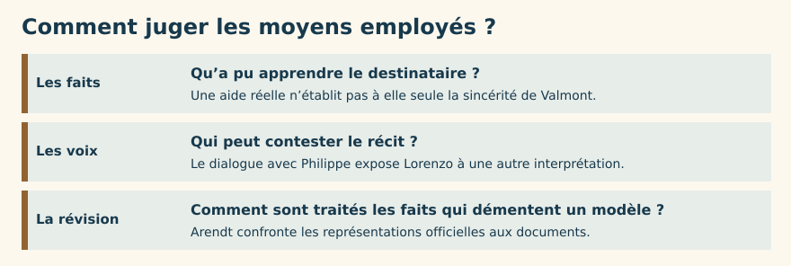

# Agro-Véto · BCPST — Humanités 2024 · Corrigé brut

*Corrigé rédigé par IA, non officiel. Signalez toute erreur.*

**Lecture du rapport du jury** · GPT-6.2 Astra Ultra · vitesse non renseignée

**Rédaction** · GPT-6.2 Astra Ultra · vitesse non renseignée

**Autocontrôle** · GPT-6.2 Astra Ultra · vitesse non renseignée

**Révision (tour 1)** · GPT-6.2 Astra Ultra · vitesse non renseignée

La dissertation de trois heures porte sur une citation de Clément Viktorovitch et les œuvres du programme sur le faire croire.

## Sujet

« il est difficile d’établir une distinction claire entre les procédés qui relèvent de la conviction, et ceux qui tombent dans la manipulation. [...] Comment savoir, dès lors, si les moyens que nous mobilisons sont éthiques ? La réponse est sans appel : nous n’en sommes jamais certains. »

Clément Viktorovitch, *Le pouvoir rhétorique. Apprendre à convaincre et décrypter les discours*, Seuil, 2021.

En quoi cette affirmation éclaire-t-elle votre lecture des œuvres au programme, Les Liaisons dangereuses de Pierre Choderlos de Laclos, Lorenzaccio d’Alfred de Musset, et les deux essais d’Hannah Arendt, « Vérité et politique », extrait de La Crise de la culture, et « Du mensonge en politique », extrait du Mensonge à la violence ?

## Dissertation

Dans la lettre XXI des *Liaisons dangereuses*, une famille reçoit effectivement l’aide de Valmont. Le lecteur sait aussi, par le récit destiné à Merteuil, quel parti Valmont attend de cette action dans l’esprit de la présidente de Tourvel. Faut-il nier le bienfait pour condamner l’usage qui en est fait ? Clément Viktorovitch, dans *Le Pouvoir rhétorique* (2021), part d’une difficulté de ce genre. Distinguer clairement les procédés de la conviction de ceux de la manipulation serait malaisé. À la question de savoir si les moyens que nous employons sont éthiques, il répond que « nous n’en sommes jamais certains ». Le premier mouvement constate un problème de frontière. Le second tire une conclusion qui porte sur nous, y compris lorsque nous pensons servir une cause juste. Or de la difficulté d’étiqueter un procédé peut-on conclure à l’impossibilité de porter un jugement fondé sur son usage ? Les lettres imaginées par Laclos, les prises de parole de *Lorenzaccio* de Musset et les essais d’Hannah Arendt « Vérité et politique » et « Du mensonge en politique » permettent d’établir pourquoi la forme du discours ne délivre aucun certificat moral, de distinguer néanmoins certains usages et de comprendre quelle responsabilité l’incertitude laisse au locuteur.

Convaincre quelqu’un, c’est chercher à lui faire tenir une proposition pour juste. L’ambition présuppose qu’il peut juger. La manipulation, elle aussi, peut aboutir à une adhésion exprimée librement en apparence, alors que le destinataire ignore quelque chose qui modifierait sa décision. Voilà pourquoi on ne peut distribuer d’avance les phrases entre un vocabulaire rationnel toujours intègre et un vocabulaire affectif nécessairement suspect. Madame de Volanges prévient son amie Tourvel du danger que lui semble représenter Valmont. La sollicitude donne ici à des raisons un poids particulier, parce que l’expéditrice répond d’une relation durable. La même langue de la confiance circule dans des lettres où Merteuil parle à Cécile. L’écart ne se lit pas dans une formule de politesse ou une marque d’amitié détachée de la situation. Il se mesure à ce que l’une sait des projets de son interlocutrice et à ce que l’autre est légitimement conduite à croire.

Musset rend sensible cette difficulté en changeant le public auquel on assiste. Dans le long entretien du troisième acte avec Philippe Strozzi, Lorenzo reprend sa conduite sous le regard d’un interlocuteur qui la réprouve. Ce qu’il présente comme rôle joué devant la cour semble avoir atteint sa propre identité. Philippe reçoit moins une attestation définitive de sincérité que l’histoire d’un être qui ne sait plus bien où finit son personnage. Le théâtre confère au spectateur plus de points de comparaison qu’à certains personnages, sans lui donner accès à une intention intacte derrière chaque phrase. Arendt généralise une part de la difficulté dans « Du mensonge en politique ». Les spécialistes chargés d’élaborer une image cohérente des décisions américaines peuvent finir par raisonner eux-mêmes à l’intérieur de cette image. Ils manient des concepts et des modèles d’allure rationnelle, tout en perdant contact avec des informations qui devraient les démentir. La bonne opinion que le locuteur se fait de son propre raisonnement constitue décidément une preuve faible.

Pourtant toutes ces situations ne sont pas également incertaines. La structure épistolaire de Laclos donne au lecteur un avantage limité mais réel. Dans la lettre XXI, Valmont raconte le secours à la marquise de Merteuil. Dans la lettre XXII, la présidente de Tourvel présente la même action à madame de Volanges et se prépare à visiter elle-même la famille avec madame de Rosemonde. La seconde épistolière tire d’un témoignage une raison d’agir et de revoir une mauvaise réputation. Nous pouvons respecter ce souci de justice tout en voyant ce que son information a d’incomplet. La proximité des deux lettres offre ainsi au lecteur un contrôle croisé dont la présidente ne dispose pas. Le fait de l’aide demeure. Le choix de ce que Tourvel pourra en conclure sur la personne de Valmont a un autre objet, dont elle ignore la nature. Une bonne conséquence locale ne suffit pas à rendre juste l’ensemble du rapport. Dans la lettre autobiographique LXXXI, Merteuil décrit sa propre formation et les contraintes pesant sur une femme de son milieu. Cette genèse permet de comprendre son désir de reprendre prise sur son apparence publique. Elle ne lui confère pas pour autant le droit de réduire à des rôles interchangeables les personnes dont elle veut obtenir l’appui. Expliquer une pratique et juger ce qu’elle fait à quelqu’un sont des opérations distinctes.

Chez Arendt, une deuxième distinction donne au jugement un appui que le seul examen de la sincérité ne fournit pas. Dans « Vérité et politique », des opinions différentes peuvent porter sur la signification d’un fait et sur la conduite qu’il appelle. Mais si l’on transforme le fait même en une opinion parmi d’autres, le destinataire ne peut plus exercer ce désaccord. Ainsi la question de savoir qui a envahi qui en 1914 n’est pas du même ordre que le jugement porté sur les responsabilités politiques plus larges de la guerre. Témoignages et documents peuvent corriger une erreur. Leur suppression ou leur disqualification systématique prive la communauté d’un monde sur lequel confronter ses raisons. Il existe donc des jugements négatifs assez assurés, même si aucune liste de procédés toujours vertueux ne peut se substituer à eux. Une opinion sincère n’a pas le pouvoir d’annuler un événement. Une intention proclamée vertueuse n’a pas davantage le pouvoir de rendre à un destinataire l’information dont il a été privé.

Cette distinction n’accorde toutefois pas à l’observateur une innocence de principe. Chez Musset, Lorenzo attribue une valeur décisive à l’épreuve qu’il veut imposer à Florence. Il espère que l’acte dirigé contre le duc fera apparaître ce que valent les républicains. L’issue politique, l’installation d’un autre Médicis, manifeste la distance entre la signification que le personnage voulait donner à son acte et ce que les institutions et les autres acteurs en feront. Elle ne prouve pas que tout moyen qui échoue soit immoral, pas plus qu’une victoire ne l’aurait justifié. Elle montre la fragilité d’un jugement portant d’avance sur la signification que le geste aura pour tous. Pour juger les moyens, il faut traverser la différence entre la fin que je revendique, l’action que j’accomplis et la place que j’accorde aux autres dans la décision.

L’examen éthique ne consiste donc pas à attendre d’être certain pour ouvrir la bouche. Il consiste à maintenir les conditions dans lesquelles la parole que j’adresse à quelqu’un pourra me revenir sous forme d’objection. Les lecteurs des *Liaisons* apprennent à comparer les lettres au lieu de laisser le dernier récit effacer ceux qui le précèdent. Les spectateurs de *Lorenzaccio* entendent l’écart entre les certitudes d’un personnage et les raisons qu’un autre pourrait leur opposer. Dans son analyse des documents du Pentagone, Arendt distingue les modèles conçus par les décideurs et les informations à partir desquelles ces modèles auraient pu être révisés. Juger exige de laisser les faits et les autres parler contre notre propre représentation. Cela vaut pour celui qui entend convaincre et aussi pour celui qui se dit habile à démasquer la parole d’autrui. Un soupçon appliqué à tout sans distinction rendrait toute discussion aussi vaine que la crédulité.

Je suivrais donc Viktorovitch dans le refus de confondre une technique reconnue ou une bonne conscience avec une garantie éthique. Je n’en conclurais pas à l’équivalence de tous les moyens. Les œuvres permettent de demander ce qu’un destinataire a pu savoir, quelle liberté de jugement lui est restée et comment le locuteur a traité les faits qui résistaient à son discours. Les réponses ne dissipent pas toujours l’incertitude. Elles en font une raison de rendre des comptes, de corriger une parole et, lorsque les pièces le permettent, de nommer une manipulation.

[Énoncé de la banque Agro-Véto](https://www.concours-agro-veto.fr/sites/default/files/media/2025-10/sujet-a-bcpst-humanites-session-2024.pdf) · [Rapport du jury 2024](https://www.concours-agro-veto.fr/sites/default/files/media/2025-10/rapport-cpge-bcpst-humanites-session-2024.pdf)
