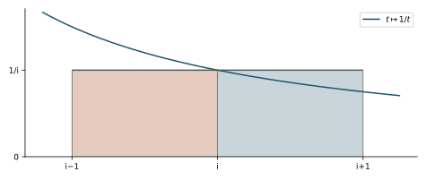
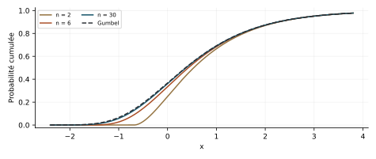
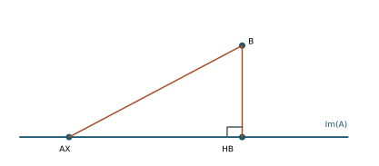

# Agro-Véto BCPST 2024 · Mathématiques, méthodes de calcul et raisonnement · Corrigé guidé

*Corrigé rédigé par IA, non officiel. Signalez toute erreur.*

**Rédaction** · GPT-6.2 Astra Ultra · vitesse non renseignée

**Révision (tour 1)** · GPT-6.2 Astra Ultra · vitesse non renseignée

La numérotation des questions suit les quatre pages du sujet. Le premier problème étudie les extremums d’exponentielles et une loi limite. Le second construit la projection utilisée dans les moindres carrés.

Le rapport du jury recommence la numérotation à 1 au deuxième problème. Son commentaire 1 correspond ainsi à la question 15 du sujet, et son commentaire 10 à la question 24. [Sujet officiel](https://www.concours-agro-veto.fr/sites/default/files/media/2025-10/bcpst_0424_sp.pdf) · [Rapport du jury](https://www.concours-agro-veto.fr/sites/default/files/media/2025-10/math_calcul_raisonnement_rapport_2024_relu_le.pdf)

## Problème 1 · I. Résultats préliminaires

### Question 1.a

> [!INDICATION]
> Comparer les expressions factorielles en conservant les bornes j = 0 et j = p.

#### Solution

Pour $0\le j\le p$, on a
$$\frac{1}{j+1}\binom pj=\frac{p!}{(j+1)!(p-j)!}=\frac{1}{p+1}\binom{p+1}{j+1}.$$

### Question 1.b

> [!INDICATION]
> Séparer les parties de taille j+1 selon la présence d’un élément fixé.

#### Solution

Dans un ensemble à $p+1$ éléments, distinguons un élément $a$. Une partie à $j+1$ éléments qui ne contient pas $a$ se choisit de $\binom p{j+1}$ façons. Une partie qui le contient se complète en choisissant $j$ éléments parmi les $p$ autres, de $\binom pj$ façons. Les deux cas forment une partition, ce qui donne $\binom{p+1}{j+1}=\binom p{j+1}+\binom pj$.

### Question 2

> [!INDICATION]
> La loi exponentielle est portée par les réels positifs.

#### Solution

Une densité est $f_X(x)=\lambda e^{-\lambda x}\mathbf1_{[0,+\infty[}(x)$. La fonction de répartition vaut $0$ pour $x<0$ et $1-e^{-\lambda x}$ pour $x\ge0$. On a $\mathbb E(X)=1/\lambda$ et $\operatorname{Var}(X)=1/\lambda^2$.

### Question 3.a

> [!INDICATION]
> Comparer la fonction à sa valeur en i sur chacun des deux intervalles.

#### Solution

Comme $i>1$, les intervalles $[i-1,i]$ et $[i,i+1]$ sont inclus dans $]0,+\infty[$. La fonction $t\mapsto 1/t$ y est décroissante. Sur le premier intervalle, $1/t\ge1/i$ et sur le second $1/t\le1/i$. Chaque intervalle a longueur $1$. Par croissance de l’intégrale,
$$\int_i^{i+1}\frac{dt}{t}\le \frac1i\le \int_{i-1}^i\frac{dt}{t}.$$

### Question 3.b

> [!INDICATION]
> Isoler $\ln(1+1/n)$ dans le logarithme.

#### Solution

Pour $n>1$, $\ln(n+1)/\ln n=1+\ln(1+1/n)/\ln n\to1$. Le numérateur du terme correctif tend vers $0$ et son dénominateur vers $+\infty$. Donc $\ln(n+1)\sim\ln n$.

### Question 3.c

> [!INDICATION]
> Sommer de 2 à n et traiter 1 séparément.

#### Solution

Posons $H_n=\sum_{k=1}^n1/k$. En sommant la question 3.a de $2$ à $n$, on obtient
$$1+\ln(n+1)-\ln2\le H_n\le1+\ln n.$$
Pour $n>1$, divisons par $\ln n>0$. Les deux bornes tendent vers $1$ par la question 3.b. Le théorème d’encadrement fournit $H_n\sim\ln n$.

## Problème 1 · II. Extremums de variables exponentielles

### Question 4

> [!INDICATION]
> Le minimum dépasse x exactement quand toutes les observations le dépassent.

#### Solution

Pour $x\ge0$, l’indépendance donne $\mathbb P(X_{(1)}>x)=\prod_{i=1}^n\mathbb P(X_i>x)=e^{-n\lambda x}$. Le minimum est positif presque sûrement, donc cette probabilité vaut $1$ pour $x<0$. Sa fonction de répartition est celle de la loi exponentielle de paramètre $n\lambda$.

### Question 5

> [!INDICATION]
> Exprimer la fonction de répartition du maximum sur toute la droite, puis dériver.

#### Solution

Pour $x\ge0$, $F_n(x)=\mathbb P(X_{(n)}\le x)=\prod_{i=1}^n\mathbb P(X_i\le x)=(1-e^{-\lambda x})^n$. Pour $x<0$, $F_n(x)=0$. Cette fonction est continue sur $\mathbb R$, notamment en $0$, et de classe $C^1$ de chaque côté de $0$. Une densité est donc
$$d_n(x)=n\lambda e^{-\lambda x}(1-e^{-\lambda x})^{n-1}\mathbf1_{[0,+\infty[}(x).$$
Pour $n=1$, le facteur à la puissance zéro vaut $1$. Le choix de la densité en $0$ est indifférent.

### Question 6

> [!INDICATION]
> Justifier l’intégrabilité, puis développer une puissance entière avant d’intégrer.

#### Solution

Le maximum est compris entre zéro et $\sum_iX_i$, dont l’espérance vaut $n/\lambda$. Il est intégrable. Le binôme de Newton appliqué à la densité donne la somme finie
$$\mathbb E(X_{(n)})=n\lambda\sum_{j=0}^{n-1}\binom{n-1}{j}(-1)^j\int_0^\infty x e^{-(j+1)\lambda x}\,dx.$$
Pour $a=(j+1)\lambda>0$, l’intégrale de $x a e^{-ax}$ vaut $1/a$, espérance de la loi exponentielle, d’où $\int_0^\infty x e^{-ax}dx=1/a^2$. On obtient $\lambda\mathbb E(X_{(n)})=n\sum_{j=0}^{n-1}\binom{n-1}{j}(-1)^j/(j+1)^2$. Avec la question 1.a,
$$\mathbb E(X_{(n)})=\frac1\lambda\sum_{j=0}^{n-1}\binom n{j+1}\frac{(-1)^j}{j+1}.$$

Une vérification indépendante consiste à intégrer la fonction de survie. En posant $v=1-e^{-\lambda x}$ sur $[0,+\infty[$, on obtient
$$\mathbb E(X_{(n)})=\frac1\lambda\int_0^1\frac{1-v^n}{1-v}\,dv=\frac1\lambda\int_0^1(1+v+\cdots+v^{n-1})\,dv.$$
La fraction se prolonge en $1$ par la valeur $n$. Cela retrouve directement le nombre harmonique que la question 7 demande d’établir par récurrence.

### Question 7.a

> [!INDICATION]
> Développer $(1-1)^{p+1}$.

#### Solution

Le binôme de Newton donne $\sum_{k=0}^{p+1}\binom{p+1}k(-1)^k=(1-1)^{p+1}=0$, car $p+1>0$.

### Question 7.b

> [!INDICATION]
> Calculer la différence des deux sommes successives et employer les deux identités de la question 1.

#### Solution

Posons $S_p=\sum_{j=0}^{p-1}\binom p{j+1}(-1)^j/(j+1)$. On a $S_1=1=H_1$. Pour $p\ge1$, Pascal aux indices $j=0,\ldots,p-1$, puis le dernier terme $j=p$ traité séparément, donnent
$$S_{p+1}-S_p=\sum_{j=0}^p\binom pj\frac{(-1)^j}{j+1}=\frac1{p+1}\sum_{k=1}^{p+1}\binom{p+1}k(-1)^{k-1}.$$
La dernière somme vaut $1$ par la question 7.a, après isolement de son terme d’indice zéro. Ainsi $S_{p+1}=S_p+1/(p+1)$. Si $S_p=H_p$, alors $S_{p+1}=H_{p+1}$. L’initialisation et l’hérédité concluent.

### Question 8

> [!INDICATION]
> Enchaîner la valeur exacte et l’équivalent du nombre harmonique.

#### Solution

Les questions 6 et 7 donnent $\mathbb E(X_{(n)})=H_n/\lambda$. La question 3.c et $\lambda>0$ fournissent alors $\mathbb E(X_{(n)})\sim (\ln n)/\lambda$.

### Question 9

> [!INDICATION]
> Développer jusqu’au deuxième ordre, car les termes de premier ordre se compensent.

#### Solution

On a $u_n=H_n-\ln n$, donc $u_{n+1}-u_n=1/(n+1)-\ln(1+1/n)$. Avec $t=1/n$, on utilise $t/(1+t)=t-t^2+o(t^2)$ et $\ln(1+t)=t-t^2/2+o(t^2)$. Ainsi
$$u_{n+1}-u_n\sim-\frac1{2n^2}.$$
Les valeurs absolues sont équivalentes à $1/(2n^2)$. La série de Riemann correspondante converge, donc la série des différences converge absolument.

Le signe peut aussi se vérifier sans développement limité. L’intégrale de $1/t$ sur $[n,n+1]$ dépasse strictement $1/(n+1)$. Ainsi $u_{n+1}-u_n<0$, ce qui concorde avec le signe du premier terme non nul.

### Question 10

> [!INDICATION]
> Écrire une somme télescopique finie.

#### Solution

Pour $N\ge2$, $u_N=u_1+\sum_{n=1}^{N-1}(u_{n+1}-u_n)$. La somme partielle a une limite finie par la question 9. La suite $(u_N)$ converge donc.

## Problème 1 · III. Loi de Gumbel

### Question 11

> [!INDICATION]
> Chercher une primitive dont les deux limites sont immédiates.

#### Solution

La fonction $f$ est continue et positive sur $\mathbb R$. La fonction $G(x)=\exp(-\lambda e^{-x})$ est dérivable et $G'(x)=\lambda e^{-x}\exp(-\lambda e^{-x})=f(x)$. Ses limites en $-\infty$ et en $+\infty$ valent respectivement $0$ et $1$. L’intégrale impropre de $f$ converge donc et vaut $1$.

### Question 12

> [!INDICATION]
> La fonction x ↦ −ln x décroît et la loi exponentielle ne possède aucun atome.

#### Solution

Comme $X_1>0$ presque sûrement, $Y$ est définie presque sûrement. Pour $x\in\mathbb R$, $\{Y\le x\}=\{X_1\ge e^{-x}\}$. La loi exponentielle étant à densité, $\mathbb P(X_1=e^{-x})=0$. Ainsi $\mathbb P(Y\le x)=\exp(-\lambda e^{-x})=G(x)$. La dérivée de cette fonction de répartition est $f$. Il s’agit de la loi de Gumbel demandée.

### Question 13

> [!INDICATION]
> Vérifier que le logarithme est défini pour tous les indices assez grands.

#### Solution

Pour $x=0$, les deux membres valent $1$. Pour $x\ne0$ fixé et $n>-x$, $1+x/n>0$ et $n\ln(1+x/n)\to x$ car $\ln(1+t)\sim t$ lorsque $t\to0$. Par continuité de l’exponentielle, $(1+x/n)^n\to e^x$.

### Question 14

> [!INDICATION]
> Écrire la fonction de répartition du maximum au seuil x + ln n.

#### Solution

Supposons $\lambda=1$. Pour chaque $x$ réel fixé, $x+\ln n\ge0$ dès que $n$ est assez grand. La question 5 donne
$$\mathbb P(X_{(n)}-\ln n\le x)=\big(1-e^{-(x+\ln n)}\big)^n=\left(1-\frac{e^{-x}}n\right)^n\longrightarrow \exp(-e^{-x})$$
par la question 13. La limite est la fonction de répartition continue de $Y$ pour $\lambda=1$. On a donc la convergence en loi annoncée.

Pour tout réel $x$, la formule valable à tous les rangs est $F_n(x)=(\max(0,1-e^{-x}/n))^n$. La partie positive tient compte du support de $X_{(n)}$. Par exemple en $x=0$ on trouve $(1-1/n)^n\to e^{-1}$. Le décalage par $\ln n$ explique pourquoi la limite est comprise strictement entre zéro et un.

## Problème 2 · Projection orthogonale et moindres carrés

### Question 15

> [!INDICATION]
> Comparer les coefficients de même indice des deux matrices de taille q × n.

#### Solution

Pour $1\le i\le q$ et $1\le j\le n$,
$$((AB)^T)_{ij}=(AB)_{ji}=\sum_{k=1}^p a_{jk}b_{ki}=\sum_{k=1}^p(B^T)_{ik}(A^T)_{kj}=(B^TA^T)_{ij}.$$
D’où l’égalité des matrices.

### Question 16

> [!INDICATION]
> Transposer les deux identités définissant la matrice inverse.

#### Solution

On a $M^T(M^{-1})^T=(M^{-1}M)^T=I_n$ et $(M^{-1})^TM^T=(MM^{-1})^T=I_n$. Par conséquent $M^T$ est inversible et $(M^T)^{-1}=(M^{-1})^T$.

### Question 17

> [!INDICATION]
> Commencer par l’inclusion immédiate, puis exprimer la norme de AX.

#### Solution

Si $AX=0$, alors $A^TAX=0$ et $\ker A\subset\ker(A^TA)$. Si $A^TAX=0$, alors $\|AX\|^2=X^TA^TAX=0$. Une norme n’est nulle qu’au vecteur nul, donc $AX=0$. Cela donne l’inclusion réciproque.

### Question 18

> [!INDICATION]
> Vérifier la symétrie et la nature du corps des coefficients.

#### Solution

La matrice $A^TA$ est carrée réelle et $(A^TA)^T=A^T(A^T)^T=A^TA$. Le théorème spectral assure sa diagonalisation sur $\mathbb R$ dans une base orthonormale.

### Question 19

> [!INDICATION]
> Le produit a 2 sur sa diagonale et −1 ailleurs. Examiner la droite des constantes et le plan de somme nulle.

#### Solution

Le calcul donne $A^TA=3I_3-J$, où $J$ est la matrice dont chaque entrée vaut $1$. Pour tout vecteur, $J$ place la somme des trois coordonnées dans chacune des trois positions. Ainsi $(1,1,1)^T$ est propre pour la valeur $0$ de $A^TA$, tandis que les vecteurs du plan de somme nulle sont propres pour la valeur $3$. Prenons
$$D=\operatorname{diag}(0,3,3),\qquad P=\begin{pmatrix}1&1&1\\1&-1&0\\1&0&-1\end{pmatrix}.$$
Les deux dernières colonnes sont indépendantes dans le plan et la première lui est extérieure. Donc $P$ est inversible, sa première ligne convient et $A^TA=PDP^{-1}$. Les coefficients choisis sont réels, donc aussi complexes comme le permet l’énoncé.

On peut vérifier la diagonalisation sans inverser $P$. La matrice $A^TA$ annule la première colonne de $P$ et multiplie les deux autres par trois, donc $A^TAP=PD$. De plus $\det P=3$, ce qui garantit que cette égalité livre bien une diagonalisation.

### Question 20

> [!INDICATION]
> Écrire le produit AX comme combinaison linéaire des colonnes de A.

#### Solution

La liberté signifie que, pour tout $(x_1,\ldots,x_p)\in\mathbb R^p$, $\sum_jx_j C_j=0$ implique $x_1=\cdots=x_p=0$. Or $AX=\sum_jx_j C_j$. On a donc $\ker A=\{0\}$ et, par la question 17, $\ker(A^TA)=\{0\}$. La matrice $A^TA$ est carrée de taille $p$ et injective. Elle est donc inversible.

### Question 21.a

> [!INDICATION]
> Regrouper le produit central puis transposer les facteurs en sens inverse.

#### Solution

Posons $S=A^TA$. Par associativité $H^2=AS^{-1}(A^TA)S^{-1}A^T=AS^{-1}A^T=H$. Comme $S$ est symétrique et inversible, la question 16 donne $(S^{-1})^T=S^{-1}$. Ainsi $H^T=A(S^{-1})^TA^T=H$.

### Question 21.b

> [!INDICATION]
> Traduire l’orthogonalité à tous les vecteurs HZ.

#### Solution

Pour tout $X\in\mathbb R^n$, $X\in(\operatorname{Im}H)^\perp$ équivaut à $\langle X,HZ\rangle=0$ pour tout $Z\in\mathbb R^n$. Comme $H^T=H$, cela équivaut à $\langle HX,Z\rangle=0$ pour tout $Z$. En particulier $Z=HX$ impose $HX=0$. Réciproquement $HX=0$ rend tous ces produits nuls. Donc $(\operatorname{Im}H)^\perp=\ker H$.

### Question 21.c

> [!INDICATION]
> Utiliser AᵀH = Aᵀ et HA = A pour les deux inclusions qui ne sont pas immédiates.

#### Solution

Si $A^TX=0$, la définition donne $HX=0$. Comme $A^TH=(A^TA)S^{-1}A^T=A^T$, la condition $HX=0$ implique aussi $A^TX=0$. Ainsi $\ker H=\ker A^T$. Les vecteurs $HX= A(S^{-1}A^TX)$ appartiennent à $\operatorname{Im}A$. Inversement $HA=AS^{-1}S=A$, donc tout $AZ=H(AZ)$ appartient à $\operatorname{Im}H$. Les images sont égales.

### Question 22

> [!INDICATION]
> Séparer B−AX en une composante orthogonale à l’image de A et une composante dans cette image.

#### Solution

Posons $\widehat X=S^{-1}A^TB$. Alors $A\widehat X=HB$. Comme $H$ est la projection orthogonale sur $\operatorname{Im}A$, $B-HB$ est orthogonal à $HB-AX\in\operatorname{Im}A$. Pythagore donne
$$g(X)=\|B-HB\|^2+\|A(\widehat X-X)\|^2.$$
Cette expression est minimale en $X=\widehat X$. L’égalité avec le minimum exige $A(\widehat X-X)=0$. La question 20 donne alors $X=\widehat X$, d’où l’unicité.

### Question 23

> [!INDICATION]
> Dans le cas carré, quelle est l’image d’une matrice à colonnes indépendantes ?

#### Solution

Si $n=p$, la matrice carrée $A$ est inversible. L’équation $AX=B$ admet donc la solution $X=A^{-1}B$, qui annule $g$. Par unicité du minimum, $\widehat X=A^{-1}B$. C’est cohérent avec $\operatorname{Im}A=\mathbb R^n$ et $HB=B$.

### Question 24

> [!INDICATION]
> Écrire les deux équations normales plutôt que d’inverser une matrice rectangulaire.

#### Solution

On trouve $A^TA=\begin{pmatrix}2&2\\2&5\end{pmatrix}$ et $A^TB=(4,8)^T$. Les équations normales sont $2x+2y=4$ et $2x+5y=8$. Par soustraction $y=4/3$, puis $x=2/3$. Ainsi $\widehat X=(2/3,4/3)^T$. Le résidu $(1/3,2/3,-1/3)^T$ est bien orthogonal aux deux colonnes de $A$.

Le carré de la norme du résidu vaut $2/3$. Ainsi la valeur minimale de $g$ est $2/3$. Pour une perturbation $(h,k)$ du minimiseur, l’augmentation vaut $h^2+k^2+(h+2k)^2$, strictement positive dès que $(h,k)\ne(0,0)$. Cela contrôle numériquement la conclusion d’unicité de la question 22.
