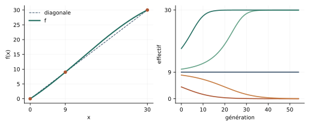
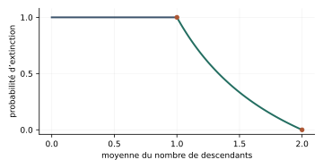
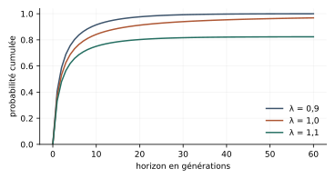

# Agro-Véto · BCPST · Modélisation mathématique et informatique 2024 — corrigé guidé

*Corrigé rédigé par IA, non officiel. Signalez toute erreur.*

**Rédaction** · GPT-6.2 Astra Ultra · vitesse non renseignée · 25 novembre 2026

**Révision** · GPT-6.2 Astra Ultra · vitesse non renseignée · 26 novembre 2026

**Évolution d’une population abstraite.** Le problème A porte sur des récurrences et des équilibres. Le problème B compare plusieurs lois de descendance dans un arbre de Galton–Watson, puis étudie la précision d’une estimation numérique.

## Repères

Pour les suites, enfermer les termes entre deux points fixes avant de passer à la limite. Pour l’arbre aléatoire, conditionner par la première génération. Dans la simulation, identifier exactement l’événement observé à 60 générations.

## A. Modèles déterministes

### Question 1 · Suite géométrique

**Indication.** Exprimer le terme de rang $n$ en fonction de $v_0$.

#### Solution

Par récurrence $v_n=v_0q^n$. Pour $v_0>0$, la limite vaut zéro exactement lorsque $0<q<1$. Pour $q=1$ la suite est constante, et pour $q>1$ elle diverge vers $+\infty$. Si $v_0=0$, elle est nulle pour toute valeur de $q$.

### Question 2.1 · Fonction d’itération

**Indication.** Développer le polynôme de degré deux avant de dériver.

#### Solution

$f(x)=3x/2-x^2/(2S)$ et $f'(x)=3/2-x/S$. Sur $[0,3S/2]$, $f$ croît de 0 à $9S/8$. Sur $[3S/2,+\infty[$, elle décroît de $9S/8$ vers $-\infty$. Le tableau sur tout le domaine demandé est donc

| $x$ | $0$ | | $3S/2$ | | $+\infty$ |
|---|---:|:---:|:---:|:---:|---:|
| $f'(x)$ | | $+$ | $0$ | $-$ | |
| $f(x)$ | $0$ | ↗ | $9S/8$ | ↘ | $-\infty$ |

### Question 2.2 · Tracer les vingt premiers termes

**Indication.** Le premier terme est déjà dans la liste avant l’entrée dans la boucle.

#### Solution

Les lignes 5 à 7 deviennent

```python
for k in range(19):
    v = v + 0.5 * v * (S - v) / S
    L.append(v)
```

La liste transmise à `plt.plot` contient $v_0,\ldots,v_{19}$, soit vingt valeurs.

### Question 2.3 · Importer le module graphique

**Indication.** Respecter l’alias utilisé par le tracé fourni.

#### Solution

```python
import matplotlib.pyplot as plt
```

### Question 2.4 · Lire la première simulation

**Indication.** Comparer le niveau commun apparent et le sens d’approche des courbes.

#### Solution

Pour les conditions initiales positives représentées, les courbes semblent tendre vers $S=30$. Le rapprochement se fait par le bas ou par le haut selon le point de départ. Le graphique porte sur les valeurs représentées et les vingt premières générations.

### Question 2.5 · Invariance, monotonie et limite

**Indication.** Sur $[0,S]$, utiliser la monotonie de $f$ pour borner l’image et le signe de $f(x)-x$ pour comparer deux termes.

#### Solution

$f(0)=0$, $f(S)=S$ et $f$ est strictement croissante sur $[0,S]$. Ainsi $0<v_0\le S$ implique $0<v_n\le S$ par récurrence. De plus $f(x)-x=x(S-x)/(2S)\ge0$ sur cet intervalle. La suite croissante et majorée converge vers $L\ge v_0>0$. Par continuité, $L=f(L)$, soit $L(S-L)=0$. La seule possibilité est $L=S$.

### Question 3.1 · Points fixes et position de la courbe

**Indication.** Factoriser l’écart à la première bissectrice.

#### Solution

Cette fois $f(x)=x+x(S-x)(x-A)/(2S^2)$. Les points fixes sont $0,A,S$. L’écart $f(x)-x$ est négatif sur $]0,A[$ et positif sur $]A,S[$. La courbe est strictement croissante par l’hypothèse admise. Elle passe par les trois points fixes, d’abord sous la diagonale puis au-dessus.



### Question 3.2 · Départ strictement inférieur à A

**Indication.** La croissance stricte de $f$ conserve l’intervalle entre deux points fixes consécutifs.

#### Solution

Pour $0<x<A$, $0=f(0)<f(x)<f(A)=A$. Par récurrence tous les termes sont dans $]0,A[$, où $f(x)<x$. La suite est strictement décroissante et minorée par zéro. Sa limite est un point fixe de $[0,v_0]$, par continuité. Puisque $v_0<A$, ce point fixe est 0.

### Question 3.3 · Départ supérieur ou égal à A

**Indication.** Répéter la preuve avec les deux points fixes qui encadrent le nouveau départ.

#### Solution

Pour $A<v_0<S$, $f$ conserve $]A,S[$ et $f(x)>x$ sur cet intervalle. La suite croît vers un point fixe de $[v_0,S]$, donc vers $S$. Pour $v_0=A$, elle est constante égale à $A$. De même les départs $0$ et $S$ donnent des suites constantes.

### Question 3.4 · Interprétation des deux niveaux

**Indication.** Comparer un départ juste en dessous et juste au-dessus de $A$.

#### Solution

$A$ est le seuil qui sépare ici extinction et convergence vers $S$. Un départ exactement égal à $A$ reste à ce niveau. $S$ est l’effectif d’équilibre vers lequel convergent les suites issues de l’intervalle $]A,S]$.

### Question 4.1 · Équilibres en temps continu

**Indication.** Rechercher les zéros du membre de droite.

#### Solution

Une solution constante vérifie $F(y)=y(S-y)(y-A)/(2S^2)=0$. Les trois valeurs sont $0$, $A$ et $S$.

### Question 4.2 · Dérivée aux équilibres

**Indication.** Dans un produit de trois facteurs, à une racine simple seul subsiste le terme où l’on a dérivé le facteur nul.

#### Solution

On obtient $F'(0)=-A/(2S)<0$, $F'(A)=A(S-A)/(2S^2)>0$ et $F'(S)=-(S-A)/(2S)<0$. Les équilibres $0$ et $S$ sont stables, $A$ est instable selon le critère donné.

### Question 4.3 · Équation linéarisée

**Indication.** Poser $w=y-x_0$ pour obtenir une équation homogène.

#### Solution

Si $y(0)=y_0$ et $c=F'(x_0)$, alors $w'=cw$ d’où $w(t)=(y_0-x_0)e^{ct}$. La solution de l’équation linéarisée est $y(t)=x_0+(y_0-x_0)e^{ct}$.

### Question 4.4 · Effet d’une petite perturbation

**Indication.** Suivre l’évolution de la distance à l’équilibre dans la solution linéarisée.

#### Solution

Pour $c<0$, $y(t)\to x_0$ quelle que soit la petite perturbation initiale. Pour $c>0$, la solution de l’équation linéarisée tend vers $+\infty$ lorsque $y_0>x_0$ et vers $-\infty$ lorsque $y_0<x_0$. Si $y_0=x_0$, elle est constante. Dans le modèle non linéaire, la linéarisation décrit le départ du voisinage de l’équilibre. Comme pour la suite de Q3, une petite perturbation est amortie près de $0$ et de $S$, et amplifiée de part et d’autre de $A$.

## B.I. Processus de Galton–Watson

### Question 5 · Descendance constante

**Indication.** Transformer la somme en un produit quand tous les termes valent le même entier.

#### Solution

$Z_{n+1}=qZ_n$, donc $Z_n=q^n$ avec $Z_0=1$. Pour $q=0$, la lignée s’éteint dès la génération 1. Pour $q=1$ elle garde exactement un individu, pour $q\ge2$ elle croît géométriquement.

### Question 6 · Descendance de Bernoulli

**Indication.** Si une génération compte au plus un individu, que peut compter la suivante ?

#### Solution

Par récurrence $Z_n\in\{0,1\}$. L’état 0 est absorbant. Être à 1 à la génération $n$ demande que la succession des $n$ tirages indépendants ait toujours donné un descendant. Ainsi $\Pr(Z_n=1)=p^n$ et $\Pr(Z_n=0)=1-p^n\longrightarrow1$.

### Question 7 · Convergence des probabilités d’extinction

**Indication.** Comparer les événements à deux générations consécutives.

#### Solution

Notons $E_n=\{Z_n=0\}$. L’absence de parents entraîne celle de descendants, donc $E_n\subseteq E_{n+1}$. Ainsi $u_n=\Pr(E_n)$ croît et reste majorée par 1. Sa limite est $\Pr(\bigcup_n E_n)$ par continuité croissante des probabilités.

### Question 8.1 · Deux descendants ou aucun

**Indication.** Écrire $Z_1$ comme le double d’une Bernoulli.

#### Solution

$Z_1$ vaut 2 avec probabilité $p$ et 0 avec probabilité $1-p$. Ainsi $\mathbb E Z_1=2p$ et $\operatorname{Var}(Z_1)=4p(1-p)$. Au bord $p=1$, seule la valeur 2 est effectivement prise.

### Question 8.2 · Conditionner par la première génération

**Indication.** Énumérer les deux branches de l’arbre qui partent de l’unique ancêtre.

#### Solution

Pour $0<p<1$, la formule des probabilités totales donne

$$
u_{n+1}=(1-p)\Pr(E_{n+1}\mid Z_1=0)+p\Pr(E_{n+1}\mid Z_1=2).
$$

Si $p=1$, on enlève la branche de probabilité nulle avant de conditionner et il reste uniquement le second terme.

### Question 8.3 · Deux lignées indépendantes

**Indication.** Pour que les deux branches disparaissent, combien de générations reste-t-il à chacune ?

#### Solution

Conditionnellement à $Z_1=2$, chacune des deux lignées a $n$ générations à parcourir, s’éteint avec probabilité $u_n$, et leurs évolutions sont indépendantes. L’extinction des deux donne donc $u_n^2$. Si $Z_1=0$, l’extinction est certaine. Ainsi $u_{n+1}=1-p+pu_n^2$, avec $u_0=0$. La formule subsiste pour $p=1$.

### Question 8.4 · Deux limites candidates

**Indication.** Utiliser la convergence de 7 avant de résoudre l’équation de point fixe.

#### Solution

La limite $L$ vérifie $pL^2-L+1-p=0$, soit $(L-1)(pL-(1-p))=0$. Les racines sont 1 et $(1-p)/p$. Elles coïncident si $p=1/2$.

### Question 8.5 · Cas critique ou sous-critique

**Indication.** Une probabilité appartient à $[0,1]$.

#### Solution

Si $p<1/2$, $(1-p)/p>1$ est impossible. Si $p=1/2$, les deux racines valent 1. Ainsi l’extinction a probabilité 1 dans les deux cas.

### Question 8.6 · Cas surcritique

**Indication.** Utiliser le plus petit point fixe comme majorant invariant.

#### Solution

Posons $r=(1-p)/p<1$. Comme $u_0=0\le r$ et que $h(x)=1-p+px^2$ est croissante sur $[0,1]$, l’inégalité $u_n\le r$ entraîne $u_{n+1}\le h(r)=r$. Le passage à la limite exclut 1 et impose $L=r$. Cela comprend $p=1$, pour lequel $r=0$.

### Question 8.7 · Probabilité en fonction de la moyenne

**Indication.** Remplacer $p$ par la moitié de la moyenne dans les deux branches.

#### Solution

Pour $m=\mathbb E Z_1=2p\in]0,2]$, la probabilité vaut 1 si $m\le1$, puis $2/m-1$ si $1<m\le2$. La courbe est continue en 1 et décroît jusqu’à 0 en 2. Au-dessus du seuil, une survie devient possible, et l’extinction garde une probabilité positive tant que $m<2$.



### Question 9.1 · Sommer sur toutes les valeurs de la première génération

**Indication.** La série des probabilités totales est géométrique.

#### Solution

En donnant à $u_n^0$ la valeur 1 pour la branche sans descendant, on obtient $u_{n+1}=\sum_{k\ge0}(1-p)p^ku_n^k=(1-p)/(1-pu_n)$. La série converge puisque $0\le pu_n\le p<1$.

### Question 9.2 · Choisir le plus petit point fixe

**Indication.** Le dénominateur est strictement positif sur $[0,1]$.

#### Solution

L’équation est $pL^2-L+1-p=0$. Ses racines sont 1 et $(1-p)/p$. La probabilité d’extinction est le plus petit de ces deux nombres, donc 1 pour $p\le1/2$, et $(1-p)/p$ pour $p>1/2$.

### Question 9.3 · Loi géométrique et seuil critique

**Indication.** Décaler l’indice de sorte que la loi géométrique commence en 1.

#### Solution

Pour $j\ge1$, $\Pr(Y+1=j)=(1-p)p^{j-1}$. Ainsi $Y+1$ est géométrique de paramètre $1-p$ et $\mathbb E Y=1/(1-p)-1=p/(1-p)$. Cette moyenne est au plus 1 exactement lorsque $p\le1/2$, ce qui est la condition trouvée en 9.2 pour l’extinction presque sûre. Le même seuil de moyenne apparaît pour la loi à zéro ou deux descendants.

## B.II. Simulation et estimation

### Question 10.1 · Arguments de la simulation

**Indication.** Identifier le paramètre du tirage et le dernier indice renvoyé.

#### Solution

`lambda_` est le paramètre de la loi de Poisson du nombre d’enfants par individu. `n` est le nombre de transitions entre générations. Le tableau renvoyé contient les effectifs des générations 0 à $n$, incluses.

### Question 10.2 · Initialisation, somme et arrêt

**Indication.** Expliquer pourquoi il est licite de laisser à zéro la fin du tableau.

#### Solution

Les lignes 11 et 12 arrêtent le calcul dès que la génération suivante est vide. Les générations ultérieures resteront à zéro. La ligne 2 a déjà réservé $n+1$ cases nulles, dont la première est ensuite fixée à 1. Les lignes 6 à 8 remettent le total des descendants à zéro pour ce tour, puis additionnent un tirage indépendant par parent.

### Question 10.3 · Additionner les lois de Poisson

**Indication.** Raisonner conditionnellement à la taille de la génération présente.

#### Solution

Conditionnellement à $Z_n=z$, la somme des $z$ variables indépendantes de loi $\mathcal P(\lambda)$ suit la loi $\mathcal P(z\lambda)$. Ainsi un seul appel `rd.poisson(Z * lambda_)` a la même loi conditionnelle que la boucle. Pour $z=0$ la valeur est nulle avec certitude.

### Question 11.1 · Tracer dix trajectoires

**Indication.** L’argument génération est 20, même si le tableau comprend 21 points.

#### Solution

```python
lambda_ = 0.7
for k in range(10):
    plt.plot(galton_watson(lambda_, 20))
plt.show()
```

Les dix appels produisent dix réalisations sur les mêmes axes.

### Question 11.2 · Conjectures issues des six graphes

**Indication.** Distinguer absence de descendants à la vingtième génération et extinction future.

#### Solution

Les courbes suggèrent une extinction presque sûre pour une moyenne inférieure à 1 et une probabilité de survie positive au-dessus de 1. Pour les valeurs élevées, certaines trajectoires ont de très grands effectifs. Dix essais et vingt générations ne suffisent pas à trancher une extinction tardive ni à établir le comportement à la valeur critique.

### Question 12.1 · Renvoyer une indicatrice

**Indication.** Dans quel cas l’extinction est-elle déjà constatée à l’instant d’arrêt ?

#### Solution

Dans le code imprimé, remplacer la ligne 12 par `return 1` et la ligne 13 par `return 0`. Le 0 final indique qu’aucune extinction n’a eu lieu *jusqu’à la génération demandée*. Une version utilisant 10.3 est

```python
def galton_watson_2(lambda_, n):
    z = 1
    for k in range(n):
        z = rd.poisson(z * lambda_)
        if z == 0:
            return 1
    return 0
```

### Question 12.2 · Effectuer cinq mille répétitions

**Indication.** Cumuler les indicatrices, puis diviser par le nombre total de répétitions.

#### Solution

```python
def extinction(lambda_):
    nombre = 0
    for k in range(5000):
        nombre += galton_watson_2(lambda_, 60)
    return nombre / 5000
```

La moyenne estime directement $u_{60}$. C’est une approximation de la probabilité d’extinction finale, avec $u_{60}\le p_\lambda$. La ligne d’accumulation utilise bien `+=` à chaque tour.



### Question 13.1 · Lire le seuil sur le graphique

**Indication.** Repérer le plateau et le sens de variation après le voisinage de 1.

#### Solution

Le tracé suggère une probabilité d’extinction finale égale à 1 pour $\lambda\le1$, puis strictement décroissante et inférieure à 1 pour $\lambda>1$. L’écart observé près du seuil peut aussi refléter la limitation à 60 générations.

### Question 13.2 · Encadrer les fluctuations de la fréquence

**Indication.** Écrire le compte comme somme d’indicatrices indépendantes et majorer la variance d’une Bernoulli.

#### Solution

Si l’on observe l’extinction *finale* dans $n$ expériences indépendantes, $S_n$ suit $\mathcal B(n,p_\lambda)$. La fréquence $F_n=S_n/n$ a moyenne $p_\lambda$ et variance $p_\lambda(1-p_\lambda)/n$. Pour $\varepsilon>0$, Bienaymé–Tchebychev donne

$$
\Pr(|F_n-p_\lambda|\ge\varepsilon)\le\frac{p_\lambda(1-p_\lambda)}{n\varepsilon^2}\le\frac{1}{4n\varepsilon^2},
$$

car $p(1-p)=1/4-(p-1/2)^2$. Pour les indicatrices arrêtées en 60, le paramètre exact de la binomiale est $u_{60}$ et la même borne probabiliste s’applique autour de $u_{60}$.

### Question 13.3 · Rayon d’un intervalle de couverture à 95 %

**Indication.** Imposer que la majoration de la probabilité d’erreur soit au plus 0,05.

#### Solution

Il suffit de choisir $1/(4n\varepsilon^2)\le0,05$, soit $\varepsilon\ge\sqrt{5/n}$. Le choix minimal issu de cette borne est $\varepsilon=\sqrt{5/n}$. L’intervalle aléatoire $[F_n-\varepsilon,F_n+\varepsilon]$ recouvre le paramètre avec une probabilité d’au moins $0,95$. On peut l’intersecter avec $[0,1]$.

### Question 13.4 · Trois lectures graphiques

**Indication.** Repérer chaque abscisse sur la figure de la page 8 et appliquer le même rayon.

#### Solution

Pour $n=5000$, le rayon de Q13.3 vaut $\varepsilon=\sqrt{0{,}001}\simeq0{,}03162$. À l’œil, on lit environ $0{,}90$, $0{,}83$ et $0{,}76$ sur la figure de la page 8. Une lecture des sommets du tracé vectoriel, étalonnée par les graduations, donne les fréquences ci-dessous au pas $1/5000$. Les intervalles sont arrondis vers l’extérieur.

| $\lambda$ | Fréquence $F_n$ sur la figure | Intervalle à 95 % pour $u_{60}$ | Intervalle à 95 % pour $p_\lambda$ |
|---:|---:|---:|---:|
| 1,05 | 0,9014 | $[0{,}8697\,;\,0{,}9331]$ | $[0{,}8697\,;\,0{,}9374]$ |
| 1,10 | 0,8286 | $[0{,}7969\,;\,0{,}8603]$ | $[0{,}7969\,;\,0{,}8607]$ |
| 1,15 | 0,7570 | $[0{,}7253\,;\,0{,}7887]$ | $[0{,}7253\,;\,0{,}7887]$ |

Le corrigé du jury arrondit les lectures centrales à $0{,}90$, $0{,}85$ et $0{,}75$. À l’épreuve, la fréquence lue et le rayon suffisent à former l’intervalle demandé. La dernière colonne tient également compte des lignées qui s’éteignent après la génération 60.

Pour calculer cet élargissement, conditionnons par le nombre de descendants comme en Q9.1. La loi de Poisson donne $u_{k+1}=h(u_k)$ où $h(x)=e^{\lambda(x-1)}$ et $u_0=0$. Si $r\in[0,1]$ vérifie $h(r)\le r$, la croissance de $h$ donne $u_k\le r$ par récurrence, puis $p_\lambda\le r$. Pour les trois valeurs de $\lambda$, on vérifie cette inégalité avec, respectivement, $r=0{,}90630$, $0{,}82387$ et $0{,}75100$. En itérant 60 fois depuis zéro, avec arrondi vers le bas à huit décimales à chaque étape, on trouve respectivement $u_{60}\ge0{,}90194$, $0{,}82349$ et $0{,}75097$. Ainsi $0\le p_\lambda-u_{60}\le b$, où $b$ vaut successivement $0{,}00436$, $0{,}00038$ et $0{,}00003$. Sur l’événement de Q13.3, on a donc $F_n-\varepsilon\le p_\lambda\le F_n+\varepsilon+b$. La probabilité de couverture est d’au moins 95 % pour chaque valeur de $\lambda$.
