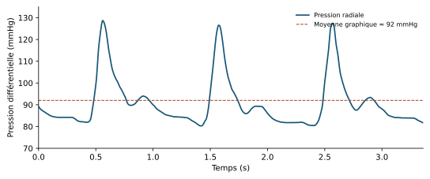
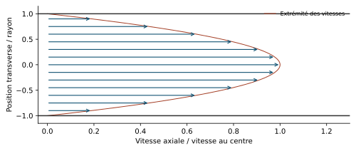
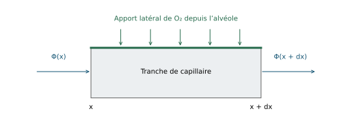
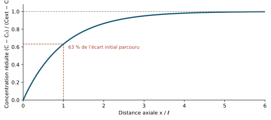

# Agro-Véto BCPST 2024 — Physique · Corrigé guidé

*Corrigé rédigé par IA, non officiel. Signalez toute erreur.*

**Lecture du rapport du jury** · GPT-6.2 Astra Ultra · vitesse non renseignée

**Rédaction** · GPT-6.2 Astra Ultra · vitesse non renseignée

## L’appareil cardiovasculaire

## I.A — Baromètre à mercure

### Question 1 — Équilibre hydrostatique

**Indication.** Orienter la verticale avant de placer les forces de pression sur les deux faces du volume choisi.

Isolons une tranche de fluide au repos de section horizontale $S$ et d'épaisseur $dz$. La pression inférieure exerce une force $P(z)S$ vers le haut, la pression supérieure une force $P(z+dz)S$ vers le bas. Les forces latérales n'ont pas de composante verticale et le poids vaut $\rho gS\,dz$. En référentiel terrestre supposé galiléen, $P(z)S-P(z+dz)S-\rho gS\,dz=0$, donc $dP/dz=-\rho g$ pour $z$ ascendant.

### Question 2 — Profil dans la colonne

**Indication.** Choisir le niveau de B comme origine et conserver une pression absolue.

La pression du mercure en $B$ est $P(0)=P_{\rm atm}$. À masse volumique $\rho_{\rm Hg}$ et pesanteur constantes, $P(z)=P_{\rm atm}-\rho_{\rm Hg}gz$ tant qu'on reste dans le liquide continu.

### Question 3 — Hauteur correspondant à une atmosphère

**Indication.** Convertir d'abord le bar en pascals. Une hauteur convertit une pression uniquement pour la masse volumique et la pesanteur choisies.

Au niveau $h$, $P(h)\simeq0$. Ainsi $h=P_{\rm atm}/(\rho_{\rm Hg} g)$. Avec $1{,}013\,10^5$ Pa, $13{,}6\,10^3\ {\rm kg\,m^{-3}}$ et $9{,}81\ {\rm m\,s^{-2}}$, on trouve $h=0{,}759$ m, soit environ 760 mm. Une différence de niveau de 1 mm de mercure représente ainsi environ $133{,}3$ Pa.

### Question 4 — Choix du liquide barométrique

**Indication.** Comparer à pression fixée les hauteurs calculées pour les deux liquides.

La même pression atmosphérique demanderait une colonne d'eau d'environ $1{,}013\,10^5/(10^3\times9{,}81)=10{,}3$ m si l'on néglige sa vapeur, contre 0,76 m de mercure. La forte densité du mercure rend l'instrument historique compact ; sa faible pression de vapeur rend l'approximation du vide plus précise.

### Question 5 — Tubes et capillarité

**Indication.** Repérer l'hypothèse utilisée lorsque la pression juste sous le ménisque est identifiée à celle du gaz.

Dans un tube fin, l'interface liquide–gaz est courbe ; sa tension superficielle crée un saut de pression dont l'ordre de grandeur varie comme $\gamma/r$ pour un rayon de tube $r$ et un angle de contact donné. Le niveau mesuré peut alors différer de celui du modèle hydrostatique à surfaces planes. Un diamètre suffisant réduit cette correction.

## I.B — Transducteur piézorésistif

### Question 6 — Diviseurs et différence de potentiel

**Indication.** Donner la même référence de potentiel aux deux branches avant de soustraire leurs tensions.

**a)** La mesure de tension est supposée ne prélever aucun courant. Prenons pour origine des potentiels le rail gauche de la figure 3 ; le rail droit est à $E$. Les deux diviseurs donnent les potentiels des points intermédiaires, orientés comme les flèches : $u_1=ER_1/(R_1+R_2)$ et $u_3=ER_3/(R_3+R)$.
**b)** La flèche de mesure va du point intermédiaire inférieur au supérieur, donc
$$u_{\rm mes}=u_1-u_3=E\left(\frac{R_1}{R_1+R_2}-\frac{R_3}{R_3+R}\right).$$
La résistance en bas à droite est bien le capteur $R$ sur le schéma.

### Question 7 — Équilibrage à la pression de référence

**Indication.** À l'équilibre du pont, les courants dans les branches peuvent rester non nuls.

À $P=P_{\rm atm}$, $R=R_0$. L'égalité des deux fractions de Q6 donne $R_1(R_3+R_0)=R_3(R_1+R_2)$, donc $R_1=R_2R_3/R_0$. Les deux nœuds ont alors le même potentiel.

### Question 8 — Linéarisation et sensibilité

**Indication.** Soustraire les deux fractions avant de négliger un terme dans le dénominateur. Une inégalité forte justifie le développement.

**a)** $R=R_0+\Delta R$ avec $\Delta R=R_0k\Delta P$. **b)** Le régime linéaire exige $|\Delta R|/R_0=|k\Delta P|\ll1$. **c)** En utilisant le réglage antérieur, la différence qui intervient dans Q6 vaut exactement
$$u_{\rm mes}=E R_3\left(\frac1{R_3+R_0}-\frac1{R_3+R_0+\Delta R}\right)
=\frac{E R_3\Delta R}{(R_3+R_0)(R_3+R_0+\Delta R)}.$$
Au premier ordre, $u_{\rm mes}\simeq S\Delta P$, où $S=ER_3R_0k/(R_3+R_0)^2$. En $\rm V\,Pa^{-1}$ si la pression est en pascals, $S$ donne la variation de tension par unité de variation de pression autour du réglage.

### Question 9 — Reconstruction du signal de pression

**Indication.** Distinguer étalonnage du zéro, conversion de la pente et variation temporelle.

Après réglage du zéro à la référence atmosphérique, un étalonnage électrique fixe $S$. Dans la plage linéaire, on enregistre la tension en fonction du temps puis on convertit par $\Delta P(t)=u_{\rm mes}(t)/S$. Le capteur et l'acquisition doivent suivre la fréquence cardiaque et ses harmoniques utiles. On reconstitue la pression absolue par $P=P_{\rm atm}+\Delta P$ si nécessaire.

## I.C — Mesures de pression artérielle

### Question 10 — Lecture de l'enregistrement radial

**Indication.** Lire plusieurs maxima pour estimer la période. Pour la moyenne, regarder l'aire du signal pendant deux périodes entières.

**a)** Sur la figure 5, les sommets se trouvent vers $127$ à $129$ mmHg et les creux vers $80$ à $82$ mmHg. La moyenne est temporelle : $\langle\Delta P\rangle=T^{-1}\int_0^T\Delta P(t)\,dt$. Une lecture d'aire sur deux cycles donne environ $92$ mmHg. Ce sont des pressions différentielles. Une addition en tête de la partie I.C est erronée : $760+120=880$ mmHg absolus.
**b)** Avec 128 et 80 mmHg, la formule clinique donne $(128+2\times80)/3=96$ mmHg. L'ordre de grandeur et la proximité de la valeur basse sont cohérents avec la courbe ; l'écart de quelques mmHg rappelle le caractère approché de la pondération. La diastole et la fin de la décroissance occupent une plus grande part du cycle que le pic systolique.
**c)** Les sommets surviennent à environ 0,56, 1,57 et 2,56 s. Deux intervalles couvrent 2,0 s, soit $f\simeq1{,}0$ Hz ou 60 battements/min. **d)** $V_1=D_V/f=5000/60\simeq83$ mL par battement avec les unités en minutes.
**e)** Le signal est approximativement périodique mais non sinusoïdal : sa série de Fourier contient une composante continue, la fondamentale proche de 1 Hz et des harmoniques aux multiples de cette fréquence. **f)** Un filtre passe-bas laissant passer la composante à fréquence nulle et dont la coupure est très inférieure à 1 Hz, par exemple 0,1 Hz, atténue les oscillations. Il faut considérer son régime établi sur plusieurs cycles.

## II.A — Écoulement dans un vaisseau

### Question 11 — Profil de Poiseuille

**Indication.** Distinguer la nullité de la variation du stock et la compensation des flux entrant et sortant dans le volume ouvert.

Choisissons comme volume de contrôle un cylindre coaxial fixe de rayon $r$ et de longueur $L$. Le régime est stationnaire : le stock de quantité de mouvement ne varie pas. Le profil est identique à l'entrée et à la sortie, donc les flux de quantité de mouvement se compensent. Il n'y a pas de flux à travers la face latérale et le poids a une projection axiale nulle. Le bilan axial devient
$$\pi r^2\Delta P+2\pi rL\eta_s\frac{dv}{dr}=0.$$
En intégrant avec l'adhérence à la paroi $v(d/2)=0$,
$$\mathbf v=\frac{\Delta P}{4\eta_sL}\left(\frac{d^2}{4}-r^2\right)\mathbf u_x.$$
Les flèches sont axiales, maximales au centre, nulles au bord ; leur extrémité dessine une parabole dans un plan méridien.

### Question 12 — Débit d'une section

**Indication.** La vitesse axiale est la même sur chaque anneau et non sur tout le disque.

La vitesse varie avec le rayon : il faut l'intégrer sur les anneaux de surface $2\pi r\,dr$. En posant $a=d/2$,
$$D_V=\int_0^a\frac{\Delta P}{4\eta_sL}(a^2-r^2)2\pi r\,dr
=\frac{\pi\Delta P\,a^4}{8\eta_sL}=\frac{\pi d^4\Delta P}{128\eta_sL}.$$
La vitesse moyenne est la moitié de la vitesse centrale.

### Question 13 — Résistance hydraulique

**Indication.** Relire la définition du rapport avant de prendre l'inverse de la conductance.

Par définition $\Delta P=R_hD_V$. De Q12 vient $R_h=128\eta_sL/(\pi d^4)$, en $\rm Pa\,s\,m^{-3}$. À longueur fixée, la résistance est très sensible au diamètre.

## II.B — Ensemble des vaisseaux

### Question 14 — Combien d'artérioles en parallèle ?

**Indication.** Choisir pour chacune des deux lignes du tableau le diamètre et la vitesse associés à ce même type de vaisseau.

Avec $d_a=20$ mm et $\bar v_a=0{,}265\ {\rm m\,s^{-1}}$, l'aorte débite $\bar v_a\pi d_a^2/4=8{,}33\,10^{-5}\ {\rm m^3\,s^{-1}}=5{,}0\ {\rm L\,min^{-1}}$. Une artériole type débite $0{,}028\times\pi(5{,}0\,10^{-5})^2/4=5{,}50\,10^{-11}\ {\rm m^3\,s^{-1}}$. Par conservation du débit en régime permanent, le rapport des débits donne $N\simeq1{,}5\,10^6$ artérioles identiques en parallèle dans ce modèle.

### Question 15 — Perte de charge artériolaire

**Indication.** Les branches en parallèle ont une perte de charge commune ; le débit global, lui, se partage.

Le débit d'une branche est $D_V/N$. Avec $\eta_s=1{,}6\,10^{-3}\ {\rm Pa\,s}$, $L=10^{-2}$ m et $d=5\,10^{-5}$ m,
$$\Delta P_{\rm art}=\frac{128\eta_s L}{\pi d^4}\frac{D_V}{N}\simeq5{,}8\,10^3\ {\rm Pa}\simeq43\ {\rm mmHg}.$$
Les pressions du tableau sont données à l'entrée des segments : il faut donc prendre $86-30=56$ mmHg de l'entrée des artérioles à celle des capillaires. L'écart est d'environ un quart de la valeur tabulée. Diamètres et longueurs dispersés, ramifications, compliance des parois, pulsations et écart au modèle newtonien limitent la prédiction ; le diamètre intervient à la puissance quatre.

## II.C — Énergie mécanique

### Question 16 — Puissance mécanique des deux pompes

**Indication.** Suivre le travail nécessaire pour faire passer le même volume d'une pression à l'autre, puis diviser par $dt$.

Pendant $dt$, le même volume $dV=D_Vdt$ entre dans la pompe et en sort. Le sang reçoit de son environnement aux sections respectives un travail de pression $P_{\rm entrée}dV-P_{\rm sortie}dV$. Pour compenser cette perte dans le bilan mécanique, à variations cinétique et gravitaire négligeables et dans le modèle de pompe idéal, le cœur fournit $(P_{\rm sortie}-P_{\rm entrée})dV$. Ainsi $\mathcal P=D_V\Delta P$.
Pour $D_V=8{,}33\,10^{-5}\ {\rm m^3s^{-1}}$ et $1\ {\rm mmHg}\simeq133{,}3$ Pa, $\mathcal P_g=(95)(133{,}3)D_V\simeq1{,}06$ W. Le cœur droit donne $\mathcal P_d=(25-3)(133{,}3)D_V\simeq0{,}244$ W. Il s'agit des puissances mécaniques transmises au sang.

### Question 17 — Différences entre les ventricules

**Indication.** Comparer les pressions à débit identique, sans compter deux fois le débit cardiaque.

Les deux circulations sont en série et ont en moyenne le même débit. Le ventricule gauche doit entretenir une élévation de pression d'environ 95 mmHg, contre 22 mmHg pour le droit. Sa charge mécanique et le travail de contraction requis sont plus grands, en accord avec une paroi musculaire plus développée.

### Question 18 — Travail mécanique quotidien

**Indication.** Additionner les deux puissances, puis convertir un jour en secondes.

À puissance constante dans l'approximation de repos, $W_{\rm cœur}=(\mathcal P_g+\mathcal P_d)\times86400\simeq1{,}12\,10^5$ J, soit $112$ kJ par jour.

### Question 19 — Coût énergétique à rendement donné

**Indication.** L'énergie consommée doit être supérieure au travail fourni lorsque le rendement est inférieur à un.

Le rendement de 0,20 est le travail mécanique divisé par l'énergie consommée. Ainsi $E_{\rm cons}=112/0{,}20\simeq560$ kJ $=5{,}6\,10^5$ J, soit $560/4{,}18\simeq134$ kcal/jour. Le rapport aux $2000$ kcal/jour pris comme repère dans l'énoncé est d'environ $6{,}7$ %. Le pompage au repos nécessite ainsi une fraction appréciable du budget énergétique dans ce modèle.

## III.A — Diffusion en régime stationnaire

### Question 20 — Dimension de la perméabilité

**Indication.** Distinguer le flux intégré sur une surface de la densité de flux.

La loi $d\Phi_{\rm lat}=h(C_{\rm ext}-C)\,dS_{\rm lat}$ met en jeu un débit molaire en $\rm mol\,s^{-1}$, une concentration en $\rm mol\,m^{-3}$ et une aire en $\rm m^2$. L'unité SI de $h$ est donc $\rm m\,s^{-1}$.

### Question 21 — Apport sur la moitié latérale du capillaire

**Indication.** Orienter les deux flux axiaux dans le même sens et distinguer la demi-surface latérale de l'aire d'une section.

Dans la tranche entre $x$ et $x+dx$, le bilan en régime stationnaire est $\Phi(x)-\Phi(x+dx)+h(C_{\rm ext}-C)\pi a\,dx=0$. Les deux premiers termes sont les flux axiaux et le troisième vient de l'alvéole sur la moitié de la surface cylindrique. Il suit
$$\frac{d\Phi}{dx}=\pi ah(C_{\rm ext}-C(x)).$$
La variation du flux axial mesure la source latérale.

### Question 22 — Loi de Fick pour le débit molaire axial

**Indication.** Le flux de la loi de Fick s'oppose à la croissance de concentration. L'orientation géométrique de l'axe est déjà fixée.

La densité de flux diffusif est $\mathbf j=-D_{\rm O_2}\nabla C$. La concentration ne dépendant que de $x$ et étant uniforme sur une section, $\Phi(x)=-D_{\rm O_2}\pi a^2\,dC/dx$. En comparant $\rm mol\,m^{-2}s^{-1}$ à $\rm mol\,m^{-4}$, on obtient pour $D_{\rm O_2}$ l'unité $\rm m^2s^{-1}$. Le signe de $\Phi$ est négatif si $C$ augmente le long de $x$ ; le modèle exclut ici le transport axial par le sang en mouvement.

### Question 23 — Longueur d'équilibration

**Indication.** Combiner une source proportionnelle à l'écart de concentration avec la dérivée du flux diffusif.

En dérivant Q22 puis en utilisant Q21 et en divisant par la section,
$$C''-\frac{C-C_{\rm ext}}{\ell^2}=0,\qquad \ell=\sqrt{\frac{D_{\rm O_2}a}{h}}.$$
Avec $1{,}7\,10^{-7}\ {\rm m^2s^{-1}}$, $4{,}0\,10^{-6}$ m et $66\,10^{-6}\ {\rm m\,s^{-1}}$, $\ell\simeq1{,}0\,10^{-4}$ m $=0{,}10$ mm. Elle mesure la distance axiale nécessaire pour que l'écart à la concentration alvéolaire diminue d'un facteur $e$ dans le modèle semi-infini.

### Question 24 — Profil dans un capillaire long

**Indication.** Employer d'abord le comportement à grande distance, puis la donnée en entrée. Ne pas confondre la constante notée C avec le champ de concentration.

**a)** $L/\ell\simeq10$. Un écart qui décroît en $e^{-x/\ell}$ est réduit à environ $5\,10^{-5}$ de sa valeur initiale à la sortie ; l'approximation d'un capillaire semi-infini convient. **b)** La solution particulière constante impose $A=C_{\rm ext}$. Le terme en $e^{x/\ell}$ doit rester borné à l'infini, donc sa constante $C$ est nulle. À l'entrée, $B=C_1-C_{\rm ext}$.
**c)** La concentration vaut $C_{\rm O_2}(x)=C_{\rm ext}-(C_{\rm ext}-C_1)e^{-x/\ell}$. Elle croît, est concave, tend vers $C_{\rm ext}$ et a parcouru $1-e^{-1}\simeq63$ % de l'écart à $x=\ell$.

### Question 25 — Apport total pour un capillaire

**Indication.** La force motrice de la diffusion latérale varie avec $x$. Il faut l'intégrer le long du capillaire.

Sommons les apports sur la moitié supérieure de la paroi :
$$\Phi_{\rm lat,1}=\int_0^\infty\pi ah(C_{\rm ext}-C_1)e^{-x/\ell}\,dx
=\pi ah\ell(C_{\rm ext}-C_1).$$
Intégrer seulement jusqu'à $L$ dans cette solution approchée ajouterait le facteur $1-e^{-L/\ell}$, pratiquement égal à un.

## III.B — Consommation de dioxygène

### Question 26 — Volume molaire du gaz

**Indication.** Employer kelvins et pascals dans l'équation des gaz parfaits.

Pour un gaz parfait, $V_m=RT/P$. À $298{,}15$ K et $1{,}013\,10^5$ Pa, $V_m=8{,}314\times298{,}15/(1{,}013\,10^5)=2{,}45\,10^{-2}\ {\rm m^3\,mol^{-1}}$, soit $24{,}5\ {\rm L\,mol^{-1}}$.

### Question 27 — Transfert de dioxygène pour les deux poumons

**Indication.** Garder les pressions en mmHg puisque le coefficient de Henry les accepte ainsi. Transformer le résultat molaire en volume de gaz.

Dans les unités du coefficient de Henry, $\Delta C=\sigma(100-40)=0{,}102\ {\rm mol\,m^{-3}}$. Pour $N=20\,10^9$ capillaires, Q25 donne $\Phi_{\rm lat,N}=N\pi ah\ell\Delta C\simeq1{,}72\,10^{-4}\ {\rm mol\,s^{-1}}$. En multipliant par $V_m$ puis par 60, le volume gazeux équivalent est $V_{\rm O_2}\simeq0{,}25\ {\rm L\,min^{-1}}$ aux conditions de Q26.

### Question 28 — Comparaison au repère physiologique

**Indication.** Comparer à la fois les unités, l'ordre de grandeur et l'écart relatif, puis revenir aux simplifications explicites de l'énoncé.

Le modèle prévoit environ $0{,}25$ L/min face aux $0{,}2$ L/min cités au repos, soit le même ordre de grandeur et une surestimation d'environ un quart. Une géométrie uniforme, un nombre indicatif de capillaires actifs et l'omission du transport convectif et de la fixation sur l'hémoglobine empêchent une prédiction individuelle précise. L'accord quantitatif approximatif valide une échelle, sans isoler chaque hypothèse du modèle.
