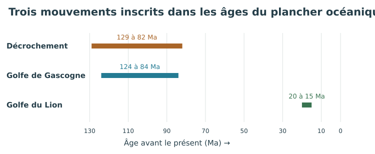
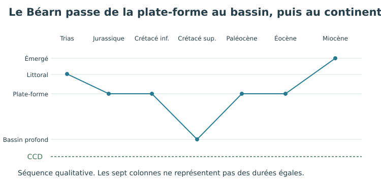
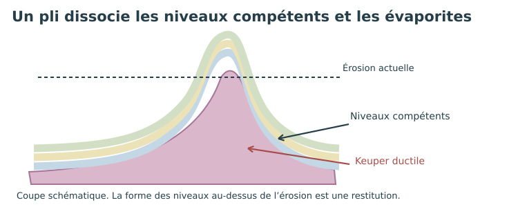
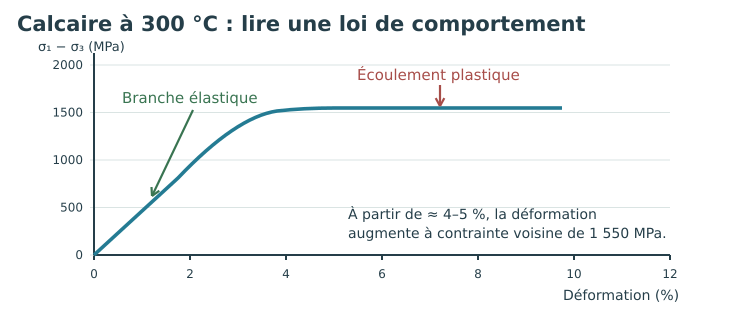
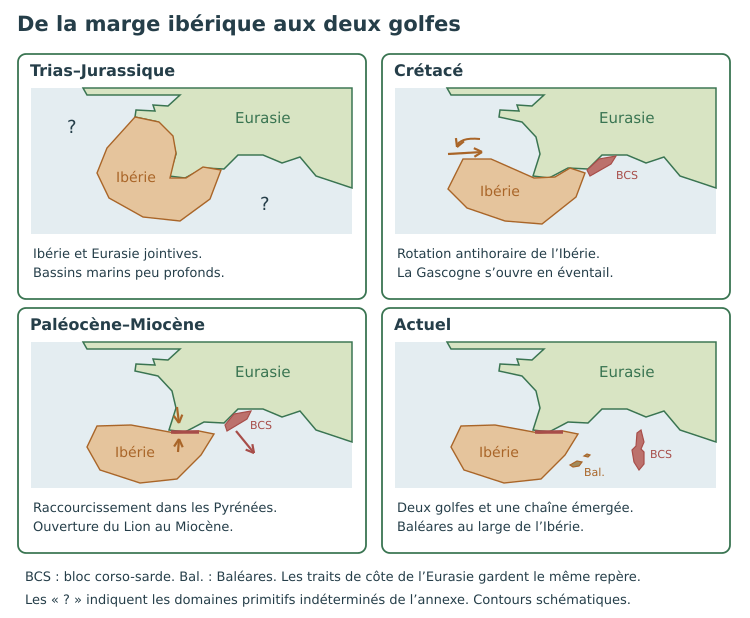
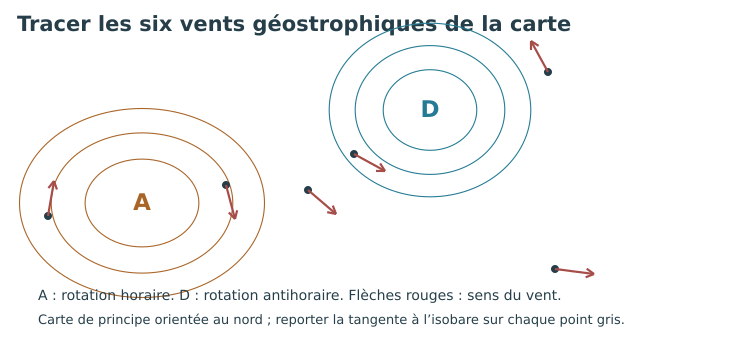
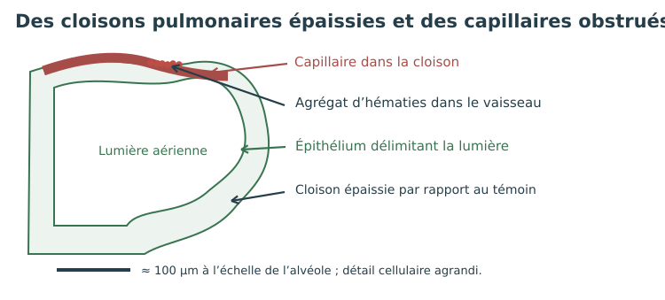

# Agro-Véto — BCPST, SVT 2024 · Corrigé brut

*Corrigé rédigé par IA, non officiel.*

**Rédaction (tour 1)** · GPT-6.2 Astra Ultra · vitesse non renseignée

**Révision (tour 2)** · GPT-6.2 Astra Ultra · vitesse non renseignée

Les 18 questions de géologie et les neuf questions ou sous-questions des thèmes biologiques 1 et 2 sont traitées. En biologie, les thèmes 3 et 4, portant sur l’infection cellulaire et la purification d’une protéine virale (B6 à B11), sont hors couverture. Le préfixe G désigne le cahier de géologie et le préfixe B le cahier de biologie.

## Géologie — Reconstitution de la formation des Pyrénées

### Question G1 — Ouverture de l’Atlantique de part et d’autre de l’Ibérie

Les plus vieilles bandes colorées au contact de la marge donnent le début de l’accrétion océanique reconnue. On lit environ 105–110 Ma au large de l’Irlande et 125–130 Ma au sud de l’Ibérie. La bande grise peut comprendre une croûte continentale très amincie et ne date pas directement le premier plancher océanique. Avec la barre de 500 km, sur le flanc européen et jusqu’à 80 Ma, on lit environ 60–110 km au nord en 25–30 Ma, soit 0,2–0,4 cm/an, contre environ 350–450 km selon la latitude au sud en 45–50 Ma, soit 0,7–1,0 cm/an. Les chiffres varient avec la ligne de mesure. Ce sont des vitesses de demi-ouverture ; les vitesses d’écartement complet seraient approximativement doubles en accrétion symétrique. L’accrétion plus précoce et plus rapide face à l’Ibérie a déplacé cette dernière vers l’est relativement à l’Eurasie, en accord avec un décrochement sénestre le long de leur limite.

### Question G2 — Rejet et période du décrochement

Le rejet est le décalage horizontal cumulé entre les deux blocs. La différence entre les bandes d’accrétion produites au nord et au sud, lue sur la carte à une échelle de 500 km, est de l’ordre de quelques centaines de kilomètres, environ 300–400 km dans la construction de G1. C’est un ordre de grandeur projeté, sensible au choix des profils et à la rotation de l’Ibérie. Le jeu est surtout documenté au Crétacé, entre le début de l’ouverture ibérique vers 125–130 Ma et l’établissement d’une accrétion plus comparable vers 84–80 Ma. L’intervalle durant lequel le flanc ibérique est actif avant le flanc irlandais, vers 130–105 Ma, contribue fortement au décalage. Sur la frise, on distingue cette phase principale de la durée plus large du mouvement.

### Question G3 — Ouverture en éventail du golfe de Gascogne

Les isochrones de même âge s’écartent nettement plus à l’ouest qu’à l’est. À titre de lecture sur des profils nord–sud, la largeur totale entre les deux bords du plancher crétacé est de l’ordre de 400–500 km à l’ouest et de 100–200 km vers l’extrémité orientale. Sur environ 40 Ma, cela représente quelque 1–1,25 cm/an contre environ 0,25–0,5 cm/an, sur les deux flancs réunis. L’ouverture diminue vers un pivot oriental. L’Ibérie a tourné dans le sens antihoraire par rapport à l’Eurasie fixe. La convergence associée du côté pyrénéen a varié avec la position par rapport au pivot et a contribué à l’orientation et à la forme du relief. La rotation en éventail s’oppose à une simple translation uniforme.

### Question G4 — Deux golfes ouverts à des époques distinctes

Le golfe de Gascogne porte des isochrones d’environ 124 à 84 Ma. Dans le golfe du Lion, les bandes orangées proches du repère 20 Ma sont cénozoïques, de l’ordre de 20 à 15 Ma pour le plancher clairement océanique de la carte. L’extension des marges peut avoir commencé avant le plancher océanique daté. On reporte ces deux intervalles séparément sur la frise. Avant cette seconde ouverture, le bloc corso-sarde se trouvait plus à l’ouest, contre la marge provençale et son prolongement vers le nord-est de l’Ibérie. Pour le restaurer, il faut le rapprocher du continent en annulant aussi sa rotation antihoraire. Les reliefs pyrénéens et provençaux appartenaient au même ensemble orogénique ; leur continuité a été rompue par l’extension ultérieure.

### Question G5 — Comment un gravimètre absolu mesure la pesanteur

Dans un référentiel terrestre considéré localement galiléen, la deuxième loi de Newton donne $\sum\vec F=m\vec a$. Un faisceau laser de longueur d’onde connue revient du miroir mobile et interfère avec le faisceau de référence. Quand le miroir descend de $\lambda/2$, l’aller-retour s’allonge de $\lambda$ et l’interférence retrouve la même phase. Le comptage des franges avec des temps connus donne la position relative $z(t)$. Le coefficient quadratique de l’ajustement $z=z_0+v_0t+at^2/2$ donne l’accélération. Sous vide et en chute libre, le poids est la force dominante. Avec l’axe vertical orienté vers le bas, $a=g$.

### Question G6 — Anomalies gravimétriques sous la chaîne et les golfes

On compare la pesanteur observée à une référence dépendant notamment de la latitude. La réduction à l’air libre corrige l’effet géométrique de l’altitude, sans enlever l’attraction des reliefs. En zone 1, l’axe pyrénéen élevé montre une anomalie à l’air libre positive, localement de l’ordre de $10^2$ mGal, liée aux masses du relief. La correction de Bouguer retranche en plus l’attraction estimée des masses topographiques, avec correction de terrain et traitement de l’eau en mer. Sous la chaîne, l’anomalie de Bouguer devient négative : une racine de croûte plus légère remplace du manteau dense. En zone 2, elle devient positive à l’approche de la marge amincie du golfe du Lion. En zone 3, elle est fortement positive au large dans les deux golfes, où le manteau est plus proche de la surface sous une croûte mince. L’anomalie positive locale de la zone 4, au nord des reliefs, est compatible avec un corps dense peu profond, par exemple une remontée de matériel mantellique. La gravimétrie seule ne fixe ni sa forme ni sa composition.

### Question G7 — Milieux de sédimentation du Béarn

Les évaporites triasiques correspondent à un bassin restreint, en climat aride, où les pertes d’eau par évaporation dépassent les apports et concentrent les sels. Les exogyres du Jurassique, comparables à des huîtres, indiquent une mer peu profonde. Les rudistes du Crétacé inférieur sont compatibles avec un récif de plate-forme carbonatée peu profonde. Les alvéolines de l’Éocène témoignent également d’une plate-forme marine, chaude et relativement peu profonde. Les molasses miocènes présentent des éléments détritiques grossiers et renferment feuilles et racines. Elles traduisent des dépôts continentaux issus de l’érosion des reliefs, par exemple dans un réseau alluvial. Les documents justifient des domaines de profondeur, sans permettre de fixer un nombre de mètres unique pour chaque calcaire.

### Question G8 — Courants de turbidité et préservation du carbonate

Les bancs de grès présentent une base grossière puis un granoclassement normal vers le haut. À mesure que le courant de turbidité perd de sa vitesse, les gros grains se déposent avant les plus fins. Des niveaux marneux séparent ces dépôts événementiels, témoignant d’une sédimentation fine dans un milieu généralement calme en profondeur. La profondeur de compensation des carbonates (CCD) est celle où les apports de carbonate sont compensés par sa dissolution ; au-dessous, il ne s’accumule habituellement pas durablement dans un dépôt pélagique. La présence de marnes et de grès calcaires rend donc plausible un dépôt en bassin profond au pied du talus, mais au-dessus de la CCD locale, de l’ordre de plusieurs kilomètres dans l’océan actuel. Le transport rapide d’un matériel carbonaté sur la pente limite la précision de cet indicateur.

### Question G9 — Construire la courbe qualitative de profondeur

La frise place les évaporites du Trias à très faible profondeur près du niveau marin, le Jurassique et le Crétacé inférieur sur une plate-forme, les flyschs du Crétacé supérieur en bassin profond au-dessus de la CCD, le Paléocène et l’Éocène de nouveau sur une plate-forme, puis au Miocène les molasses en milieu continental émergé. Elle décrit donc d’abord un approfondissement suivi d’une remontée de la surface de dépôt et d’une émersion. Les limites dessinées entre les milieux sont approximatives.

### Question G10 — Basalte en coussins et relations de superposition

La lame montre des cristaux de pyroxène et de plagioclase dans une pâte sombre riche en microlites. Le refroidissement rapide d’une partie du liquide a produit une roche volcanique basaltique. Les lobes arrondis, empilés et limités par un bord marqué à l’échelle décimétrique, sont des coussins. Ils se forment lors de l’émission sous l’eau d’une lave dont la surface fige rapidement. Les bandes volcaniques de la carte détaillée s’intercalent dans les séries marno-flyschs albiennes–cénomaniennes et cénomaniennes. Une coulée recouvre les couches plus anciennes et est recouverte de couches postérieures. La superposition la situe donc autour de la limite Crétacé inférieur–supérieur, dans l’ensemble Albien–Cénomanien, environ 110–94 Ma pour cette fourchette large. Le Miocène en surface constitue une couverture ultérieure.

### Question G11 — Contexte du magmatisme alcalin

Sur l’annexe, les affleurements rouges se répartissent dans les séries du Crétacé inférieur et du Crétacé supérieur. On prolonge donc la barre de magmatisme de la fin du Crétacé inférieur dans le Crétacé supérieur, en marquant l’intervalle Albien–Cénomanien établi plus finement en G10. La carte simplifiée n’horodate pas chaque émission. Un magmatisme alcalin peut accompagner un rift intraplaque ou un point chaud, par fusion partielle de faible degré. Ici, la contemporanéité avec l’ouverture du golfe de Gascogne, le milieu marin et l’amincissement lithosphérique rendent l’extension régionale particulièrement vraisemblable.

### Question G12 — Anticlinal et comportement des évaporites

À 300 °C, le calcaire présente d’abord une branche approximativement linéaire, élastique, puis un changement de pente suivi d’une déformation plastique à contrainte proche de 1,5 GPa. À 25 °C la résistance atteint un maximum plus élevé, autour de 2 GPa, puis baisse, ce qui favorise un comportement plus fragile. Sur la carte, le cœur montre des terrains anciens, du Trias et du Lias, encadrés par des terrains jurassiques puis crétacés plus jeunes. Les pendages divergent vers les deux flancs. L’ensemble définit un anticlinal érodé, dont les couches ne sont pas horizontales. Le Keuper riche en évaporites est épaissi au cœur de la coupe et aminci sous les flancs. Les courbes du gypse indiquent une déformation importante sous quelques dizaines de MPa ou moins, très en dessous des contraintes des calcaires. Un fluage du niveau évaporitique peut donc accommoder le plissement et un décollement, tandis que les bancs plus compétents peuvent se fracturer. La géométrie des couches et les accidents visibles guident les failles restituées dans la partie aujourd’hui érodée, qui demeurent une interprétation.

### Question G13 — Encadrer l’épisode compressif

Les terrains crétacés du chaînon sont plissés. Au nord, des couches plus récentes, jusqu’aux calcaires et grès du Paléocène–Éocène inférieur (Selandien–Yprésien), participent à la structure. Une molasse du Miocène supérieur repose en discordance sur plusieurs formations anciennes et les recouvre. La déformation observée est donc postérieure au dépôt des couches paléogènes affectées et antérieure à la couverture miocène qui la scelle localement. Pour la frise, on encadre l’épisode principal entre l’Éocène et le Miocène supérieur, sans en déduire qu’il a duré en continu pendant tout cet intervalle.

### Question G14 — Reconstruire la paléogéographie

Le schéma met en série les indices accessibles dans les documents. Au Trias–Jurassique, les deux ensembles continentaux portent des bassins peu profonds près du futur Béarn. Au Crétacé, l’Atlantique et la Gascogne s’ouvrent, l’Ibérie se déplace vers l’est et tourne dans le sens antihoraire. Amincissement, volcanisme marin puis flyschs profonds accompagnent cette évolution. Au Paléogène et jusqu’au Miocène, la convergence plisse la couverture et épaissit la croûte, puis les molasses s’accumulent sur les terrains déformés. L’ouverture plus récente du golfe du Lion sépare le bloc corso-sarde de la marge provençale. La position de ce bloc est restaurée avant cette ouverture dans les deux cases intermédiaires. Le schéma n’attribue pas d’âge ou de déplacement non résolu aux Baléares.

## Géologie — Reliefs, drainage et météorologie

### Question G15 — Deux profils de vallée

Dans la vallée d’Aspe, le profil présente un fond étroit et pointu vers 430 m, entre des versants qui remontent jusqu’à environ 1 000 m. Ce profil transversal en V traduit une incision fluviale dominante. La vallée d’Ossau montre un fond large sur plusieurs centaines de mètres vers 450 m, et des versants formant une auge en U. Abrasion et arrachement par un glacier ont élargi et surcreusé la vallée. Les cours d’eau actuels peuvent ensuite remanier les deux fonds.

### Question G16 — Déviation du gave d’Ossau au Quaternaire

La large vallée septentrionale dessine un chenal continu, aujourd’hui disproportionné au regard de son drainage, et contient des alluvions anciennes, pléistocènes puis würmiennes. Son profil longitudinal décroît de plus de 400 à environ 200 m. Un cours d’eau important l’occupait. Le cours actuel du gave d’Ossau rejoint plus au sud-ouest le gave d’Aspe, en empruntant un tronçon plus encaissé à ruptures de pente et dépôts plus récents. À la sortie du tronçon amont, la répartition des dépôts glaciaires dessine une moraine barrant la voie ancienne. L’obstacle a pu dévier les écoulements vers un autre exutoire, qui s’est ensuite incisé. Il s’agit d’une capture ou déviation du drainage associée à la dernière glaciation, le Würm, au Pléistocène récent. La carte ne date pas précisément le jour ni le millénaire du basculement.

### Question G17 — Vents sur la carte de pression

A, autour de 1 030 hPa sur l’Atlantique subtropical, est un anticyclone. D, au voisinage des îles Britanniques, est une dépression. À l’équilibre géostrophique, gradient de pression horizontal et force de Coriolis s’équilibrent. Les vents sont tangents aux isobares, dans le sens horaire autour de A et antihoraire autour de D. Sur la planche, la flèche à l’ouest de A monte vers le nord, celle à sa droite descend vers le sud ou le sud-est. Les deux points au sud-ouest de D indiquent un flux vers le sud-est ou l’est-sud-est. Au nord-est de D, le flux remonte vers le nord-ouest, tandis que sur son bord méridional, vers la Méditerranée, il va vers l’est. La construction est représentée ci-dessous avec les six points de l’annexe.

### Question G18 — Précipitations et températures de part et d’autre de la chaîne

À Oloron (200 m), de nombreux mois dépassent 100 mm de pluie, avec environ 135–140 mm en avril et en novembre. À Jaca (800 m), les maxima du graphique sont plutôt proches de 80–90 mm et les mois d’été descendent vers 40 mm. Oloron est plus douce en hiver (environ 7 °C en janvier contre 4 °C) et présente une amplitude annuelle moindre. Les deux moyennes estivales sont voisines de 20–22 °C. Dans la situation synoptique représentée, l’air humide arrive de l’Atlantique sur le versant d’Oloron. En s’élevant, il se détend, se refroidit et peut atteindre la saturation, ce qui favorise condensation et précipitations. L’air redescendant sous le vent vers Jaca se comprime, se réchauffe et s’assèche, produisant une ombre pluviométrique. La moindre influence océanique et l’altitude supérieure de Jaca contribuent au contraste des températures. Une carte instantanée illustre ce mécanisme sans résumer toutes les situations annuelles.

## Biologie — Carbone atmosphérique

### Question B1.1 — Décrire une anomalie de concentration

En avril 2020, les anomalies de la concentration troposphérique en CO₂ sont le plus souvent négatives sur les régions documentées de l’hémisphère Nord, avec de larges plages de l’ordre de −0,2 à −0,5 ppm. En mai, plusieurs noyaux bleus sont plus intenses, notamment sur des secteurs d’Amérique du Nord et d’Eurasie, approchant localement −1 ppm. D’autres secteurs restent proches de zéro ou légèrement positifs. L’anomalie exprime l’écart à une trajectoire de référence pour le même lieu et la même saison. Une concentration inférieure au scénario peut encore augmenter dans l’absolu.

### Question B1.2 — Identifier les réservoirs et les flux de carbone

Les restrictions touchant transports et activité économique ont pu réduire la combustion de carburants fossiles. Le flux de carbone du réservoir géologique fossile (charbon, pétrole, gaz) vers l’atmosphère sous forme de CO₂ s’est alors trouvé inférieur à celui prévu dans le scénario sans restrictions. La baisse relative d’apport peut expliquer une partie des anomalies négatives. Les échanges avec la biosphère et l’océan et le transport atmosphérique continuent en parallèle, si bien qu’une carte de concentrations n’est pas directement une carte d’émissions.

### Question B2.1 — Tester les limites de l’attribution

Dans la région de l’océan Indien, des anomalies négatives et positives existent déjà en janvier et février 2020, avant les restrictions considérées. En février, on observe localement un bleu proche de −1 ppm sur l’Afrique australe et de fortes anomalies positives sur l’Australie, de l’ordre de +0,5 à +1 ppm. Une différence entre mesure et scénario a donc aussi d’autres causes. Les dates et régions différentes empêchent d’utiliser ces cartes comme témoins strictement appariés, mais elles limitent une attribution exclusive au confinement.

### Question B2.2 — Expliquer un écart local

Les grands incendies de végétation en Australie au cours de l’été austral 2019–2020 pourraient contribuer aux anomalies positives au-dessus de l’Australie en février. La combustion transfère du carbone de la biomasse vers l’atmosphère. Une attribution demanderait de croiser cartes de surface brûlée, vents et observations de CO₂. La carte d’anomalies seule ne permet pas de séparer feu, transport ou différence d’absorption végétale.

## Biologie — Lecture clinique des images pulmonaires

### Question B3 — Schématiser une alvéole pathologique

Sur le cliché témoin, les lumières aériennes sont largement ouvertes et les cloisons alvéolaires fines. Sur les coupes pathologiques, les cloisons sont épaissies ou encombrées, avec des agrégats d’hématies immobilisées dans le compartiment vasculaire. Des cellules immunitaires sont repérables sur le détail coloré. L’épithélium alvéolaire et l’endothélium capillaire délimitent deux lumières distinctes. L’atteinte de la perfusion et l’augmentation de la distance de diffusion peuvent compromettre les échanges gazeux. Le schéma explique l’anomalie tissulaire aux échelles données par les barres de 100 puis 5 µm. Le dernier cliché rapporte aussi des particules repérées dans la légende, sans que leur aspect isolé permette une quantification.

### Question B4.1 — Décrire les artérioles

Dans le groupe pathologique, les segments artériolaires rouges paraissent irréguliers, avec rétrécissements et interruptions apparentes. Le témoin présente des trajets de calibre plus régulier et un réseau plus continu. Les conduits bleus représentent les voies aériennes.

### Question B4.2 — Relier les agrégats à la perfusion

Des agrégats d’hématies et des thromboses peuvent freiner ou interrompre la microcirculation. Une perfusion insuffisante et des lésions vasculaires locales peuvent contribuer à l’aspect irrégulier ou appauvri du réseau artériolaire. Cette relation est compatible avec les deux images. Des observations post mortem transversales ne suffisent pas à établir le sens causal ni à prouver que toutes les branches ont été atteintes par le même mécanisme.

### Question B5.1 — Contrôler les facteurs de confusion

L’échantillon ne comprend que sept personnes, âgées de 66 à 96 ans, toutes décédées. Quatre avaient fumé et quatre présentaient une thrombose artérielle pulmonaire. Six avaient un IMC supérieur à 25, dont deux supérieur à 30. Trois avaient un diabète de type II. Les deux patients ventilés (4 et 5) avaient aussi fumé et présentaient tous deux une thrombose. Ces caractères se recouvrent chez les mêmes individus, ce qui rend leur contribution respective difficile à isoler. Le tableau indique aussi de l’hypertension et des traitements associés. Âge, tabac ou facteurs vasculaires peuvent modifier les poumons indépendamment ou conjointement. Les thromboses sont particulièrement pertinentes pour interpréter les anomalies artériolaires. Les observations portent ainsi sur des cas graves, avec des profils hétérogènes et des données limitées sur la comparabilité des témoins.

### Question B5.2 — Renforcer la comparaison clinique

Élargir le nombre de cas et de témoins, puis apparier ou stratifier sur l’âge, le tabagisme, les antécédents vasculaires et l’assistance respiratoire. Inclure des témoins ayant eu une autre affection respiratoire grave aiderait à distinguer ce qui est commun aux lésions de réanimation. Standardiser les régions pulmonaires observées et le délai post mortem, faire coter à l’aveugle plusieurs champs par patient et quantifier la fréquence des occlusions. L’unité statistique doit rester le patient lorsque plusieurs images proviennent du même poumon. Des données cliniques longitudinales permettraient enfin de comparer le moment des troubles circulatoires et leur gravité.
