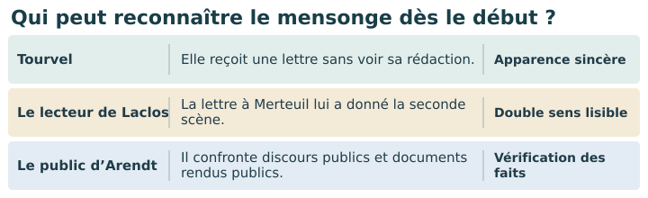

# Banque PT — Français B 2024 · Corrigé brut

*Corrigé rédigé par IA, non officiel. Signalez toute erreur.*

**Rédaction** · GPT-6.2 Astra Ultra · vitesse non renseignée

[Énoncé officiel](https://www.banquept.fr/documents/2024/fr_b_2024_pt.pdf) · [Rapport du jury](https://www.banquept.fr/documents/ecrit/rapport/2024/rapport_fra_b_ecrit_2024.pdf) · [Programme officiel](https://www.education.gouv.fr/bo/2023/Hebdo28/ESRS2317934A)

Épreuve de quatre heures sur « Faire croire ». Hannah Arendt, « Du mensonge en politique » et « Vérité et politique » · Alfred de Musset, Lorenzaccio · Choderlos de Laclos, Les Liaisons dangereuses.

David Fonseca, « Politique du mensonge. Les “vérités” du mensonge en politique », Droits, 2013/2, nº 58, p. 235–264. Le passage va de la difficulté d’expliquer le mensonge politique (p. 2) à l’urgence de le condamner en démocratie (p. 4). Le feuillet donne les deux questions p. 4.

Texte de 1417 mots selon le sujet. Résumé de 200 mots à 10 % près (180 à 220), 8 points. Dissertation, 12 points.

## Résumé

D’où vient cette autorité exceptionnelle du mensonge politique ? En chercher les mobiles ou en dresser le procès laisse intacte une présence silencieuse dont le secret échappe à nos explications.

Le mensonge suscite la réprobation parce que rien ne le distingue initialement du vrai. Les visages savent garder leur secret. La parole qui abuse une fois de notre confiance compromet même la crédibilité des vérités futures. Comment les hommes pourraient-ils encore vivre ensemble ? Mentir exige précisément une parole adressée à autrui. Le silence en est exclu, de même que la simple méprise. Le menteur connaît le fait, choisit de le déformer et sait donner à son invention un air de sincérité.

Pourtant la littérature nous fait goûter la victoire provisoire du trompeur sur ses dupes et sur des circonstances hostiles. Le spectateur épargné admire une virtuosité apparentée au talent du créateur. Cette liberté de concevoir une autre réalité éclaire aussi, chez Arendt, la parenté entre mensonge et initiative politique. Affirmer un fait engage envers le passé, imaginer le monde autrement ouvre un avenir et rend possible une action. Cette puissance des mots rend la vigilance particulièrement urgente dans une démocratie, puisque la vie publique y repose sur la parole.

*200 mots.*

## Dissertation

Les œuvres confirment-elles que le mensonge, défini comme un « vouloir faire croire », échappe toujours au regard dans un premier temps ?

Un lecteur des *Liaisons dangereuses* peut admirer une lettre de Valmont destinée à Tourvel tout en redoutant ce qu’elle lui fera croire. Le même mensonge apparaît comme tel au lecteur et reste, pour la destinataire, une déclaration vraisemblable. David Fonseca qualifie le mensonge de volonté de faire croire et situe son invisibilité au premier moment de la rencontre. Est-ce une propriété de tout mensonge ou une condition de sa réussite auprès de quelqu’un ? Les œuvres nous invitent à suivre la distribution inégale des indices et à nous demander ce qui arrive à une parole trompeuse quand elle devient reconnaissable.

Pour persuader, un mensonge doit d’abord se présenter sous l’aspect d’une parole que son auteur pourrait soutenir sincèrement. Laclos fait de cette ressemblance le principe d’une expérience de lecture. Valmont rédige auprès d’Émilie une lettre à Tourvel dont chaque expression d’émotion physique s’accorde avec la situation réelle et suggère pourtant à la présidente une tout autre cause. La syntaxe ne porte aucune marque de la fausseté du sentiment allégué. Dans *Lorenzaccio*, la faiblesse ostensiblement manifestée devant l’épée accrédite l’image d’un favori inoffensif. Alexandre voit un geste et croit y lire une nature. Dans les deux cas, l’artifice réussit en empruntant un signe que l’on sait ordinairement interpréter.

Mais le mot « toujours » exige une épreuve plus rigoureuse. Le lecteur de Laclos a lu la lettre où Valmont annonce à Merteuil les circonstances de sa rédaction. Loin d’être d’abord trompé puis détrompé, il repère le double sens dès les premiers mots. Il demeure pourtant le témoin d’une tentative de tromper Tourvel. Le défaut de visibilité n’appartient donc pas à l’énoncé en lui-même. La scène de Musset l’établit autrement. Le cardinal Cibo, soupçonneux, n’accorde pas à la réputation de lâcheté de Lorenzo la valeur de preuve qu’y attache Alexandre. Il suffit que le même signe admette un autre mobile pour que la tromperie soit soupçonnable avant même d’être prouvée. Soupçonner l’intention ne signifie certes pas posséder déjà la preuve des faits.

Du reste, une version officielle peut continuer à produire des effets quand des témoins en ont déjà aperçu les failles. Arendt relève, à propos du Vietnam, l’écart entre les informations dont disposaient les administrations et l’image que leurs responsables travaillaient à maintenir. Les observations qui contrarient la démonstration sont parfois connues de ceux-là mêmes qui la diffusent. L’efficacité politique se déplace alors. On peut échouer à convaincre un enquêteur et conserver malgré tout la maîtrise des déclarations publiques. Pire, la répétition peut rendre indisponibles les repères communs qui permettraient aux autres de trancher. La parution des documents du Pentagone intéresse précisément Arendt parce qu’elle donne à des lecteurs la possibilité de confronter des versions jusqu’alors séparées.

L’invisibilité première définit donc exactement l’expérience de celui qui prend le mensonge pour vrai. Elle cesse d’être une nécessité si l’on considère la volonté de tromper, qui subsiste jusque dans une manœuvre maladroite, ou si l’on considère le tiers qui en a surpris les préparatifs. Laclos, Musset et Arendt donnent à leurs lecteurs cette place exigeante. Voir comment une tromperie se construit oblige encore à comprendre pourquoi elle réussit ailleurs.
