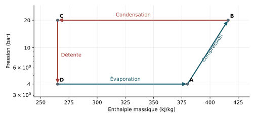
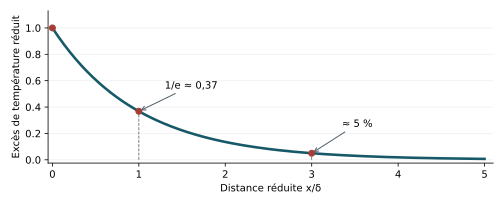
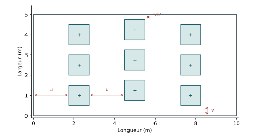

# Banque PT — Informatique et modélisation 2024 · Corrigé brut

*Corrigé rédigé par IA, non officiel. Signalez toute erreur.*

**Rédaction** · GPT-6.2 Astra Ultra · vitesse non renseignée · 26 novembre 2026

**Révision** · GPT-6.2 Astra Ultra · vitesse non renseignée · 26 novembre 2026

Épreuve de quatre heures, sans calculatrice. Le sujet porte sur la température et la filtration de l’air en salle de fabrication de batteries. Le jury indique environ 40 % pour la modélisation et 60 % pour l’informatique.

[Sujet officiel et diagramme du R404A](https://www.banquept.fr/documents/2024/info_mod_2024_pt.pdf) · [Rapport du jury](https://www.banquept.fr/documents/ecrit/rapport/2024/rapport_info_model_ecrit_2024.pdf)

## Bilans du climatiseur

### Q1 — Énergie et entropie sur un cycle

Le système est le fluide de la machine. Le travail $W$ et la chaleur $Q$ sont positifs quand le fluide les reçoit. Pour le thermostat à la température absolue $T$, les deux principes donnent
$$
\Delta U=W+Q,\qquad \Delta S=\frac{Q}{T}+S_{\rm créée},\qquad S_{\rm créée}\geq0.
$$
Au retour à l'état initial, les fonctions d'état reprennent leur valeur. Ainsi $W+Q=0$ et $Q/T+S_{\rm créée}=0$.

### Q2 — Signes des échanges

La température absolue est positive. Le second bilan impose $Q=-T S_{\rm créée}\leq 0$. Le premier impose alors $W=T S_{\rm créée}\geq0$. L'égalité correspond à un cycle réversible monotherme, sans échange net.

### Q3 — Possibilité d'un climatiseur monotherme

Pour refroidir la pièce, il faudrait que le transfert reçu par la pièce soit négatif, donc que le fluide en retire une chaleur $Q>0$ par cycle. La question précédente impose $Q\leq0$. Un climatiseur cyclique avec cette unique source est impossible.

### Q4 — Deux thermostats

Prenons $T_c>T_f>0$ et comptons toujours les échanges reçus par le fluide. Les bilans sur un cycle sont
$$
W+Q_f+Q_c=0,\qquad \frac{Q_f}{T_f}+\frac{Q_c}{T_c}=-S_{\rm créée}\leq0.
$$
Le thermostat chaud reçoit la chaleur rejetée par le circuit.

### Q5 — Chaleur prélevée dans la pièce

La pièce constitue la source froide et cède de l'énergie. Le climatiseur reçoit donc $Q_f>0$ à l'évaporateur.

### Q6 — Travail du compresseur

Le bilan d'entropie donne $Q_c\leq-(T_c/T_f)Q_f$. En réinjectant cette borne dans le premier principe, on obtient $W=-Q_c-Q_f\geq (T_c/T_f-1)Q_f>0$. La machine consomme du travail, même lorsque ses transformations sont idéales.

### Q7 — Efficacité d'un cycle réversible

Le service rendu est la chaleur extraite de la pièce, la dépense est le travail reçu. Le coefficient de performance frigorifique vaut $\varepsilon=Q_f/W$. En régime réversible, $Q_c=-T_cQ_f/T_f$, d'où
$$
\varepsilon_{\rm rév}=\frac{T_f}{T_c-T_f}.
$$
Ce rapport sans dimension peut dépasser l'unité, puisque le travail sert à transférer une chaleur.

### Q8 — Effet de la température extérieure

À température intérieure $T_f$ fixée, $T_c$ est celle de l'extérieur. La dérivée $-T_f/(T_c-T_f)^2$ est négative. Lorsque l'extérieur se réchauffe, le travail minimal par unité de chaleur extraite augmente et l'efficacité réversible diminue.

## Cycle du R404A

### Q9 — Sortie de l'évaporateur

Sur le diagramme pression–enthalpie, suivre l'isobare $4\,\mathrm{bar}$ jusqu'à l'isotherme $10\,^{\circ}\mathrm C$ dans la vapeur. La saturation à cette pression se situe vers $-12\,^{\circ}\mathrm C$. Le point A est donc une vapeur sèche surchauffée. Son abscisse donne $h_A\simeq380\,\mathrm{kJ\,kg^{-1}}$.

### Q10 — Compression réversible et adiabatique

Ni chaleur échangée ni entropie créée dans cette étape, donc $s_B=s_A$. Suivre l'isentrope issue de A, vers la droite et vers le haut, jusqu'à l'isobare $20\,\mathrm{bar}$. La lecture en B donne $h_B\simeq416\,\mathrm{kJ\,kg^{-1}}$ et $T_B\simeq70\,^{\circ}\mathrm C$. Les valeurs graphiques sont à quelques unités près.

### Q11 — Travail mécanique massique

En régime permanent, pour une entrée et une sortie, $\Delta(h+e_c+e_p)=w+q$. Les variations d'énergie cinétique et potentielle sont négligeables et le compresseur est adiabatique. Ainsi $w=h_B-h_A\simeq36\,\mathrm{kJ\,kg^{-1}}$. Son signe positif correspond au travail fourni au fluide.

### Q12 — Sortie du condenseur

De B à C, la pression reste à $20\,\mathrm{bar}$. Parcourir cette isobare vers la gauche pendant le refroidissement, la liquéfaction, puis jusqu'à $43\,^{\circ}\mathrm C$, côté liquide. L'isotherme pratiquement verticale donne $h_C\simeq265\,\mathrm{kJ\,kg^{-1}}$.

### Q13 — Détente

Dans le détendeur adiabatique en régime permanent, le travail mécanique utile est nul en l'absence de pièce mobile. En négligeant les mêmes variations d'énergies macroscopiques qu'en Q11, $h_D-h_C=q+w=0$. La détente est isenthalpique. L'irréversibilité de l'étranglement autorise une augmentation d'entropie.

### Q14 — Sortie du détendeur

La verticale $h_D=h_C\simeq265\,\mathrm{kJ\,kg^{-1}}$ coupe l'isobare $4\,\mathrm{bar}$ sous la cloche. Lire l'isotherme et la courbe de titre au voisinage de D donne $T_D\simeq-12\,^{\circ}\mathrm C$ et $x_D\simeq0{,}47$ (environ $0{,}45$ à $0{,}50$ selon la lecture). Un kilogramme de mélange contient donc environ $0{,}47\,\mathrm{kg}$ de vapeur.



### Q15 — Chaleur massique reçue à l'évaporateur

L'évaporateur sans travail utile fonctionne en régime permanent à basse pression. Le bilan du fluide sur D–A donne $q_f=h_A-h_D\simeq115\,\mathrm{kJ\,kg^{-1}}>0$. Cette chaleur provient de la pièce à refroidir.

### Q16 — Efficacité réelle

Le fluide extrait environ $115\,\mathrm{kJ}$ de la pièce pour environ $36\,\mathrm{kJ}$ de travail par kilogramme. On obtient $\varepsilon=(h_A-h_D)/(h_B-h_A)\simeq3{,}2$. Les lectures d'enthalpie arrondies fixent la précision du résultat.

### Q17 — Comparaison à la borne réversible

L'évaporation s'effectue vers $-12\,^{\circ}\mathrm C$ et la liquéfaction à $20\,\mathrm{bar}$ vers $44\,^{\circ}\mathrm C$. Avec $T_f\simeq261\,\mathrm K$ et $T_c\simeq317\,\mathrm K$, on trouve $\varepsilon_{\rm rév}\simeq261/(317-261)\simeq4{,}7$. Un contrôle par l’équation d’état du R404A donne $h_A=379{,}9$, $h_B=416{,}3$, $h_C=h_D=265{,}2$ en $\mathrm{kJ\,kg^{-1}}$, et $x_D=0{,}466$. Ces valeurs confirment la lecture sans exiger une telle précision sur le graphique. La valeur réelle d'environ $3{,}2$ reste inférieure au maximum. La détente et les transferts thermiques à différence finie de température créent de l'entropie.

## Conduction dans une ailette

### Q18 — Bilan d'une tranche d'ailette

Posons $S=ab$, section droite, et $p=2(a+b)$, périmètre de la surface latérale. Le débit de chaleur conduit dans le sens des $x$ croissants vaut $\Phi(x)=-\lambda S T'(x)$. La tranche $[x,x+\mathrm dx]$ cède $hp[T(x)-T_{\rm air}]\mathrm dx$ à l'air par unité de temps. En régime stationnaire son bilan est
$$
\Phi(x)-\Phi(x+\mathrm dx)-hp(T-T_{\rm air})\mathrm dx=0.
$$
Au premier ordre, $\lambda S T''-hp(T-T_{\rm air})=0$. Chaque terme représente, après division par $\mathrm dx$, une puissance par unité de longueur.

### Q19 — Longueur caractéristique

En posant $\theta=T-T_{\rm air}$, l'équation devient $\theta''-\theta/\delta^2=0$, avec
$$
\delta=\sqrt{\frac{\lambda S}{hp}}=\sqrt{\frac{\lambda ab}{2h(a+b)}}.
$$
Comme $\lambda S$ est en $\mathrm{W\,m\,K^{-1}}$ et $hp$ en $\mathrm{W\,m^{-1}\,K^{-1}}$, $\delta$ est une longueur.

### Q20 — Solution générale et ailette longue

L'équation caractéristique a pour racines $\pm1/\delta$, d'où $T(x)=T_{\rm air}+A\exp(x/\delta)+B\exp(-x/\delta)$. L'hypothèse d'ailette infinie s'applique si $L/\delta\gg1$. L'excès de température s'éteint alors en amont de l'extrémité.

### Q21 — Profil de température

La limite $T(x)\to T_{\rm air}$ à grande distance impose $A=0$. La continuité thermique au pied impose $T(0)=T_0=50\,^{\circ}\mathrm C$, donc $B=T_0-T_{\rm air}$. Ainsi $T(x)=T_{\rm air}+(T_0-T_{\rm air})\exp(-x/\delta)$.



### Q22 — Puissance évacuée

En intégrant la perte latérale sur l'ailette assimilée à un domaine semi-infini, on trouve
$$
P=hp(T_0-T_{\rm air})\int_0^\infty e^{-x/\delta}\,\mathrm dx
=\sqrt{2h\lambda ab(a+b)}\,(T_0-T_{\rm air}).
$$
On peut aussi évaluer le flux à la base. Retrouver au pied $-\lambda ab T'(0)=\lambda ab(T_0-T_{\rm air})/\delta=P$ vérifie le bilan. Pour un pied plus chaud que l'air, la puissance évacuée est positive, en watts.

## Implantation des groupes de ventilation

### Q23 — Volume de la salle

Pour une salle parallélépipédique dont les trois dimensions sont en mètres, $V=L\ell h$ est en mètres cubes. La fonction renvoie le produit.

```python
def volume(L, l, h):
    return L * l * h
```


### Q24 — Nombre nécessaire de groupes

Le besoin horaire est $V\,tx_{\rm renew}$ en mètres cubes par heure. Chaque unité de filtration et de ventilation (FFU) fournit le débit $Q>0$ dans la même unité. Le nombre entier minimal est le plafond du quotient, ce qui garantit $nQ\geq V\,tx_{\rm renew}$. On importe `ceil` depuis `math`.

```python
def nbre_ffu(V, Q, tx_renew):
    return ceil(V * tx_renew / Q)
```


### Q25 — Bilan des largeurs et des intervalles

Chaque carré mesure un mètre de côté. Une horizontale traverse $n_x$ carrés, $n_x-1$ intervalles intérieurs et deux marges de largeur $u$. Ainsi $L=n_x+(n_x+1)u$. Sur une verticale il y a $n_y-1$ intervalles intérieurs et deux marges totalisant $2v$ (respectivement $v+v$ ou $v/2+3v/2$ pour les colonnes décalées). Donc $\ell=n_y+(n_y+1)v$. Les contraintes sont $u\geq1$, $v\geq0$ et $n_x,n_y$ entiers positifs.
 
La division entière du programme donne $n_xn_y=n-(n\bmod n_y)\leq n$. Le signe strict imprimé dans la troisième relation vaut lorsque le reste est non nul. Le cas d'égalité est réalisé à l'initialisation et chaque fois que $n_y$ divise $n$.

### Q26 — Initialisation sur une seule ligne

Placer $n$ appareils sur une horizontale fixe $n_x=n$, $n_y=1$, $u=(L-n)/(n+1)$ et $v=(\ell-1)/2$. Si $u\geq1$ et $v\geq0$, cette implantation convient immédiatement pour la règle du script.

### Q27 — Boucle de répartition

Le test principal est `u < 1`. À chaque nouveau rang, $n_y$ augmente et $n_x=\lfloor n/n_y\rfloor$ diminue ou reste constant. Les expressions sont `EXP2 = (L-nx)/(nx+1)` et `EXP3 = (l-ny)/(ny+1)`. L'espacement vertical décroît avec $n_y$ ; si la première solution horizontale a $v<0$, aucun rang supplémentaire ne résoudra le problème. Les deux dernières valeurs renvoyées sont $u,v$, appelées par inadvertance $a,b$ dans le cadre imprimé.

```python
def repartition(L, l, n):
    nx, ny = n, 1
    u = (L - nx) / (nx + 1)
    v = (l - ny) / (ny + 1)
    while u < 1 and ny < n:
        ny += 1
        nx = n // ny
        u = (L - nx) / (nx + 1)
        v = (l - ny) / (ny + 1)
    if n < 1 or u < 1 or v < 0:
        raise ValueError("Aucune implantation admissible")
    return nx, ny, u, v
```

Par exemple, avec $L=10$, $\ell=5$, $n=11$, on aboutit à $n_x=n_y=3$, $u=1{,}75\,\mathrm m$ et $v=0{,}5\,\mathrm m$. Les neuf appareils doivent alors fournir chacun le débit total requis divisé par neuf. Avec le débit nominal fictivement ajustable, le rapport de vitesses vaut $V\,tx_{\rm renew}/(n_xn_y Q)$. Dans l'installation réelle, le débit requis par appareil doit aussi rester sous le maximum constructeur de $2200\,\mathrm{m^3\,h^{-1}}$ indiqué p. 7. Si l'on exige littéralement moins de $n$ appareils dès le départ, le budget entier devient $n-1$, ce qui change l'initialisation demandée en Q26.



## Exploitation des mesures

### Q28 — Convertir les virgules décimales

La méthode des chaînes renvoie une nouvelle chaîne et remplace chaque occurrence. Ainsi `"-0,884\t0,041"` devient `"-0.884\t0.041"` en conservant la tabulation.

```python
def remplace_virgule_par_point(chaine):
    return chaine.replace(",", ".")
```


### Q29 — Lire les quatre colonnes

Les treize premières lignes contiennent métadonnées et titres. Pour chaque ligne restante, les cinq emplacements effectifs du cadre sont, dans l'ordre, `ligne`, `float(liste[0])`, `float(liste[1])`, `float(liste[2])` et `float(liste[3])`. Le cinquième alimente le courant. La conversion en flottant accepte la fin de ligne de la dernière colonne.

```python
def lire_colonnes(chemin_fichier):
    Ltemps, Lconsigne, Lvitesse, Lcourant = [], [], [], []
    with open(chemin_fichier, encoding="utf-8-sig") as fichier:
        for _ in range(13):
            next(fichier)
        for ligne in fichier:
            liste = remplace_virgule_par_point(ligne).split("\t")
            Ltemps.append(float(liste[0]))
            Lconsigne.append(float(liste[1]))
            Lvitesse.append(float(liste[2]))
            Lcourant.append(float(liste[3]))
    return Ltemps, Lconsigne, Lvitesse, Lcourant
```

Le retour ci-dessus est celui du cadre de Q29. La question suivante remplace ce retour de quatre listes par un dictionnaire.

### Q30 — Rendre les séries accessibles par leur nom

Une clé textuelle repère chacune des quatre listes de flottants, dans l'ordre des mesures. À un même indice, le temps, la consigne, la vitesse et le courant proviennent de la même ligne. Le dictionnaire est créé par la première instruction puis renvoyé à l'appelant par la seconde. Un lecteur peut demander `donnees["courant"]` sans mémoriser la colonne.

```python
def extraction_resultats_essai(nom_fichier):
    t, c, v, i = lire_colonnes(nom_fichier)
    dico = {"temps": t, "consigne": c, "vitesse": v, "courant": i}
    return dico
```


### Q31 — Accéder à l'essai 1

L'argument est le nom relatif du fichier dans le dossier courant. Le dictionnaire conserve les quatre séries ; on affiche uniquement la liste des temps.
```python
donnees = extraction_resultats_essai("essai1.txt")
print(donnees["temps"])
```

### Q32 — Tracer la vitesse mesurée

L'abscisse est le temps mesuré en secondes et l'ordonnée la vitesse mesurée en tours par minute. Le premier élément de la liste renvoyée par `plot` est l'objet courbe. Pour l'afficher dans un script, appeler ensuite `plt.show()`. On utilise `import matplotlib.pyplot as plt`.

```python
def affichage(donnees):
    fig, ax = plt.subplots()
    courbe, = ax.plot(donnees["temps"], donnees["vitesse"])
    ax.set(xlabel="Temps (s)", ylabel="Vitesse (tr/min)")
    return courbe
```


### Q33 — Moyenne sur un intervalle d'indices

Il y a exactement `fin - deb` termes. La tranche de Python inclut `deb` et exclut `fin`, comme demandé.

```python
def moyenne_sur_intervalle(Liste, deb, fin):
    if not 0 <= deb < fin <= len(Liste):
        raise ValueError("Intervalle vide ou hors de la liste")
    return sum(Liste[deb:fin]) / (fin - deb)
```


### Q34 — Point de fonctionnement d'un essai

Sur le plateau, le couple d'accélération est nul, donc $C_r=C_m=K I$ avec $K=0{,}13\,\mathrm{N\,m\,A^{-1}}$. Calculer les moyennes de la vitesse **mesurée** $N$ et du courant $I$ sur le même intervalle. À $10\,\mathrm{Hz}$ à partir de $t=0$, les deux dates $50$ et $70\,\mathrm s$, incluses, correspondent aux indices 500 et 700. La borne Python exclue est 701, soit 201 échantillons.

```python
def point_de_fonctionnement(donnees):
    N = moyenne_sur_intervalle(donnees["vitesse"], 500, 701)
    I = moyenne_sur_intervalle(donnees["courant"], 500, 701)
    return N, 0.13 * I
```


### Q35 — Parcourir les dix-huit essais

Les noms vont de `essai1.txt` à `essai18.txt` inclus. Chaque tour ajoute les deux composantes d'un même point aux listes correspondantes. Importer `Path` depuis `pathlib`.

```python
def analyse_essais(dossier="."):
    L_vit, L_Cr = [], []
    for j in range(1, 19):
        nom = Path(dossier) / f"essai{j}.txt"
        N, Cr = point_de_fonctionnement(extraction_resultats_essai(nom))
        L_vit.append(N)
        L_Cr.append(Cr)
    return L_vit, L_Cr
```

Dans le répertoire des essais, `L_vit, L_Cr = analyse_essais()` produit les deux listes de longueur 18. Q31 et Q35 demandent d’écrire les scripts qui lisent puis affichent ou mémorisent les données. Le fascicule publie des lignes d’exemple et des graphes. L’annale n’y joint aucun des dix-huit fichiers complets. Le contrôle fourni rejoue les six lignes tabulées de la p. 12 et traite dix-huit fichiers de test synthétiques, identifiés dans son code.

## Régression sur le couple résistant

### Q36 — Apprentissage supervisé

Chaque exemple associe une entrée mesurée $x=\omega^2$ à une cible connue $y=C_r$. Les erreurs sur ces cibles guident l'estimation des coefficients. C'est le cadre supervisé. La descente de gradient est l'algorithme d'optimisation choisi et peut aussi servir dans d'autres cadres. En classification la cible est une classe, par exemple « filtre propre » ou « filtre encrassé ». Ici la sortie est une grandeur continue exprimée en newtons-mètres, d'où une régression.

### Q37 — Régression linéaire multiple

On peut relier le couple à plusieurs variables explicatives par une combinaison affine à coefficients inconnus. Par exemple, avec température $T_a$, humidité $H$ et durée d'utilisation $d$, poser
$$
\widehat C_r=a_0+a_1\omega^2+a_2T_a+a_3H+a_4d.
$$
Les coefficients ont les unités qui convertissent chaque terme en couple. Le modèle est linéaire en ses coefficients, bien qu'il soit quadratique en $\omega$. Estimer ces termes additionnels demanderait d'observer les variables correspondantes et de disposer de variations permettant de distinguer leurs effets.

### Q38 — Matrice de régression

Former une colonne de $m$ carrés de vitesses et une colonne de $m$ unités, dans cet ordre. La sortie a la forme $(m,2)$. Si les données initiales sont en tr/min, $\omega=2\pi N/60$ avant l'élévation au carré. Les entrées `X` et `Y` restent alignées sur l’ordre des dix-huit essais. On utilise `import numpy as np`.

```python
def matrice_explicative(V_N2):
    x = np.asarray(V_N2, dtype=float).reshape(-1, 1)
    return np.hstack((x, np.ones((len(x), 1))))
```

```python
V_N2 = (2 * np.pi * np.asarray(L_vit) / 60) ** 2
X = matrice_explicative(V_N2)
Y = np.asarray(L_Cr).reshape(-1, 1)
```

### Q39 — Prédictions

Le vecteur colonne $\theta=(a_1,a_0)^{\mathsf T}$ a la forme $(2,1)$. Ainsi $F=X\theta$ est de forme $(m,1)$ et $F_k=a_1x^{(k)}+a_0$. L'opérateur `@` effectue le produit matriciel.

```python
def modele(X, theta):
    return X @ theta
```


### Q40 — Coût scalaire

L'erreur au point $k$ est $r_k=a_1x^{(k)}+a_0-y^{(k)}$. Les erreurs opposées ne doivent pas s'annuler et les grands écarts sont davantage pénalisés. Le sujet demande la **somme** des carrés,
$$
Q(a_0,a_1)=\sum_{k=1}^{m}(a_1x^{(k)}+a_0-y^{(k)})^2.
$$

### Q41 — Écriture matricielle

La colonne des résidus vaut $r=X\theta-Y$. Son produit scalaire avec elle-même est la somme des carrés de ses composantes. Donc $Q(\theta)=r^{\mathsf T}r=(X\theta-Y)^{\mathsf T}(X\theta-Y)$, matrice $1\times1$ assimilée à un scalaire.

### Q42 — Fonction de coût

Le produit terme à terme `r * r` suivi d'une somme calcule le scalaire. Conserver $Y$ et $\theta$ sous forme de colonnes évite une diffusion implicite indésirable entre un tableau $(m,1)$ et un tableau $(m,)$.

```python
def cout(X, Y, theta):
    r = modele(X, theta) - Y
    return float(np.sum(r * r))
```


### Q43 — Dérivées partielles

Pour le point $k$, $\partial r_k/\partial a_1=x^{(k)}$ et $\partial r_k/\partial a_0=1$. La dérivation de $r_k^2$ donne donc
$$
\frac{\partial Q}{\partial a_1}=2\sum_{k=1}^m x^{(k)}r_k,\qquad
\frac{\partial Q}{\partial a_0}=2\sum_{k=1}^m r_k .
$$

### Q44 — Vecteur gradient

Empiler ces dérivées dans l'ordre de $\theta$, pente puis ordonnée à l'origine. La première ligne de $X^{\mathsf T}$ contient les $x^{(k)}$ et la seconde des unités. Ainsi
$$
\nabla Q(\theta)=2X^{\mathsf T}r=2X^{\mathsf T}(X\theta-Y).
$$
Le produit d'une matrice $(2,m)$ par une colonne $(m,1)$ donne bien une direction dans l'espace des deux paramètres.

### Q45 — Calcul du gradient

La transposée est accessible avec `X.T`. La fonction renvoie une colonne de même forme que `theta`, qui pourra être soustraite simultanément aux deux coefficients après multiplication par le pas.

```python
def gradient(X, Y, theta):
    return 2 * X.T @ (modele(X, theta) - Y)
```


### Q46 — Itérations de descente

À l'itération $j$, les deux composantes du gradient sont évaluées au même $\theta_j$, puis $\theta_{j+1}=\theta_j-\alpha\nabla Q(\theta_j)$. Une copie préserve l'initialisation. Pour $n=0$, elle est renvoyée telle quelle.

```python
def descente_gradient(X, Y, theta_init, alpha, n):
    theta = np.array(theta_init, dtype=float, copy=True)
    for _ in range(n):
        theta = theta - alpha * gradient(X, Y, theta)
    return theta
```

La mise à jour élément par élément serait incorrecte si elle recalculait le second gradient avec une pente déjà modifiée. Avec un pas suffisamment petit, le coût décroît. Si $X$ est de rang deux, la Hessienne $2X^{\mathsf T}X$ est définie positive. Le choix $0<\alpha<1/\lambda_{\max}(X^{\mathsf T}X)$ donne une convergence vers le minimum unique. La figure de l'énoncé indique après 300 itérations $a_1\simeq5{,}3137\times10^{-6}$ et $a_0\simeq0{,}0500$.

## Régimes établi et transitoire du moteur

### Q47 — Courbe du couple résistant

La grille $0,10,\ldots,250$ comporte 26 points. Avec $a_1=5{,}3\times10^{-6}$ dans cette partie, le couple passe de $0{,}05$ à $0{,}38125\,\mathrm{N\,m}$. Le nom du sujet est de nouveau `affichage` avec une autre signature. Dans le module qui réunit les parties, on la nomme `affichage_couple`. Isolément, poser `affichage = affichage_couple` donne l'appel `affichage(a0, a1)` demandé. Utiliser `plt.show()` pour ouvrir la figure.

```python
def affichage_couple(a0, a1):
    w = np.arange(0, 251, 10)
    fig, ax = plt.subplots()
    courbe, = ax.plot(w, a1 * w**2 + a0)
    ax.set(xlabel="Vitesse (rad/s)", ylabel="Couple (N m)")
    return courbe
```


### Q48 — Équilibre par dichotomie

On cherche l'abscisse où $C_r=C_u$, donc le zéro de $f(\omega,U)=a_1\omega^2+a_0-0{,}839(U-1{,}17\omega)$. Sur $\omega\geq0$, $\partial f/\partial\omega=2a_1\omega+0{,}839\times1{,}17>0$. Un changement de signe garantit ici un unique équilibre. On conserve à chaque itération le demi-intervalle qui contient ce zéro. Quand sa largeur est au plus $2e$, le milieu est à distance au plus $e$ de la racine.

```python
def f(w, U):
    return 5.3e-6 * w**2 + 0.05 - 0.839 * (U - 1.17 * w)


def dichotomie(U, deb, fin, e):
    if e <= 0 or deb > fin:
        raise ValueError("Intervalle ou precision incorrect")
    fd, ff = f(deb, U), f(fin, U)
    if fd == 0:
        return deb, U
    if ff == 0:
        return fin, U
    if fd * ff > 0:
        raise ValueError("Changement de signe requis")
    while fin - deb > 2 * e:
        milieu = (deb + fin) / 2
        fm = f(milieu, U)
        if fm == 0:
            return milieu, U
        if fd * fm < 0:
            fin = milieu
        else:
            deb, fd = milieu, fm
    return (deb + fin) / 2, U
```

Avec la loi imprimée, `dichotomie(146, 0, 250, 0.001)` donne environ $124{,}65\,\mathrm{rad\,s^{-1}}$, soit $1190\,\mathrm{tr\,min^{-1}}$. Réciproquement $1250\,\mathrm{tr\,min^{-1}}$ vaut $130{,}90\,\mathrm{rad\,s^{-1}}$ et demande $U=1{,}17\omega+(a_1\omega^2+a_0)/0{,}839\simeq153{,}3\,\mathrm V$. La phrase de transition associant $146\,\mathrm V$ à $1250\,\mathrm{tr\,min^{-1}}$ ne reproduit donc pas les coefficients donnés.

### Q49 — Équation dynamique

Le bilan des moments est $J\dot\omega=C_m-C_r=kI-a_1\omega^2-a_0$. Dans la notation de l'équation suivante, $a=a_1$ et $b=a_0$. Donc
$$
g(\omega,t)=\frac{\mathrm d\omega}{\mathrm dt}=\frac{kI-b-a\omega^2}{J}.
$$
Le courant et les paramètres sont constants après l'échelon, donc le membre de droite n'a aucune dépendance explicite en $t$. Un équilibre positif éventuel vérifie $\omega_\infty=\sqrt{(kI-b)/a}$ pour $kI>b$ et $a>0$.

### Q50 — Différence avant

Pour une vitesse deux fois dérivable près de $t$, le développement de Taylor est $\omega(t+T)=\omega(t)+T\dot\omega(t)+O(T^2)$. Après division par $T>0$, $[\omega(t+T)-\omega(t)]/T=\dot\omega(t)+O(T)$. La différence avant approche donc la dérivée à l'ordre un quand le pas devient petit devant le temps caractéristique de variation.

### Q51 — Mise à jour explicite

En substituant la pente $g(\omega(t),t)$ de début de pas, on obtient $\omega(t+T)\simeq\omega(t)+Tg(\omega(t),t)$. Dans la simulation, $\omega_{j+1}=\omega_j+Tg(\omega_j,t_j)$ et $t_{j+1}=t_j+T$. Aucune valeur inconnue du pas suivant n'est nécessaire au calcul.

### Q52 — Intégrateur d'Euler

Initialiser les deux listes au même instant $t_0$ et avec la donnée $\omega_0$. La boucle `while` calcule d'abord la nouvelle vitesse à partir du dernier couple stocké, puis ajoute la nouvelle date. Si la longueur de l'intervalle n'est pas un multiple du pas, le dernier pas est raccourci pour atteindre exactement $t_1$. On importe `isclose` depuis `math`.

```python
def Euler_Explicite(g, w0, t0, t1, T):
    if T <= 0 or t1 < t0:
        raise ValueError("Bornes ou pas incorrects")
    LT, Lw = [t0], [w0]
    i = 0
    while LT[-1] < t1:
        i += 1
        suivant = min(t0 + i * T, t1)
        if isclose(suivant, t1, rel_tol=0, abs_tol=1e-12 * T):
            suivant = t1
        dt = suivant - LT[-1]
        Lw.append(Lw[-1] + dt * g(Lw[-1], LT[-1]))
        LT.append(suivant)
    return LT, Lw
```

Chaque position dans `LT` et `Lw` correspond au même état. Pour $t_0=t_1$ les deux listes se réduisent à la condition initiale.

### Q53 — Temps de réponse et régime permanent

La courbe se stabilise. On estime $\omega_\infty$ par le dernier échantillon, après avoir vérifié que la fin de l'enregistrement est en plateau. Avec la convention du temps de réponse à $5\,\%$, on cherche la première date à partir de laquelle **tous** les échantillons suivants restent dans $[\omega_\infty-0{,}05|\omega_\infty|,\omega_\infty+0{,}05|\omega_\infty|]$. Parcourir le tableau depuis la fin permet de distinguer l'entrée définitive d'un premier passage suivi d'un dépassement.

```python
def caracteristiques(LT, Lw):
    # Le dernier point est pris sur un plateau établi.
    w_inf = Lw[-1]
    largeur = 0.05 * abs(w_inf)
    i = len(Lw) - 1
    while i > 0 and abs(Lw[i - 1] - w_inf) <= largeur:
        i -= 1
    return LT[i] - LT[0], w_inf
```

```python
tr, w_inf = caracteristiques(LT, Lw)
print(f"Temps de réponse à 5 % : {tr:.2f} s")
print(f"Vitesse permanente : {w_inf:.2f} rad/s")
```
La courbe imprimée pour l'échelon de $6{,}5\,\mathrm A$ atteint environ $130\,\mathrm{rad\,s^{-1}}$. Le seuil inférieur est donc voisin de $123{,}5\,\mathrm{rad\,s^{-1}}$. Son entrée définitive dans la bande se lit vers $7$ à $8\,\mathrm s$. Les listes de la simulation fourniraient une datation au pas près. La reproduction numérique exacte de cette courbe exigerait également les paramètres de la dynamique, dont l’inertie $J$ ne reçoit aucune valeur dans le fascicule.
