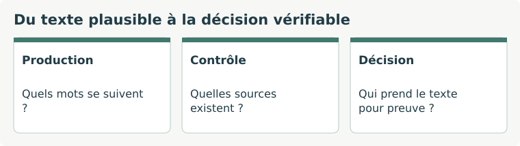
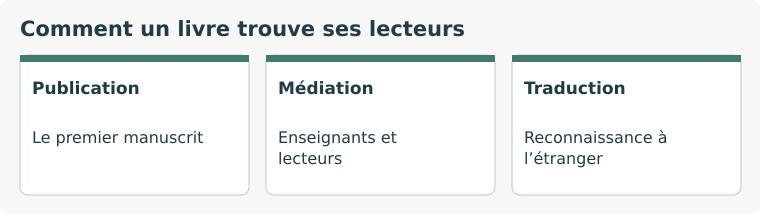
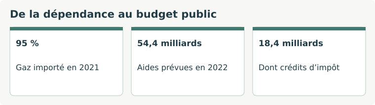

# Banque PT — Langue vivante A 2024 · Corrigé brut

*Corrigé rédigé par IA, non officiel.*

**Rédaction** · GPT-6.2 Astra Ultra · vitesse non renseignée

L’épreuve dure trois heures. Chaque candidat compose dans la langue choisie à l’inscription. Ce fascicule présente les cinq synthèses de 450 à 500 mots. Le décompte indiqué inclut le titre.

## Allemand

*ChatGPT, eine Gefahr für die Menschheit?*

**Wie gefährlich ist eine überzeugende Antwort?**

Der von Midjourney entworfene Chatbot hat einen riesigen Kopf voller Augen, ein geöffnetes Maul und einen winzigen menschlichen Gesprächspartner. Dass ausgerechnet eine bildgenerierende Software einem Sprachprogramm ein so bedrohliches Gesicht gibt, macht die Darstellung doppeldeutig. Sie zeigt, was sich mit solchen Werkzeugen ausdrücken lässt, und wie leicht man ihnen menschliche Absichten zuschreibt. Um die Gefahr von ChatGPT einzuschätzen, muss man deshalb seine tatsächliche Arbeitsweise von dem Eindruck unterscheiden, den seine Antworten erwecken.

Das Deutsche Schulportal erklärt, warum der Eindruck von Wissen so überzeugend ist. Das Modell wurde mit großen Textmengen trainiert und berechnet, welche Wörter wahrscheinlich aufeinander folgen. Eine gut formulierte Antwort kann deshalb richtig sein, ohne dass ihre Formulierung irgendeine Garantie dafür bietet. Die vom Schulportal befragte Medienforscherin weist auf Fehler und fehlende überprüfbare Quellen hin. Gerade in einer Schule verändert das die Bedeutung einer Aufgabe. Wer einen flüssigen Text abgibt, hat den Gegenstand möglicherweise kaum verstanden. Wer die Antwort mit Quellen vergleicht und ihre Fehler erklären kann, beschäftigt sich dagegen eingehend mit dem Inhalt.

Wie weit der Unterschied zwischen Plausibilität und Belegbarkeit reicht, zeigt das Experiment des Standard. Auf die Frage nach möglichen Gefahren der künstlichen Intelligenz liefert der Chatbot verschiedene vorstellbare Szenarien. Doch auch für ein erfundenes wissenschaftliches Phänomen findet er mühelos eine Erklärung samt Forschern und Arbeiten. Seine Bereitschaft zu antworten verrät also wenig über den Wahrheitsgehalt der Frage selbst. Das gilt ebenso für düstere Vorhersagen über die Menschheit. Der bedrohliche Kopf im Bild bietet eine einprägsame Vorstellung von Macht, aber keinen Nachweis dafür, dass die Maschine selbst einen Plan verfolgt.

Ernst zu nehmen sind dagegen Menschen, die überzeugende Texte gezielt einsetzen. Die vom Manager Magazin vorgestellten Experten warnen vor politischen Einflussversuchen, bei denen finanzstarke Gruppen öffentliche Beteiligung vortäuschen und damit Entscheidungsträger unter Druck setzen könnten. Wo viele ähnlich gerichtete Stellungnahmen als Zeichen breiter Zustimmung gelten, wird die Frage nach ihrer Herkunft politisch bedeutsam. Die von Statista verglichenen Zeiträume veranschaulichen, wie schnell sich ein neues Angebot verbreiten kann. ChatGPT erreichte die Millionenschwelle in fünf Tagen, während vergleichbare Schwellen bei älteren Diensten Monate oder Jahre erforderten. Die Grafik misst allerdings je nach Dienst verschiedene Vorgänge, etwa Downloads oder Übernachtungen. Über die Verlässlichkeit einer einzelnen Antwort gibt sie keine Auskunft.

Die Gefahr wächst somit dort, wo sprachliche Gewandtheit mit überprüftem Wissen oder massenhaft erzeugte Zustimmung mit unabhängigen Stimmen verwechselt wird. Dass viele Menschen das Werkzeug rasch ausprobieren können, vergrößert die Reichweite beider Verwechslungen. In der Schule lässt sich an einer einzelnen Antwort üben, was auch die politische Öffentlichkeit braucht, nämlich nach Herkunft, Belegen und Interessen zu fragen. Ob die Technik der Menschheit schadet, hängt nach diesen Beispielen besonders davon ab, welche Entscheidungen Menschen an ihre Texte knüpfen und welche Möglichkeiten zur Überprüfung ihnen dabei offenstehen. Gerade die anschaulichste Darstellung kann diese Prüfung lediglich anregen, niemals ersetzen.

**(464 Wörter, einschließlich Titel)**

## Anglais

*To what extent can it be said that wearable technologies are the future of sports and healthcare?*

**When does a helpful sensor become an unwelcome witness?**

A referee deciding whether a rugby pass travelled forward and a patient checking how lunch affected her blood sugar face an unexpectedly similar problem. Each needs information that a single glance cannot provide. Small sensors can now supply it without interrupting play or repeatedly piercing the skin. Yet the value of a continuous record depends on who may read it, how confidently it can be interpreted and when its owner can switch the device off.

Stanford Medicine describes glucose patches already worn on the arm, watches that monitor sleep and shirts that record vital signs. Improvements in materials and power supplies could make future instruments less conspicuous and their readings more reliable. The distinction between a product that is available and an application still being developed matters. A stream of measurements could help identify a change before the wearer notices any symptoms, but the possibility of earlier detection does not establish a diagnosis in every case. The advantage lies partly in being able to follow one person over time.

Sport offers another way to see what a measurement adds. CNN describes a chip inside a rugby ball that tracks its movement and communicates with receivers around the pitch. The ball itself is an instrument rather than something an athlete wears. Alongside devices worn by players, it shows how measurements of a particular movement can supplement a referee’s limited camera angle or give coaches a clearer view of performance. Information gathered for one decision, however, may also be attractive for quite different purposes.

The Guardian had already identified that difficulty in 2015. Professional players might welcome better training while objecting to an employer following their sleep, diet and private activities away from the field. The Raconteur graphic from the same year shows why such concerns extended beyond one team. It mapped large regional markets, particularly in Asia and the Pacific and in North America, and projected increasing shipments. Its figures for later years were forecasts at publication. They indicate commercial expectations, while telling us little about whether individual athletes or patients wanted every projected use.

The New Yorker cartoon approaches the question from the other end of the age spectrum. A child explains, with cheerful certainty, that a device hears everything and that a future version will even read thoughts. The listener’s anxious expression turns a promise of greater sensitivity into a joke about losing the last private space. Its force comes from the gap between a child’s easy familiarity with an interface and the far more difficult question of consent. Wearable technologies can have a future in both healthcare and sport precisely because they can record what would otherwise pass unnoticed. Their usefulness to the person being measured will depend on whether the setting, purpose and audience of that record remain open to scrutiny.

**(473 words, title included)**

## Arabe

*على ضوء الوثائق الخمس المقدمة أدناه، بين إلى أي حد يمكن للبلدان العربية أن تساهم في حل أزمة القراءة والترويج للأدب العربي في العالم؟*

**من باب دار النشر إلى يد القارئ**

حين فازت رواية الكاتبة العمانية جوخة الحارثي بجائزة عالمية، كان في استطاعة القارئ العربي أن يجد أصلها بلغته منذ سنوات. غير أن كثيرا من القراء والنقاد لم يلتفتوا إليها إلا بعد انتقالها إلى الإنجليزية. تلخص هذه المفارقة بعض ما تواجهه البلدان العربية في سعيها إلى تشجيع القراءة والتعريف بأدبها في الخارج. فوجود كتاب جيد لا يكفي لضمان وصوله إلى القارئ، كما أن وصول رواية واحدة إلى جمهور عالمي لا يحل تلقائيا مشكلات من يحاولون نشر كتبهم الأولى.

توضح قصة سيدات القمر أن الترجمة يمكن أن تكشف قيمة عمل عجزت مؤسسات النقد والنشر المحلية عن إبرازها. فقد نقلت مارلين بوث الرواية إلى الإنجليزية، وأتاح نجاح الترجمة للكاتبة أن تصل إلى جمهور أوسع وأن تستعيد اهتمام القراء العرب أنفسهم. ولا يعني ذلك أن الرواية اكتسبت قيمتها بعد فوزها، بل إن مسارها يدعو إلى التساؤل عن الجهة التي تملك فرصة تقديم الأدب وتزكيته. فإذا تأخر هذا التعريف محليا، فقد تظل أعمال أخرى مجهولة لأنها لم تجد من يترجمها أو يقدمها إلى جائزة.

وهذا ما تضيف إليه شهادات الكتاب الشباب بعدا ماديا. فقبل الحديث عن الترجمة على المؤلف أن يجد ناشرا يقرأ مخطوطته ويمنحها فرصة. وقد ينتظر جوابا طويلا أو يطلب منه دفع نفقات النشر أو القبول بشروط تحد من حقوقه. وفي المقابل يتردد الناشر في المخاطرة باسم لا يعرفه الجمهور. تنشأ بذلك حلقة يصعب كسرها، إذ يشترط النجاح الأول جمهورا لا يملك الكاتب بعد وسيلة للوصول إليه. وتوسيع قاعدة القراء يمكن أن يغير بعض شروط هذه العلاقة إذا صاحبه اهتمام بنوعية الكتاب وصناعته وطريقة تقديمه.

ولا تتفق الوثائق على أن انشغال الناس بالشاشات يعني نهاية القراءة. ففي الرسم الساخر يمد بائع الكتب كتابا نحو شاب منشغل بهاتفه، وتحيط بالشاب علامات الشبكات التي تستأثر بانتباهه. والمسافة القصيرة بين اليد الممدودة والعين المنصرفة تختصر صعوبة يومية لا تعالجها وفرة العناوين وحدها. أما المقال المتفائل بمستقبل الكتاب فيربط عودة القارئ بتحسين المضمون والإخراج والعرض. فالوقت الذي تمنحه الشبكات لمحتوياتها هو نفسه الوقت الذي يتعين على الكتاب أن يجد لنفسه مكانا فيه.

ويقدم تحدي القراءة العربي مثالا على التحرك المنظم في هذا المجال. فالمخطط يرسم للطالب طريقا يبدأ بالتسجيل واختيار الكتب ثم القراءة والتلخيص، قبل الانتقال بين مراحل المسابقة المحلية والوطنية. هكذا تتحول دعوة عامة إلى نشاط متكرر يمكن للمدرسة أن تتابعه. ويمنح الاشتراك الواسع الكتاب العربي فرصة لأن يصبح موضوع حديث مشترك بين تلاميذ من بلدان مختلفة. لكن عدد المشاركين يقيس مدى انتشار المبادرة، أما استمرار القراءة بعد المسابقة فيتوقف أيضا على ما سيجده هؤلاء في المكتبات.

يتبين إذن أن التعريف بالأدب العربي في العالم يبدأ جزئيا من ظروف اللقاء به داخل مجتمعاته. فدور المترجم يكمل عمل الناشر والناقد والمعلم، ولكل واحد منهم قدرة على فتح باب قد يظل مغلقا أمام المؤلف أو القارئ. ومن تفاعل هذه الأدوار يمكن أن تنشأ فرص أوسع للكتب التي تنتظر اليوم أول من يقرأها باهتمام، محليا أو خارج حدود اللغة.

**(457 كلمة، بما فيها العنوان)**

## Espagnol

*Apoderarse de la cultura de un colectivo: ¿robo u homenaje?*

**¿Quién firma la tradición y quién cobra por ella?**

Dos prendas fotografiadas una junto a otra pueden decir más sobre la apropiación cultural que una declaración de admiración. En el mensaje de la senadora mexicana Susana Harp, varias líneas unen los motivos de un gabán tradicional de Michoacán y los de una prenda comercializada por Isabel Marant. La comparación invita a preguntar quién creó esos diseños, quién recibe el reconocimiento y en qué condiciones una semejanza puede considerarse un homenaje.

Según Catalina Infante, la frontera se vuelve especialmente visible cuando un elemento conserva su atractivo mientras pierde su historia. Así ocurrió cuando una revista evocó la detención de Angela Davis para recrear la moda de los setenta. Para la activista, transformar aquel episodio en escenario publicitario borraba precisamente la lucha que daba sentido a la imagen. El debate en torno a la segunda película de Avatar plantea una cuestión similar. Sus detractores observan que un relato inspirado en la resistencia de pueblos indígenas puede reportar beneficios y protagonismo a profesionales ajenos a ellos. Que la ficción denuncie la colonización no resuelve por sí solo la cuestión de quién puede representar a los colonizados.

En la industria textil, el problema se aprecia también en el trabajo que desaparece detrás del producto. La guía de El Heraldo de México explica que una artesana puede dedicar días o meses a la misma pieza. Los hilos, las puntadas y las pequeñas diferencias entre dos prendas permiten reconocer una fabricación manual. Una copia industrial puede reproducir un motivo, pero no incorpora necesariamente ese tiempo ni remunera a quienes mantienen viva la técnica. A su vez, el precio elevado de una prenda de diseñador tampoco acredita que el dinero llegue a la comunidad. Esa distancia da fuerza a la denuncia de Harp, que coloca una etiqueta de lujo al lado de un origen geográfico concreto.

El encuentro Original, organizado en México, ensaya otra manera de mostrar diseños al público. El País describe una pasarela en la que creadores de distintas comunidades presentan sus piezas con sus nombres y referentes culturales. Participan asimismo invitados de otros países. El intercambio no requiere aquí que las diferencias se borren para que una empresa pueda hablar en nombre de todos. La presencia de los artesanos les permite intervenir en el relato y establecer una relación directa con quienes ven su trabajo.

Las controversias del cine y de la moda muestran, en definitiva, que la semejanza formal es un punto de partida y raras veces basta para emitir un juicio. Importa averiguar si el préstamo oculta su procedencia, a quién se escucha cuando surge un desacuerdo y cómo se distribuyen los beneficios. Un homenaje resulta más creíble cuando quienes han transmitido un saber pueden decidir de qué manera se presenta, obtener reconocimiento y participar en las oportunidades creadas por su circulación. Eso exige atender tanto a las condiciones de producción como a las palabras con que se anuncia el resultado.

**(489 palabras, incluido el título)**

## Italien

*In che misura l’Italia subisce la crisi energetica di oggi?*

**Quando il prezzo del gas entra nel carrello della spesa**

Davanti all’annuncio della crisi del gas, uno dei personaggi disegnati da Altan ha già trovato un affare. Propone di speculare su sciarpe e piumoni. La battuta funziona perché quello che per una famiglia rappresenta un modo di difendersi dal freddo può diventare per qualcun altro un’occasione di guadagno. Mette così a fuoco un interrogativo che attraversa il dossier. Perché il rincaro di una fonte energetica colpisce in Italia attività tanto diverse, e chi sostiene il costo delle risposte alla crisi?

Il rapporto di Cassa Depositi e Prestiti individua una prima fragilità nella struttura degli approvvigionamenti. Nel 2021 l’Italia importava il 95 per cento del gas consumato e ne dipendeva più della media europea anche per produrre elettricità. La vulnerabilità riguarda quindi pure chi non acquista direttamente gas per la propria attività. Inoltre, di fronte alla possibile interruzione delle forniture russe, il livello delle scorte e la disponibilità di altre fonti acquistano un’importanza immediata. Il rischio consiste sia nel dover pagare di più sia nel non avere a disposizione quanto occorre.

Il rincaro si propaga lungo la filiera alimentare. Come spiega Il Giorno, il coltivatore paga di più i concimi e il carburante, mentre l’allevatore vede salire il costo dei mangimi. A queste spese si aggiungono quelle della trasformazione, del trasporto e della distribuzione. Sullo scaffale la variazione può manifestarsi persino in una confezione più piccola venduta al prezzo abituale. Al tempo stesso, un aumento del prezzo finale non significa che l’agricoltore guadagni di più. Può trovarsi a vendere senza riuscire a coprire l’aumento dei propri costi.

Sul modo di interpretare questa situazione le voci divergono. Per Paolo Maddalena, le privatizzazioni hanno esposto beni essenziali alla speculazione e la risposta dovrebbe consistere nel ripristino della proprietà pubblica. Il bersaglio della sua critica richiama l’opportunismo preso di mira da Altan, ma la sua proposta politica va distinta dalle misure effettivamente adottate. Il grafico di Confindustria quantifica in 54,4 miliardi di euro il piano italiano di aiuti del 2022. Ai crediti d’imposta, la voce maggiore con 18,4 miliardi, si aggiungono riduzioni degli oneri di sistema e interventi per famiglie e lavoratori. Sono strumenti differenti che ripartiscono parte dello shock sul bilancio pubblico.

Resta da capire quale vulnerabilità sopravviva al soccorso immediato. Se un credito d’imposta consente a un’impresa di proseguire la produzione, da solo non cambia né la provenienza del gas né il peso che questo assume nel sistema elettrico. Il rapporto CDP affianca perciò al coordinamento europeo sui prezzi strategie di diversificazione e riduzione della dipendenza. La dimensione sociale e quella energetica si incontrano proprio qui. Proteggere oggi il potere d’acquisto delle famiglie e mantenere in attività le imprese risponde all’urgenza, mentre modificare gli approvvigionamenti affronta la possibilità che un nuovo shock si trasmetta domani dalla bolletta fino al supermercato.

**(468 parole, titolo compreso)**

