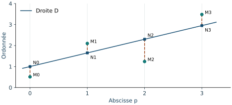
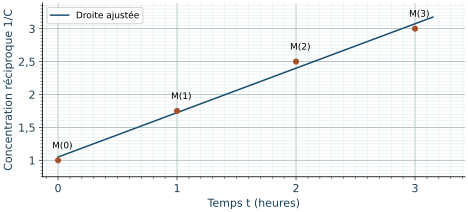

# Banque PT — Mathématiques A · 2024 · Corrigé guidé

*Corrigé rédigé par IA, non officiel. Signalez toute erreur.*

**Rédaction** · GPT-6.2 Astra Ultra · vitesse non renseignée

Les trois protocoles de tirage du problème I sont indépendants les uns des autres. Le problème II relie l’interpolation aux moindres carrés par un produit scalaire défini sur quatre nœuds. Les figures des questions II.4 et II.9.a répondent aux deux tracés demandés.

## Problème I · A. Tirages sans remise et échange

### Question I.A.1.a

> [!INDICATION]
> Identifier l’événement auquel l’indicatrice attribue un.

#### Solution

Alice prend l’un des dix bonbons à la menthe parmi vingt bonbons équiprobables avec probabilité $1/2$. L’indicatrice $X_A$ suit la loi de Bernoulli de paramètre $1/2$.

### Question I.A.1.b

> [!INDICATION]
> Employer les formules pour une indicatrice.

#### Solution

L’espérance vaut $\mathbb E X_A=1/2$ et la variance $\operatorname{Var}(X_A)=(1/2)(1-1/2)=1/4$.

### Question I.A.2.a

> [!INDICATION]
> Le zéro ne correspond pas au même type de bonbon pour les deux enfants.

#### Solution

Pour réaliser $(0,0)$, Alice doit prendre un nougat puis Cyril une menthe. Après le premier tirage, dix menthes restent sur dix-neuf bonbons. La probabilité vaut $(10/20)(10/19)=5/19$.

### Question I.A.2.b

> [!INDICATION]
> Compter les dix-neuf possibilités conditionnelles au premier tirage.

#### Solution

Si Alice prend un nougat, il reste dix menthes et neuf nougats. Si elle prend une menthe, il reste neuf menthes et dix nougats. Chaque premier type ayant probabilité $1/2$, la matrice des probabilités, lignes $X_A=0,1$, colonnes $X_C=0,1$, est
$$
\frac1{38}\begin{pmatrix}10&9\\9&10\end{pmatrix}.
$$

### Question I.A.3

> [!INDICATION]
> Sommer les probabilités de chaque colonne.

#### Solution

Chacune des deux sommes vaut $(9+10)/38=1/2$. Ainsi $X_C$ est de Bernoulli de paramètre $1/2$.

### Question I.A.4.a

> [!INDICATION]
> Le produit de deux indicatrices compte leur succès commun.

#### Solution

On a $\mathbb E(X_AX_C)=\mathbb P(X_A=X_C=1)=5/19$. Par conséquent $\operatorname{Cov}(X_A,X_C)=5/19-1/4=1/76$.

### Question I.A.4.b

> [!INDICATION]
> L’indépendance impose une condition sur la covariance.

#### Solution

Ces variables bornées ont une covariance strictement positive. Comme l’indépendance entraînerait une covariance nulle, elles sont dépendantes.

### Question I.A.5

> [!INDICATION]
> Compter les menthes des deux tirages avant leur redistribution.

#### Solution

Toutes les menthes reviennent à Alice. Les deux tirages peuvent donner deux nougats, une menthe et un nougat, ou deux menthes, chacune de ces situations ayant probabilité positive. Ainsi $Y_A(\Omega)=\{0,1,2\}$.

### Question I.A.6.a

> [!INDICATION]
> Suivre les deux bonbons après l’échange.

#### Solution

Chaque bonbon arrive chez l’enfant qui l’aime. Il y a exactement deux bonbons, donc $Y=Y_A+Y_C=2$ avec probabilité un. Sa loi est la masse de Dirac en $2$.

### Question I.A.6.b

> [!INDICATION]
> Une constante est égale à son espérance.

#### Solution

Dans la formule centrée $\operatorname{Cov}(Y,Y_A)=\mathbb E[(Y-\mathbb EY)(Y_A-\mathbb EY_A)]$, le premier facteur est nul presque sûrement. La covariance vaut donc zéro.

### Question I.A.6.c

> [!INDICATION]
> Développer la covariance d’une somme.

#### Solution

Par bilinéarité et symétrie, $\operatorname{Cov}(Y,Y_A)=\operatorname{Cov}(Y_A,Y_A)+\operatorname{Cov}(Y_C,Y_A)=\operatorname{Var}(Y_A)+\operatorname{Cov}(Y_A,Y_C)$.

### Question I.A.6.d

> [!INDICATION]
> Utiliser les valeurs de probabilité positive trouvées à la question 5.

#### Solution

On obtient $\operatorname{Cov}(Y_A,Y_C)=-\operatorname{Var}(Y_A)<0$. La variance est strictement positive puisque $Y_A$ prend plusieurs valeurs avec probabilité positive.

### Question I.A.7

> [!INDICATION]
> Identifier l’indicatrice d’une menthe pour chacun des deux tirages.

#### Solution

Le premier bonbon est une menthe si $X_A=1$. L’indicatrice d’une menthe au second tirage vaut $1-X_C$. Alice reçoit toutes ces menthes, donc $Y_A=X_A+1-X_C$.

### Question I.A.8

> [!INDICATION]
> La soustraction change le signe du terme croisé.

#### Solution

La linéarité donne $\mathbb E Y_A=1+1/2-1/2=1$. Ensuite $\operatorname{Var}(Y_A)=\operatorname{Var}(X_A)+\operatorname{Var}(X_C)-2\operatorname{Cov}(X_A,X_C)=1/4+1/4-2/76=9/19$.

### Question I.A.9

> [!INDICATION]
> Déterminer les paramètres que le support et la moyenne imposeraient.

#### Solution

Pour une loi binomiale non constante, le support complet est $\{0,\ldots,n\}$. Ici $n$ devrait valoir $2$ et $2p=1$ donnerait $p=1/2$. La variance serait $2p(1-p)=1/2$, différente de $9/19$. Aucune loi binomiale ne convient.

## Problème I · B. Attente de la deuxième menthe

### Question I.B.1.a

> [!INDICATION]
> Jusqu’au premier succès, chaque échec rétablit exactement le même paquet.

#### Solution

Au départ il y a six menthes et dix nougats. Avant le premier succès, chaque tirage se fait dans cette même composition, avec une chance de succès $p_1=3/8$. Pour $k\ge1$, il faut $k-1$ échecs puis un succès, d’où $\mathbb P(Z_1=k)=(5/8)^{k-1}(3/8)$. C’est la loi géométrique de paramètre $3/8$ sur $\mathbb N^*$.

### Question I.B.1.b

> [!INDICATION]
> La loi géométrique compte ici l’essai réussi.

#### Solution

Ses moments sont $\mathbb E Z_1=1/p_1=8/3$ et $\operatorname{Var}(Z_1)=(1-p_1)/p_1^2=40/9$.

### Question I.B.1.c

> [!INDICATION]
> Examiner le terme général aux deux extrémités de l’intervalle de convergence.

#### Solution

Par définition $G_1(t)=\sum_{k\ge1}(3/8)(5/8)^{k-1}t^k=(3/5)\sum_{k\ge1}(5t/8)^k$. La série géométrique converge pour $|5t/8|<1$. Aux bornes son terme ne tend pas vers zéro. Ainsi $D_1=]-8/5,8/5[$.

### Question I.B.1.d

> [!INDICATION]
> Sommer la série à partir de son indice un.

#### Solution

Sur $D_1$, $G_1(t)=(3/5)(5t/8)/(1-5t/8)=3t/(8-5t)$.

### Question I.B.1.e

> [!INDICATION]
> Les dérivées en zéro se lisent dans les coefficients de Taylor.

#### Solution

Le terme constant est nul, donc $G_1(0)=0$. Pour tout $k\ge1$, $G_1^{(k)}(0)=k!(3/8)(5/8)^{k-1}$.

### Question I.B.2

> [!INDICATION]
> Après la première menthe, il reste quinze bonbons.

#### Solution

$Z_2$ suit la loi géométrique de paramètre $p_2=5/15=1/3$ sur $\mathbb N^*$, avec $\mathbb P(Z_2=k)=(1/3)(2/3)^{k-1}$. On a $\mathbb E Z_2=3$, $\operatorname{Var}(Z_2)=6$, $D_2=]-3/2,3/2[$, $G_2(t)=t/(3-2t)$, $G_2(0)=0$ et $G_2^{(k)}(0)=k!(1/3)(2/3)^{k-1}$ pour $k\ge1$.

### Question I.B.3.a

> [!INDICATION]
> Compter les deux phases de tirage.

#### Solution

$Z=Z_1+Z_2$ est le nombre total de tirages jusque et y compris la deuxième menthe. Par linéarité $\mathbb E Z=8/3+3=17/3$.

### Question I.B.3.b

> [!INDICATION]
> Répartir tout effectif admissible entre les deux temps d’attente.

#### Solution

Les deux attentes valent au moins un et tous les couples d’entiers positifs ont probabilité positive par indépendance. Tout $n\ge2$ se réalise par exemple avec $(Z_1,Z_2)=(1,n-1)$. Le support est $\{2,3,\ldots\}$.

### Question I.B.3.c

> [!INDICATION]
> Utiliser l’indépendance admise des deux temps d’attente.

#### Solution

Pour $t\in D_1\cap D_2$, les deux séries convergent absolument et l’indépendance donne $G(t)=\mathbb E(t^{Z_1}t^{Z_2})=G_1(t)G_2(t)$.

### Question I.B.3.d

> [!INDICATION]
> Les deux termes de bord de la formule de Leibniz s’annulent.

#### Solution

Pour $n\ge2$, $G^{(n)}(0)=\sum_{k=1}^{n-1}\binom nk G_1^{(k)}(0)G_2^{(n-k)}(0)$. Les termes $k=0,n$ ont disparu car $G_1(0)=G_2(0)=0$.

### Question I.B.3.e

> [!INDICATION]
> La convolution des deux suites géométriques est une différence de puissances.

#### Solution

Posons $u=5/8$, $v=2/3$. L’expression précédente devient $(n!/8)\sum_{k=1}^{n-1}u^{k-1}v^{n-k-1}$. En multipliant la somme par $v-u=1/24$, on obtient par télescopage $v^{n-1}-u^{n-1}$. Ainsi $G^{(n)}(0)=3n![(2/3)^{n-1}-(5/8)^{n-1}]$.

### Question I.B.3.f

> [!INDICATION]
> Diviser la dérivée par la factorielle.

#### Solution

Pour tout entier $n\ge2$, le coefficient de $t^n$ dans $G$ est $\mathbb P(Z=n)=3[(2/3)^{n-1}-(5/8)^{n-1}]$.

### Question I.B.3.g

> [!INDICATION]
> Utiliser la série géométrique dérivée dans la définition de l’espérance.

#### Solution

On somme $n\mathbb P(Z=n)$ pour $n\ge2$. On peut ajouter le terme nul d’indice $1$. Comme $\sum_{n\ge1}nr^{n-1}=(1-r)^{-2}$ pour $|r|<1$, on retrouve $\mathbb E Z=3[9-64/9]=17/3$.

## Problème I · C. Alternance entre Cyril et Alice

### Question I.C.1

> [!INDICATION]
> Quelles catégories de bonbons épuisent le paquet ?

#### Solution

Les menthes et les nougats forment une partition du contenu. La somme de leurs proportions est donc $a+c=1$.

### Question I.C.2.a

> [!INDICATION]
> Avant le succès de Cyril, une paire de tours doit se terminer sans consommation.

#### Solution

Cyril échoue en tirant une menthe et Alice en tirant un nougat. Ainsi $C_{2p+1}=\bigcap_{j=1}^{p}(M_{2j-1}\cap N_{2j})\cap N_{2p+1}$, avec intersection vide égale à l’événement certain lorsque $p=0$.

### Question I.C.2.b

> [!INDICATION]
> Chaque bonbon refusé est remis dans le paquet.

#### Solution

À chaque tirage de la suite prescrite avant l’arrêt, la composition est celle du départ. Par multiplication des probabilités conditionnelles, $\mathbb P(C_{2p+1})=(ac)^p c$.

### Question I.C.2.c

> [!INDICATION]
> Identifier la personne qui joue aux rangs pairs.

#### Solution

Les rangs pairs sont réservés à Alice. Pour tout $p\ge1$, $C_{2p}$ est impossible et sa probabilité vaut zéro.

### Question I.C.3

> [!INDICATION]
> Les rangs possibles du premier succès sont disjoints.

#### Solution

Par sommation sur les rangs impairs, $\mathbb P(B=1)=\sum_{p\ge0}(ac)^p c=c/(1-ac)$ puisque $0<ac<1$.

### Question I.C.4

> [!INDICATION]
> Décrire les deux derniers tirages d’un succès d’Alice.

#### Solution

Après $p$ paires infructueuses, Cyril doit tirer une menthe, la remettre, puis Alice doit tirer une menthe à son tour. La probabilité de cette suite vaut $(ac)^p a^2$. En sommant les événements disjoints, on trouve $\mathbb P(B=0)=a^2/(1-ac)$.

### Question I.C.5

> [!INDICATION]
> Additionner les deux probabilités d’arrêt.

#### Solution

Comme $c+a^2=c+a(1-c)=1-ac$, les probabilités des deux gagnants totalisent un. Il en résulte $\mathbb P(B=-1)=0$. Un enfant finit presque sûrement par manger un bonbon.

### Question I.C.6

> [!INDICATION]
> Comparer la solution algébrique avec les proportions réalisables dans un paquet fini.

#### Solution

L’égalité des probabilités nécessite $c=a^2$. Avec $c=1-a$, elle impose $a^2+a-1=0$, soit $a=(\sqrt5-1)/2$, l’autre racine étant négative. Cette valeur est irrationnelle, alors que dans un paquet fini $a$ est le rapport de deux effectifs entiers. Aucun paquet ne peut donc réaliser exactement l’égalité.

## Problème II · Produit scalaire et interpolation

### Question II.1.a

> [!INDICATION]
> Écrire les trois facteurs du dénominateur pour le nœud zéro.

#### Solution

Le dénominateur de $L_0$ vaut $(0-1)(0-2)(0-3)=-6$. Donc $L_0=-(X-1)(X-2)(X-3)/6$.

### Question II.1.b

> [!INDICATION]
> Omettre chaque fois le facteur qui correspond au nœud choisi.

#### Solution

Les dénominateurs pour $p=1,2,3$ sont respectivement $2,-2,6$. Ainsi $L_1=X(X-2)(X-3)/2$, $L_2=-X(X-1)(X-3)/2$ et $L_3=X(X-1)(X-2)/6$.

### Question II.1.c

> [!INDICATION]
> Un autre nœud annule un facteur du numérateur.

#### Solution

Pour $p,k\in\{0,1,2,3\}$, on a $L_p(k)=0$ si $k\ne p$ et $L_p(p)=1$, chaque facteur du produit valant alors un. Autrement dit $L_p(k)=\delta_{pk}$.

### Question II.2.a

> [!INDICATION]
> Une somme de carrés nulle annule successivement quatre évaluations.

#### Solution

La forme $\varphi(P,Q)=\sum_{k=0}^3P(k)Q(k)$ est symétrique et bilinéaire par linéarité de l’évaluation. On a $\varphi(P,P)\ge0$. Si elle est nulle, $P$ s’annule aux quatre nœuds. Son degré étant au plus trois, il est nul. Cela donne le caractère défini et achève la preuve.

### Question II.2.b

> [!INDICATION]
> Relier le produit scalaire des polynômes cardinaux à leurs valeurs nodales.

#### Solution

L’identité de II.1.c donne $\varphi(L_p,L_q)=\sum_k\delta_{pk}\delta_{qk}=\delta_{pq}$. La famille orthonormée est libre et compte quatre éléments en dimension quatre. Elle forme donc une base orthonormée.

### Question II.2.c

> [!INDICATION]
> Évaluer le développement de $Q$ au nœud $j$.

#### Solution

Si $Q=\sum_{p=0}^3 q_p L_p$, alors $Q(j)=q_j$ par II.1.c. Les coordonnées demandées sont $(Q(0),Q(1),Q(2),Q(3))$ dans l’ordre du sujet.

### Question II.3

> [!INDICATION]
> Centrer le polynôme $X$ sur les quatre nœuds avant de le normaliser.

#### Solution

Le polynôme $1$ a norme $2$. La moyenne des quatre nœuds est $3/2$, donc $X-3/2$ est orthogonal à $1$. Sa norme carrée est $(9+1+1+9)/4=5$. La famille $E_0=1/2$, $E_1=(X-3/2)/\sqrt5$ est orthonormée et engendre $\mathbb R_1[X]$.

### Question II.4

> [!INDICATION]
> Tracer pour chaque abscisse un point observé et un point de la droite.

#### Solution

La droite $D$ est représentée ci-dessous. Les points ronds $M_p=(p,y_p)$ portent les observations de cet exemple dessiné. Les carrés $N_p=(p,ap+b)$ appartiennent à $D$. Chaque segment vertical a longueur $d_p$.

### Question II.5

> [!INDICATION]
> La différence des abscisses est nulle.

#### Solution

La distance euclidienne entre $M_p$ et $N_p$ se réduit à $d_p=|y_p-(ap+b)|$. En élevant au carré puis en sommant, $\delta(a,b)=\sum_{p=0}^3(y_p-ap-b)^2$.

### Question II.6.a

> [!INDICATION]
> L’interpolation utilise précisément la propriété cardinale.

#### Solution

Le polynôme $Q=\sum_{p=0}^3 y_p L_p$ appartient à $\mathbb R_3[X]$ et vérifie $Q(k)=y_k$ aux quatre nœuds. La différence de deux solutions serait de degré au plus trois avec quatre racines distinctes, donc nulle. Le polynôme est unique.

### Question II.6.b

> [!INDICATION]
> Évaluer le carré de la norme dans la définition de $\varphi$.

#### Solution

Pour $H(X)=aX+b$, on a $\|Q-H\|^2=\sum_{p=0}^3(Q(p)-H(p))^2=\sum_{p=0}^3(y_p-ap-b)^2=\delta(a,b)$.

### Question II.6.c

> [!INDICATION]
> Projeter le vecteur $Q$ dans l’espace euclidien des polynômes.

#### Solution

Le théorème de projection donne $H_0$, projeté orthogonal de $Q$ sur le sous-espace $\mathbb R_1[X]$ de $\mathbb R_3[X]$. Pour tout $H$ affine, $\|Q-H\|^2=\|Q-H_0\|^2+\|H-H_0\|^2$. La distance au carré est minimale pour $H=H_0$ et en ce seul point.

## Problème II · Calcul du minimum et exploitation des mesures

### Question II.7.a

> [!INDICATION]
> Développer la projection dans la base orthonormée du sous-espace.

#### Solution

Avec les deux polynômes de II.3, la projection vaut $H_0=\varphi(Q,E_0)E_0+\varphi(Q,E_1)E_1$. En effet $Q-H_0$ est orthogonal à chacun des deux vecteurs.

### Question II.7.b

> [!INDICATION]
> Exprimer les produits scalaires par les deux sommes mesurées.

#### Solution

Notons $Y=\sum y_p$ et $XY=\sum p y_p$, où $XY$ désigne la seconde somme du sujet. Les coefficients de projection sont $Y/2$ et $(XY-3Y/2)/\sqrt5$. Il vient
$$
H_0(X)=\frac Y4+\frac{XY-3Y/2}{5}(X-3/2)=\frac{2XY-3Y}{10}X+\frac{7Y-3XY}{10}.
$$

### Question II.8.a

> [!INDICATION]
> Annuler les dérivées partielles par rapport à la pente et à l’ordonnée à l’origine.

#### Solution

On a $\partial_a\delta=2(14a+6b-XY)$ et $\partial_b\delta=2(6a+4b-Y)$, car $\sum p=6$ et $\sum p^2=14$. La matrice du système a pour déterminant $56-36=20$. Ainsi il existe un unique point critique $(a_0,b_0)=((2XY-3Y)/10,(7Y-3XY)/10)$.

### Question II.8.b

> [!INDICATION]
> Développer la fonction au point critique pour comparer toutes ses valeurs.

#### Solution

Pour un déplacement $(u,v)$, le terme linéaire s’annule au point critique. Il reste $\delta(a_0+u,b_0+v)-\delta(a_0,b_0)=\sum_{p=0}^3(up+v)^2$. Cette somme est positive hors de $(0,0)$, car ses termes aux rangs zéro et un imposeraient $v=u=0$ si elle était nulle. Le minimum est donc global et unique.

### Question II.9.a

> [!INDICATION]
> Les ordonnées à placer sont les inverses des quatre mesures.

#### Solution

Les points demandés sont $M(0)=(0,1)$, $M(1)=(1,7/4)$, $M(2)=(2,5/2)$ et $M(3)=(3,3)$. Sur le tracé, le temps s’exprime en heures et l’axe vertical porte la concentration réciproque.

### Question II.9.b

> [!INDICATION]
> Comparer les accroissements entre deux mesures consécutives.

#### Solution

La loi $C(t)=k/(t+c)$ implique $1/C(t)=(t+c)/k$, affine en $t$. Des mesures exactes du modèle seraient alignées. Or les accroissements pour un pas d’une heure sont $3/4$, $3/4$ et $1/2$. Les quatre points ne sont donc pas alignés, ce qui peut s’expliquer par les incertitudes de mesure.

### Question II.10.a

> [!INDICATION]
> Traduire les paramètres du modèle en coefficients d’une droite.

#### Solution

On ajuste les observations $y_p=1/C(p)$ par $at+b$ en minimisant la somme des carrés des écarts verticaux. II.6–8 donnent un unique couple de coefficients. Dès que $a\ne0$, les identités $a=1/k$ et $b=c/k$ donnent $k=1/a$ et $c=b/a$.

### Question II.10.b

> [!INDICATION]
> Vérifier séparément la somme des ordonnées et leur somme pondérée.

#### Solution

Ici $Y=1+7/4+5/2+3=33/4$ et $XY=7/4+2(5/2)+3\cdot3=63/4$. On en déduit $a=27/40$, $b=21/20$, puis les valeurs ajustées $k=40/27$ et $c=14/9$.

### Question II.10.c

> [!INDICATION]
> Déterminer le temps de franchissement sur la droite des mesures réciproques.

#### Solution

La droite croissante atteint le seuil réciproque $12$ lorsque $27t/40+21/20=12$, soit $t=146/9\simeq16{,}22$ heures. La concentration devient strictement inférieure à $1/12$ après cet instant. L’arrondi à l’entier le plus proche demandé est **16 heures**. Si l’on ne pouvait contrôler qu’aux heures entières, la première observation sous le seuil aurait lieu à la dix-septième heure.

## Sources et rapport du jury

Le jury distingue la possibilité algébrique du jeu équitable de sa réalisation avec un paquet fini (partie I.C). Il demande ensuite de préciser le sous-espace de projection, de démontrer le minimum global et de légender les axes du graphique des inverses des mesures (p. 6–8).

[Énoncé de la Banque PT](https://www.banquept.fr/documents/2024/math_a_2024_pt.pdf) · [Rapport du jury](https://www.banquept.fr/documents/ecrit/rapport/2024/rapport_math_a_ecrit_2024.pdf)
