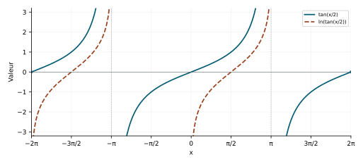
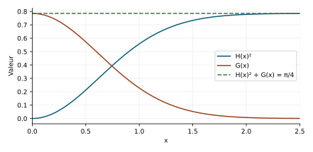

# Banque PT — Mathématiques C · Session 2024 · Corrigé brut

*Corrigé rédigé par IA, non officiel. Signalez toute erreur.*

**Rédaction** · GPT-6.2 Astra Ultra · vitesse non renseignée

Le demi-angle relie une intégrale logarithmique à la constante de Catalan et donne une solution d’équation différentielle. Une autre intégrale à paramètre mène à l’intégrale de Gauss. Le produit du sinus fournit enfin des sommes de séries.

Écrit de quatre heures, sans calculatrice. Une feuille de papier millimétré est à rendre pour P.3.g. La grille d’admissibilité attribue à Math C le coefficient 6 pour l’École polytechnique et 3 pour chacune des ENS Paris-Saclay et Rennes. [Sujet](https://www.banquept.fr/documents/2024/math_c_2024_pt.pdf) · [Livret, p. 13](https://www.banquept.fr/documents/livret/2024/Livret_PT_2024.pdf#page=13)

Le rapport revient sur le domaine et le tracé des fonctions du préambule, la justification des échanges entre série et intégrale et les hypothèses de dérivation des intégrales à paramètre. [Rapport du jury](https://www.banquept.fr/documents/ecrit/rapport/2024/rapport_math_c_ecrit_2024.pdf)

## Préambule. Fonctions du demi-angle

### Question P.1

Sur $]-\pi/2,\pi/2[$, $\tan'(x)=1/\cos^2x=1+\tan^2x$.

### Question P.2.a

Pour $x\ne\pi/2$ dans $]0,\pi[$, $g(x)=\cos x/\sin x$. Le sinus est strictement positif sur tout cet intervalle. Le quotient y est donc dérivable et continu, avec valeur zéro en $\pi/2$. Il fournit le prolongement $\widetilde g$ demandé.

### Question P.2.b

On a $\widetilde g'(x)=(-\sin^2x-\cos^2x)/\sin^2x=-1/\sin^2x$. Une primitive cherchée est donc $-\cot x=-\cos x/\sin x$ sur tout $]0,\pi[$.

### Question P.3.a

La fonction $f_1(x)=\tan(x/2)$ est définie sur $D_1=\mathbb R\setminus\{(2k+1)\pi:k\in\mathbb Z\}$. La tangente du demi-angle est positive lorsque $x/2\in]k\pi,k\pi+\pi/2[$. Donc $D_2=\bigcup_{k\in\mathbb Z}]2k\pi,(2k+1)\pi[$ pour $f_2(x)=\log\tan(x/2)$.

### Question P.3.b

La translation par $2\pi$ laisse $D_1,D_2$ invariants. Comme $\tan(x/2+\pi)=\tan(x/2)$, elle conserve les valeurs des deux fonctions. On peut prendre $T_1=T_2=2\pi$. C’est aussi la plus petite période positive, car les pôles de $f_1$ sont espacés de $2\pi$ et les bords gauches des composantes de $D_2$ le sont également.

### Question P.3.c

La tangente est dérivable partout où elle est définie et la fonction logarithme est dérivable sur $]0,+\infty[$. Ainsi $f_1$ est dérivable sur $D_1$ et $f_2$ sur $D_2$.

### Question P.3.d

Par composition, $f_1'(x)=1/(2\cos^2(x/2))=(1+\tan^2(x/2))/2$ sur $D_1$.

### Question P.3.e

Sur $D_2$, $f_2'=f_1'/f_1=1/(2\sin(x/2)\cos(x/2))=1/\sin x$.

### Question P.3.f

En une période, $f_1$ est strictement croissante sur $]-\pi,\pi[$, sa dérivée étant positive. Pour $f_2$, seule la partie $]0,\pi[$ de $[0,2\pi[$ appartient au domaine et $f_2'>0$ sur cet intervalle. Les limites viennent de celles de la tangente et du logarithme. Les tableaux sont
$$
\begin{array}{c|ccc}x&-\pi&&\pi\\\hline f_1(x)&-\infty&\nearrow&+\infty\end{array}
\qquad
\begin{array}{c|ccc}x&0&&\pi\\\hline f_2(x)&-\infty&\nearrow&+\infty\end{array}.
$$
Comme $\tan(\pi/4)=1$, pour tout $x=\pi/2+2k\pi$ on a $f_1(x)=1$ et $f_2(x)=0$.

### Question P.3.g

Sur $[-2\pi,2\pi]$, les deux asymptotes de $f_1$ sont $x=\pm\pi$ et ses zéros sont $-2\pi,0,2\pi$. Les branches de $f_2$ occupent $]-2\pi,-\pi[$ et $]0,\pi[$, vont de $-\infty$ à $+\infty$ et coupent l’axe en $-3\pi/2$ et $\pi/2$. Le dessin respecte ces discontinuités et la même unité sur les axes.

[Télécharger la planche pour les deux fonctions du demi-angle](https://raw.githubusercontent.com/knoel99/corriges-concours/d50a2fd77f11cb1d2431656f826a5165dfeed4ca/2024/banque-pt/banque-pt_pt_maths-c_2024/planches/fonctions-du-demi-angle.svg)

Imprimez chaque planche sur A4 paysage à 100 %, sans ajustement, sans marges ni en-têtes de navigateur. Vérifiez à la règle que deux graduations entières successives sont distantes de 1 cm, sur chaque axe.

### Question P.4.a

Pour $f_3(x)=1/\cos^2x$, $D_3=\mathbb R\setminus\{\pi/2+k\pi:k\in\mathbb Z\}$. Le quotient est dérivable sur cet ouvert entier.

### Question P.4.b

On a $f_3'(x)=2\sin x/\cos^3x$, strictement positif sur $]0,\pi/4]$ et nul en zéro. Les valeurs aux bornes, aussi limites intérieures par continuité, donnent le tableau
$$
\begin{array}{c|ccc}x&0&&\pi/4\\\hline f_3(x)&1&\nearrow&2\end{array}.
$$

## I. Une représentation de la constante de Catalan

On note $C=\sum_{n\ge0}(-1)^n/(2n+1)^2$. Pour l’approcher, on appellera $S_N$ la somme des termes d’indice 0 à $N$ inclus.

### Question I.1.a

Sur $]0,+\infty[$, une primitive de $\log t$ est $t\log t-t$.

### Question I.1.b

Pour $\varepsilon>0$, la primitive donne $\int_{\varepsilon}^{1}\log t\,dt=-1-\varepsilon\log\varepsilon+\varepsilon$.

### Question I.1.c

Comme $\varepsilon\log\varepsilon\to0$ quand $\varepsilon\to0^+$, l’intégrale impropre existe et vaut $-1$. Son intégrande est négatif sur $]0,1[$, donc elle converge aussi absolument.

### Question I.2

La fonction est continue sur $]0,\pi/2]$ avec valeur zéro à droite. En zéro, $\tan(x/2)/(x/2)\to1$, donc $\log\tan(x/2)=\log x-\log2+o(1)$. Son module est majoré près de zéro par $|\log x|+C$, intégrable par I.1.c. L’intégrale converge absolument.

### Question I.3

Pour $|x|<1$, $(1+x^2)^{-1}=\sum_{n\ge0}(-1)^n x^{2n}$. La primitivation terme à terme donne
$$
\arctan x=\sum_{n=0}^\infty\frac{(-1)^n x^{2n+1}}{2n+1}.
$$
Le rayon est 1 par conservation du rayon sous primitivation.

### Question I.4

Posons $v_n(x)=(-1)^nx^{2n}/(2n+1)$. Sur $]0,1[$, leur somme vaut $\arctan(x)/x$ d’après I.3. Le théorème d’intégration des séries de fonctions intégrables permet d’échanger somme et intégrale si la somme des intégrales des modules est finie (la série converge alors presque partout absolument). Ici $\int_0^1 |v_n|=1/(2n+1)^2$, de somme finie par comparaison à une série de Riemann d’exposant 2. Les bornes ne changent pas la valeur de l’intégrale. Il en résulte
$$
\int_0^1\frac{\arctan x}{x}dx=\sum_{n\ge0}\int_0^1v_n(x)dx=\sum_{n\ge0}\frac{(-1)^n}{(2n+1)^2}=C.
$$

### Question I.5.a

La substitution $u=\tan(x/2)$ va de 0 à 1 et $dx=2du/(1+u^2)$. Elle s’effectue d’abord sur un intervalle tronqué, puis à la limite par I.2. L’intégrale vaut $2\int_0^1\log u\,du/(1+u^2)$. En intégrant par parties avec la primitive $\arctan u$, le bord est nul en 1 et en zéro car $\arctan u\sim u$ et $u\log u\to0$. Il reste $-2\int_0^1\arctan(u)du/u=-2C$.

### Question I.5.b

Les modules $(2n+1)^{-2}$ décroissent vers zéro. Le critère des séries alternées assure que la somme est comprise entre $S_1=1-1/9=8/9$ et $S_2=S_1+1/25$. Ainsi $8/9$ est une approximation par défaut avec une erreur strictement inférieure à $1/25=0{,}04$.

### Question I.5.c

Le reste alterné vérifie $|C-S_N|\le1/(2N+3)^2$. Pour $p>2$ entier, il suffit donc de prendre $N\ge\lceil(10^p-3)/2\rceil=5\cdot10^{p-1}-1$. Alors l’erreur est au plus $10^{-2p}$.

## II. Équation différentielle sur l’intervalle ouvert

Sur $]0,\pi[$, on cherche toutes les solutions de $y''+y=\cot x$, d’abord à partir d’une solution particulière, puis par variation de la constante.

### Question II.1

Avec $f_4(x)=\sin x\,f_2(x)$, on a $f_4'=\cos x\,f_2(x)+1$ puisque $f_2'=1/\sin x$. Donc $f_4''=-\sin x\,f_2(x)+\cos x/\sin x=-f_4+\cot x$ sur $]0,\pi[$.

### Question II.2

L’équation $y_0''+y_0=0$ a pour polynôme caractéristique $r^2+1$, de racines $\pm i$. Ses solutions réelles sont $y_0=A\cos x+B\sin x$, $A,B\in\mathbb R$.

### Question II.3

Par II.1, $f_4$ résout l’équation avec second membre $\cot x$. Par linéarité, pour toute solution $y$, $y-f_4$ résout l’équation homogène. Réciproquement ajouter $f_4$ à une solution homogène donne une solution. Ainsi $y=A\cos x+B\sin x+f_4(x)$.

### Question II.4.a

Écrivons $y=z\sin x$, ce qui est possible pour toute solution sur $]0,\pi[$. Deux dérivations donnent $y''+y=z''\sin x+2z'\cos x$. En posant $w=z'$ et en divisant par $\sin x$, on obtient $(E')\colon w'+2\cot x\,w=\cos x/\sin^2x$.

### Question II.4.b

L’équation homogène équivaut à $(w\sin^2x)'=0$, donc $w_h=A/\sin^2x$, ce qui inclut la solution nulle. Par variation de la constante, posons $w=u(x)/\sin^2x$ dans $(E')$. Le membre de gauche vaut $u'/\sin^2x$. Ainsi $u'=\cos x$, soit $u=\sin x+A$, et $z'=1/\sin x+A/\sin^2x$.

### Question II.4.c

P.3.e donne une primitive de $1/\sin x$, et P.2.b une primitive de $1/\sin^2x$. Donc $z(x)=\log\tan(x/2)-A\cot x+B$.

### Question II.4.d

On multiplie par $\sin x$. Il vient $y=f_4(x)-A\cos x+B\sin x$. Comme $-A$ est un réel arbitraire, c’est exactement la famille de II.3.

## III. Calcul de l’intégrale de Gauss

On considère $G(x)=\int_0^{\pi/4}\exp(-x^2/\cos^2\theta)\,d\theta$ et $H(x)=\int_0^x e^{-t^2}dt$.

### Question III.1

Pour $0\le\theta\le\pi/4$, $\cos^2\theta\ge1/2$. Pour tout réel $x$, $\theta\mapsto\exp(-x^2/\cos^2\theta)$ est donc continue sur le segment. Ainsi $D_G=\mathbb R$.

### Question III.2

L’intégrande est continu en $x$ et compris entre zéro et un, majorant intégrable en $\theta$ sur le segment. Le théorème de continuité dominée donne la continuité de $G$ sur $\mathbb R$.

### Question III.3

Comme $1/\cos^2\theta\ge1$, on a $0\le G(x)\le (\pi/4)e^{-x^2}$. D’où $\lim_{x\to+\infty}G(x)=0$.

### Question III.4

La dérivée partielle de l’intégrande en $x$ est $-2x\sec^2\theta\,e^{-x^2\sec^2\theta}$. Sur $|x|\le a$ et $0\le\theta\le\pi/4$, son module est au plus $4a$, intégrable en $\theta$. La continuité et cette domination justifient la dérivation sous l’intégrale, sur chaque segment puis sur $\mathbb R$ entier. Donc
$$
G'(x)=-2x\int_0^{\pi/4}\sec^2\theta\,e^{-x^2\sec^2\theta}d\theta .
$$

### Question III.5.a

La fonction $e^{-t^2}$ est continue partout. Son intégrale entre 0 et tout réel fini $x$ existe. Donc $D_H=\mathbb R$.

### Question III.5.b

La fonction continue $t\mapsto e^{-t^2}$ possède pour primitive s’annulant en zéro $H(x)=\int_0^x e^{-t^2}dt$. Ainsi $H\in C^1(\mathbb R)$ et $H'(x)=e^{-x^2}$.

### Question III.6

Si $x\ne0$, poser $u=x\tan\theta$ entraîne $du=x\sec^2\theta\,d\theta$. La substitution est monotone de 0 à $x$ et $x^2\sec^2\theta=x^2+u^2$. Ainsi $G'(x)=-2e^{-x^2}\int_0^x e^{-u^2}du=-2e^{-x^2}H(x)$, même pour $x<0$. Pour $x=0$, III.4 donne $G'(0)=0$ et $H(0)=0$, donc l’égalité demeure vraie.

### Question III.7

Par III.5.b–6, $(H^2+G)'=2He^{-x^2}-2e^{-x^2}H=0$. L’intervalle $\mathbb R$ étant connexe, la somme est constante. En zéro elle vaut $0+\int_0^{\pi/4}1\,d\theta=\pi/4$.

### Question III.8

Quand $x\to+\infty$, III.3 et III.7 donnent $H(x)^2\to\pi/4$. Pour $x>0$, $H(x)>0$, donc $H(x)\to\sqrt\pi/2$. C’est la valeur de $\int_0^\infty e^{-t^2}dt$. Si $x>0$, la substitution $u=\sqrt{x}t$ fournit ensuite $\int_0^\infty e^{-xt^2}dt=\sqrt\pi/(2\sqrt{x})$.

## IV. Produit du sinus et sommes de séries

La fonction $\varphi$ est définie par $\varphi(0)=1$ et $\varphi(x)=\sin(x)/x$ ailleurs. On étudie le produit fini $P_N(X)=\prod_{k=1}^N(1-X/(k\pi))(1+X/(k\pi))$, puis la somme $D=\sum_{n\ge0}(4n+1)^{-2}$.

### Question IV.1

Pour tout réel $x$, $\sin x=\sum_{n\ge0}(-1)^n x^{2n+1}/(2n+1)!$. Le rapport des modules de deux termes consécutifs indexés par $n$ tend vers zéro pour chaque $x\ne0$. Le rayon est infini, la convergence a donc lieu sur $\mathbb R$ tout entier (également pour tout complexe).

### Question IV.2

Pour $x\ne0$, en divisant la série par $x$, on trouve $\varphi(x)=\sum_{n\ge0}(-1)^nx^{2n}/(2n+1)!$. La série a un rayon infini et vaut 1 en zéro. Elle représente donc aussi la valeur attribuée à $\varphi(0)$.

### Question IV.3

On a $P_N(X)=\prod_{k=1}^N(1-X^2/(k\pi)^2)$. Pour produire le degré deux, il faut choisir un seul terme en $X^2$ et des termes constants dans tous les autres facteurs. Donc $\alpha_N=-\pi^{-2}\sum_{k=1}^N1/k^2$.

### Question IV.4

Par IV.2, $\alpha=-1/(3!)=-1/6$. Le sujet admet $\alpha_N\to\alpha$. Ainsi, en passant à la limite dans IV.3, $\sum_{k\ge1}1/k^2=\pi^2/6$. C’est l’hypothèse de convergence des coefficients qui autorise cette identification.

### Question IV.5

La somme sur les pairs vaut $\tfrac14\sum_{k\ge1}1/k^2=\pi^2/24$. La somme sur les impairs vaut donc $\pi^2/6-\pi^2/24=\pi^2/8$. La série absolument convergente signée, qui commence au rang 1 par un terme négatif, a pour somme $\pi^2/24-\pi^2/8=-\pi^2/12$.

### Question IV.6

Posons $E=\sum_{n\ge0}1/(4n+3)^2$. Par convergence absolue on peut partager et regrouper les termes. Ainsi $C=D-E$ et $D+E=\pi^2/8$ par IV.5. Il en résulte $2D-C=\pi^2/8$.

### Question IV.7

La formule donne $D=(\pi^2/8+C)/2$. Les données $1{,}2337$ et $8/9$ donnent déjà environ $1{,}0613$, avec une erreur due à $C$ de moins de $0{,}02$. Pour préciser la valeur, la somme $S_{100}=\sum_{n=0}^{100}(-1)^n/(2n+1)^2$ vaut environ $0{,}915978$ et son écart à $C$ est inférieur à $1/203^2$. En la combinant avec $\pi^2/8\simeq1{,}2337$, on obtient $D\simeq1{,}0748$ à $10^{-4}$ près.
