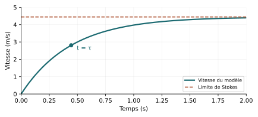
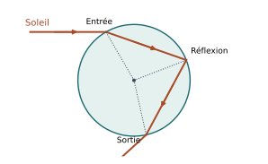
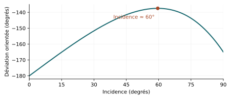
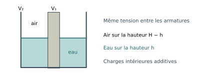
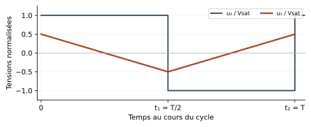
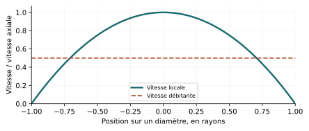
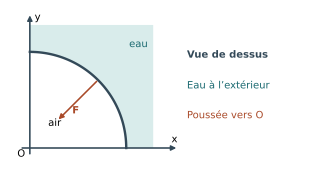

# Banque PT 2024 — Physique A · Corrigé guidé

*Corrigé rédigé par IA, non officiel. Signalez toute erreur.*

**Rédaction** · GPT-6.2 Astra Ultra · vitesse non renseignée

**Révision (tour 1)** · GPT-6.2 Astra Ultra · vitesse non renseignée

[Sujet officiel](https://www.banquept.fr/documents/2024/ph_a_2024_pt.pdf) · [Rapport du jury](https://www.banquept.fr/documents/ecrit/rapport/2024/rapport_phys_a_ecrit_2024.pdf) · [Livret de la session](https://www.banquept.fr/documents/livret/2024/Livret_PT_2024.pdf#page=13)

**Le cycle de l’eau de pluie.** De la chute d’une goutte jusqu’à l’énergie récupérée au barrage, le sujet relie la mécanique, l’optique, l’électronique et les écoulements. Les applications numériques utilisent les constantes et la précision demandées dans le feuillet.

## I.1 · Chute dans une atmosphère sèche

### Question 1 · Poussée d’Archimède sur la goutte

**Piste de résolution**

Identifier le fluide déplacé et le volume de la sphère immergée dans l’air.

La poussée est opposée au poids du volume d’air déplacé. Avec l’axe $Oz$ descendant et $V=4\pi R^3/3$, on a $\vec P_A=-\rho_a Vg\,\vec e_z$. La norme demandée est $P_A=4\pi\rho_a g R^3/3$, en newtons.

### Question 2 · Comparaison avec le poids

**Piste de résolution**

Les deux forces font intervenir le même volume et la même accélération de pesanteur.

Le poids de la goutte vaut $P=\rho_e Vg$. Ainsi $P_A/P=\rho_a/\rho_e=1/1000=10^{-3}$. La poussée représente 0,1 % du poids et sa prise en compte changerait le terme de pesanteur d’environ un millième. On la néglige pour la suite.

### Question 3 · Équation de chute dans l’air sec

**Piste de résolution**

Projeter le principe fondamental de la dynamique sur l’axe vertical descendant.

Dans le référentiel terrestre supposé galiléen, la chute s’effectue suivant $+\vec e_z$ et la traînée s’oppose à la vitesse. La projection donne $m\dot v=mg-6\pi\eta_a Rv$ avec $m=4\pi\rho_eR^3/3$. Ainsi $\dot v+[9\eta_a/(2\rho_eR^2)]v=g$, avec $v(0)=0$.

### Question 4 · Temps caractéristique de relaxation

**Piste de résolution**

Le coefficient de la vitesse dans l’équation normalisée est l’inverse d’une durée.

Écrivons $\dot v+v/\tau=g$. Alors $\tau=2\rho_eR^2/(9\eta_a)$. En utilisant $R=2\times10^{-4}$ m et $\eta_a=2\times10^{-5}$ Pa·s, on obtient environ 0,44 s, soit **0,4 s** à un chiffre significatif.

### Question 5 · Évolution de la vitesse

**Piste de résolution**

Chercher d’abord la vitesse constante qui annule la dérivée, puis utiliser la condition initiale.

La solution constante est $g\tau$ et le terme homogène est proportionnel à $\exp(-t/\tau)$. La goutte partant du repos, $v(t)=g\tau[1-\exp(-t/\tau)]$. Au tout début, $v(t)\simeq gt$, car la force de frottement s’annule à vitesse nulle.

### Question 6 · Vitesse limite dans le modèle de Stokes

**Piste de résolution**

Au régime limite, la force de traînée équilibre le poids.

Le modèle prévoit $v_\infty=g\tau=2\rho_e gR^2/(9\eta_a)$ vers le bas. Avec la valeur non arrondie de $\tau$, cela donne environ 4,4 m/s, soit **4 m/s** au chiffre significatif demandé. Son domaine de validité doit être confronté au nombre de Reynolds.

### Question 7 · Vérification du régime de traînée

**Piste de résolution**

Choisir le diamètre comme longueur caractéristique et la viscosité de l’air comme viscosité du fluide ambiant.

Le nombre de Reynolds instantané est $\mathrm{Re}(t)=\rho_a(2R)v(t)/\eta_a$. Il part de zéro et atteint, avec la vitesse limite du modèle, environ 89, soit **90**. La loi de Stokes suppose un écoulement rampant, $\mathrm{Re}\ll1$, bien plus restrictif que la simple absence de turbulence. Le seuil indicatif $\mathrm{Re}=1$ est déjà atteint pour $v=\eta_a/(2\rho_aR)=0{,}05$ m/s. L’estimation obtenue invalide donc l’usage de la loi de Stokes sur l’ensemble de la chute.

## I.2 · Chute dans une atmosphère humide

### Question 8 · Loi de croissance du rayon

**Piste de résolution**

Dériver le volume d’une sphère dont le rayon dépend du temps.

L’hypothèse de croissance s’écrit $\dot V=k\,4\pi r^2$ où $k$ est constant dans ce modèle. Or $V=4\pi r^3/3$ donne aussi $\dot V=4\pi r^2\dot r$. Par conséquent $\dot r=k$ et $r(t)=r_0+kt$. Le coefficient de croissance est une vitesse.

### Question 9 · Débit de masse captée

**Piste de résolution**

La densité du liquide demeure constante pendant la croissance.

La masse vaut $m(t)=4\pi\rho_e(r_0+kt)^3/3$. En dérivant, $\mathrm dm/\mathrm dt=4\pi\rho_e k(r_0+kt)^2$. Le débit de masse est positif lorsque de l’eau rejoint la goutte et se mesure en kilogrammes par seconde. Le rayon croît linéairement, mais le débit de masse captée augmente comme le carré du rayon.

### Question 10 · Équation pour une goutte en croissance

**Piste de résolution**

Développer la dérivée de la quantité de mouvement avant de diviser par la masse instantanée.

Avec le bilan de l’énoncé, $m\dot v+\dot m v=mg-6\pi\eta_a rv$. La matière captée est implicitement prise sans quantité de mouvement verticale initiale dans ce référentiel. Or $\dot m/m=3k/r$ et $6\pi\eta_a r/m=9\eta_a/(2\rho_e r^2)$. Ainsi $\dot v+[A/(r_0+kt)+B/(r_0+kt)^2]v=g$ avec $A=3k$ et $B=9\eta_a/(2\rho_e)$. Chacun des deux coefficients devant $v$ a la dimension d’une fréquence.

### Question 11 · Solution approchée en atmosphère humide

**Piste de résolution**

Écrire la solution homogène comme une puissance de $r_0+kt$. Tester ensuite une solution affine en temps.

Lorsque $r\gg B/A$, l’équation réduite est $\dot v+3kv/r=g$, avec $k>0$. L’intégration homogène donne $v_h=C/r^3$. Une solution affine est $v_p=g(r_0+kt)/(4k)$ puisque $\dot v_p=g/4$ et $3kv_p/r=3g/4$. Si l’on applique l’équation approchée depuis le départ au repos, $C=-gr_0^4/(4k)$, donc $v(t)=g[(r_0+kt)-r_0^4/(r_0+kt)^3]/(4k)$. Si l’approximation commence seulement à $t_*$, on conserve $v=v_p+C/r^3$ en fixant $C=[v(t_*)-v_p(t_*)]r(t_*)^3$ par continuité.

### Question 12 · Origine de la sphéricité

**Piste de résolution**

À volume donné, rechercher la forme dont la surface est minimale.

La tension superficielle de l’interface eau-air, $\gamma$, est aussi son énergie libre par unité d’aire, en J/m² ou en N/m. Former une aire $S$ coûte l’énergie $\gamma S$ à température et composition données. Une petite goutte tend donc vers la sphère, de surface minimale à volume fixé, tant que les sollicitations aérodynamiques restent faibles.

## II · Formation d’un arc-en-ciel

### Question 13 · Trois déviations orientées

**Piste de résolution**

Suivre les flèches de la figure 3. À la réflexion, le prolongement du rayon incident et sa demi-droite de retour diffèrent d’un angle plat.

Les déviations comptées positivement dans le sens trigonométrique sont $D_1=i_2-i_1$, $D_2=i_2+i_3-\pi$ et $D_3=i_4+i_3$. À la sortie, le rayon intérieur est repéré par l’angle $-i_3$ à la normale. À la réflexion, le changement de sens par rapport à la demi-droite incidente explique le terme $-\pi$. Par exemple, pour une incidence de 60° et $n=1{,}33$, les deux réfractions produisent chacune environ −19° et la réflexion interne environ −99°. Ces trois déviations sont bien horaires.

### Question 14 · Réfraction et réflexion interne

**Piste de résolution**

Employer la normale locale à chaque point. Dans le cercle, une corde fait le même angle en valeur absolue avec les deux rayons portés à ses extrémités.

À l’entrée, $\sin i_1=n\sin i_2$, donc $i_2=\arcsin(\sin i_1/n)$. La symétrie des angles de réflexion à la paroi donne $i_3=i_2$. À la sortie, $n\sin(-i_3)=\sin i_4$. On choisit la branche physique de la réfraction et on obtient $i_4=-i_1$. Le signe négatif provient du repérage orienté propre à la figure 3.

### Question 15 · Déviation totale de l’arc primaire

**Piste de résolution**

Ajouter les rotations successives de la direction de propagation.

L’angle total est $D=D_1+D_2+D_3=2i_2+2i_3-i_1+i_4-\pi$. En insérant les résultats de réfraction et de réflexion, on trouve $D(i_1)=4\arcsin(\sin i_1/n)-2i_1-\pi$. Pour une incidence nulle, le rayon repart en sens opposé et la formule donne $-\pi$.

### Question 16 · Incidence de déviation maximale

**Piste de résolution**

Dériver la fonction avant d’élever au carré. L’incidence physique est entre zéro et un angle droit.

La dérivée est $D'=4\cos i_1/\sqrt{n^2-\sin^2 i_1}-2$. Au point stationnaire, $2\cos i_1=\sqrt{n^2-\sin^2 i_1}$. Le carré fournit $4(1-\sin^2i_1)=n^2-\sin^2 i_1$, donc $\sin i_{1,\max}=\sqrt{(4-n^2)/3}$. Pour $1<n<2$, la dérivée est positive en zéro, négative en $\pi/2$ et ne s’annule qu’une fois. Le point stationnaire est un maximum.

### Question 17 · Valeur de la déviation maximale

**Piste de résolution**

Réemployer directement le sinus de l’incidence calculé à la question précédente.

Avec $s=\sqrt{(4-n^2)/3}$, $i_{1,\max}=\arcsin s$ et $D_{\max}=4\arcsin(s/n)-2\arcsin s-\pi$. À $n=1{,}33$, on trouve une incidence proche de 59,6° et une déviation orientée voisine de −138°. La direction de l’arc primaire est donc à environ 42° de la direction antisolaire.

### Question 18 · Dispersion de la déviation

**Piste de résolution**

Composer le sens de variation de la loi de Cauchy et celui de la courbe de la figure 5.

Avec $B>0$, $\mathrm dn/\mathrm d\lambda=-2B/\lambda^3<0$. La figure 5 montre que $D_{\max}$ décroît avec $n$. Par conséquent, **$D_{\max}$ augmente lorsque la longueur d’onde augmente**. Cette déviation orientée est négative, elle se rapproche donc de zéro vers le rouge.

### Question 19 · Domaine du visible

**Piste de résolution**

Donner des bornes approximatives et préciser la couleur de chaque extrémité.

Une plage usuelle du spectre visible s’étend d’environ **400 nm** dans le violet à environ **800 nm** dans le rouge. Les transitions sont progressives et dépendent de la sensibilité de l’œil. Les valeurs souvent utilisées de 380 à 780 nm sont également compatibles avec cette convention.

### Question 20 · Ordre des couleurs dans l’arc primaire

**Piste de résolution**

La direction de référence pour le rayon apparent de l’arc est la direction antisolaire.

L’écart angulaire au point antisolaire vaut $\alpha=\pi-|D_{\max}|=\pi+D_{\max}$. Comme la longueur d’onde du rouge dépasse celle du violet, $\alpha_{\rm rouge}>\alpha_{\rm violet}$. Le rouge est vers l’extérieur de l’anneau primaire, donc **au-dessus du violet au sommet de l’arc**.

### Question 21 · Origine des arcs supplémentaires

**Piste de résolution**

Compter les réflexions internes entre les deux réfractions à travers la surface de la goutte.

L’arc primaire provient d’une réflexion interne. Les rayons subissant deux réflexions internes ont un autre angle de déviation stationnaire et produisent l’arc secondaire, de rayon apparent plus grand et d’ordre chromatique inversé. Trois réflexions donnent un arc tertiaire, du côté du Soleil. Chaque réflexion supplémentaire ne conserve qu’une fraction de l’intensité, ce qui rend les ordres élevés difficiles à voir.

## III.1 · Capacité du pluviomètre

### Question 22 · Symétries du champ dans le condensateur

**Piste de résolution**

Identifier séparément les composantes possibles du champ et les coordonnées dont son module dépend.

Hors effets de bord, la distribution cylindrique est invariante par translation selon $z$ et rotation autour de $Oz$. Les composantes dans la base cylindrique peuvent donc dépendre seulement de $r$. Le plan méridien contenant $M$ et l’axe est un plan de symétrie des charges, donc le champ y appartient et $E_\theta=0$. Le plan perpendiculaire à l’axe passant par $M$ est aussi un plan de symétrie, donc $E_z=0$. Ainsi $\vec E(M)=E(r)\vec e_r$.

### Question 23 · Champ radial par le théorème de Gauss

**Piste de résolution**

Choisir une surface fermée et calculer la charge effectivement enfermée sur sa longueur.

Prenons un cylindre de Gauss coaxial, de rayon $a_1<r<a_2$ et de longueur $\ell$, fermé par deux disques. Le flux sur les bases est nul et le flux latéral vaut $2\pi r\ell E(r)$. La charge enfermée est $Q\ell/H$. Le théorème de Gauss donne $E(r)=Q/(2\pi\varepsilon_0Hr)$, dirigé vers l’armature externe car $Q>0$.

### Question 24 · Définition de la capacité à vide

**Piste de résolution**

Employer la charge de l’armature au potentiel le plus élevé pour obtenir une capacité positive.

L’armature intérieure porte $+Q$ et son potentiel est $V_1>V_2$. La capacité vaut $C_0=Q/(V_1-V_2)$. Le quotient d’un coulomb par un volt s’exprime en farads.

### Question 25 · Capacité géométrique du coaxial

**Piste de résolution**

Intégrer le champ entre les deux rayons dans le sens où le potentiel décroît.

La relation $\vec E=-\nabla V$ donne $V_1-V_2=\int_{a_1}^{a_2}E(r)\,\mathrm dr=Q\ln(a_2/a_1)/(2\pi\varepsilon_0H)$. Par conséquent $C_0=2\pi\varepsilon_0H/\ln(a_2/a_1)$. La capacité croît avec la hauteur des armatures et le logarithme porte sur un rapport sans dimension.

### Question 26 · Deux diélectriques à la même tension

**Piste de résolution**

Repérer les deux électrodes communes aux portions de condensateur superposées.

La partie inférieure remplie d’eau et la partie supérieure remplie d’air voient toutes deux la différence de potentiel $V_1-V_2$ entre les mêmes conducteurs. Les charges intérieures s’ajoutent, $Q=Q_{\rm eau}+Q_{\rm air}$. Ces capacités sont donc en parallèle et $C=C_{\rm eau}+C_{\rm air}$, en négligeant les effets de bord au niveau de l’interface.

### Question 27 · Loi de mesure de la hauteur

**Piste de résolution**

Remplacer la hauteur totale de chaque capacité partielle par sa hauteur propre.

En posant $L=\ln(a_2/a_1)$, les deux contributions sont $2\pi\varepsilon h/L$ et $2\pi\varepsilon_0(H-h)/L$. Leur somme est $C(h)=C_0[1+(\varepsilon/\varepsilon_0-1)h/H]$. Ainsi $A=(\varepsilon/\varepsilon_0-1)/H$ et $B=1$. À vide on retrouve $C_0$ et à remplissage complet $C(H)=(\varepsilon/\varepsilon_0)C_0$.

## III.2 · Conditionnement du pluviomètre

### Question 28 · Caractéristiques de l’ALI idéal

**Piste de résolution**

Distinguer le courant d’entrée, les impédances des bornes et le gain en boucle ouverte.

Un ALI idéal a des courants de polarisation nuls aux deux entrées, une impédance d’entrée infinie, une impédance de sortie nulle et un gain statique différentiel en boucle ouverte infini. Son alimentation borne ici sa tension de sortie entre $-V_{\rm sat}$ et $+V_{\rm sat}$.

### Question 29 · Fonctionnement du premier ALI

**Piste de résolution**

Examiner la borne à laquelle la sortie revient par la résistance de rétroaction.

La sortie $u_2$ revient par $R_2$ sur l’entrée non-inverseuse, alors que l’entrée inverseuse est à la masse. Cette réaction positive renforce toute perturbation de la tension différentielle. Le fonctionnement stable se fait sur l’un des deux rails de saturation. Cet étage est un comparateur à hystérésis.

### Question 30 · Potentiel de l’entrée non-inverseuse

**Piste de résolution**

Appliquer la loi des nœuds au point commun à $R_1$ et $R_2$ avec un courant d’entrée nul.

Le nœud de potentiel $V_+$ est relié à $u_1$ par $R_1$ et à $u_2$ par $R_2$. Alors $(u_1-V_+)/R_1+(u_2-V_+)/R_2=0$. On en tire $V_+=(R_2u_1+R_1u_2)/(R_1+R_2)$. L’autre borne est à $V_-=0$.

### Question 31 · Seuil inférieur du comparateur

**Piste de résolution**

Partir du rail positif et chercher le passage de la tension différentielle par zéro.

Avec $u_2=+V_{\rm sat}$, le basculement se produit lorsque $R_2u_1+R_1V_{\rm sat}=0$. Le seuil d’entrée à la descente est donc $U_1^-=-R_1V_{\rm sat}/R_2$. En franchissant ce seuil vers le bas, la sortie passe au rail négatif.

### Question 32 · Seuil supérieur du comparateur

**Piste de résolution**

Remplacer la sortie dans la condition de basculement par le rail négatif.

Avec $u_2=-V_{\rm sat}$, le seuil montant correspond à $R_2u_1-R_1V_{\rm sat}=0$. Ainsi $U_1^+=+R_1V_{\rm sat}/R_2$. La largeur d’hystérésis est $U_1^+-U_1^-=2(R_1/R_2)V_{\rm sat}$.

### Question 33 · Fonctionnement du second ALI

**Piste de résolution**

Identifier le signe de la rétroaction par le condensateur. Vérifier que la rampe reste entre les rails.

Le condensateur relie la sortie $u_3$ à l’entrée inverseuse. La rétroaction est négative pour les variations du signal. Dans le régime d’oscillation prévu, le second ALI travaille en fonctionnement linéaire et $V_-=V_+=0$. La rampe doit rester dans sa plage de sortie. Avec les mêmes rails pour les deux ALI, $R_1<R_2$ place les seuils strictement à l’intérieur de cette plage.

### Question 34 · Équation de l’intégrateur

**Piste de résolution**

Orienter le même courant depuis $u_2$ vers la masse virtuelle puis de la masse virtuelle vers le condensateur.

Le courant dans $R_2$ vaut $u_2/R_2$. Il traverse ensuite le condensateur de la borne à zéro vers la sortie, donc vaut $C(h)\,\mathrm d(0-u_3)/\mathrm dt$. Il en résulte $u_2=-R_2C(h)\dot u_3$. La constante demandée est $k=R_2C(h)>0$, de dimension temporelle.

### Question 35 · Première rampe de l’oscillateur

**Piste de résolution**

Le fil de retour impose l’égalité des tensions $u_1$ et $u_3$. Utiliser l’état de départ spécifié.

De $0$ au premier basculement, $u_2=+V_{\rm sat}$ est constante. En posant $C=C(h)$ pendant la mesure, on a $\dot u_3=-V_{\rm sat}/(R_2C)$. Comme $u_3(0)=U_1^+$, il vient $u_3(t)=(R_1/R_2)V_{\rm sat}-V_{\rm sat}t/(R_2C)$. Le condensateur impose la continuité de la rampe.

### Question 36 · Instant du premier basculement

**Piste de résolution**

Diviser l’écart entre les deux seuils par le module de la pente de la rampe.

La première descente s’achève pour $u_3(t_1)=U_1^-=-(R_1/R_2)V_{\rm sat}$. En égalant les deux expressions, on obtient $t_1=2R_1C$. La tension de saturation et $R_2$ se simplifient, car elles interviennent à la fois dans la pente et dans l’excursion à parcourir.

### Question 37 · Seconde rampe

**Piste de résolution**

Recoller la nouvelle solution à la valeur du condensateur à l’instant du basculement.

Entre $t_1$ et le basculement suivant, $u_2=-V_{\rm sat}$ et la pente devient $+V_{\rm sat}/(R_2C)$. La tension reste égale à $U_1^-$ à l’instant de commutation, donc $u_3(t)=-(R_1/R_2)V_{\rm sat}+V_{\rm sat}(t-t_1)/(R_2C)$, avec $t_1=2R_1C$.

### Question 38 · Retour à la saturation positive

**Piste de résolution**

Chercher le temps absolu écoulé depuis zéro, à distinguer de la durée de la seconde rampe.

Le second basculement vérifie $u_3(t_2)=U_1^+$. Ainsi $t_2-t_1=2R_1C$ et $t_2=4R_1C$. À cet instant, le comparateur change de rail et la tension du condensateur a retrouvé sa valeur initiale.

### Question 39 · Créneau et triangle sur une période

**Piste de résolution**

Reporter les trois instants de commutation sur les mêmes axes temporels.

La sortie $u_2$ est un créneau, positif entre $0$ et $t_1$ et négatif entre $t_1$ et $t_2$. Elle reprend $+V_{\rm sat}$ en $t_2$. La tension $u_3$ suit un triangle continu du seuil $+U$ vers $-U$, puis remonte à $+U$, avec $U=R_1V_{\rm sat}/R_2$. Les pentes sont respectivement négative et positive. La figure illustre le cas $R_1/R_2=1/2$.

### Question 40 · Période de l’astable

**Piste de résolution**

Vérifier que les deux sorties et le sens d’évolution ont retrouvé leur état de départ.

Les deux signaux recommencent le même cycle après $t_2$, donc $T=4R_1C(h)$. Le rapport cyclique du créneau vaut un demi et la fréquence est $1/[4R_1C(h)]$. L’eau de pluie recueillie augmente la capacité et donc la période mesurée.

## III.3 · Mesure des précipitations

### Question 41 · Hauteur de pluie et aire de collecte

**Piste de résolution**

Comparer le volume recueilli au volume de pluie tombé sur la même aire horizontale. Préciser l’aire utilisée si l’on définit une hauteur équivalente.

L’ouverture active est l’anneau d’aire $S_a=\pi(a_2^2-a_1^2)$. Le volume recueilli est $S_a h$. Sous une pluie verticale uniforme de hauteur locale $h_s$, il tombe $S_a h_s$ sur cette même ouverture. La hauteur météorologique est donc $h_s=h$. Si l’on rapporte le seul volume collecté à toute l’emprise du cylindre extérieur, la hauteur équivalente sur ce disque est $h_{\rm disque}=S_a h/(\pi a_2^2)=[1-(a_1/a_2)^2]h$. La pluie tombant sur l’électrode centrale n’entre pas dans le volume collecté.

### Question 42 · Inversion de la loi de mesure

**Piste de résolution**

Diviser la période par sa valeur à vide. Le niveau zéro doit correspondre à la période à vide.

L’astable donne $C/C_0=T/(4R_1C_0)$. En inversant la relation affine de la question 27, on obtient pour la hauteur de pluie $h_s=h=H[T/(4R_1C_0)-1]/(\varepsilon/\varepsilon_0-1)$. Les rayons interviennent dans $C_0$ et se simplifient dans le bilan de l’ouverture annulaire. Pour la convention de volume rapporté au disque extérieur évoquée à la question 41, il faut multiplier le membre de droite par $1-(a_1/a_2)^2$.

### Question 43 · Hauteur après l’averse

**Piste de résolution**

Calculer d’abord la période à vide à partir de la capacité fournie parmi les données numériques.

Avec $R_1=10^3$ Ω et $C_0=10$ nF, $T_0=4R_1C_0=40$ µs. Le rapport $T/T_0=44/40=1{,}1$ donne $h_s=(0{,}10\ \mathrm m)\times0{,}1/80=1{,}25\times10^{-4}$ m. Au chiffre significatif demandé, cela représente **0,1 mm de pluie**. La hauteur rapportée au disque complet vaut $8/9$ de cette valeur, soit environ 0,11 mm avant l’arrondi. L’application utilise la valeur de $C_0$ donnée explicitement pour le capteur. La formule du coaxial idéal de la question 25, appliquée aux rayons et à la hauteur fournis, donnerait seulement environ 5 pF. Les deux jeux de données ne coïncident donc pas.

## IV · Remplissage d’une nappe phréatique

### Question 44 · Condition sur la paroi du capillaire

**Piste de résolution**

Appliquer l’adhérence visqueuse à la roche immobile. Préciser aussi la régularité de la solution sur l’axe.

La condition de non-glissement sur la paroi fixe du capillaire impose $\vec v(a)=\vec0$, soit $v(a)=0$. En outre la vitesse reste finie en $r=0$ et le profil régulier y a une pente nulle. Ces conditions déterminent les constantes d’intégration.

### Question 45 · Profil de vitesse dans la roche

**Piste de résolution**

Projeter l’équation sur la verticale et intégrer deux fois en imposant la régularité puis l’adhérence.

La projection donne $(rv')'=-(\rho_e g/\eta_e)r$. Une première intégration donne $rv'=-\rho_e g r^2/(2\eta_e)+C_1$. Un $C_1$ non nul conduirait à un terme logarithmique singulier sur l’axe. Donc $C_1=0$ et $v(r)=-\rho_e g r^2/(4\eta_e)+C_2$. Avec $v(a)=0$, on trouve $v(r)=K(a^2-r^2)$ où $K=\rho_e g/(4\eta_e)$. Le maximum se situe sur l’axe.

### Question 46 · Durée minimale de percolation

**Piste de résolution**

Le trajet le plus rapide emprunte la ligne de courant dont la vitesse axiale est la plus élevée.

La vitesse centrale vaut $v_{\max}=\rho_e g a^2/(4\eta_e)=2{,}5\times10^{-6}$ m/s. Pour $H=10^3$ m, $\Delta t_{\min}=H/v_{\max}=4\eta_e H/(\rho_e g a^2)=4\times10^8$ s. Cela correspond à environ 13 ans, soit de l’ordre de **dix ans**.

### Question 47 · Débit à travers une section

**Piste de résolution**

Intégrer la vitesse sur les couronnes élémentaires et tenir compte de leur aire.

Pour une couronne de rayon $r$ et d’épaisseur $\mathrm dr$, $\mathrm dS=2\pi r\,\mathrm dr$. Ainsi $D_v=2\pi K\int_0^a(a^2-r^2)r\,\mathrm dr=\pi K a^4/2=\pi\rho_e g a^4/(8\eta_e)$. Le débit est compté positivement vers le bas et se mesure en m³/s.

### Question 48 · Vitesse moyenne débitante

**Piste de résolution**

La vitesse débitante est celle d’un profil uniforme donnant le même débit.

On obtient $\bar v=D_v/(\pi a^2)=\rho_e g a^2/(8\eta_e)=v_{\max}/2$. La moyenne est pondérée par l’aire des couronnes. Pour le capillaire du sujet, $\bar v=1{,}25\times10^{-6}$ m/s avant arrondi.

### Question 49 · Temps moyen de traversée

**Piste de résolution**

Diviser le volume liquide contenu dans le capillaire par le volume qui en sort par seconde.

Le temps de séjour moyen du flux entrant vaut $\Delta t_{\rm moy}=\pi a^2H/D_v=H/\bar v=8\eta_eH/(\rho_e g a^2)=2\Delta t_{\min}$. Numériquement, **$8\times10^8$ s**, environ 25 ans. Cette moyenne pondère chaque temps de parcours $H/v(r)$ par le débit local $v(r)\,\mathrm dS$. Ainsi les lignes de courant proches de la paroi sont lentes et transportent très peu d’eau.

### Question 50 · Minéralisation pendant l’infiltration

**Piste de résolution**

Relier l’échelle de temps de l’écoulement au contact de l’eau avec la roche.

L’eau circulant lentement dans des pores étroits reste en contact avec une grande surface de roche pendant des années dans ce modèle. La dissolution progressive de minéraux, notamment des carbonates dans un sol calcaire, y libère des ions. Leur présence explique qu’une eau de source puisse être plus minéralisée qu’une eau de pluie récente. Les temps chiffrés dépendent de l’idéalisation des pores en capillaires rectilignes.

## V · Production hydroélectrique

### Question 51 · Direction de la poussée sur un quart de cylindre

**Piste de résolution**

Vue de dessus, associer chaque élément du premier quadrant à son image par réflexion dans la droite $y=x$.

Les forces latérales sont horizontales. Deux éléments symétriques par rapport à la bissectrice $y=x$ ont même pression. Leurs composantes perpendiculaires à cette bissectrice se compensent. Dans la figure 9, l’eau se trouve à l’extérieur de l’arc et exerce la plus forte pression sous la surface libre. La résultante est donc dirigée **vers le centre du quart de cercle**, selon $-(\vec e_x+\vec e_y)/\sqrt2$.

### Question 52 · Force atmosphérique sur la face intérieure

**Piste de résolution**

Intégrer le vecteur radial tout autour du quart de cercle. Il change de direction avec l’angle.

Sur la face intérieure, l’air pousse vers les rayons croissants. Avec $\mathrm dS=R\,\mathrm d\theta\,\mathrm dz$ et $\vec e_r=\cos\theta\,\vec e_x+\sin\theta\,\vec e_y$, la somme vaut $\vec F_{\rm air}=P_0R\int_0^H\mathrm dz\int_0^{\pi/2}\vec e_r\,\mathrm d\theta=P_0RH(\vec e_x+\vec e_y)$. Le module du vecteur intégré diffère de l’intégrale des modules.

### Question 53 · Pression hydrostatique du réservoir

**Piste de résolution**

Partir de la surface libre et intégrer avec l’axe vertical ascendant.

Dans l’eau au repos, $\mathrm dP/\mathrm dz=-\rho_e g$. La surface libre à $z=H$ vérifie $P(H)=P_0$. Ainsi $P(z)=P_0+\rho_e g(H-z)$ pour $0\leq z\leq H$. La pression augmente avec la profondeur.

### Question 54 · Force de l’eau sur la face extérieure

**Piste de résolution**

La force élémentaire est normale à la surface et dirigée vers le centre. Intégrer séparément la profondeur et l’angle.

L’eau pousse selon $-\vec e_r$. On a $\vec F_{\rm eau}=-R\int_0^H[P_0+\rho_e g(H-z)]\,\mathrm dz\int_0^{\pi/2}\vec e_r\,\mathrm d\theta$. Après intégration, $\vec F_{\rm eau}=-R(P_0 H+\rho_e gH^2/2)(\vec e_x+\vec e_y)$. Le signe concorde avec le côté occupé par l’eau sur la vue de dessus.

### Question 55 · Norme de la résultante

**Piste de résolution**

Additionner d’abord les deux vecteurs. La pression atmosphérique agit des deux côtés.

Les termes proportionnels à $P_0$ s’annulent. Il reste $\vec F=-R\rho_e gH^2(\vec e_x+\vec e_y)/2$. Puisque $\|\vec e_x+\vec e_y\|=\sqrt2$, la norme est $F=R\rho_e gH^2/\sqrt2$. Elle a la dimension d’une pression multipliée par une aire.

### Question 56 · Valeur de la force dans le modèle de voûte

**Piste de résolution**

Les 568 m indiqués dans le sujet mesurent l’arc du quart de cercle. En déduire le rayon avant la substitution.

L’arc mesure $\pi R/2=568$ m, soit $R=2\times568/\pi\simeq362$ m. Pour $H=305$ m, $F=(2\times568/\pi)\times10^3\times10\times305^2/\sqrt2$. Le modèle du réservoir rempli donne environ $2{,}38\times10^{11}$ N, soit **$2\times10^{11}$ N** au chiffre significatif demandé.

### Question 57 · Puissance hydraulique moyenne

**Piste de résolution**

Calculer l’énergie potentielle perdue par kilogramme, puis multiplier par le débit de masse.

Le débit volumique moyen est $Q_v=2{,}0\times10^{10}/(365\times24\times3600)\simeq634$ m³/s. Avec une chute idéale de hauteur $H$, la puissance hydraulique disponible est $P_h=\rho_e Q_v gH\simeq1{,}93\times10^9$ W, soit **2 GW**. Pour un rendement global $\eta$, la production électrique effective serait $\eta P_h$. Le sujet ne donne pas de rendement.

### Question 58 · Comparaison avec la production nucléaire

**Piste de résolution**

Comparer les puissances dans une même unité. Préciser la différence entre une tranche et une centrale à plusieurs tranches.

Une tranche électronucléaire de puissance est typiquement de l’ordre du gigawatt électrique. Les quelque 2 GW hydrauliques estimés sont donc du même ordre de grandeur qu’une centrale nucléaire comptant une ou quelques tranches, avant prise en compte des rendements et des conditions d’exploitation.
