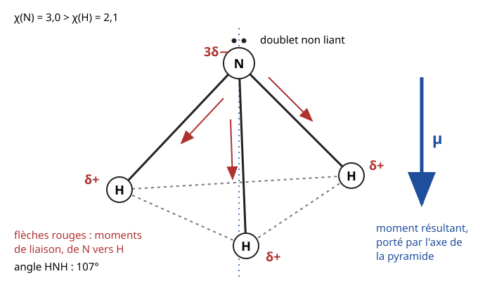
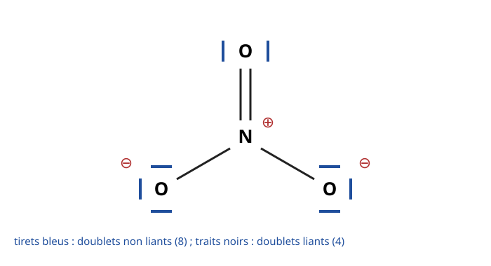
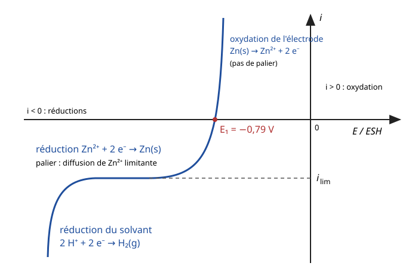
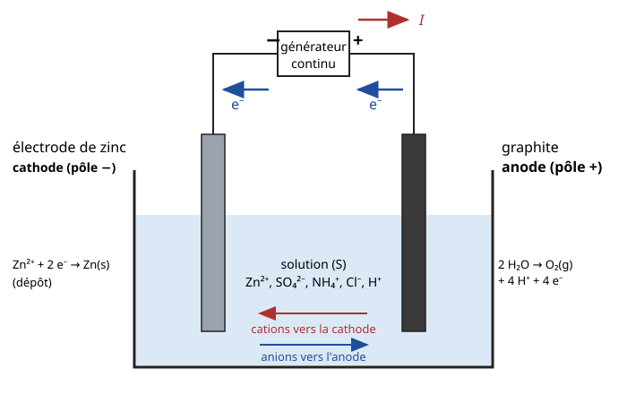
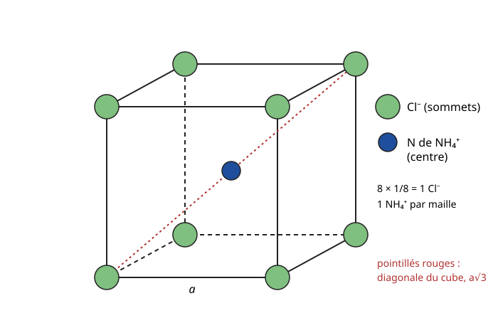

# Banque PT PT — Physique B - Chimie 2024 · Corrigé brut

*Corrigé rédigé par IA, non officiel. Signalez toute erreur.*

**Rédaction** · modèle exact non renseigné (famille Claude) · effort non renseigné · vitesse non renseignée

**Révision (tour 2)** · modèle exact non renseigné (famille Claude) · effort non renseigné · vitesse non renseignée · 28 novembre 2026

Sujet « Azote et phosphore » : 38 questions numérotées de 1 à 38, en trois parties indépendantes, durée 2 heures, calculatrice interdite. Les applications numériques utilisent les valeurs approchées du sujet ($\ln10\approx2{,}3$ ; $\tfrac{RT}{\mathcal F}\ln10=0{,}06\ \mathrm V$ à 298 K).

## Partie A — L'ammoniac et la phosphine

## A.1 — Structures et changements d'état

### Question 1 — Polarité de l'ammoniac

Le tableau donne $\chi(\mathrm N)=3{,}0$ et $\chi(\mathrm H)=2{,}1$. L'azote, plus électronégatif, attire vers lui les doublets liants : chaque liaison $\mathrm{N-H}$ est polarisée, l'azote porte une charge partielle négative et chaque hydrogène une charge partielle $+\delta$ (soit $-3\delta$ sur l'azote).

Chaque liaison porte un moment dipolaire $\vec\mu_i$, dirigé par convention de la charge négative vers la charge positive, donc de $\mathrm N$ vers $\mathrm H$. Les trois vecteurs ont la même norme et sont disposés symétriquement autour de l'axe de la pyramide (axe passant par $\mathrm N$ et par le centre du triangle des hydrogènes). Leurs composantes perpendiculaires à l'axe se compensent ; leurs composantes sur l'axe s'ajoutent, car la molécule est pyramidale et non plane.

$$\vec\mu=\vec\mu_1+\vec\mu_2+\vec\mu_3\neq\vec 0$$

**L'ammoniac est une molécule polaire.** Son moment dipolaire est porté par l'axe de la pyramide et dirigé de l'azote vers le centre de la base formée par les trois hydrogènes (le doublet non liant de l'azote, situé à l'opposé de la base, renforce ce moment).

### Question 2 — Cohésion de l'ammoniac liquide

La cohésion du liquide est assurée par des interactions **intermoléculaires**, de deux types.

- Les **interactions de van der Waals**, attractives et de courte portée : interaction entre dipôles permanents (Keesom), entre dipôle permanent et dipôle induit (Debye), entre dipôles instantanés (London). Énergie de l'ordre de **1 à 10 kJ·mol⁻¹**.
- Les **liaisons hydrogène** : un hydrogène lié à un azote (très électronégatif) interagit avec le doublet non liant de l'azote d'une molécule voisine, $\mathrm{N-H\cdots N}$. Énergie de l'ordre de **10 à 40 kJ·mol⁻¹**.

À titre de comparaison, une liaison covalente représente plusieurs centaines de kJ·mol⁻¹ : la vaporisation ne rompt aucune liaison $\mathrm{N-H}$.

### Question 3 — Températures d'ébullition comparées

La température d'ébullition est d'autant plus élevée que les interactions intermoléculaires à vaincre sont fortes.

- Dans l'ammoniac liquide, les molécules sont associées par **liaisons hydrogène**, en plus des interactions de van der Waals.
- Pour la phosphine, $\chi(\mathrm P)=2{,}2\approx\chi(\mathrm H)=2{,}1$ : les liaisons $\mathrm{P-H}$ sont quasiment non polarisées, la molécule est très peu polaire et **ne forme pas de liaison hydrogène**. Seules subsistent des interactions de van der Waals, essentiellement de type London.

La phosphine est plus volumineuse, donc plus polarisable, ce qui renforce l'interaction de London ; cet effet ne compense pas l'absence de liaisons hydrogène, nettement plus énergétiques. D'où $T_{\text{éb}}(\mathrm{NH_3})=-33\,^\circ\mathrm C$, supérieure de $100\,^\circ\mathrm C$ à $T_{\text{éb}}(\mathrm{PH_3})=-133\,^\circ\mathrm C$.

## A.2 — Thermodynamique de décomposition de la phosphine

### Question 4 — Effet d'une élévation de pression

Le solide $\mathrm{P_4(s)}$ a une activité égale à 1. Avec $P_i=x_iP$ pour les gaz parfaits :

$$Q_r=\frac{\left(P_{\mathrm{H_2}}/P^\circ\right)^6}{\left(P_{\mathrm{PH_3}}/P^\circ\right)^4}=\frac{x_{\mathrm{H_2}}^{\,6}}{x_{\mathrm{PH_3}}^{\,4}}\left(\frac{P}{P^\circ}\right)^{2}$$

Le système est initialement à l'équilibre : $Q_r=K^\circ(T)$. On augmente $P$ à température constante ($K^\circ$ inchangée) et à composition constante (fractions molaires inchangées) : $Q_r$ augmente, donc juste après la perturbation $Q_r>K^\circ$.

Le système évolue alors dans le sens qui fait diminuer $Q_r$, c'est-à-dire le **sens indirect**.

$$\boxed{\text{Une élévation de pression déplace l'équilibre (R1) dans le sens indirect, celui de la formation de } \mathrm{PH_3}.}$$

C'est le sens qui diminue la quantité de gaz (6 moles de gaz donnent 4 moles de gaz).

### Question 5 — Signification de l'enthalpie de formation nulle

L'enthalpie standard de formation d'une espèce est l'enthalpie standard de la réaction qui la forme à partir des corps simples pris dans l'**état standard de référence** de chaque élément. Elle est nulle, à toute température, pour le corps simple qui constitue lui-même cet état de référence.

$$\boxed{\mathrm{P_4(s)} \text{ est l'état standard de référence de l'élément phosphore.}}$$

### Question 6 — Enthalpie standard de réaction

Loi de Hess, avec $\Delta_fH^\circ(\mathrm{H_2(g)})=0$ (dihydrogène gazeux : état standard de référence de l'élément hydrogène) et $\Delta_fH^\circ(\mathrm{P_4(s)})=0$ :

$$\begin{aligned}
\Delta_rH^\circ&=\Delta_fH^\circ(\mathrm{P_4(s)})+6\,\Delta_fH^\circ(\mathrm{H_2(g)})-4\,\Delta_fH^\circ(\mathrm{PH_3(g)})\\
&=-4\times5{,}6\ \mathrm{kJ\cdot mol^{-1}}
\end{aligned}$$

$$\boxed{\Delta_rH^\circ=-22\ \mathrm{kJ\cdot mol^{-1}}}$$

(valeur calculée $-22{,}4$, donnée avec deux chiffres significatifs comme $5{,}6$). $\Delta_rH^\circ<0$ : la réaction est **exothermique**.

### Question 7 — Signe de l'entropie standard de réaction

L'entropie molaire d'un gaz est très supérieure à celle d'un solide ; le signe de $\Delta_rS^\circ$ est donc celui de la variation de la quantité de gaz :

$$\sum_{\text{gaz}}\nu_i=6-4=+2>0$$

La réaction augmente la quantité de gaz (et forme en plus un solide), donc le désordre :

$$\boxed{\Delta_rS^\circ>0}$$

### Question 8 — Expression de la constante d'équilibre

Par définition de la constante d'équilibre et de l'enthalpie libre standard de réaction :

$$\Delta_rG^\circ(T)=-RT\ln K^\circ(T)$$

$$\Delta_rG^\circ(T)=\Delta_rH^\circ-T\,\Delta_rS^\circ$$

d'où

$$\boxed{K^\circ(T)=\exp\!\left(-\frac{\Delta_rH^\circ}{RT}+\frac{\Delta_rS^\circ}{R}\right)}$$

Avec $\Delta_rH^\circ<0$ et $\Delta_rS^\circ>0$, les deux termes de l'exponentielle sont positifs : $K^\circ>1$ à toute température, ce qui est cohérent avec la valeur $K^\circ(800\ \mathrm K)=5\times10^{6}$ annoncée par le sujet et avec l'hypothèse de réaction totale faite ensuite.

## A.3 — Cinétique de décomposition de la phosphine

### Question 9 — Chauffer ou refroidir le réacteur

D'après la question 6, $\Delta_rH^\circ<0$ : la décomposition de la phosphine est exothermique, elle libère de l'énergie thermique. Si rien n'était fait, la température du milieu augmenterait. Pour maintenir $T=800\ \mathrm K$, cette énergie doit être évacuée vers l'extérieur.

$$\boxed{\text{L'opérateur doit refroidir le réacteur.}}$$

Remarque : le réacteur étant indéformable, le transfert thermique reçu par le système vaut $Q=\Delta U=\xi\,\Delta_rU^\circ$, avec $\Delta_rU^\circ=\Delta_rH^\circ-RT\sum_{\text{gaz}}\nu_i=\Delta_rH^\circ-2RT$. Cette grandeur est encore plus négative que $\Delta_rH^\circ$ : la conclusion est inchangée, $Q<0$. Cette conclusion repose sur l'équation (R1) telle que l'écrit le sujet, avec du phosphore solide : c'est aussi ce choix qui donne la relation de la question 11.

### Question 10 — Tableau d'avancement

Avancement $\xi$ en moles ; le réacteur est initialement vide, il ne contient à $t=0$ que la phosphine.

| | $\mathrm{PH_3(g)}$ | $\mathrm{P_4(s)}$ | $\mathrm{H_2(g)}$ | total gaz |
|---|---|---|---|---|
| état initial | $n_0$ | $0$ | $0$ | $n_0$ |
| avancement $\xi$ | $n_0-4\xi$ | $\xi$ | $6\xi$ | $n_0+2\xi$ |

La réaction étant totale, $\xi_{\max}=n_0/4$.

### Question 11 — Relation entre les pressions

À $T$ et $V$ constants, pour des gaz parfaits :

$$P_0=\frac{n_0RT}{V}$$

$$P=\frac{(n_0+2\xi)RT}{V}=P_0+\frac{2\xi RT}{V}$$

$$P_{\mathrm{PH_3}}=\frac{(n_0-4\xi)RT}{V}=P_0-2\times\frac{2\xi RT}{V}$$

La deuxième relation donne $\dfrac{2\xi RT}{V}=P-P_0$, que l'on reporte dans la troisième :

$$P_{\mathrm{PH_3}}=P_0-2(P-P_0)$$

$$\boxed{P_{\mathrm{PH_3}}=3P_0-2P}$$

Vérification : à $t=0$, $P=P_0$ et $P_{\mathrm{PH_3}}=P_0$ ; en fin de réaction totale, $P=\tfrac32P_0$ et $P_{\mathrm{PH_3}}=0$.

### Question 12 — Concentration en phosphine

Loi des gaz parfaits appliquée à la phosphine seule : $P_{\mathrm{PH_3}}V=n_{\mathrm{PH_3}}RT$, donc

$$\boxed{C_{\mathrm{PH_3}}=\frac{n_{\mathrm{PH_3}}}{V}=\frac{P_{\mathrm{PH_3}}}{RT}=\frac{3P_0-2P}{RT}}$$

Avec $P$ en pascals, $C_{\mathrm{PH_3}}$ est en $\mathrm{mol\cdot m^{-3}}$ ; il faut diviser par $10^3$ pour l'obtenir en $\mathrm{mol\cdot L^{-1}}$.

### Question 13 — Ordre 1 et loi intégrée

Notons $C=C_{\mathrm{PH_3}}$. La vitesse volumique de la réaction (R1) est

$$v=\frac1V\frac{\mathrm d\xi}{\mathrm dt}=-\frac14\frac{\mathrm dC}{\mathrm dt}$$

Si la réaction est d'ordre 1 par rapport à la phosphine, $v=kC$, soit

$$\frac{\mathrm dC}{\mathrm dt}=-4kC$$

$$\boxed{\ln C_{\mathrm{PH_3}}(t)=\ln C_0-4kt\quad\Longleftrightarrow\quad C_{\mathrm{PH_3}}(t)=C_0\,\mathrm e^{-4kt}}$$

Pour l'ordre 1, c'est donc $\ln C$ qui est une fonction affine de $t$ ; pour l'ordre 0 ce serait $C$, et pour l'ordre 2 ce serait $1/C$.

Lecture de la figure 2 du sujet :

- tracé de $C=f(t)$ : les points dessinent une courbe nettement incurvée (décroissance de type exponentiel), ils sont au-dessus de la droite de régression au début et à la fin, au-dessous au milieu : l'ordre 0 est exclu ;
- tracé de $1/C=g(t)$ : même défaut, écarts systématiques et très importants en fin d'expérience : l'ordre 2 est exclu ;
- tracé de $\ln C=h(t)$ : les points expérimentaux sont **raisonnablement alignés** sur la droite de régression, répartis de part et d'autre sans courbure d'ensemble, sur toute la durée de l'expérience.

Le modèle affine convient pour $\ln C$ : **la décomposition de la phosphine suit une loi de vitesse d'ordre 1.** L'ordonnée à l'origine de la régression, $-6{,}93$, correspond bien à $\ln C_0$ avec $C_0\approx1{,}0\times10^{-3}\ \mathrm{mol\cdot L^{-1}}$, valeur lue à $t=0$ sur le premier tracé ($\ln10^{-3}=-3\times2{,}3=-6{,}9$).

### Question 14 — Valeur de la constante de vitesse

La régression du tracé $\ln C=h(t)$ donne une pente $-5{,}05\times10^{-4}\ \mathrm{s^{-1}}$ (temps en secondes). Par identification avec $\ln C=\ln C_0-4kt$ :

$$4k=5{,}05\times10^{-4}\ \mathrm{s^{-1}}$$

$$\boxed{k=\frac{5{,}05\times10^{-4}}{4}=1{,}26\times10^{-4}\ \mathrm{s^{-1}}}$$

Pour un ordre 1, $k$ est homogène à l'inverse d'un temps. Avec la convention $\mathrm dC/\mathrm dt=-k_{\text{app}}C$, on lirait directement $k_{\text{app}}=5{,}05\times10^{-4}\ \mathrm{s^{-1}}$ ; l'énoncé ne tranche pas entre les deux écritures, et $\tau$ (questions 15 et 16) n'en dépend pas.

### Question 15 — Temps de décomposition de 90 %

À l'instant $\tau$, il reste 10 % de la phosphine initiale : $C(\tau)=C_0/10$. La loi intégrée donne

$$\ln\frac{C(\tau)}{C_0}=-\ln10=-4k\tau$$

$$\boxed{\tau=\frac{\ln10}{4k}}$$

Ce temps ne dépend pas de $C_0$, comme tout temps de réaction fractionnaire d'une loi d'ordre 1.

### Question 16 — Évaluation numérique du temps

Lecture graphique (figure 2 du sujet, tracé $C=f(t)$) : $C_0\approx1{,}0\times10^{-3}\ \mathrm{mol\cdot L^{-1}}$ à $t=0$ ; la concentration atteint $C_0/10=1{,}0\times10^{-4}\ \mathrm{mol\cdot L^{-1}}$ pour le point situé vers $t\approx4{,}6\times10^{3}\ \mathrm s$ (entre les graduations 4000 et 5000). De même, sur le tracé de $\ln C$, l'ordonnée $-6{,}9-2{,}3=-9{,}2$ est atteinte vers $4{,}5\times10^{3}\ \mathrm s$.

Confirmation par le calcul :

$$\tau=\frac{\ln10}{4k}=\frac{2{,}3}{5{,}05\times10^{-4}}\ \mathrm s$$

$$\boxed{\tau\approx4{,}6\times10^{3}\ \mathrm s}$$

soit environ 1 h 15 min.

## Partie B — Titrage des ions nitrate dans un engrais

### Question 17 — Schéma de Lewis de l'ion nitrate

Décompte : $5$ (N) $+\,3\times6$ (O) $+\,1$ (charge) $=24$ électrons de valence, soit 12 doublets.

L'azote est central, lié aux trois oxygènes. Pour respecter l'octet sur chaque atome :

- une liaison double $\mathrm{N=O}$ ; cet oxygène porte deux doublets non liants et aucune charge formelle ;
- deux liaisons simples $\mathrm{N-O}$ ; chacun de ces oxygènes porte trois doublets non liants et une charge formelle $-1$ ;
- l'azote, engagé dans quatre doublets liants et sans doublet non liant, porte une charge formelle $+1$.

Vérifications : $4$ doublets liants $+\,2+3+3=8$ doublets non liants, soit 12 doublets ; somme des charges formelles $+1-1-1=-1$, charge de l'ion ; octet respecté pour les quatre atomes. Trois formules mésomères équivalentes s'obtiennent en déplaçant la double liaison : les trois liaisons $\mathrm{N-O}$ sont en réalité identiques et l'ion est plan triangulaire.

### Question 18 — Constante d'équilibre de la réaction (R2)

Demi-équations :

$$\mathrm{NO_3^-(aq)+4\,H^+(aq)+3\,e^-=NO(g)+2\,H_2O(\ell)}\qquad E_1^\circ=0{,}97\ \mathrm V$$

$$\mathrm{Fe^{3+}(aq)+e^-=Fe^{2+}(aq)}\qquad E_2^\circ=0{,}77\ \mathrm V$$

(R2) est la première demi-équation moins trois fois la seconde : elle met en jeu $n=3$ électrons. Par combinaison des enthalpies libres standard :

$$\Delta_rG^\circ=-3\mathcal FE_1^\circ+3\mathcal FE_2^\circ=-RT\ln K^\circ$$

$$\log K^\circ=\frac{3\left(E_1^\circ-E_2^\circ\right)}{\dfrac{RT}{\mathcal F}\ln10}=\frac{3\times(0{,}97-0{,}77)}{0{,}06}=10$$

$$\boxed{K^\circ=10^{10}}$$

Commentaire : $K^\circ\gg1$ (supérieure à $10^{4}$), la réaction est thermodynamiquement très favorable et peut être considérée comme **totale**, en accord avec l'énoncé et avec la règle du gamma (l'oxydant le plus fort, $\mathrm{NO_3^-}$, réagit avec le réducteur le plus fort, $\mathrm{Fe^{2+}}$). Le chauffage à $60\,^\circ\mathrm C$ pendant 15 minutes répond à une exigence cinétique, non thermodynamique.

### Question 19 — Réaction support du titrage

Demi-équations (milieu acide) :

$$\mathrm{Cr_2O_7^{2-}(aq)+14\,H^+(aq)+6\,e^-=2\,Cr^{3+}(aq)+7\,H_2O(\ell)}$$

$$\mathrm{Fe^{2+}(aq)=Fe^{3+}(aq)+e^-}\qquad(\times6)$$

$$\boxed{\mathrm{Cr_2O_7^{2-}(aq)+6\,Fe^{2+}(aq)+14\,H^+(aq)=2\,Cr^{3+}(aq)+6\,Fe^{3+}(aq)+7\,H_2O(\ell)}\qquad(R3)}$$

Vérification des charges : $-2+12+14=+24$ à gauche, $+6+18=+24$ à droite.

### Question 20 — Quantité d'ions fer(II) restants

À l'équivalence du titrage, d'après (R3) :

$$\frac{n_1}{6}=n(\mathrm{Cr_2O_7^{2-}})_{\text{versé}}=c_2V_2$$

$$\boxed{n_1=6\,c_2V_2}$$

$$n_1=6\times2{,}00\times10^{-2}\times10{,}0\times10^{-3}$$

$$\boxed{n_1=1{,}20\times10^{-3}\ \mathrm{mol}}$$

### Question 21 — Quantité d'ions nitrate

Quantité de fer(II) introduite : $c_1V_1$. Quantité consommée par (R2) : $c_1V_1-n_1$. Les ions nitrate étant le réactif limitant de la réaction totale (R2), qui consomme 3 $\mathrm{Fe^{2+}}$ par $\mathrm{NO_3^-}$ :

$$\boxed{n(\mathrm{NO_3^-})=\frac{c_1V_1-n_1}{3}}$$

$$c_1V_1=2{,}00\times10^{-1}\times30{,}0\times10^{-3}=6{,}00\times10^{-3}\ \mathrm{mol}$$

$$n(\mathrm{NO_3^-})=\frac{6{,}00\times10^{-3}-1{,}20\times10^{-3}}{3}$$

$$\boxed{n(\mathrm{NO_3^-})=1{,}60\times10^{-3}\ \mathrm{mol}}$$

Le fer(II) était bien en excès : $n_1>0$.

### Question 22 — Pourcentage massique en ions nitrate

$$m(\mathrm{NO_3^-})=n(\mathrm{NO_3^-})\,M_{\mathrm{NO_3^-}}=1{,}60\times10^{-3}\times62=9{,}9\times10^{-2}\ \mathrm g=99\ \mathrm{mg}$$

$$w=\frac{m(\mathrm{NO_3^-})}{m}=\frac{99}{400}$$

$$\boxed{w\approx25\ \%}$$

(valeur calculée $24{,}8\ \%$ ; deux chiffres significatifs, comme la masse molaire fournie).

## Partie C — Utilisations du chlorure d'ammonium

## C.1 — Mesure de son enthalpie standard de dissolution

### Question 23 — Équation de dissolution

$$\boxed{\mathrm{NH_4Cl(s)=NH_4^+(aq)+Cl^-(aq)}}$$

### Question 24 — Enthalpie standard de dissolution

**Système.** L'ensemble {calorimètre, eau, chlorure d'ammonium}, de son état initial (eau et calorimètre à $\theta_1$, solide non dissous supposé lui aussi à $\theta_1$, l'énoncé ne précisant pas sa température) à son état final (solution et calorimètre à $\theta_2$).

**Premier principe.** La transformation est monobare, avec équilibre mécanique dans l'état initial et dans l'état final, sans autre travail que celui des forces de pression : $\Delta H=Q$. Le calorimètre est supposé parfaitement calorifugé, la transformation est adiabatique : $Q=0$. Donc

$$\Delta H=0$$

**Chemin fictif.** $H$ est une fonction d'état : on calcule $\Delta H$ sur un chemin en deux étapes ayant les mêmes états extrêmes.

- Étape 1 : dissolution totale à température constante $\theta_1$ et pression constante. L'avancement final est $\xi=\dfrac{m}{M_{\mathrm{NH_4Cl}}}$, et

$$\Delta H_1=\xi\,\Delta_{\text{diss}}H^\circ=\frac{m}{M_{\mathrm{NH_4Cl}}}\,\Delta_{\text{diss}}H^\circ$$

- Étape 2 : variation de température, de $\theta_1$ à $\theta_2$, de la solution (capacité thermique assimilée à celle de l'eau, $m_ec_e$) et du calorimètre (capacité $K$), à composition constante :

$$\Delta H_2=\left(m_ec_e+K\right)\left(\theta_2-\theta_1\right)$$

**Bilan.** $\Delta H=\Delta H_1+\Delta H_2=0$, d'où

$$\boxed{\Delta_{\text{diss}}H^\circ=-\frac{M_{\mathrm{NH_4Cl}}\left(m_ec_e+K\right)\left(\theta_2-\theta_1\right)}{m}=\frac{M_{\mathrm{NH_4Cl}}\left(m_ec_e+K\right)\left(\theta_1-\theta_2\right)}{m}}$$

Homogénéité : $\mathrm{g\cdot mol^{-1}}\times\mathrm{J\cdot K^{-1}}\times\mathrm K/\mathrm g=\mathrm{J\cdot mol^{-1}}$. Signe : $\theta_2<\theta_1$, donc $\Delta_{\text{diss}}H^\circ>0$ ; la dissolution est **endothermique**, ce qui correspond bien au refroidissement observé.

L'application numérique n'est pas demandée. À titre de contrôle seulement, avec $M_{\mathrm{NH_4Cl}}=53{,}5\ \mathrm{g\cdot mol^{-1}}$ (valeur non fournie par le sujet) : $(200\times4{,}2+80)\times6{,}0\times53{,}5/20\approx1{,}5\times10^{4}\ \mathrm{J\cdot mol^{-1}}$, soit environ $+15\ \mathrm{kJ\cdot mol^{-1}}$, ordre de grandeur raisonnable.

Remarque : si l'on attribuait à la solution la masse $m_e+m$, il suffirait de remplacer $m_ec_e$ par $(m_e+m)c_e$ ; l'énoncé invite à assimiler la capacité de la solution à celle de l'eau introduite.

## C.2 — Utilisation comme « sel de fond »

### Question 25 — Condition de non-précipitation de l'hydroxyde de zinc

La dissolution $\mathrm{Zn(OH)_2(s)=Zn^{2+}(aq)+2\,HO^-(aq)}$ a pour constante $K_s=10^{-17}$. Le précipité ne se forme pas tant que le quotient de réaction, calculé avec les concentrations de la solution, reste inférieur à $K_s$ (concentrations en $\mathrm{mol\cdot L^{-1}}$, $c^\circ=1\ \mathrm{mol\cdot L^{-1}}$) :

$$\boxed{\frac{[\mathrm{Zn^{2+}}]\,[\mathrm{HO^-}]^2}{(c^\circ)^3}<K_s}$$

Avec $[\mathrm{Zn^{2+}}]=1{,}0\times10^{-1}\ \mathrm{mol\cdot L^{-1}}$ :

$$[\mathrm{HO^-}]<c^\circ\sqrt{\frac{K_s\,c^\circ}{[\mathrm{Zn^{2+}}]}}=\sqrt{\frac{10^{-17}}{10^{-1}}}=10^{-8}\ \mathrm{mol\cdot L^{-1}}$$

Or $\mathrm{pH}=\mathrm pK_e+\log\left([\mathrm{HO^-}]/c^\circ\right)$, fonction croissante de $[\mathrm{HO^-}]$ :

$$\mathrm{pH}<14-8$$

$$\boxed{\mathrm{pH}<6{,}0}$$

Forme littérale : $\mathrm{pH}<\mathrm pK_e-\tfrac12\left(\mathrm pK_s+\log\dfrac{[\mathrm{Zn^{2+}}]}{c^\circ}\right)$. La solution (S), acidifiée par l'acide sulfurique, vérifie cette condition.

### Question 26 — Lecture de la courbe courant-potentiel

Espèces électroactives : le zinc de l'électrode, les ions $\mathrm{Zn^{2+}}$ et le solvant acide ($\mathrm{H^+}$, $\mathrm{H_2O}$) ; les ions $\mathrm{SO_4^{2-}}$, $\mathrm{NH_4^+}$ et $\mathrm{Cl^-}$ sont électro-inactifs. La courbe de la figure 3 du sujet se découpe en quatre portions, de la droite vers la gauche.

- $E>E_1$, $i>0$, branche anodique montante : **oxydation du zinc de l'électrode**, $\mathrm{Zn(s)\to Zn^{2+}(aq)+2\,e^-}$.
- $E=E_1$, $i=0$ : potentiel d'équilibre du couple $\mathrm{Zn^{2+}/Zn}$. La courbe coupe l'axe avec une pente non nulle, sans surtension notable : le système est rapide sur cette électrode.
- $E<E_1$, $i<0$, branche descendante : **réduction des ions zinc**, $\mathrm{Zn^{2+}(aq)+2\,e^-\to Zn(s)}$, puis palier horizontal d'ordonnée $i_{lim}$ (valeur négative) : le courant est limité par la diffusion des ions $\mathrm{Zn^{2+}}$ vers l'électrode.
- Potentiels les plus bas, courant qui plonge à nouveau : **réduction du solvant**, $\mathrm{2\,H^+(aq)+2\,e^-\to H_2(g)}$, qui s'ajoute à la précédente (mur du solvant, sans palier).

Bien que $E^\circ(\mathrm{H^+/H_2})=0\ \mathrm V$ soit supérieur à $E_1$, la réduction de $\mathrm{H^+}$ ne démarre qu'à des potentiels bien plus bas : ce couple est lent sur le zinc (forte surtension cathodique).

### Question 27 — Potentiel à courant nul

En $E_1$ le courant est nul : l'électrode est au potentiel d'équilibre du couple $\mathrm{Zn^{2+}/Zn}$, donné par la relation de Nernst (activité du métal égale à 1, deux électrons échangés) :

$$E_1=E^\circ(\mathrm{Zn^{2+}/Zn})+\frac{0{,}06}{2}\log\frac{[\mathrm{Zn^{2+}}]}{c^\circ}$$

$$E_1=-0{,}76+0{,}03\times\log\left(1{,}0\times10^{-1}\right)=-0{,}76-0{,}03$$

$$\boxed{E_1=-0{,}79\ \mathrm V}$$

Cette valeur est négative, en accord avec la position de $E_1$ à gauche de l'axe des ordonnées sur la figure du sujet.

### Question 28 — Grandeurs dont dépend le courant limite

Le courant limite de diffusion est proportionnel :

- à la **concentration** de l'espèce électroactive consommée, ici $[\mathrm{Zn^{2+}}]$ au sein de la solution ;
- à l'**aire de la surface immergée** de l'électrode.

Il est aussi proportionnel au nombre d'électrons échangés par ion réduit (ici 2) et au coefficient de diffusion de l'ion ; il augmente avec l'agitation, qui amincit la couche de diffusion.

### Question 29 — Absence de palier anodique

Pour $i>0$, l'espèce oxydée est le zinc métallique, c'est-à-dire **l'électrode elle-même**. Ce réactif solide est déjà présent à l'interface, en quantité non limitante : il n'a pas à être apporté par diffusion depuis la solution. Aucun phénomène de transport de matière ne vient donc limiter le courant, qui croît sans palier avec le potentiel.

### Question 30 — Réaction à l'électrode de zinc

On veut déposer du zinc métallique à partir des ions de la solution : il faut les réduire.

$$\boxed{\mathrm{Zn^{2+}(aq)+2\,e^-\to Zn(s)}}$$

L'électrode de zinc est le siège d'une **réduction** : c'est la **cathode**. L'électrode de graphite est alors l'anode, siège d'une oxydation (celle de l'eau, $\mathrm{2\,H_2O(\ell)\to O_2(g)+4\,H^+(aq)+4\,e^-}$, les autres ions étant électro-inactifs).

### Question 31 — Schéma du montage d'électrolyse

La réduction à la cathode consomme des électrons, que le générateur doit fournir : l'électrode de zinc est reliée à la **borne négative** du générateur de tension continue, l'électrode de graphite à sa **borne positive**.

Dans le circuit extérieur, les électrons vont de l'anode de graphite vers la borne $+$ du générateur, puis de la borne $-$ vers la cathode de zinc ; le courant $I$ circule en sens inverse (il sort par la borne $+$ et entre dans la solution par l'anode). Dans la solution, le courant est porté par les ions : cations vers la cathode, anions vers l'anode.

### Question 32 — Masse de zinc déposée

Charge ayant traversé le circuit : $q=I\,\Delta t$, soit une quantité d'électrons

$$n(\mathrm e^-)=\frac{I\,\Delta t}{\mathcal F}$$

D'après $\mathrm{Zn^{2+}+2\,e^-\to Zn}$, si tous les électrons servent à réduire le zinc (rendement faradique égal à 1) :

$$n(\mathrm{Zn})=\frac{n(\mathrm e^-)}{2}=\frac{I\,\Delta t}{2\mathcal F}$$

$$\boxed{m_{\mathrm{Zn}}=\frac{M_{\mathrm{Zn}}\,I\,\Delta t}{2\mathcal F}}$$

Homogénéité : $\mathrm{g\cdot mol^{-1}}\times\mathrm C/(\mathrm{C\cdot mol^{-1}})=\mathrm g$.

### Question 33 — Baisse du rendement faradique

Augmenter la tension d'électrolyse abaisse le potentiel de la cathode et augmente l'intensité totale. D'après la courbe courant-potentiel :

- le courant de réduction de $\mathrm{Zn^{2+}}$ ne peut pas dépasser, en valeur absolue, le courant limite de diffusion $i_{lim}$ (palier) ;
- au-delà, le supplément de courant correspond à la **réduction concurrente du solvant**, $\mathrm{2\,H^+(aq)+2\,e^-\to H_2(g)}$, qui n'est limitée par aucun palier.

Une fraction croissante des électrons sert donc à produire du dihydrogène et non du zinc : le rendement faradique, rapport de la charge utile à la charge totale (ou de la masse déposée à la masse théorique), **diminue**.

### Question 34 — Intérêt du sel de fond

Le chlorure d'ammonium est un électrolyte fort dont les ions $\mathrm{NH_4^+}$ et $\mathrm{Cl^-}$ sont électro-inactifs dans le domaine de potentiel utilisé.

- Il **augmente la conductivité** de la solution, donc diminue sa résistance et la chute ohmique entre les électrodes : pour une intensité donnée, la tension à appliquer et l'énergie électrique consommée sont plus faibles.
- Ses ions assurent le passage du courant dans la solution (migration) **sans participer aux réactions d'électrode** : ils n'introduisent ni réaction parasite ni impureté dans le dépôt, et la solution reste conductrice alors que les ions $\mathrm{Zn^{2+}}$ sont consommés.

## C.3 — Structure cristalline du chlorure d'ammonium

### Question 35 — Schéma de la maille

Maille cubique d'arête $a$ : un ion chlorure à chacun des huit sommets, un ion ammonium (représenté par son atome d'azote) au centre du cube.

Population : $8\times\tfrac18=1$ ion $\mathrm{Cl^-}$ et $1$ ion $\mathrm{NH_4^+}$ par maille, ce qui respecte la stœchiométrie et la neutralité de $\mathrm{NH_4Cl}$.

### Question 36 — Coordinence des ions

La coordinence d'un ion est le nombre de ses plus proches voisins, ici de signe opposé.

- L'ion $\mathrm{NH_4^+}$, au centre du cube, est entouré de huit ions $\mathrm{Cl^-}$ situés aux sommets, tous à la distance $a\sqrt3/2$.
- Un ion $\mathrm{Cl^-}$, à un sommet, appartient à huit mailles ; il est entouré des huit ions $\mathrm{NH_4^+}$ situés aux centres de ces mailles, à la même distance $a\sqrt3/2$.

$$\boxed{\text{Coordinence 8 pour chaque ion (coordinence notée 8/8).}}$$

### Question 37 — Relation entre le paramètre de maille et les rayons

Dans le modèle des sphères dures, les ions de signes opposés sont tangents. Le cation central touche les anions des sommets le long de la **grande diagonale du cube**, de longueur $a\sqrt3$, sur laquelle se succèdent un rayon d'anion, un diamètre de cation et un rayon d'anion :

$$a\sqrt3=R_{\mathrm{Cl^-}}+2R_{\mathrm{NH_4^+}}+R_{\mathrm{Cl^-}}$$

$$\boxed{a\sqrt3=2\left(R_{\mathrm{NH_4^+}}+R_{\mathrm{Cl^-}}\right)}$$

### Question 38 — Condition de stabilité

Deux anions plus proches voisins occupent les extrémités d'une arête : leurs centres sont distants de $a$. Ils ne sont pas tangents si

$$a>2R_{\mathrm{Cl^-}}$$

Avec $a=\dfrac{2\left(R_{\mathrm{NH_4^+}}+R_{\mathrm{Cl^-}}\right)}{\sqrt3}$ :

$$R_{\mathrm{NH_4^+}}+R_{\mathrm{Cl^-}}>\sqrt3\,R_{\mathrm{Cl^-}}$$

$$\boxed{\frac{R_{\mathrm{NH_4^+}}}{R_{\mathrm{Cl^-}}}>\sqrt3-1\approx0{,}73}$$

Si le cation était plus petit, les anions se toucheraient le long des arêtes sans que le cation soit au contact de ses voisins : la répulsion entre anions l'emporterait et la structure ne serait pas stable.
