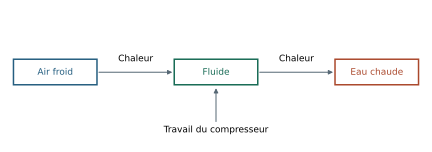
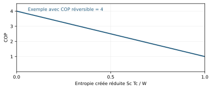
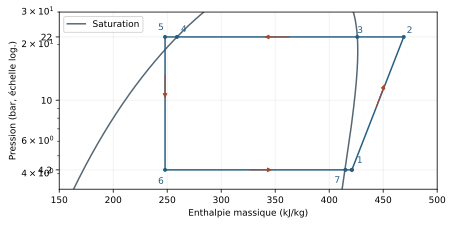

# Banque PT 2024 — Physique B - Thermodynamique · Corrigé brut

*Corrigé rédigé par IA, non officiel.*

**Rédaction** · GPT-6.2 Astra Ultra · vitesse non renseignée

**Révision (tour 1)** · GPT-6.2 Astra Ultra · vitesse non renseignée

Chauffage d’une habitation par pompe à chaleur. Épreuve de deux heures, sans calculatrice. [Sujet et documents](https://www.banquept.fr/documents/2024/ph_b_th_2024_pt.pdf) · [Rapport du jury, p. 3–5](https://www.banquept.fr/documents/ecrit/rapport/2024/rapport_phys_b_ecrit_2024.pdf)

## A. Modèle ditherme

### Q1. Échanges de la pompe à chaleur

Le fluide prélève de la chaleur à la source froide à $T_F$, reçoit du travail d'un organe moteur et livre de la chaleur à la source chaude à $T_C>T_F$. Sur un cycle, le fluide revient à son état initial. Le réchauffement de la source chaude constitue l'effet recherché.

### Q2. Signes des trois transferts

Pour le fluide, $Q_F>0$ car la source froide lui cède de la chaleur, $W>0$ car le compresseur lui fournit du travail, et $Q_C<0$ car le fluide cède de la chaleur à la source chaude. L'énergie thermique reçue par la maison vaut donc $-Q_C$.

### Q3. Définition du COP

Le coefficient de performance vaut l'énergie utile divisée par l'énergie mécanique dépensée. L'énergie interne étant une fonction d'état, $\Delta U=0$ sur un cycle. Le premier principe donne $W+Q_F+Q_C=0$, donc
$$
\mathrm{COP}=\frac{-Q_C}{W}=\frac{Q_C}{Q_C+Q_F}=1+\frac{Q_F}{W}>1 .
$$

### Q4. Entropie créée et efficacité

L'entropie du fluide est une fonction d'état. Sur le cycle, $0=\Delta S=Q_C/T_C+Q_F/T_F+S_c$, avec $S_c\ge0$. Introduisons $Q_C=-W\,\mathrm{COP}$ et $Q_F=W(\mathrm{COP}-1)$. Après regroupement,
$$
\boxed{\mathrm{COP}=\frac{T_C}{T_C-T_F}\left(1-\frac{T_F S_c}{W}\right)} .
$$
Les températures sont absolues et $T_FS_c/W$ est sans dimension. En chauffage domestique, un COP réel est de l'ordre de quelques unités, par exemple 3 à 5 dans de bonnes conditions.

### Q5. Évolution du COP

À $T_F,T_C,W$ fixés, la droite part de $T_C/(T_C-T_F)$ pour $S_c=0$ et a pour pente $-T_C T_F/[W(T_C-T_F)]$. Le domaine de fonctionnement avec $Q_F>0$ se termine à $\mathrm{COP}=1$, soit $S_c=W/T_C$. La partie utile de la droite est décroissante.

### Q6. Limite réversible

$S_c=0$ correspond au cycle réversible, sans dissipation ni transfert thermique sous une différence finie de température. Pour ces thermostats, le COP atteint le maximum de Carnot $T_C/(T_C-T_F)$. Les frottements, les pertes de charge ou les écarts de température non nuls réduisent le COP réel.

## B. Cycle de la pompe à chaleur au R410A

### Q7. Sources et système mécanique

La source froide est **l'air extérieur**, qui entre à environ −3 °C. La source chaude est **l'eau du circuit de chauffage** relié au ballon et au plancher. Le travail est transmis au R410A par le **compresseur** entraîné par son moteur. Le circulateur figuré côté eau appartient au circuit hydraulique.

### Q8. Condenseur

Le condenseur doit être en contact avec l'eau à réchauffer. Il s'agit de l'**échangeur 2**, situé côté module hydraulique. Le R410A haute pression y cède de la chaleur à l'eau en se refroidissant, en se liquéfiant puis en se sous-refroidissant.

### Q9. Évaporateur

L'**échangeur 1**, dans l'unité extérieure, est l'évaporateur. Le fluide basse pression y reçoit de la chaleur de l'air extérieur, qui circule grâce au ventilateur. La température de vaporisation doit être inférieure à celle de l'air.

### Q10. Détente de 5 à 6

Pour l'écoulement permanent dans le détendeur, les variations d'énergies cinétique et potentielle sont négligeables. Le premier principe industriel donne $h_6-h_5=w_i+q=0$, car le détendeur est adiabatique et sans pièce mobile. La détente est **isenthalpique**, avec production d'entropie et diminution de pression.

### Q11. Hypothèse sur la compression

La compression est approximativement adiabatique si le transit est rapide ou le compresseur bien isolé. Pour l'idéaliser comme isentropique, on suppose en outre la transformation intérieurement réversible, donc sans production d'entropie. Alors $s_2=s_1$. Des frottements réels augmentent $s$ lors d'une compression adiabatique.

### Q12. Placement des sept états

Sur l'annexe p. 11 du PDF, on suit l'isentrope depuis 1 jusqu'à 22 bar pour atteindre 2. À haute pression on va vers la gauche par 3 (vapeur saturée), 4 (liquide saturé) et 5 (liquide à 30 °C). La verticale $h_6=h_5$ conduit à 6 sous 4,2 bar. À basse pression on va vers la droite jusqu'à 7 puis 1. La figure reproduit le tracé sur des axes $p,h$ de mêmes grandeurs. Le sens est $1\to2\to3\to4\to5\to6\to7\to1$.

| État | Pression (bar) | Enthalpie lue (kJ/kg, environ) | Situation |
|---|---:|---:|---|
| 1 | 4,2 | 421 | Vapeur surchauffée à −12 °C |
| 2 | 22 | 469 | Vapeur comprimée, isentrope issue de 1 |
| 3 | 22 | 426 | Vapeur juste saturante |
| 4 | 22 | 259 | Liquide juste saturé |
| 5 | 22 | 248 | Liquide sous-refroidi |
| 6 | 4,2 | 248 | Mélange liquide-vapeur |
| 7 | 4,2 | 415 | Vapeur juste saturante |

### Q13. Titre massique en vapeur

Seul l'état 6 est strictement diphasique. La règle des moments découle de $h_6=(1-x_6)h_l+x_6h_v$. À 4,2 bar, on lit environ $h_l=172$ et $h_v=415\ \mathrm{kJ/kg}$ à gauche et à droite de la cloche. Ainsi $x_6=(248-172)/(415-172)\simeq0{,}31$. Environ 31 % de la masse est déjà vapeur à la sortie du détendeur. La fraction massique liquide restante se vaporise dans l'évaporateur.

### Q14. Trois échanges massiques

Le fluide s'écoule en régime permanent avec variations d'énergies cinétique et potentielle négligées. Dans le compresseur adiabatique, $w_{12}=h_2-h_1\simeq+48\ \mathrm{kJ/kg}$. Les échangeurs n'ont pas de pièce mobile. Le condenseur donne $q_{25}=h_5-h_2\simeq-221\ \mathrm{kJ/kg}$, l'évaporateur $q_{61}=h_1-h_6\simeq+173\ \mathrm{kJ/kg}$. Le bilan ferme le cycle puisque $48-221+173=0$.

### Q15. Intérêt de la surchauffe

Une légère surchauffe entre 7 et 1 garantit que le dernier liquide s'est vaporisé, même en cas de petites fluctuations. On évite l'arrivée de gouttes et les chocs hydrauliques susceptibles d'endommager le compresseur. Il n'en découle pas qu'une surchauffe arbitrairement grande améliorerait les performances.

### Q16. COP de chauffage

On trouve $\mathrm{COP}_{410}=(-q_{25})/w_{12}=221/48\simeq\boxed{4{,}6}$. Un kilowattheure de travail électrique, avec la mécanique supposée idéale, permet de livrer environ 4,6 kWh de chaleur, dont 3,6 kWh prélevés à l'air. Un radiateur électrique au point d'usage fournit environ 1 kWh de chaleur par kWh électrique.

### Q17. Compression réelle

Notons $e'=0{,}90\,\mathrm{COP}_{410}\simeq4{,}14$. Les états 1 et 5 sont inchangés. Ainsi $e'=(h_{2'}-h_5)/(h_{2'}-h_1)$, d'où
$$
h_{2'}=h_1+\frac{h_1-h_5}{e'-1}\simeq421+\frac{173}{3{,}14}\simeq476\ \mathrm{kJ/kg}.
$$
À 22 bar, l'intersection avec cette enthalpie donne **environ 75 °C**, à quelques degrés près sur le réseau d'isothermes. Le travail du compresseur et la température de refoulement augmentent.

## C. Comparaison avec le R32

### Q18. Gain annoncé

Le tableau R32 donne $w=588-518=70$ et $-q_C=588-254=334\ \mathrm{kJ/kg}$, donc $\mathrm{COP}_{32}=334/70\simeq4{,}77$. Avec la lecture précédente pour le R410A, le gain relatif est $(4{,}77/4{,}6-1)\,100\simeq3{,}7\,\%$. Le calcul confirme le sens de l'amélioration. Avec ces lectures, il ne retrouve pas précisément les 6 à 7 % annoncés pour des équipements commerciaux. Le gain est sensible à l'écart graphique $h_2-h_1$ et le cycle du sujet est une approximation.

## D. Vidange et circulation dans le plancher

### Q19. Relation de Bernoulli

Le long d'une ligne de courant d'un fluide parfait, incompressible et homogène en régime stationnaire sous la seule pesanteur, $p+\rho gz+\rho v^2/2$ est constant. La relation vaut ici instantanément dans l'approximation de vidange quasi stationnaire.

### Q20. Conservation du volume

Avec $S=\pi R^2$ et $s=\pi r^2$, le volume dans le ballon est $Sz$. La conservation du volume impose $S\,dz/dt=-sv_0$. Ainsi $v_0=-(R/r)^2 dz/dt$. La surface descend, donc $dz/dt<0$ tandis que la vitesse sortante est positive.

### Q21. Vitesse à l'orifice

Entre la surface libre de cote $z$ et l'orifice de cote zéro, tous deux à la pression atmosphérique, Bernoulli donne $\rho gz+\rho v_z^2/2=\rho v_0^2/2$. Donc $v_0=\sqrt{2gz+v_z^2}$ avec $v_z=dz/dt$ algébrique.

### Q22. Petitesse de la vitesse du niveau libre

$r/R=0{,}005/0{,}50=10^{-2}$, d'où $|v_z|/v_0=(r/R)^2=10^{-4}$. Exactement $v_0=\sqrt{2gz/[1-(r/R)^4]}$. La correction relative du dénominateur vaut $10^{-8}$ et $\boxed{v_0\simeq\sqrt{2gz}}$.

### Q23. Hauteur en fonction du temps

L'équation devient $dz/dt=-(r/R)^2\sqrt{2gz}$. En intégrant $dz/\sqrt z$ de $H_0$ à $z(t)$, on obtient
$$
z(t)=\left[\sqrt{H_0}-\left(\frac rR\right)^2\sqrt{\frac g2}\,t\right]^2 .
$$
Cette branche décroissante s'applique jusqu'à l'annulation du crochet. Le ballon reste ensuite vide.

### Q24. Fin de la vidange

On annule le crochet et l'on trouve $\boxed{t_v=(R/r)^2\sqrt{2H_0/g}}$. Le rapport des rayons est sans dimension et la racine a l'unité d'un temps.

### Q25. Application numérique

Avec $H_0=2{,}0\ \mathrm m$, $g=10\ \mathrm{m/s^2}$ et $R/r=100$, $t_v=10^4\sqrt{0{,}4}\simeq6{,}3\times10^3\ \mathrm s$, soit environ **1 h 45 min**. Un petit orifice vidange ainsi lentement un ballon de grande section.

### Q26. Puissance hydraulique requise

À débit constant sur une boucle, la différence d'altitude et d'énergie cinétique entre le départ et le retour s'annule si l'on prend la même section. La pompe doit fournir à chaque kilogramme au moins l'énergie dissipée $gH_f$. Ici $H_f=120\times0{,}035=4{,}2\ \mathrm m$, soit une chute de pression $\rho gH_f=42\ \mathrm{kPa}$. Le débit est $D_v=6{,}0\ \mathrm{L/min}=10^{-4}\ \mathrm{m^3/s}$. La puissance hydraulique est $\rho D_v gH_f\simeq\boxed{4{,}2\ \mathrm W}$ pour les seules pertes linéaires.

### Q27. Puissance préconisée

Les coudes, vannes et raccords créent des pertes singulières supplémentaires. Le rendement de l'ensemble moteur-pompe est inférieur à 1. La puissance électrique nominale intègre ces effets et une marge de fonctionnement, ce qui rend plausible une préconisation de **15 W**.

### Q28. Disposition des tuyaux

La pose **en escargot** juxtapose une branche aller encore chaude et une branche retour plus froide. La variation spatiale de température du sol est ainsi atténuée. Dans le serpentin simple, les tours successifs se refroidissent dans le même sens et peuvent créer un côté plus chaud que l'autre.
