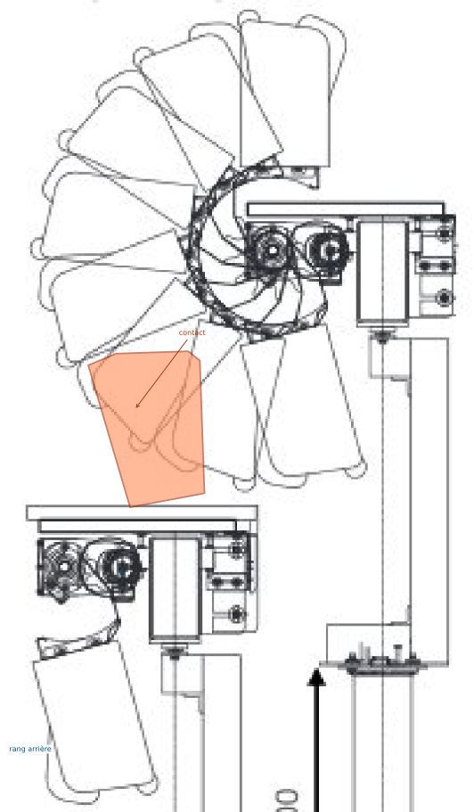
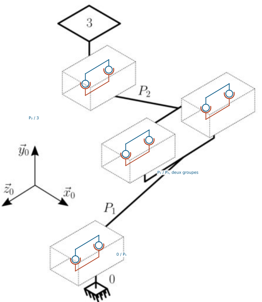
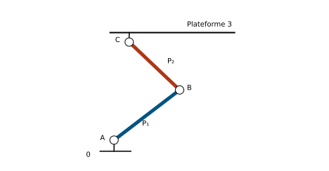
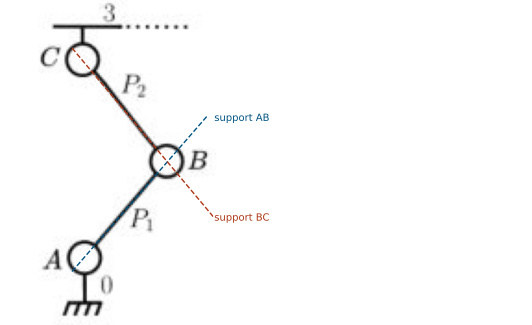
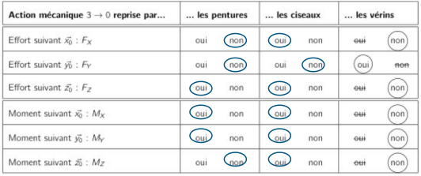
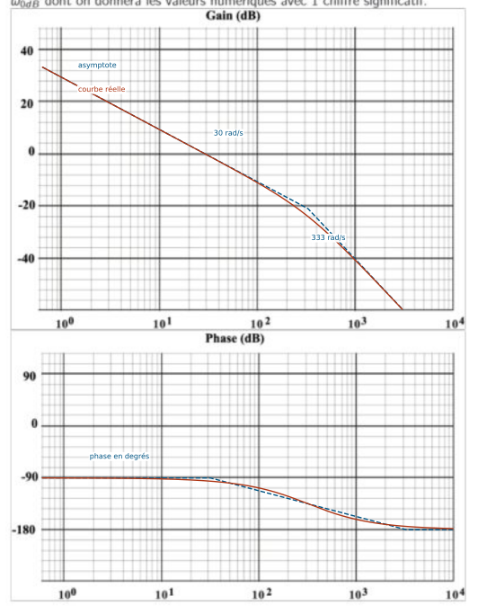
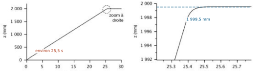

# Banque PT 2024 — Sciences industrielles A · Corrigé brut

*Corrigé rédigé par IA, non officiel. Signalez toute erreur.*

**Rédaction** · GPT-6.2 Astra Ultra · vitesse non renseignée · 26 novembre 2026

**Révision (tour 1)** · GPT-6.2 Astra Ultra · vitesse non renseignée · 26 novembre 2026

Dans la grande salle Pierre Boulez de la Philharmonie de Paris, le parterre et les modules de scène changent de hauteur pour adapter la salle aux concerts. Les onze rangs du parterre, le module d’orchestre et la plateforme à double motorisation font ici l’objet de modèles distincts. Les renvois indiquent la page du PDF officiel, garde comprise.

[Sujet et cahier officiels](https://www.banquept.fr/documents/2024/si_a_2024_pt.pdf) · [Rapport du jury](https://www.banquept.fr/documents/ecrit/rapport/2024/rapport_si_a_ecrit_2024.pdf)

## I — Déployer le parterre

### Question 1 — Tester le retournement à 1 300 mm

Sur la grille, reporter le siège du rang $i+1$ après un demi-tour autour de son pivot, en maintenant ce rang à sa hauteur de référence. Son dossier redressé pénètre dans l’enveloppe balayée par le siège du rang $i$ lors de la rotation. La distance minimale admissible de 100 mm est violée. Le constructeur prescrit 1 800 mm et le rang suivant en position basse.

[Sujet p. 6](https://www.banquept.fr/documents/2024/si_a_2024_pt.pdf#page=6) · [Cahier p. 37 du PDF](https://www.banquept.fr/documents/2024/si_a_2024_pt.pdf#page=37)

### Question 2 — Calculer la hauteur du onzième rang

La différence est de dix intervalles de 200 mm, soit $H_{11}^{fin}=2000$ mm. Un mécanisme commun convient si sa course utile couvre 2 m et permet d’arrêter chaque rang à sa consigne propre. Un élévateur limité à la seule hauteur de retournement de 1 800 mm serait insuffisant pour le rang 11.

### Question 3 — Chronométrer l’ouverture rang par rang

Avec $v=1$ m/min, $T_{mep}=1,8$ min, $H_6^{fin}=1,0$ m et $T_6=(1,8-1,0)/v=0,8$ min. Ajouter 15 s de rotation par rang. L’hypothèse $T_{moy}=T_6$ donne $11(1,8+0,25+0,8)=31,35$ min. À un chiffre significatif : 2 min, 0,8 min et environ 30 min. Le plafond de 10 min est dépassé. L’approximation du sujet pour la moyenne tient lieu de calcul rang par rang, y compris pour le dernier qui dépasse 1,8 m.

### Question 4 — Construire les listes de positionnement

Deux lignes suffisent pour les lignes 23 et 24. Elles produisent onze couples dans le même ordre et couvrent de 0 à 2 000 mm.

~~~python
Hfinal = [200 * (rang - 1) for rang in range(1, 12)]
Rtot = list(range(1, 12))
~~~

## II — Guider le module d’orchestre

### Question 5 — Identifier les contacts articulés

En E, chacune des deux articulations 0–$P_1$ présente deux surfaces sphériques complémentaires de même centre. Les bagues sont maintenues axialement. Chaque contact se modélise par une liaison sphérique à trois rotations. Le détail D donne le même montage double entre $P_2$ et 3. En C, les deux groupes d’articulation entre $P_1$ et $P_2$ portent chacun deux rotules, soit quatre contacts sphère/sphère et quatre liaisons sphériques. Les détails montrent également des portées cylindriques de montage. Le mouvement relatif des bagues articulées se fait sur les portées sphériques.

[Sujet p. 13](https://www.banquept.fr/documents/2024/si_a_2024_pt.pdf#page=13) · [Cahier p. 40 du PDF](https://www.banquept.fr/documents/2024/si_a_2024_pt.pdf#page=40)

### Question 6 — Placer les huit liaisons

Deux rotules relient 0 à $P_1$ au niveau inférieur, quatre relient $P_1$ à $P_2$ au niveau intermédiaire, deux relient $P_2$ à 3 au niveau supérieur. Le tracé montre leurs centres étagés dans la direction $z_0$ et rattache à chaque groupe les deux solides effectivement articulés.

[Sujet p. 13](https://www.banquept.fr/documents/2024/si_a_2024_pt.pdf#page=13) · [Cahier p. 41 du PDF](https://www.banquept.fr/documents/2024/si_a_2024_pt.pdf#page=41)

### Question 7 — Réduire la penture à trois pivots

Les deux rotules de l’articulation inférieure imposent un pivot $(A,z_0)$. L’articulation supérieure donne un pivot $(C,z_0)$. Les quatre centres de la charnière médiane sont alignés et donnent également un pivot $(B,z_0)$. Le schéma plan minimal est la série $0-A-P_1-B-P_2-C-3$, les trois pivots étant parallèles.

[Sujet p. 13](https://www.banquept.fr/documents/2024/si_a_2024_pt.pdf#page=13) · [Cahier p. 42 du PDF](https://www.banquept.fr/documents/2024/si_a_2024_pt.pdf#page=42)

### Question 8 — Calculer la liaison équivalente d’une penture

Notons $u,v,w$ les trois vitesses de rotation relatives en A, B et C. Au point C la résultante cinématique est $(u+v+w)z_0$ et la vitesse $u z_0\times AC+v z_0\times BC$. Hors alignement, $AC$ et $BC$ sont indépendants. La vitesse de C peut donc être quelconque dans le plan, tandis que $w$ règle librement la rotation finale. Cela caractérise un appui plan de normale $z_0$. Deux pentures en parallèle de même normale autorisent le même espace de mouvements.

### Question 9 — Évaluer l’intérêt mécanique du doublage

Le doublage ne réduit pas les trois mobilités planes et ne garantit pas l’horizontalité. Le déploiement géométrique maximal d’une chaîne de deux caissons est $2L_P=2,6$ m, ce qui rend possible l’amplitude imposée de 1,2 m selon l’implantation. Le guidage rectiligne et la suppression de la rotation exigent une structure complémentaire. Les caissons espacés et leurs larges paliers améliorent la raideur et répartissent les actions transversales.

### Question 10 — Identifier le mouvement issu des ciseaux

HEDG est un parallélogramme dont les diagonales sont égales, donc un rectangle. HG restant horizontal, ED est horizontal et HE vertical. E reste sur la verticale de H et la plateforme suit une translation verticale sans rotation ni déplacement horizontal. Le ciseau apporte ainsi le guidage recherché.

### Question 11 — Fermer les deux boucles du ciseau

Pour la chaîne inférieure, $HF+FG+GH=0$, soit $(L_b/2)(x_1-x_2)=\lambda x_0$ en vecteurs. Pour la chaîne supérieure, $ED+DF+FE=0$ donne $ED=(L_b/2)(x_1-x_2)=\lambda x_0$. La projection verticale donne $\sin\theta_2=\sin\theta_1$. Sur la branche croisée représentée, $\theta_2=\pi-\theta_1$, puis $\lambda=L_b\cos\theta_1$.

### Question 12 — Réserver l’encombrement horizontal

Pour une hauteur $Y$, $Y=L_b\sin\theta_1$ et l’emprise entre axes est $\lambda=\sqrt{L_b^2-Y^2}$. Elle atteint presque $L_b=2$ m en repli. À 1,2 m de hauteur mesurés depuis l’alignement, $\lambda=1,6$ m. Pour une course imposée, l’état le plus bas fixe l’emprise maximale. Les niveaux supérieurs des figures 16 et 17 utilisent des ciseaux superposés. Leurs courses verticales s’ajoutent, ce qui permet des barres plus courtes et une emprise compatible avec le petit plateau.

### Question 13 — Fermer les vitesses au point F

Pour $(1/0)$ en H : $(\dot\theta_1z_0,0)$. Pour $(2/1)$ en F : $((\dot\theta_2-\dot\theta_1)z_0,0)$. Pour $(2/g_2)$ en G : $(\dot\theta_2z_0,0)$. Pour $(g_2/0)$ en G : $(0,\dot\lambda x_0)$. Les paires ordonnées donnent vitesse angulaire puis vitesse du point. La fermeture $\mathcal V_{1/0}+\mathcal V_{2/1}=\mathcal V_{2/g_2}+\mathcal V_{g_2/0}$ en F donne $(L_b/2)\dot\theta_1 y_1=\dot\lambda x_0+(L_b/2)\dot\theta_2 y_2$.

### Question 14 — Relier le coulissement à la vitesse de levée

$V_{30}=L_b\cos\theta_1\,\dot\theta_1$ et $\dot\lambda=-L_b\sin\theta_1\,\dot\theta_1$. Ainsi $\dot\lambda=-V_{30}\tan\theta_1$ tant que $\cos\theta_1\ne0$. À la montée, les galets se rapprochent, en accord avec le signe négatif.

### Question 15 — Compter les contraintes en trois dimensions

Le bâti inclut les corps et le plateau inclut les tiges. Neuf solides restent mobiles, soit le plateau, les quatre caissons, les deux barres et les deux galets. On compte six pivots de pentures, cinq pivots de ciseau, deux glissières de galets et deux glissières de vérins. Chacune des quinze liaisons à un degré impose cinq contraintes spatiales. Avec la seule mobilité de levée $m=1$, $h=75-6\times9+1=22$.

### Question 16 — Comparer au décompte plan

$h=15\times2-3\times9+1=4$. La modélisation plane suppose les axes de pivots déjà parallèles et les mouvements maintenus dans le même plan. Les contraintes spatiales d’alignement et de position transversale ne figurent plus dans le bilan.

### Question 17 — Reconnaître le composant déformable

Le coussinet en Néoprène se déforme localement en compression différentielle et permet le faible rotulage de la plaque. Une sphérique en 3D ou un pivot dans le modèle plan représente cette souplesse, qui réduit les contraintes transversales du vérin.

### Question 18 — Isoler les deux caissons de la penture

Pour le bilan de transmission, en négligeant les poids propres, $P_1$ reçoit deux forces de pivot en A et B. Elles sont opposées et colinéaires à AB. Son action sur $P_2$ en B est donc portée par AB. De même, $P_2$ reçoit deux forces en B et C et exerce en B sur $P_1$ une force de support BC. Les deux actions mutuelles sont opposées. AB et BC étant distincts, elles sont nulles. Dans cette configuration déployée non alignée, la penture ne reprend aucune action dans le plan médian.

[Sujet p. 17](https://www.banquept.fr/documents/2024/si_a_2024_pt.pdf#page=17) · [Cahier p. 48 du PDF](https://www.banquept.fr/documents/2024/si_a_2024_pt.pdf#page=48)

### Question 19 — Affecter les efforts aux sous-ensembles

Dans l’ordre des lignes $F_X,F_Y,F_Z,M_X,M_Y,M_Z$, entourer pour les pentures : non, non, oui, oui, oui, non. Pour les ciseaux : oui, non, oui, oui, oui, oui. Pour les vérins : non, oui, non, non, non, non, comme l’indique la colonne préremplie. Les pentures renforcent le guidage transversal et le ciseau interdit le déplacement horizontal et le basculement de la plateforme. Le vérin fournit la puissance dans la seule translation verticale.

[Sujet p. 17](https://www.banquept.fr/documents/2024/si_a_2024_pt.pdf#page=17) · [Cahier p. 48 du PDF](https://www.banquept.fr/documents/2024/si_a_2024_pt.pdf#page=48)

## III — Effort des vérins

### Question 20 — Écrire la matrice d’inertie du caisson réel

Le plan médian $(G_{P1},x_{P1},y_{P1})$ est un plan de symétrie matérielle. Les produits $xz$ et $yz$ sont nuls par parité. Dans l’ordre $(x_{P1},y_{P1},z_0)$, les lignes de la matrice sont $(A,-F,0)$, $(-F,B,0)$ et $(0,0,C)$. La géométrie réelle n’impose pas $F=0$, et $z_0$ est principal.

[Sujet p. 19](https://www.banquept.fr/documents/2024/si_a_2024_pt.pdf#page=19) · [Cahier p. 49 du PDF](https://www.banquept.fr/documents/2024/si_a_2024_pt.pdf#page=49)

### Question 21 — Écrire l’énergie de la plateforme

$m_3=\rho_D L_3\ell_3/g$ si $\rho_D$ est exprimé en N/m². Le niveau 250 daN/m² est un poids surfacique. On obtient $E_c(3/0)=m_3\dot\delta^2/2$. Pour 12 m², le poids équivalent est de 30 kN et la masse correspondante proche de 3,06 t.

### Question 22 — Évaluer l’apport des ciseaux

Les barres et les galets se déplacent effectivement, mais leurs masses et leurs inerties sont supposées négligeables devant celles des caissons. La contribution cinétique des ciseaux est donc prise nulle dans ce modèle.

### Question 23 — Calculer le torseur cinétique et l’énergie du caisson inférieur

En posant $\alpha=\theta_{P1}$, $L=L_P$, la vitesse de $G_1$ vaut $(L/2)\dot\alpha y_{P1}$. Les deux éléments du torseur cinétique en $G_1$ sont $m_P(L/2)\dot\alpha y_{P1}$ et $I_P\dot\alpha z_0$. Donc $E_{c1}=(I_P+m_PL^2/4)\dot\alpha^2/2$.

### Question 24 — Calculer le torseur cinétique et l’énergie du caisson supérieur

Notons $\beta=\theta_{P2}$ et $s=\dot\alpha+\dot\beta$. Comme B se déplace, $v_{G2}=L\dot\alpha y_{P1}+(L/2)s y_{P2}$. Le torseur cinétique réduit en $G_2$ a pour résultante $m_Pv_{G2}$ et pour moment $I_Ps z_0$. D’où $E_{c2}=m_PL^2[\dot\alpha^2+s^2/4+\dot\alpha s\cos\beta]/2+I_Ps^2/2$. La projection croisée est indispensable car les deux vitesses ne sont généralement pas orthogonales.

### Question 25 — Calculer la puissance motrice

Le glisseur du vérin 1 produit $P_{T_1\to3}=F_v\dot\delta$. La puissance intérieure totale des liaisons parfaites de l’ensemble isolé est nulle : à chaque point de liaison, le torseur transmissible est réciproque de la vitesse relative. Les tiges sont extérieures au système $\Sigma$ défini par le sujet.

### Question 26 — Calculer la puissance du poids

Pour une penture incluse dans $\Sigma$, $y_{G1}=L\sin\alpha/2$ et $y_{G2}=L\sin\alpha+(L/2)\sin(\alpha+\beta)$. La plateforme s’élève de $\delta$. Ainsi $P_g=-m_3g\dot\delta-m_Pg L[3\dot\alpha\cos\alpha+(\dot\alpha+\dot\beta)\cos(\alpha+\beta)]/2$. Les galets et barres n’apportent aucun terme dans l’approximation donnée. En montée le poids global absorbe de la puissance.

### Question 27 — Exprimer la géométrie en fonction de la levée

$AB+BC=AC$ donne $L\cos\alpha+L\cos(\alpha+\beta)=0$ et $L\sin\alpha+L\sin(\alpha+\beta)=\delta$. Dans la configuration en chevron, $\alpha+\beta=\pi-\alpha$, donc $\beta=\pi-2\alpha$ et $\delta=2L\sin\alpha$. On peut dériver pour obtenir $\dot\beta=-2\dot\alpha$ et $\dot\delta=2L\cos\alpha\,\dot\alpha$.

### Question 28 — Énoncer le théorème de l’énergie cinétique

Pour le système matériel $\Sigma$ à masse constante, dans le référentiel terrestre galiléen, la dérivée de la somme des énergies cinétiques de ses solides égale la somme des puissances extérieures et intérieures. Les liaisons internes parfaites ont une puissance relative nulle, et les liaisons au bâti immobile ne fournissent pas de puissance. L’injection des vitesses de Q27 permet d’exprimer le résultat avec $\delta$ et ses dérivées.

### Question 29 — Obtenir la loi simplifiée de levage

Le théorème donne $m_3\dot\delta\ddot\delta=(3F_v-m_3g)\dot\delta$, soit $F_v=m_3(g+\ddot\delta)/3$. L’expression obtenue pendant le mouvement se prolonge par continuité aux instants de vitesse nulle. À vitesse constante, chaque vérin reprend 10 kN du poids réparti de 30 kN. Le maximum de dimensionnement annoncé de 15 kN inclut les phases d’accélération.

## IV — Motorisation double et commande

### Question 30 — Former le transfert d’un moteur

$i=(U_{eq}-K_{eq}\Omega)/R_{eq}$. En absence de charge, $(Jp+f)\Omega=K_{eq}i$. D’où $\Omega/U_{eq}=K_{eq}/[R_{eq}Jp+R_{eq}f+K_{eq}^2]$. La constante de temps est $\tau=R_{eq}J/(R_{eq}f+K_{eq}^2)$.

[Sujet p. 23](https://www.banquept.fr/documents/2024/si_a_2024_pt.pdf#page=23) · [Cahier p. 56 du PDF](https://www.banquept.fr/documents/2024/si_a_2024_pt.pdf#page=56)

### Question 31 — Identifier le moteur équivalent à deux moteurs accouplés

Le couple total vaut $2K(U-K\Omega)/R$. L’écriture $K_{eq}(U-K_{eq}\Omega)/R_{eq}$ donne $K_{eq}=K$ et $R_{eq}=R/2$. Dans la figure 30, $J$ et $f$ sont ceux de la branche mécanique commune.

### Question 32 — Évaluer l’effet d’une panne

Il reste le couple $K(U-K\Omega)/R$, donc $K_{eq}=K$ et $R_{eq}=R$. À tension et vitesse identiques, le couple électromagnétique disponible est divisé par deux. Le moteur restant entraîne toujours les arbres liés, avec une accélération et une vitesse sous charge réduites et une capacité de levage à vérifier selon la charge.

### Question 33 — Vérifier la rapidité et le dépassement en vitesse

Avec les valeurs exactes, $\tau=25\times0,001/(25\times0,01+3^2)=2,70$ ms et $t_{5\%}=\tau\ln20=8,10$ ms. C’est inférieur à 0,1 s. Un premier ordre stable répond de manière monotone à l’échelon résultant et n’a aucun dépassement.

### Question 34 — Déterminer la vitesse sous chargement maximal

$\Omega_\infty=(3\times540+25\times(-10))/(25\times0,01+9)=148,1$ rad/s, environ 1 415 tr/min, au-dessus de $0,8\times1400=1120$ tr/min. Avec les valeurs grossièrement arrondies autorisées dans l’énoncé, on trouve $0,3\times540-3\times10=132$ rad/s, soit 1 261 tr/min. Les deux calculs satisfont le critère. La différence provient des deux gains arrondis avant soustraction.

### Question 35 — Adapter la consigne de position

Posons $r=r_1r_2r_3\,pas/(2\pi)$, en mm/rad. Alors $Z=r\Theta_m$ ; lorsque $Z_c=Z$, il faut $K_{adapt}Z_c=K_{capt}\Theta_m$. Ainsi $K_{adapt}=K_{capt}/r=2\pi K_{capt}/(r_1r_2r_3\,pas)$.

### Question 36 — Choisir la classe du correcteur de position

L’intégration de la vitesse fournit déjà une boucle ouverte de classe 1 : un correcteur de classe 0 permet l’erreur nulle sur une consigne constante si la boucle est stable. Pour équilibrer un couple constant avec une tension de commande non nulle et une erreur finale nulle, il faut une intégration dans le correcteur lui-même, donc une classe au moins égale à 1. Un PI convenablement réglé convient pour les deux.

### Question 37 — Éliminer les variables internes

On a $\varepsilon=(K_{capt}/r)(Z_c-Z)$ et $pZ=r[K_v C_z\varepsilon+K_{pert}C_r]/(1+\tau_vp)$. Après regroupement, $Z=[K_vK_{capt}C_z Z_c+rK_{pert}C_r]/[p(1+\tau_vp)+K_vK_{capt}C_z]$. Le signe positif de la perturbation respecte la convention $C_r<0$.

### Question 38 — Borner le gain par le dépassement

Avec $C_z=K_p>0$, $\tau_vp^2+p+K_vK_{capt}K_p$ doit avoir deux racines réelles négatives pour une réponse sans dépassement. Le discriminant donne $K_p\le1/(4\tau_vK_vK_{capt})$, soit $K_{p,max}=277,8$ pour les constantes de la page 26.

### Question 39 — Borner le gain par la précision en charge

Avec un échelon de charge $C_r$, $Z_\infty-Z_c=rK_{pert}C_r/(K_vK_{capt}K_p)$. Pour une tolérance $e_{max}=1$ mm, $K_p>rK_{pert}|C_r|/(K_vK_{capt}e_{max})=50$. La valeur 50 donne exactement la limite, l’exigence étant stricte. À 100, l’erreur est de 0,5 mm.

### Question 40 — Construire le diagramme de Bode asymptotique

Pour $K_p=100$, $L(p)=30/[p(1+0,003p)]$. Le gain asymptotique est $20\log_{10}(30/\omega)$ avant $\omega_c=333$ rad/s, puis décroît à −40 dB/décade. La coupure est vers $3\times10^1$ rad/s, la cassure vers $3\times10^2$ rad/s à un chiffre significatif. La phase asymptotique va de −90° à −180°, et vaut −135° à la cassure.

[Sujet p. 26](https://www.banquept.fr/documents/2024/si_a_2024_pt.pdf#page=26) · [Cahier p. 61 du PDF](https://www.banquept.fr/documents/2024/si_a_2024_pt.pdf#page=61)

### Question 41 — Tracer les courbes réelles et calculer les marges

La courbe réelle a pour module $30/[\omega\sqrt{1+(0,003\omega)^2}]$ et pour phase $-90^\circ-\arctan(0,003\omega)$. À $\omega_{0dB}\simeq29,88$ rad/s, le produit vaut 0,0896 et $\arctan(0,0896)\simeq0,0894$ rad, soit 5,12°. La marge de phase vaut 84,9°, au-dessus de 60°. La phase n’atteint −180° qu’à l’infini, pour un gain qui tend vers zéro : la marge de gain infinie dépasse 15 dB. Les courbes réelles et asymptotiques sont superposées sur la grille de Q40.

### Question 42 — Valider la réponse saturée

La saturation à 540 V limite la vitesse de montée, d’où une longue rampe avant l’approche finale. La figure 34 donne une hauteur stabilisée vers 1 999,5 mm sans dépassement en environ 25,5 s, sous 60 s. L’erreur due à la charge de −10 N·m vaut 0,5 mm, sous 1 mm, et l’erreur de consigne seule est nulle. Les marges désaturées satisfont le cahier, la vitesse est supérieure à 1 120 tr/min et son transitoire monotone dure environ 8 ms. Les 250 daN/m² correspondent à la charge de calcul, le constructeur annonce 15 kN par vérin au maximum. Le déroulement par groupes des onze rangs satisfait également la durée distincte de dix minutes.

[Sujet p. 27](https://www.banquept.fr/documents/2024/si_a_2024_pt.pdf#page=27) · [Cahier p. 63 du PDF](https://www.banquept.fr/documents/2024/si_a_2024_pt.pdf#page=63)
