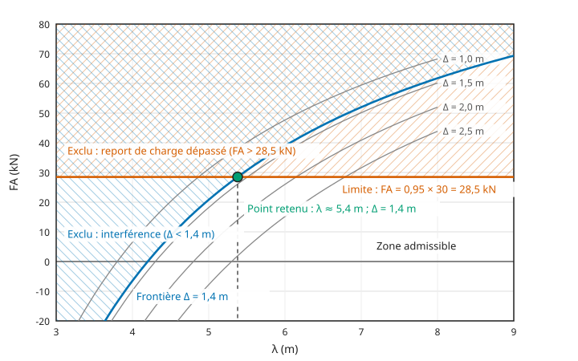
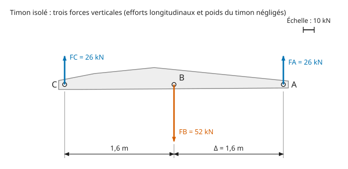
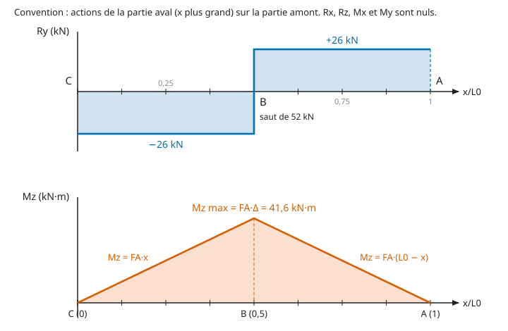
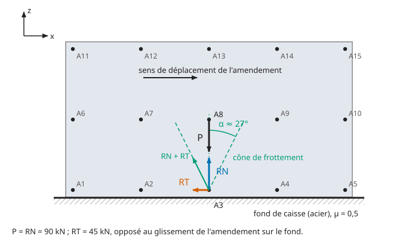
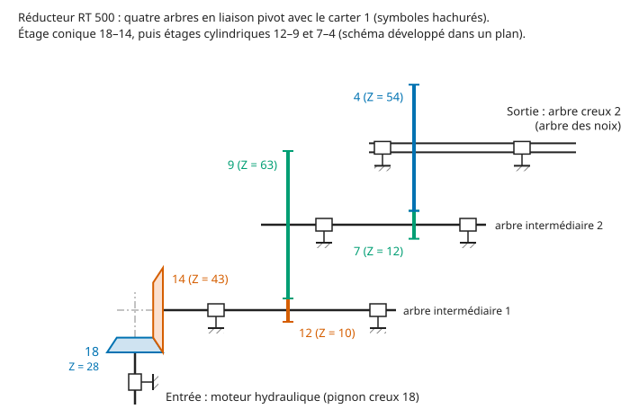
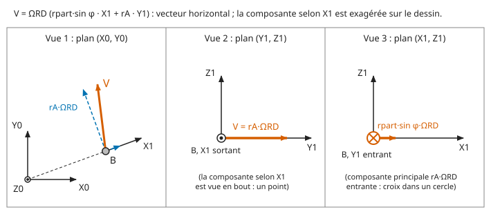
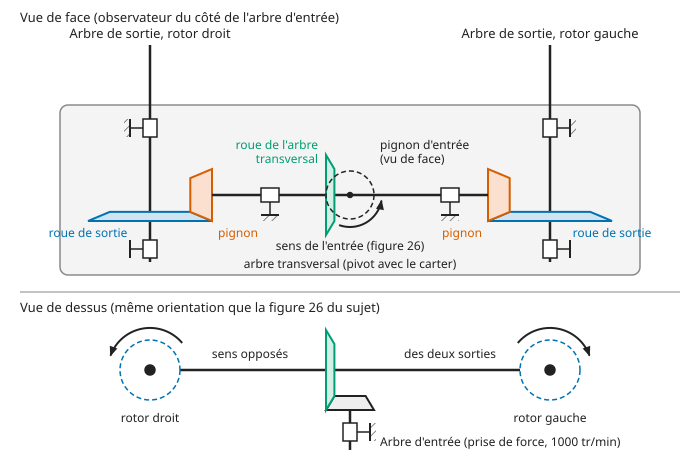
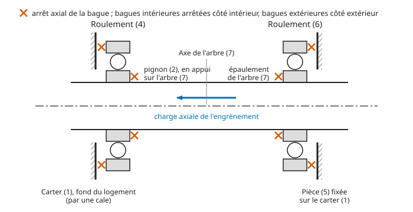

# Banque PT PT — Sciences industrielles B 2024 · Corrigé brut

*Corrigé rédigé par IA, non officiel. Signalez toute erreur.*

**Rédaction** · modèle exact non renseigné (famille Claude) · effort non renseigné · vitesse non renseignée

Épreuve de 6 h, sans calculatrice ni document. Support : étude de préconception d'un épandeur agricole monocoque surbaissé à caisse étroite (gamme « FORCE »), de volume utile $11\ \text{m}^3$. Les 62 questions de la notice justificative sont traitées dans l'ordre du sujet ; les tracés demandés sur le cahier réponse sont donnés sous forme de schémas originaux. Les applications numériques sont menées avec $g = 10\ \text{m·s}^{-2}$ et des arrondis compatibles avec un calcul à la main.

Principales données utilisées :

| Grandeur | Valeur | Grandeur | Valeur |
|---|---|---|---|
| $l_{norme}$ | $2500\ \text{mm}$ | $M_{mat.}$ | $9\ \text{t}$ |
| $l_{pneu}$ | $420\ \text{mm}$ | $M_{benne}$ | $4\ \text{t}$ |
| $j_{roue/coque}$ | $80\ \text{mm}$ | $\mu$ | $0{,}5$ |
| $h_{utile}$ | $1{,}5\ \text{m}$ | $D_{noix}$ | $180\ \text{mm}$ |
| $V_{utile}$ | $11\ \text{m}^3$ | $\eta_{meca}$, $\eta_{vol}$ | $0{,}9$ et $0{,}9$ |
| $\Delta p$ | $120\ \text{bar}$ | $P_{tracteur}^{max}$ | $110\ \text{kW}$ à $1000\ \text{tr·min}^{-1}$ |
| $d_{hér.}$ | $740\ \text{mm}$ | $d_{BE}$ | $52\ \text{mm}$ |
| $p_{mat.}$ | $75\ \text{MPa}$ | $F_{eng}$ | $35\,000\ \text{N}$ |

---

## Partie II.1 — Optimisation de la position de l'essieu

**II.1.1 — Respect du report de charge sur l'attelage du tracteur**

### Question 1 — Largeur utile maximale de la caisse

La caisse étroite est logée entre les roues. Dans la largeur hors tout, on trouve de chaque côté un pneumatique et le jeu entre la roue et la coque :

$$l_{utile}^{max} = l_{norme} - 2\,l_{pneu} - 2\,j_{roue/coque}$$

Application numérique :

$$l_{utile}^{max} = 2500 - 2\times 420 - 2\times 80$$

$$\boxed{l_{utile}^{max} = 1500\ \text{mm}}$$

### Question 2 — Longueur utile de la caisse

Sur la figure 8, la cote $L_{utile}$ est celle du rectangle central de hauteur $h_{utile}$. La section longitudinale comporte en plus deux triangles rectangles (paroi avant et côté rotors), de hauteur $h_{utile}$ et de base $h_{utile}/\tan 75^\circ$. Les parois latérales étant verticales, le volume est le produit de cette section par la largeur :

$$V_{utile} = l_{utile}^{max}\,h_{utile}\left(L_{utile} + \frac{h_{utile}}{\tan 75^\circ}\right)$$

D'où

$$\boxed{L_{utile} = \frac{V_{utile}}{l_{utile}^{max}\,h_{utile}} - \frac{h_{utile}}{\tan 75^\circ}}$$

La figure 16 donne $\tan 75^\circ \approx 3{,}75$ (valeur exacte $3{,}73$). Alors :

$$\begin{aligned}
\frac{V_{utile}}{l_{utile}^{max}\,h_{utile}} &= \frac{11}{1{,}5\times 1{,}5} \approx 4{,}89\ \text{m}\\
\frac{h_{utile}}{\tan 75^\circ} &\approx \frac{1{,}5}{3{,}75} = 0{,}40\ \text{m}
\end{aligned}$$

$$\boxed{L_{utile} \approx 4{,}49\ \text{m} = 4490\ \text{mm}}$$

L'énoncé retient ensuite $5\ \text{m}$, valeur arrondie par excès.

### Question 3 — Position de $G_0$ et effort vertical en $K$

**Position de $G_0$.** $G_0$ est le barycentre de $G_{mat.}$ (masse $M_{mat.}$) et de $G_{benne}$ (masse $M_{benne}$) :

$$\overrightarrow{G_{mat.}G_0} = \frac{M_{benne}}{M_{mat.}+M_{benne}}\,\overrightarrow{G_{mat.}G_{benne}}$$

soit

$$\overrightarrow{G_{mat.}G_{benne}} = \frac{M_{mat.}+M_{benne}}{M_{benne}}\,\overrightarrow{G_{mat.}G_0}$$

Avec $M_{mat.} = 9\ \text{t}$ et $M_{benne} = 4\ \text{t}$, le coefficient vaut $13/4 = 3{,}25$ : c'est la relation de l'énoncé. $G_0$ est sur le segment $[G_{mat.}G_{benne}]$, plus près de la masse la plus lourde. Sur la figure 17, les deux centres sont sur une même verticale, donc $G_0$ aussi.

**Effort vertical en $K$.** Le contact pneumatique-sol est modélisé par une ponctuelle parfaite (sans frottement) sur un sol horizontal : l'action du sol est portée par la normale au contact, donc verticale, et dirigée vers le haut car le contact est unilatéral. Cette hypothèse est cohérente avec la situation : l'étude est statique, les roues ne sont ni motorisées ni freinées et tournent librement sur l'essieu. L'équilibre d'une roue en moment autour de son axe impose alors une composante tangentielle nulle au sol (résistance au roulement négligée).

### Question 4 — Bilan des actions mécaniques extérieures

Ensemble isolé : benne, essieu, roues, distributeur, timon, matière. Problème plan $(\vec x, \vec y)$.

| Action mécanique | Point d'application | Direction | Sens |
|---|---|---|---|
| Pesanteur sur l'ensemble, de norme $(M_{mat.}+M_{benne})\,g$ | $G_0$ | verticale ($\vec y$) | vers le bas ($-\vec y$) |
| Sol sur les pneumatiques, $\vec F_K$ | $K$ | verticale ($\vec y$) | vers le haut ($+\vec y$) |
| Tracteur sur le timon, $\vec F_A$ (articulation libre en rotation : force passant par $A$, sans moment) | $A$ | a priori quelconque dans le plan ; verticale d'après l'équilibre, les deux autres actions étant verticales | vers le haut si $G_0$ est entre $K$ et $A$ |

Les masses du timon, du distributeur et de l'essieu sont négligées.

### Question 5 — Théorèmes et équations

On applique le principe fondamental de la statique à l'ensemble isolé, dans le plan $(\vec x,\vec y)$. On note $X_A$ et $F_A$ les composantes de l'action du tracteur. D'après la figure 17, $G_0$ est à la distance horizontale $1{,}2 + 1{,}6 + \Delta = \Delta + 2{,}8$ de $A$ (longueurs en mètres), donc à $\lambda - \Delta - 2{,}8$ de $K$.

| Théorème | Composante utile | Équation correspondante |
|---|---|---|
| Résultante statique | sur $\vec y$ | $F_A + F_K - (M_{mat.}+M_{benne})\,g = 0$ |
| Moment statique en $K$ | sur $\vec z$ | $\lambda\,F_A - (\lambda - \Delta - 2{,}8)\,(M_{mat.}+M_{benne})\,g = 0$ |
| Résultante statique | sur $\vec x$ | $X_A = 0$ |

**Commentaire.** Trois équations scalaires pour trois inconnues ($X_A$, $F_A$, $F_K$) : le problème est isostatique et se résout sans hypothèse supplémentaire. Cela tient aux hypothèses déjà posées : problème plan, effort purement vertical en $K$, masses secondaires négligées. Avec une composante tangentielle en $K$, il y aurait quatre inconnues et il faudrait une hypothèse de plus.

### Question 6 — Expressions de $F_A$ et $F_K$

L'équation de moment en $K$ donne :

$$\boxed{F_A = (M_{mat.}+M_{benne})\,g\,\frac{\lambda - \Delta - 2{,}8}{\lambda}}$$

L'équation de résultante donne alors :

$$\boxed{F_K = (M_{mat.}+M_{benne})\,g\,\frac{\Delta + 2{,}8}{\lambda}}$$

avec $\lambda$ et $\Delta$ en mètres.

Vérification sur la figure II.1 du cahier réponse : pour $\Delta = 1{,}0\ \text{m}$, la formule donne $F_A = 0$ en $\lambda = 3{,}8\ \text{m}$ et $F_A = 130\times 4{,}2/8 \approx 68\ \text{kN}$ en $\lambda = 8\ \text{m}$, ce que montre la courbe.

### Question 7 — Évolution de $F_A$ et contrainte de report de charge

**Évolution.** À $\Delta$ fixé :

$$F_A = (M_{mat.}+M_{benne})\,g\left(1 - \frac{\Delta + 2{,}8}{\lambda}\right)$$

$F_A$ croît avec $\lambda$. Reculer l'essieu éloigne $K$ de la verticale de $G_0$ : le bras de levier du poids par rapport à $K$ augmente et la part du poids reportée sur l'attelage aussi. Pour $\lambda = \Delta + 2{,}8$, l'essieu est sous $G_0$ et $F_A = 0$. En deçà, $F_A < 0$ : l'épandeur soulève l'arrière du tracteur. Quand $\lambda$ devient grand, $F_A$ tend vers le poids total, $130\ \text{kN}$.

**Adhérence.** Pour charger l'essieu arrière du tracteur et améliorer son adhérence, il faut augmenter $F_A$, donc reculer l'essieu de l'épandeur (augmenter $\lambda$), dans la limite du report de charge autorisé.

**Contrainte de report de charge.** Avec la marge de $5\ \%$ :

$$F_A \le 0{,}95\times 30\,000 = 28\,500\ \text{N}$$

On trace la droite horizontale $F_A = 28{,}5\ \text{kN}$ et on hachure la zone située au-dessus (figure 1).

### Question 8 — Contraintes sur $\Delta$

| Contraintes limitant la valeur minimale de $\Delta$ | Contraintes limitant la valeur maximale de $\Delta$ |
|---|---|
| Non-interférence entre l'arrière du tracteur (roues, relevage) et l'avant de l'épandeur (grille de protection, caisse, centrale hydraulique), en particulier en virage serré : exigence 4 | Résistance du timon : le moment de flexion maximal est proportionnel à $\Delta$ |
| Place nécessaire à l'arbre de transmission à cardans et à son joint grand angle, dont les angles de travail augmentent quand le timon raccourcit | Encombrement et longueur hors tout de l'attelage, maniabilité : à $F_A$ donné, $\lambda$ augmente avec $\Delta$, ce qui dégrade le rayon de braquage (exigence 4.1) |
| Accès à l'attelage, à la béquille et aux liaisons hydrauliques et électriques | Masse et coût du timon, longueur de l'arbre de transmission |

La condition du cahier des charges est $\Delta > 1{,}4\ \text{m}$. La frontière est la courbe d'équation

$$F_A = 130\left(1 - \frac{4{,}2}{\lambda}\right)\ \text{kN}$$

située juste au-dessus de la courbe $\Delta = 1{,}5\ \text{m}$. Les courbes à $\Delta$ plus petit sont au-dessus : on hachure la zone située au-dessus et à gauche de cette frontière (figure 1).

### Question 9 — Choix de $\lambda$ et $\Delta$

**Démarche.** Le domaine admissible est la zone non hachurée : sous la droite $F_A = 28{,}5\ \text{kN}$, à droite de la courbe $\Delta = 1{,}4\ \text{m}$, avec $F_A > 0$. On veut $F_A$ le plus grand possible (adhérence) et $\lambda$ le plus petit possible (essieu avancé, rayon de braquage réduit). Sur la droite $F_A = 28{,}5\ \text{kN}$, le plus petit $\lambda$ est obtenu pour le plus petit $\Delta$ admissible. L'optimum est donc l'intersection de la droite et de la courbe $\Delta = 1{,}4\ \text{m}$ :

$$\lambda = \frac{\Delta + 2{,}8}{1 - \dfrac{F_A}{(M_{mat.}+M_{benne})\,g}}$$

$$\lambda = \frac{4{,}2}{1 - 28{,}5/130} \approx 5{,}4\ \text{m}$$

$$\boxed{\begin{aligned}
\lambda &\approx 5{,}4\ \text{m}\\
\Delta &= 1{,}4\ \text{m}
\end{aligned}}$$

En prenant un peu de marge sur l'interférence, le couple $(\lambda = 5{,}5\ \text{m},\ \Delta = 1{,}5\ \text{m})$ convient aussi : $F_A \approx 28{,}4\ \text{kN}$.

**Peut-on dépasser la valeur de $\lambda$ proposée ? Non.** À $\Delta$ fixé, $F_A$ croît avec $\lambda$ : au-delà de la valeur proposée, la force sur l'attelage dépasse $28{,}5\ \text{kN}$ et le report de charge n'est plus respecté. De plus, reculer l'essieu augmente le rayon de braquage.

**II.1.2 — Vérification de la résistance du timon**

### Question 10 — Actions mécaniques sur le timon

On isole le timon. Les efforts longitudinaux sont négligés et le poids du timon aussi : il reste trois forces verticales.

| Action mécanique | Point d'application | Direction | Sens |
|---|---|---|---|
| Tracteur sur timon, $\vec F_A$ | $A$ | verticale | vers le haut |
| Benne sur timon (pivot), $\vec F_B$ | $B$ | verticale | vers le bas |
| Benne sur timon (pivot), $\vec F_C$ | $C$ | verticale | vers le haut |

Norme de $\vec F_A$ :

$$F_A = \frac{1}{5}\,(M_{mat.}+M_{benne})\,g = \frac{13\,000\times 10}{5}$$

$$\boxed{F_A = 26\,000\ \text{N} = 26\ \text{kN}}$$

Équilibre du timon, avec $CB = 1{,}6\ \text{m}$ et $BA = \Delta = 1{,}6\ \text{m}$, les forces étant comptées positivement vers le haut. Moment en $C$ :

$$1{,}6\,F_B + (1{,}6 + \Delta)\,F_A = 0$$

$$F_B = -\frac{1{,}6+\Delta}{1{,}6}\,F_A = -2F_A = -52\ \text{kN}$$

Résultante :

$$F_C = -F_A - F_B = +26\ \text{kN}$$

$$\boxed{\begin{aligned}
\lVert\vec F_B\rVert &= 52\ \text{kN (vers le bas)}\\
\lVert\vec F_C\rVert &= 26\ \text{kN (vers le haut)}
\end{aligned}}$$

À l'échelle du cahier réponse (un segment pour $10\ \text{kN}$), $\vec F_A$ et $\vec F_C$ mesurent $2{,}6$ segments vers le haut, $\vec F_B$ mesure $5{,}2$ segments vers le bas (figure 2).

### Question 11 — Torseur de cohésion et diagrammes

Modèle de la figure 18 : $C$ en $x = 0$ (articulation), $B$ en $x = L_0/2 = \Delta$ (appui simple), $A$ en $x = L_0 = 2\Delta$, chargé par $F_A\,\vec y$. Les actions d'appui sont $F_C\,\vec y = F_A\,\vec y$ et $F_B\,\vec y = -2F_A\,\vec y$ (question 10).

**Convention.** Le torseur de cohésion en $M$ d'abscisse $x$ est celui des actions de la partie aval ($x_P > x$) sur la partie amont. Avec la convention opposée, tous les signes changent.

Pour $M \in [B,A]$, la partie aval ne reçoit que $F_A\,\vec y$ en $A$ :

$$\begin{aligned}
R_y &= F_A\\
M_z &= F_A\,(L_0 - x)
\end{aligned}$$

Pour $M \in [C,B]$, la partie aval reçoit $F_A\,\vec y$ en $A$ et $-2F_A\,\vec y$ en $B$ :

$$\begin{aligned}
R_y &= F_A - 2F_A = -F_A\\
M_z &= F_A\,(L_0 - x) - 2F_A\left(\frac{L_0}{2} - x\right) = F_A\,x
\end{aligned}$$

Dans les deux zones, le torseur a la même forme :

$$\begin{Bmatrix} R_x & M_x\\ R_y & M_y\\ R_z & M_z \end{Bmatrix}_{(M,\vec x,\vec y,\vec z)} = \begin{Bmatrix} 0 & 0\\ X & 0\\ 0 & X \end{Bmatrix}_{(M,\vec x,\vec y,\vec z)}$$

**Sollicitations.**

| Sollicitation | $M\in[C,B]$ | $M\in[B,A]$ |
|---|---|---|
| Traction | 0 | 0 |
| Compression | 0 | 0 |
| Cisaillement | X | X |
| Torsion | 0 | 0 |
| Flexion | X | X |

Le timon travaille en flexion simple autour de $\vec z$.

**Diagrammes** (figure 3). Les résultantes sont en newtons (ici en kN), les moments en N·m (ici en kN·m).

- $R_x = R_z = 0$ et $M_x = M_y = 0$ sur toute la poutre.
- $R_y = -F_A = -26\ \text{kN}$ pour $x/L_0 \in [0\,;0{,}5[$, puis $R_y = +F_A = +26\ \text{kN}$ pour $x/L_0 \in\ ]0{,}5\,;1]$. Le saut en $B$ vaut $52\ \text{kN}$, norme de $\vec F_B$.
- $M_z$ est linéaire par morceaux : nul en $C$, maximal en $B$, nul en $A$.

Au point $B$ :

$$M_z^{max} = F_A\,\Delta = 26\times 1{,}6$$

$$\boxed{M_z^{max} = 41{,}6\ \text{kN·m}}$$

### Question 12 — Contraintes dans le timon

- Contraintes longitudinales $\sigma$ : **oui** (dues au moment de flexion $M_z$). Unité : Pa (usuellement MPa).
- Contraintes de cisaillement $\tau$ : **oui** (dues à l'effort tranchant $R_y$). Unité : Pa (usuellement MPa).

En flexion, dans la section d'abscisse $x$, la contrainte normale est linéaire en $y$ et de valeur absolue :

$$\lvert\sigma(x,y)\rvert = \frac{\lvert M_z(x)\rvert}{I_{G\vec z}}\,\lvert y\rvert$$

Elle est maximale en $B$, sur les fibres extrêmes $y = \pm h_0/2$, où $M_z^{max} = F_A\,\Delta$ :

$$\sigma_{max} = \frac{F_A\,\Delta}{I_{G\vec z}}\,\frac{h_0}{2}$$

$$\boxed{\sigma_{max} = \frac{(M_{mat.}+M_{benne})\,g\,\Delta\,h_0}{10\,I_{G\vec z}}}$$

La contrainte tangentielle moyenne est la même dans toutes les sections, car $\lvert R_y\rvert = F_A$ partout :

$$\boxed{\tau = \frac{F_A}{S_0} = \frac{(M_{mat.}+M_{benne})\,g}{5\,S_0}}$$

Il s'agit de la valeur moyenne dans la section ; pour une section rectangulaire pleine, le maximum local, sur la fibre neutre, vaut $1{,}5$ fois cette valeur.

### Question 13 — Forme du timon

Le moment de flexion est nul aux articulations $C$ et $A$ et maximal dans la zone de $B$. Or $\sigma_{max} = \lvert M_z\rvert\,h/(2\,I_{G\vec z})$, et le module de flexion $I_{G\vec z}/(h/2)$ croît vite avec la hauteur $h$ de la section. Le timon est donc haut dans sa zone centrale, là où le moment est grand, et s'affine vers $A$ et vers $C$, là où il s'annule : la hauteur suit l'allure du diagramme de $M_z$. C'est une forme proche d'une poutre d'égale résistance, qui garde une contrainte à peu près uniforme le long de la poutre et économise de la matière et de la masse là où elle ne travaille pas. Aux extrémités, la section minimale est fixée par l'effort tranchant, constant, et par le logement des articulations.

## Partie II.2 — Dimensionnement de la motorisation et de la chaîne de transmission de puissance du fond mouvant

**II.2.1 — Couple nécessaire sur l'arbre d'entraînement des noix**

### Question 14 — Actions sur l'amendement et cône de frottement

On isole la masse d'amendement, qui glisse vers l'arrière (sens $+\vec x$ de la figure du cahier réponse) sur le fond en acier de la caisse.

| Action | Point d'application | Direction et sens |
|---|---|---|
| Poids $\vec P$ | $A_8$ (centre du volume d'amendement) | vertical, vers le bas |
| Réaction normale du fond $\vec R_N$ | $A_3$ (milieu du fond, à la verticale de $A_8$) | verticale, vers le haut |
| Frottement du fond $\vec R_T$ | $A_3$ | horizontal, opposé au déplacement de l'amendement ($-\vec x$) |
| Cône de frottement | sommet $A_3$, axe vertical (normale au fond) | demi-angle au sommet $\alpha$ |

En glissement, la résultante $\vec R_N + \vec R_T$ est sur le cône, inclinée de $\alpha$ par rapport à la normale, du côté opposé au mouvement (figure 4).

$$\tan\alpha = \mu = 0{,}5$$

$$\boxed{\alpha = \arctan(0{,}5) \approx 27^\circ}$$

Lecture sur la figure 16 : la tangente vaut $0{,}5$ pour un angle d'environ $27^\circ$ (valeur exacte $26{,}6^\circ$).

### Question 15 — Effort tangentiel $R_T$

Équilibre vertical de l'amendement, la benne étant chargée à sa capacité maximale :

$$R_N = M_{mat.}\,g$$

À la limite du glissement (loi de Coulomb), $R_T = \mu\,R_N = R_N\tan\alpha$. En mouvement uniforme, les traverses du fond mouvant doivent fournir un effort égal à ce frottement :

$$\boxed{R_T = M_{mat.}\,g\,\tan\alpha}$$

$$R_T = 9000\times 10\times 0{,}5$$

$$\boxed{R_T = 45\,000\ \text{N} = 45\ \text{kN}}$$

### Question 16 — Couple $C_{noix}$

L'effort $R_T$ est transmis par les brins tendus des deux chaînes, tangents aux noix au rayon $D_{noix}/2$. En régime uniforme, en négligeant le poids et les frottements propres des chaînes et des traverses, le couple total sur l'arbre des noix est :

$$\boxed{C_{noix} = M_{mat.}\,g\,\tan\alpha\,\frac{D_{noix}}{2}}$$

$$C_{noix} = 45\,000\times 0{,}09$$

$$\boxed{C_{noix} = 4050\ \text{N·m} \approx 4{,}05\ \text{kN·m}}$$

L'énoncé retient ensuite $4\ \text{kN·m}$.

**II.2.2 — Puissance mécanique maximale nécessaire au fond mouvant**

### Question 17 — Situation la plus exigeante en puissance

La puissance est le produit de l'effort de poussée, qui croît avec la masse d'amendement, par la vitesse du fond mouvant, qui croît avec le débit massique à fournir. Ce débit est proportionnel à la dose, à la vitesse d'avancement et à la largeur d'épandage.

| Critère | Faible | Élevée | Valeur retenue |
|---|---|---|---|
| Masse d'amendement dans la benne | | X | $9\ \text{t}$ (exigence 1.5) |
| Dose à épandre par hectare | | X | $40\ \text{t·ha}^{-1}$ (exigence 2.1) |
| Vitesse d'avancement de l'ensemble tracteur/épandeur | | X | $10\ \text{km·h}^{-1}$ (exigence 2.1) |
| Largeur d'épandage | | X | $18\ \text{m}$ (exigence 1.3) |

### Question 18 — Flux massique nécessaire

Pendant $\mathrm{d}t$, le tracteur couvre la surface $L_{épand.}\,v_{tracteur}\,\mathrm{d}t$, sur laquelle il faut déposer la masse surfacique $\eta_{dose}$ (hypothèse H1) :

$$\boxed{\Phi_{néc.} = \eta_{dose}\,v_{tracteur}\,L_{épand.}}$$

En unités SI : $\eta_{dose}$ en $\text{kg·m}^{-2}$ ($1\ \text{t·ha}^{-1} = 0{,}1\ \text{kg·m}^{-2}$), $v_{tracteur}$ en $\text{m·s}^{-1}$, $L_{épand.}$ en m, $\Phi_{néc.}$ en $\text{kg·s}^{-1}$.

### Question 19 — Flux massique fourni aux hérissons

L'amendement, de masse volumique $\rho_{mat.}$, traverse la section $S_{proj} = l_{utile}\,h_{utile}^{max}$ à la vitesse du fond mouvant (hypothèses H2 et H3) :

$$\boxed{\Phi_{hér.} = \rho_{mat.}\,l_{utile}\,h_{utile}^{max}\,v_{fond}^{max}}$$

### Question 20 — Vitesse d'avance maximale du fond mouvant

En égalant $\Phi_{néc.}$ et $\Phi_{hér.}$ :

$$\boxed{v_{fond}^{max} = \frac{\eta_{dose}\,v_{tracteur}\,L_{épand.}}{\rho_{mat.}\,l_{utile}\,h_{utile}^{max}}}$$

Valeurs retenues à la question 17, avec la masse volumique la plus faible du cahier des charges :

$$\begin{aligned}
\eta_{dose} &= 40\ \text{t·ha}^{-1} = 4\ \text{kg·m}^{-2}\\
v_{tracteur} &= 10\ \text{km·h}^{-1} \approx 167\ \text{m·min}^{-1}\\
L_{épand.} &= 18\ \text{m}\\
\rho_{mat.} &= 600\ \text{kg·m}^{-3}\\
l_{utile} &= 1{,}5\ \text{m}\\
h_{utile}^{max} &= 1{,}5\ \text{m}
\end{aligned}$$

$$v_{fond}^{max} = \frac{4\times 167\times 18}{600\times 1{,}5\times 1{,}5} = \frac{12\,000}{1350}$$

$$\boxed{v_{fond}^{max} \approx 8{,}9\ \text{m·min}^{-1}}$$

Le flux correspondant est $\Phi = 4\times 2{,}78\times 18 = 200\ \text{kg·s}^{-1}$, soit $12\ \text{t·min}^{-1}$.

### Question 21 — Vitesse de rotation des noix

L'entraînement se fait sans glissement (H4) : la chaîne avance de $\pi D_{noix}$ par tour de noix. Avec $v_{fond}^{max}$ en $\text{m·min}^{-1}$ et $N_{noix}$ en $\text{tr·min}^{-1}$ :

$$\boxed{v_{fond}^{max} = \pi\,D_{noix}\,N_{noix}}$$

$$N_{noix} = \frac{v_{fond}^{max}}{\pi\,D_{noix}} = \frac{8{,}9}{\pi\times 0{,}18}$$

$$\boxed{N_{noix} \approx 15{,}7\ \text{tr·min}^{-1}}$$

### Question 22 — Puissance mécanique $P_{noix}$

$$\boxed{P_{noix} = C_{noix}\,\omega_{noix} = C_{noix}\,\frac{2\pi\,N_{noix}}{60}}$$

Avec $C_{noix} = 4\ \text{kN·m}$ et $N_{noix} \approx 15{,}7\ \text{tr·min}^{-1}$, soit $\omega_{noix} \approx 1{,}65\ \text{rad·s}^{-1}$ :

$$\boxed{P_{noix} \approx 4000\times 1{,}65 \approx 6{,}6\ \text{kW}}$$

Vérification : l'effort $C_{noix}/(D_{noix}/2) \approx 44{,}4\ \text{kN}$ multiplié par $v_{fond}^{max} \approx 0{,}148\ \text{m·s}^{-1}$ redonne $6{,}6\ \text{kW}$.

### Question 23 — Fiabilité des hypothèses H1 à H4

Classement proposé, de la plus fiable à la moins fiable (d'autres classements argumentés sont recevables) :

| Hypothèse | Commentaires |
|---|---|
| H4 (entraînement sans glissement) | Très fiable : la noix entraîne la chaîne par obstacle, comme un pignon, et il ne peut pas y avoir de glissement. La relation entre $v_{fond}$ et $N_{noix}$ est exacte ; sans influence sur l'incertitude de la puissance. |
| H2 (benne pleine sur toute la largeur et la hauteur) | Vraie au début de l'épandage, puis le chargement se tasse et s'affaisse. À flux imposé, une section plus faible demande une vitesse de fond plus élevée, mais l'effort de frottement baisse avec la masse restante : la puissance change peu. Garder à la fois le couple de la benne pleine et la vitesse maximale est donc sécuritaire. |
| H1 (dépose uniforme sur la largeur d'épandage, à la vitesse du tracteur) | Acceptable en moyenne : le flux moyen est bien celui de la dose demandée. La répartition transversale réelle n'est pas uniforme (dépôt plus fort dans l'axe, recouvrement entre passages), ce qui déplace le flux réel de quelques dizaines de pourcents au plus ; l'effet sur la puissance est proportionnel. |
| H3 (l'amendement avance en bloc à la vitesse du fond mouvant) | La moins fiable : l'amendement est un matériau en vrac, hétérogène. Les couches hautes glissent et se cisaillent par rapport aux couches basses, la matière frotte en réalité sur les parois et se tasse contre les hérissons. Le flux réel est inférieur au flux calculé : il faut une vitesse de fond plus grande, et les efforts de cisaillement s'ajoutent. La puissance réelle est sous-estimée. |

**II.2.3 — Puissance hydraulique et nécessité d'un réducteur**

### Question 24 — Puissance hydraulique

Le rendement global du moteur est le produit des rendements volumétrique et mécanique. La puissance hydraulique à fournir est plus grande que la puissance mécanique utile :

$$\boxed{P_{hyd} = \frac{P_{noix}}{\eta_{meca}\,\eta_{vol}}}$$

$$P_{hyd} = \frac{8100}{0{,}9\times 0{,}9} = \frac{8100}{0{,}81}$$

$$\boxed{P_{hyd} = 10\,000\ \text{W} = 10\ \text{kW}}$$

### Question 25 — Cylindrée sans réducteur

Sans réducteur, $C_{mot} = C_{noix} = 4000\ \text{N·m}$ :

$$C_y = \frac{2\pi\,C_{noix}}{\eta_{meca}\,\Delta p} = \frac{2\pi\times 4000}{0{,}9\times 120\times 10^{5}}$$

$$\boxed{C_y \approx 2{,}3\times 10^{-3}\ \text{m}^3\text{·tr}^{-1} = 2{,}3\ \text{L·tr}^{-1}}$$

soit environ $2330\ \text{cm}^3\text{·tr}^{-1}$.

### Question 26 — Débit hydraulique

$$Q = \frac{P_{hyd}}{\Delta p} = \frac{10\,000}{120\times 10^{5}} \approx 8{,}3\times 10^{-4}\ \text{m}^3\text{·s}^{-1}$$

Comme $1\ \text{m}^3\text{·s}^{-1} = 60\,000\ \text{L·min}^{-1}$ :

$$\boxed{Q = 50\ \text{L·min}^{-1}}$$

Vérification : la vitesse des noix vaut $P_{noix}/C_{noix} \approx 2{,}0\ \text{rad·s}^{-1}$, soit $19{,}3\ \text{tr·min}^{-1}$, et $C_y\,N_{noix}/\eta_{vol} = 2{,}33\times 19{,}3/0{,}9 \approx 50\ \text{L·min}^{-1}$.

### Question 27 — Caractéristiques dimensionnantes du moteur

| Caractéristique | Valeur trouvée | Unité |
|---|---|---|
| Puissance hydraulique | 10 | kW |
| Cylindrée | 2330 (soit 2,33 L) | $\text{cm}^3\text{·tr}^{-1}$ |
| Débit | 50 | $\text{L·min}^{-1}$ |
| Vitesse de rotation | environ 19 (soit $P_{noix}/C_{noix}$) | $\text{tr·min}^{-1}$ |
| Différence de pression | 120 | bar |
| Couple | 4000 | N·m |

**Commentaire.** Le plus gros moteur du catalogue (figure 19) a une cylindrée de $485\ \text{cm}^3\text{·tr}^{-1}$ et un couple de $426\ \text{N·m}$ en continu ($507$ à $547\ \text{N·m}$ en intermittent pour les deux plus gros modèles), sous une pression continue limitée à $69\ \text{bar}$. Il faudrait une cylindrée près de cinq fois plus grande et un couple environ dix fois plus grand : aucun moteur ne convient en prise directe. De plus, une vitesse de l'ordre de $19\ \text{tr·min}^{-1}$ se situe tout en bas des plages de vitesse, hors de la zone de bon rendement. Le débit ($50\ \text{L·min}^{-1}$) et la pression ($120\ \text{bar}$) sont en revanche compatibles avec l'alimentation du tracteur. Il faut donc adapter le couple et la vitesse par un réducteur.

### Question 28 — Intérêt d'un réducteur

| Influence de l'utilisation d'un réducteur sur : | Augmentation | Sans effet majeur | Diminution |
|---|---|---|---|
| Vitesse de rotation du moteur hydraulique | X | | |
| Couple à délivrer par le moteur hydraulique | | | X |
| Cylindrée du moteur hydraulique | | | X |
| Puissance hydraulique nécessaire aux bornes du moteur hydraulique | | X | |
| Puissance mécanique nécessaire sur l'arbre d'entraînement des noix | | X | |
| Rendement de l'ensemble de la chaîne de transmission de puissance | | | X |

Le réducteur divise le couple demandé au moteur par environ $1/R$ et multiplie sa vitesse d'autant : la cylindrée chute dans le même rapport et le moteur travaille dans une plage de vitesse où son rendement est correct. Le besoin sur l'arbre des noix ne change pas. Le rendement de la chaîne est multiplié par celui du réducteur (environ $0{,}86$, question 33) ; la puissance hydraulique augmente donc d'environ $17\ \%$, ce qui reste du même ordre de grandeur.

**II.2.4 — Choix du réducteur mécanique**

### Question 29 — Réducteurs adaptés

Le réducteur doit admettre en sortie le couple $C_{noix} \approx 4\ \text{kN·m}$ ($4050\ \text{N·m}$ d'après la question 16). D'après la figure 23, les modèles dont le couple de sortie est suffisant sont :

**RT 500 ($5000\ \text{N·m}$), RT 800 ($8000\ \text{N·m}$) et RT 1000 ($10\,000\ \text{N·m}$).**

Le RT 400 ($4000\ \text{N·m}$) est à la limite, sans aucune marge : il n'est pas retenu. Les modèles RT 50 à RT 300 ($500$ à $3000\ \text{N·m}$) sont insuffisants.

### Question 30 — Justification du RT 500

Le RT 500 est le plus petit modèle dont le couple de sortie dépasse le besoin avec une marge : $5000/4000 = 1{,}25$. Les RT 800 et RT 1000 seraient surdimensionnés, donc plus lourds, plus encombrants et plus chers. Son architecture convient aussi au montage de la figure 10 : arbre de sortie creux enfilé sur l'arbre des noix, carter plat plaqué contre le flanc de la caisse, entrée par renvoi conique qui permet de fixer le moteur hydraulique perpendiculairement à l'arbre des noix.

### Question 31 — Schéma cinématique du réducteur RT 500

La nomenclature (figure 24) donne quatre classes d'équivalence en rotation, toutes en liaison pivot avec le carter (1) par deux roulements :

| Arbre | Pièces | Liaison avec le carter (1) |
|---|---|---|
| Entrée (moteur hydraulique) | pignon conique creux (18), $Z_{18} = 28$ | pivot (roulements 19) |
| Intermédiaire 1 | roue conique (14), $Z_{14} = 43$, clavetée (13) sur le pignon arbré (12), $Z_{12} = 10$ | pivot (roulements 16), axe perpendiculaire à l'entrée |
| Intermédiaire 2 | roue (9), $Z_9 = 63$, clavetée (8) sur le pignon arbré (7), $Z_7 = 12$ | pivot (roulements 10), axe parallèle à l'intermédiaire 1 |
| Sortie (arbre des noix) | roue (4), $Z_4 = 54$, sur l'arbre creux (2) | pivot (roulements 5), axe parallèle |

Trois engrènements en série : conique (18)–(14), cylindrique (12)–(9), cylindrique (7)–(4). Le moteur hydraulique est accouplé au pignon creux (18), l'arbre des noix est enfilé dans l'arbre creux (2) (figure 5).

### Question 32 — Rapport cinématique du réducteur

En valeur absolue, pour trois engrènements en série :

$$\boxed{R = \frac{\Omega_{sortie}}{\Omega_{entrée}} = \frac{Z_{18}}{Z_{14}}\times\frac{Z_{12}}{Z_{9}}\times\frac{Z_{7}}{Z_{4}}}$$

$$R = \frac{28\times 10\times 12}{43\times 63\times 54} = \frac{3360}{146\,286}$$

$$\boxed{R \approx 0{,}023 \approx \frac{1}{43{,}5}}$$

Sans calculatrice : $28/43 \approx 0{,}65$, $10/63 \approx 0{,}16$ et $12/54 \approx 0{,}22$, dont le produit vaut environ $0{,}023$. L'énoncé retient ensuite un rapport de réduction de $45$.

### Question 33 — Rendement global du réducteur

La puissance traverse trois engrènements en série :

$$\boxed{\eta_{réd.} = \eta_{engr.}^{\,3}}$$

$$\boxed{\eta_{réd.} = 0{,}95^3 \approx 0{,}86}$$

### Question 34 — Couple en entrée du réducteur

Bilan de puissance du réducteur :

$$C_{noix}\,\Omega_{sortie} = \eta_{réd.}\,C_{réd.}\,\Omega_{entrée}$$

Avec $R = \Omega_{sortie}/\Omega_{entrée} = 1/45$ :

$$\boxed{C_{réd.} = \frac{R\,C_{noix}}{\eta_{réd.}}}$$

$$C_{réd.} = \frac{4000}{45\times 0{,}857}$$

$$\boxed{C_{réd.} \approx 104\ \text{N·m}}$$

**II.2.5 — Choix du moteur hydraulique**

### Question 35 — Cylindrée avec réducteur

Le couple à fournir par le moteur est maintenant $C_{mot} = C_{réd.}$ :

$$\boxed{C_y = \frac{2\pi\,C_{réd.}}{\eta_{meca}\,\Delta p} = \frac{2\pi\,R\,C_{noix}}{\eta_{réd.}\,\eta_{meca}\,\Delta p}}$$

$$C_y = \frac{2\pi\times 104}{0{,}9\times 120\times 10^{5}} \approx 6{,}0\times 10^{-5}\ \text{m}^3\text{·tr}^{-1}$$

$$\boxed{C_y \approx 60\ \text{cm}^3\text{·tr}^{-1}}$$

### Question 36 — Conditions d'épandage les plus exigeantes

Le flux à fournir, donc la vitesse du fond mouvant, est proportionnel à la dose et à la vitesse du tracteur (question 18). Cases à cocher :

| Conditions d'épandage | Minimum souhaité | Maximum souhaité |
|---|---|---|
| Dosage | $5\ \text{t·ha}^{-1}$ : non | $40\ \text{t·ha}^{-1}$ : **coché** |
| Vitesse d'avance du tracteur | $5\ \text{km·h}^{-1}$ : non | $10\ \text{km·h}^{-1}$ : **coché** |

### Question 37 — Vitesse de rotation du moteur

$$\boxed{N_{mot} = \frac{N_{noix}}{R}}$$

Avec le rapport de réduction de $45$ et $N_{noix} = 18\ \text{tr·min}^{-1}$ :

$$\boxed{N_{mot} = 45\times 18 = 810\ \text{tr·min}^{-1}}$$

### Question 38 — Choix du moteur hydraulique

Point de fonctionnement le plus exigeant : $C_{réd.} \approx 104\ \text{N·m}$ à $N_{mot} = 810\ \text{tr·min}^{-1}$, soit une puissance mécanique d'environ $8{,}8\ \text{kW}$, avec une cylindrée d'au moins $60\ \text{cm}^3\text{·tr}^{-1}$ sous $120\ \text{bar}$.

Tableau de la figure 19 :

| Moteur | Vitesse maximale continue / intermittente ($\text{tr·min}^{-1}$) | Couple continu / intermittent (N·m) | Conclusion |
|---|---|---|---|
| XLH 53cc | 721 / 864 | 83 / 93 | couple insuffisant |
| XLH 63cc | 693 / 806 | 104 / 116 | vitesse insuffisante ($806 < 810$), couple continu à la limite |
| XLH 80cc | 710 / 848 | 130 / 145 | convient |
| XLH 100cc et au-delà | 568 / 678 au plus | suffisant | vitesse insuffisante |

**Modèle choisi : XLH 80cc.**

**Justification.** C'est le seul moteur qui atteint $810\ \text{tr·min}^{-1}$ avec un couple d'au moins $104\ \text{N·m}$. Sur sa courbe caractéristique (figure 21), le point ($810\ \text{tr·min}^{-1}$, $104\ \text{N·m}$) se trouve dans la zone d'utilisation intermittente, près de la ligne de pression $110\ \text{bar}$ et de la ligne de débit $68\ \text{L·min}^{-1}$. C'est acceptable, car ce point correspond aux conditions extrêmes (dose et vitesse maximales à la fois, benne pleine), qui ne sont pas tenues en permanence. Dans les conditions courantes, le moteur travaille dans sa zone continue, où son rendement global dépasse $70\ \%$.

Réserve : le débit théorique à ce point, $80\times 810 \approx 65\ \text{L·min}^{-1}$, dépasse les $60\ \text{L·min}^{-1}$ de l'exigence 8.2, mais reste inférieur aux $100\ \text{L·min}^{-1}$ annoncés sur la figure 11 pour l'arrivée hydraulique du tracteur.

## Partie II.3 — Dimensionnement de la chaîne de transmission de puissance des rotors de distribution verticaux

**II.3.1 — Rapport cinématique entre l'arbre d'entraînement et les rotors**

### Question 39 — Vitesse du centre $B$ d'une particule solidaire du rotor

La particule est solidaire du rotor, en rotation autour de $(O,\vec Z_0)$ à la vitesse $\Omega_{RD}\,\vec Z_0$. Le point $A'$ est sur l'axe, donc de vitesse nulle :

$$\vec V_{(B,\,part./R_0)} = \Omega_{RD}\,\vec Z_0\wedge\overrightarrow{A'B}$$

Avec $\overrightarrow{A'A} = r_A\,\vec X_1$ et $\overrightarrow{AB} = r_{part.}\,\vec Z_2$. La base de $R_2$ se déduit de celle de $R_1$ par la rotation d'angle $\varphi$ autour de $\vec X_1$ :

$$\vec Z_2 = \cos\varphi\,\vec Z_1 - \sin\varphi\,\vec Y_1$$

Donc

$$\overrightarrow{A'B} = r_A\,\vec X_1 - r_{part.}\sin\varphi\,\vec Y_1 + r_{part.}\cos\varphi\,\vec Z_1$$

Comme $\vec Z_0 = \vec Z_1$, on a $\vec Z_1\wedge\vec X_1 = \vec Y_1$ et $\vec Z_1\wedge\vec Y_1 = -\vec X_1$ :

$$\boxed{\vec V_{(B,\,part./R_0)} = \Omega_{RD}\left(r_{part.}\sin\varphi\,\vec X_1 + r_A\,\vec Y_1\right)}$$

La vitesse est horizontale. Le terme principal est la vitesse orthoradiale $r_A\,\Omega_{RD}$ ; le terme selon $\vec X_1$ est petit, car $r_{part.} = 15\ \text{mm}$ est très inférieur à $r_A$.

### Question 40 — Tracé du vecteur vitesse dans les trois vues

On note $V_Y = r_A\,\Omega_{RD}$ la composante principale (selon $\vec Y_1$) et $V_X = r_{part.}\sin\varphi\,\Omega_{RD}$ la petite composante selon $\vec X_1$ (dessinée pour $\varphi > 0$). Il n'y a pas de composante selon $\vec Z_1$.

| Vue | Tracé |
|---|---|
| Vue 1, plan $(\vec X_0,\vec Y_0)$, vue de dessus | Vecteur d'origine $B$, presque perpendiculaire à $\vec X_1$, tourné de $+90^\circ$ par rapport à $\vec X_1$ (direction $\vec Y_1$, sens de la rotation), avec une petite composante le long de $\vec X_1$ |
| Vue 2, plan $(\vec Y_1,\vec Z_1)$, $\vec X_1$ vers l'observateur | Flèche horizontale selon $+\vec Y_1$, de longueur $V_Y$ ; la composante $V_X$, perpendiculaire à la feuille, se réduit à un point |
| Vue 3, plan $(\vec X_1,\vec Z_1)$, $\vec Y_1$ entrant dans la feuille | La composante principale $V_Y$ est perpendiculaire à la feuille, entrante (symbole de la croix dans un cercle) ; seule apparaît une petite flèche horizontale selon $+\vec X_1$, de longueur $V_X$ |

Dans les trois vues, le vecteur est horizontal (figure 6).

### Question 41 — Comparaison avec la vitesse d'éjection

**Différences.** À l'instant de l'éjection, pris tel que $\vec Y_1 = \vec Y_0$, la vitesse de la question 39 a une composante orthoradiale $r_A\,\Omega_{RD}$ selon $\vec Y_0$, une petite composante radiale $r_{part.}\sin\varphi\,\Omega_{RD}$ selon $\vec X_0$, et aucune composante verticale. Le vecteur donné a bien une composante orthoradiale ($17\ \text{m·s}^{-1}$) et une composante selon $\vec X_0$ nulle (le petit terme est négligé), mais il possède en plus une composante verticale de $3\ \text{m·s}^{-1}$.

**Explications.** Au moment où elle se décroche, la particule n'est plus solidaire du rotor : elle glisse ou roule sur la surface hélicoïdale, inclinée de $\varphi$. La vitesse de $B$ est alors la somme de la vitesse d'entraînement, horizontale (question 39), et d'une vitesse relative le long de la surface inclinée, qui possède une composante verticale. Le rotor se comporte comme une vis : sa surface inclinée pousse la particule vers le haut. La composante de $17\ \text{m·s}^{-1}$ reste la vitesse d'entraînement en périphérie du rotor.

### Question 42 — Théorème et équations de mouvement

**Théorème.** Principe fondamental de la dynamique appliqué à la particule dans le référentiel $R_0$ supposé galiléen : théorème de la résultante dynamique, en projection sur $\vec Y_0$ et $\vec Z_0$ (le théorème du moment est inutile pour le mouvement du centre de gravité).

**Forces.** Le poids $-m\,g\,\vec Z_0$ et la traînée, opposée à la vitesse $\vec V = V_y\,\vec Y_0 + V_z\,\vec Z_0$ :

$$\vec F_{frottement\ air} = -\frac{1}{2}\,\rho_{air}\,S_{prj}\,C_x\,\lVert\vec V\rVert\,\vec V$$

avec

$$\begin{aligned}
m &= \rho_{part.}\,\frac{4}{3}\,\pi\,r_{part.}^3\\
S_{prj} &= \pi\,r_{part.}^2
\end{aligned}$$

**Équations de mouvement.**

$$\boxed{\begin{aligned}
m\,\frac{\mathrm{d}V_y}{\mathrm{d}t} &= -\frac{1}{2}\,\rho_{air}\,S_{prj}\,C_x\,\sqrt{V_y^2+V_z^2}\;V_y\\
m\,\frac{\mathrm{d}V_z}{\mathrm{d}t} &= -m\,g-\frac{1}{2}\,\rho_{air}\,S_{prj}\,C_x\,\sqrt{V_y^2+V_z^2}\;V_z
\end{aligned}}$$

### Question 43 — Résolution des équations

**Non.** Les deux équations sont non linéaires (produit de la norme de la vitesse par une composante) et couplées par le terme $\sqrt{V_y^2+V_z^2}$ : elles n'ont pas de solution analytique simple.

**Méthodologie.** Deux voies :

- résolution numérique pas à pas (schéma d'Euler explicite par exemple) : à partir des conditions initiales, on calcule les vitesses puis les positions à chaque pas de temps ;
- linéarisation : sur la durée du vol, la norme de la vitesse varie peu ; on la remplace par une constante $V_0$, par exemple sa valeur initiale $\sqrt{17^2+3^2}\approx 17{,}3\ \text{m·s}^{-1}$. Les équations deviennent linéaires, du premier ordre et découplées :

$$\begin{aligned}
\frac{\mathrm{d}V_y}{\mathrm{d}t} + k\,V_y &= 0\\
\frac{\mathrm{d}V_z}{\mathrm{d}t} + k\,V_z + g &= 0
\end{aligned}$$

avec

$$k = \frac{\rho_{air}\,S_{prj}\,C_x\,V_0}{2\,m} = \frac{3\,\rho_{air}\,C_x\,V_0}{8\,\rho_{part.}\,r_{part.}}$$

$$k = \frac{3\times 1{,}3\times 0{,}45\times 17{,}3}{8\times 800\times 0{,}015} \approx 0{,}32\ \text{s}^{-1}$$

On retrouve le coefficient $0{,}3\ \text{s}^{-1}$ des équations approchées de l'énoncé.

### Question 44 — Vitesses $V_y(t)$ et $V_z(t)$

Conditions initiales (en $\text{m·s}^{-1}$) : $V_y(0) = 17$ et $V_z(0) = 3$.

La première équation est homogène :

$$\boxed{V_y(t) = 17\,e^{-0{,}3\,t}}$$

La seconde a pour solution particulière constante $-10/0{,}3 \approx -33{,}3$. Avec la condition initiale :

$$V_z(t) = \left(3 + \frac{10}{0{,}3}\right)e^{-0{,}3\,t} - \frac{10}{0{,}3}$$

$$\boxed{V_z(t) \approx 36{,}3\,e^{-0{,}3\,t} - 33{,}3}$$

avec $t$ en secondes et les vitesses en $\text{m·s}^{-1}$.

### Question 45 — Positions $Y(t)$ et $Z(t)$

En intégrant entre $0$ et $t$ :

$$Y(t) = Y_{ini} + \frac{17}{0{,}3}\left(1 - e^{-0{,}3\,t}\right)$$

$$\boxed{Y(t) \approx Y_{ini} + 56{,}7\left(1 - e^{-0{,}3\,t}\right)}$$

$$Z(t) = Z_{ini} + \frac{36{,}3}{0{,}3}\left(1 - e^{-0{,}3\,t}\right) - 33{,}3\,t$$

$$\boxed{Z(t) \approx Z_{ini} + 121\left(1 - e^{-0{,}3\,t}\right) - 33{,}3\,t}$$

avec les positions en mètres. Vérification : $V_z$ s'annule pour $t \approx 0{,}29\ \text{s}$, où $Z \approx 2{,}9\ \text{m}$ avec $Z_{ini} = 2{,}5\ \text{m}$, ce qui correspond au sommet de la courbe de la figure 25.

### Question 46 — Position initiale, temps de chute et portée

**Choix de la position initiale.** $Z_{ini} = 2{,}5\ \text{m}$ est la hauteur du haut du rotor : c'est la particule éjectée le plus haut, donc celle dont le vol dure le plus longtemps et qui va le plus loin. Ce choix donne la portée maximale, c'est-à-dire la limite extérieure de la bande épandue ; les particules éjectées plus bas tombent plus près. $Y_{ini} = 0$ place le départ sur l'axe du rotor et non en périphérie (à $0{,}37\ \text{m}$ de l'axe), écart négligeable devant la portée. Le calcul suppose aussi une éjection perpendiculaire à l'axe de l'épandeur et un sol plan et horizontal : c'est une estimation par excès.

**Lecture de la figure 25.** La courbe $Z$ coupe l'axe $Z = 0$ pour $t \approx 1{,}05$ à $1{,}1\ \text{s}$. À cet instant, la courbe $Y$ (échelle de droite) donne environ $15{,}5\ \text{m}$.

$$\boxed{\begin{aligned}
t_{chute} &\approx 1{,}1\ \text{s}\\
Y_{sol} &\approx 15{,}5\ \text{m}
\end{aligned}}$$

Les expressions de la question 45 donnent $t \approx 1{,}08\ \text{s}$ et $Y \approx 15{,}7\ \text{m}$, en accord avec la lecture.

### Question 47 — Respect de l'exigence 1.3

**Oui.** L'exigence 1.3 demande une distribution sur une largeur comprise entre $15$ et $18\ \text{m}$. Avec la vitesse initiale proposée, la particule la plus favorable retombe à environ $15{,}5\ \text{m}$, valeur située dans l'intervalle demandé.

Réserve : cette distance est une portée maximale, pour une particule partant du haut du rotor ; la majorité des particules, éjectées plus bas ou dans d'autres directions, retombe plus près. La marge par rapport à la borne basse ($15\ \text{m}$) est faible, mais la vitesse des rotors permet de l'ajuster.

### Question 48 — Vitesse de rotation des rotors

La composante horizontale de la vitesse d'éjection est la vitesse d'entraînement en périphérie du hérisson, au rayon $d_{hér.}/2$ :

$$V_{ini} = \Omega_{RD}\,\frac{d_{hér.}}{2}$$

$$\boxed{\Omega_{RD} = \frac{2\,V_{ini}}{d_{hér.}}}$$

Avec $V_{ini} = 17\ \text{m·s}^{-1}$ et $d_{hér.} = 0{,}74\ \text{m}$ :

$$\boxed{\Omega_{RD} = \frac{2\times 17}{0{,}74} \approx 46\ \text{rad·s}^{-1} \approx 440\ \text{tr·min}^{-1}}$$

(La composante verticale de $3\ \text{m·s}^{-1}$ ne vient pas de la vitesse d'entraînement ; en prenant la norme $17{,}3\ \text{m·s}^{-1}$, on obtiendrait $47\ \text{rad·s}^{-1}$, écart inférieur à $2\ \%$.)

### Question 49 — Rapport cinématique $R_{hér.}$

$$R_{hér.} = \frac{N_{RD}}{N_{prise\ de\ force}} = \frac{440}{1000}$$

$$\boxed{R_{hér.} \approx 0{,}44}$$

C'est un rapport de réduction. L'énoncé retient ensuite $N_{RD} = 450\ \text{tr·min}^{-1}$, soit $R_{hér.} = 0{,}45$.

**II.3.2 — Architecture du boîtier d'entraînement des rotors**

### Question 50 — Architecture du boîtier

**Contraintes.** L'arbre d'entrée est horizontal, dans l'axe longitudinal de la machine. Les deux arbres de sortie sont verticaux, de part et d'autre de l'entrée, et tournent en sens opposés (figure 26). Le rapport global vaut $R_{hér.} = 0{,}45$.

**Architecture proposée** (figure 7) : trois renvois d'angle à engrenages coniques et un arbre transversal.

- L'arbre d'entrée, en liaison pivot avec le carter, porte un pignon conique.
- Ce pignon engrène avec une roue conique solidaire d'un arbre transversal horizontal, logé dans la partie tubulaire du carter et guidé par une liaison pivot.
- L'arbre transversal porte à chaque extrémité un pignon conique, qui engrène avec une roue conique liée à l'arbre de sortie vertical correspondant ; chaque arbre de sortie est en liaison pivot avec le carter (deux roulements, figure 29).

**Sens de rotation.** Les deux pignons d'extrémité tournent ensemble. Placés de façon symétrique par rapport au plan médian du boîtier (tous deux du côté intérieur des arbres de sortie, ou tous deux du côté extérieur), ils attaquent les deux roues de sortie sur des flancs opposés : les deux arbres de sortie tournent en sens contraires. Le côté où l'on place la roue conique de l'arbre transversal par rapport à l'arbre d'entrée fixe ensuite le sens d'ensemble ; changer cette roue de côté inverse les deux sorties à la fois. Avec les sens de la figure 26 et des pignons du côté intérieur, la roue de l'arbre transversal est placée du côté du rotor droit.

**Rapport.** Le produit des rapports des deux étages doit valoir $0{,}45$ :

$$R_{hér.} = \frac{Z_{pignon\ entrée}}{Z_{roue\ transversale}}\times\frac{Z_{pignon\ transversal}}{Z_{roue\ sortie}} = 0{,}45$$

Par exemple un premier étage de rapport $1$ (simple renvoi) et un second étage de $18$ dents sur $40$.

**II.3.3 — Accouplement entre l'arbre de sortie du boîtier et un rotor**

### Question 51 — Couple maximal $C_{RD}$

Toute la puissance de la prise de force est supposée transiter par un seul accouplement, à la vitesse $N_{RD} = 450\ \text{tr·min}^{-1}$ :

$$\boxed{C_{RD} = \frac{P_{tracteur}^{max}}{\Omega_{RD}} = \frac{60\,P_{tracteur}^{max}}{2\pi\,N_{RD}}}$$

Avec $\Omega_{RD} = 2\pi\times 450/60 \approx 47\ \text{rad·s}^{-1}$ :

$$\boxed{C_{RD} = \frac{110\,000}{47{,}1} \approx 2330\ \text{N·m}}$$

### Question 52 — Longueur minimale de la clavette

Pour $d_{BE} = 52\ \text{mm}$ (ligne « 50 à 58 » de la figure 27), la clavette a pour largeur $a = 16\ \text{mm}$ et pour hauteur $h_{clav.} = b = 10\ \text{mm}$.

Le couple est transmis par un effort tangentiel appliqué au rayon de l'arbre :

$$F = \frac{2\,C_{RD}}{d_{BE}}$$

Cet effort s'appuie sur le flanc de la clavette, sur la demi-hauteur engagée dans l'arbre (ou dans le moyeu), soit la surface $L_{clav.}\,h_{clav.}/2$, avec une pression supposée uniforme. La condition de non-matage s'écrit :

$$\frac{F}{L_{clav.}\,\dfrac{h_{clav.}}{2}} \le p_{mat.}$$

$$\boxed{L_{clav.} \ge \frac{4\,C_{RD}}{d_{BE}\,h_{clav.}\,p_{mat.}}}$$

$$L_{clav.} \ge \frac{4\times 2330}{0{,}052\times 0{,}010\times 75\times 10^{6}} = \frac{9320}{39\,000}$$

$$\boxed{L_{clav.} \approx 0{,}24\ \text{m} = 240\ \text{mm}}$$

**Commentaire.** Cette longueur est irréaliste : elle dépasse largement les $100\ \text{mm}$ de contact disponibles, et vaut près de cinq fois le diamètre de l'arbre alors qu'une clavette utile ne dépasse guère $1{,}5$ à $2$ fois le diamètre. Deux clavettes ne suffiraient pas non plus ($120\ \text{mm}$ chacune). La clavette ne convient pas pour ce couple.

### Question 53 — Longueur minimale des cannelures

Figure 28, série moyenne, $d = d_{BE} = 52\ \text{mm}$ : $n = 8$ cannelures, $D = 60\ \text{mm}$, $B = 10\ \text{mm}$ et $s = 18\ \text{mm}^2$ de surface réelle d'appui par millimètre de longueur.

La surface d'appui totale est $s\,L_{cann.}$. La pression, supposée uniforme, agit au rayon moyen des flancs :

$$r_m = \frac{d_{BE} + D}{4} = 28\ \text{mm}$$

Le couple transmissible vaut $p\,s\,L_{cann.}\,r_m$. La condition de non-matage donne :

$$\boxed{L_{cann.} \ge \frac{C_{RD}}{p_{mat.}\,s\,r_m} = \frac{4\,C_{RD}}{p_{mat.}\,s\,(d_{BE}+D)}}$$

Avec $s = 18\ \text{mm}^2\text{·mm}^{-1} = 18\times 10^{-3}\ \text{m}^2\text{·m}^{-1}$ :

$$L_{cann.} \ge \frac{2330}{75\times 10^{6}\times 18\times 10^{-3}\times 0{,}028} = \frac{2330}{37\,800}$$

$$\boxed{L_{cann.} \approx 0{,}062\ \text{m} = 62\ \text{mm}}$$

**Commentaire.** Cette longueur est inférieure aux $100\ \text{mm}$ disponibles : l'emmanchement cannelé convient, avec une marge d'environ $1{,}6$. À diamètre égal, les cannelures offrent une surface d'appui bien plus grande que la clavette, et elles affaiblissent moins l'arbre.

**II.3.4 — Guidage en rotation d'un arbre de sortie du boîtier**

### Question 54 — Montage de roulements

**Type de montage.** Deux roulements rigides à une rangée de billes, arbre tournant par rapport à la charge : les bagues intérieures sont montées serrées sur l'arbre, les bagues extérieures glissantes dans leurs logements. La lecture de la figure 29 donne quatre arrêts axiaux, un par bague :

| Bague | Arrêt axial | Côté |
|---|---|---|
| Bague intérieure de (4) | moyeu du pignon (2), lui-même en appui sur un épaulement de l'arbre (7) | côté intérieur (vers l'autre roulement) |
| Bague extérieure de (4) | fond du logement du carter (1), par l'intermédiaire d'une cale | côté extérieur |
| Bague intérieure de (6) | épaulement de l'arbre (7) | côté intérieur |
| Bague extérieure de (6) | épaulement du logement de la pièce (5), fixée sur le carter (1) par les vis (9) | côté extérieur |

Chaque roulement n'arrête l'arbre que dans un sens : (4) vers le bas, (6) vers le haut. C'est un montage à arrêts axiaux opposés, disposés « en X » (bagues intérieures épaulées vers l'intérieur, bagues extérieures arrêtées vers l'extérieur), avec un jeu axial de fonctionnement réglé par cale. Il n'y a ni palier fixe arrêté des deux côtés, ni palier entièrement libre.

Le schéma demandé est donné figure 8, avec l'axe de l'arbre horizontal, le roulement (4) à gauche et le roulement (6) à droite, comme sur le cahier réponse.

**Taille du roulement (4).** L'effort d'engrènement s'applique en $C$, à $50\ \text{mm}$ du roulement (4) et à $150\ \text{mm}$ du roulement (6) : le roulement (4) reprend la plus grande part de la charge radiale (les trois quarts de la composante tangentielle). De plus, la composante axiale de l'effort sur le pignon conique pousse l'arbre vers le bas, et c'est le roulement (4) qui l'arrête dans ce sens : il reprend toute la charge axiale. Plus chargé, il doit avoir une capacité de charge plus grande ($C = 97{,}5\ \text{kN}$ contre $74{,}1\ \text{kN}$), donc une taille supérieure.

### Question 55 — Composant (8)

**Nom.** Le composant (8) est un joint à lèvre (bague d'étanchéité à lèvre à frottement radial).

**Fonction.** Il assure l'étanchéité dynamique entre l'arbre tournant (7) et la pièce fixe (5), à la sortie du boîtier : il retient le lubrifiant dans le carter et empêche l'entrée de polluants (poussière, eau, amendement), ce qui protège les roulements et les engrenages.

### Question 56 — Torseur de l'action d'engrènement en $C$

D'après la figure 30, la force fait l'angle $\alpha$ (angle de pression) avec la direction tangentielle $\vec Z$. Sa projection dans le plan $(\vec X,\vec Y)$, de norme $F_{eng}\sin\alpha$, fait l'angle $\beta$ avec l'axe $\vec Y$. Les trois composantes sont négatives (la flèche part de $C$ vers les $X$, $Y$ et $Z$ négatifs). L'action est une force passant par $C$ : le moment en $C$ est nul.

$$\boxed{\left\{\mathbf T_{engr.\to(2)}\right\} = \begin{Bmatrix} -F_{eng}\,\sin\alpha\,\sin\beta & 0\\ -F_{eng}\,\sin\alpha\,\cos\beta & 0\\ -F_{eng}\,\cos\alpha & 0 \end{Bmatrix}_{(C,\vec X,\vec Y,\vec Z)}}$$

$Z_{engr.}$ est la composante tangentielle, qui transmet le couple ; $Y_{engr.}$ est la composante radiale, dirigée vers l'axe ; $X_{engr.}$ est la composante axiale, qui pousse le pignon vers le roulement (4).

Remarque de lecture : cette écriture prend $\alpha$ comme l'angle réel entre la force et $\vec Z$. Si l'on prenait pour $\alpha$ l'angle apparent dessiné dans la vue $(\vec X,\vec Z)$, on aurait $\tan\alpha = X_{engr.}/Z_{engr.}$, ce qui diffère peu pour un angle de pression usuel.

### Question 57 — Composantes nulles des torseurs en $A$ et $B$

Liaison rotule de centre $A$ : la résultante est quelconque, le moment en $A$ est nul. On barre $L_A$, $M_A$ et $N_A$.

Liaison linéaire annulaire de centre $B$ et d'axe $(B,\vec X)$ (axe de l'arbre) : la résultante est perpendiculaire à $\vec X$, le moment en $B$ est nul. On barre $X_B$, $L_B$, $M_B$ et $N_B$.

$$\left\{\mathbf T_A\right\} = \begin{Bmatrix} X_A & 0\\ Y_A & 0\\ Z_A & 0 \end{Bmatrix}_{(A,\vec X,\vec Y,\vec Z)}$$

$$\left\{\mathbf T_B\right\} = \begin{Bmatrix} 0 & 0\\ Y_B & 0\\ Z_B & 0 \end{Bmatrix}_{(B,\vec X,\vec Y,\vec Z)}$$

Il reste cinq inconnues de liaison.

### Question 58 — Système isolé et équations utiles

**Système isolé.** L'ensemble tournant formé de l'arbre de sortie (7), du pignon (2) et des bagues intérieures des roulements.

**Hypothèses.** Vitesse de rotation constante et ensemble équilibré : les quantités d'accélération sont nulles et le principe fondamental de la dynamique se réduit aux équations de la statique. Poids négligés devant l'effort d'engrènement. Liaisons parfaites. Les efforts transversaux apportés par le rotor en bout d'arbre ne sont pas pris en compte : le rotor ne transmet qu'un couple autour de $\vec X$.

**Équations nécessaires.** Les cinq inconnues ($X_A$, $Y_A$, $Z_A$, $Y_B$, $Z_B$) sont données par cinq équations :

| Équation | Cochée |
|---|---|
| Résultante sur $\vec X$ | oui |
| Résultante sur $\vec Y$ | oui |
| Résultante sur $\vec Z$ | oui |
| Moment autour de $(A,\vec X)$ | non |
| Moment autour de $(A,\vec Y)$ | oui |
| Moment autour de $(A,\vec Z)$ | oui |

L'équation de moment autour de $(A,\vec X)$ relie la composante tangentielle au couple transmis au rotor ($y_C\,Z_{engr.} + C_{rotor} = 0$) : elle ne contient aucune inconnue de liaison.

### Question 59 — Composantes des torseurs en $A$ et $B$

Avec $\overrightarrow{AB} = x_B\,\vec X$ et $\overrightarrow{AC} = x_C\,\vec X + y_C\,\vec Y$, les moments en $A$ sont :

$$\overrightarrow{AC}\wedge\vec F_{eng} = y_C\,Z_{engr.}\,\vec X - x_C\,Z_{engr.}\,\vec Y + \left(x_C\,Y_{engr.} - y_C\,X_{engr.}\right)\vec Z$$

$$\overrightarrow{AB}\wedge\vec R_B = -x_B\,Z_B\,\vec Y + x_B\,Y_B\,\vec Z$$

Équations de moment en $A$ :

$$\begin{aligned}
\text{sur } \vec Y &: \quad -x_C\,Z_{engr.} - x_B\,Z_B = 0\\
\text{sur } \vec Z &: \quad x_C\,Y_{engr.} - y_C\,X_{engr.} + x_B\,Y_B = 0
\end{aligned}$$

Équations de résultante :

$$\begin{aligned}
X_A + X_{engr.} &= 0\\
Y_A + Y_B + Y_{engr.} &= 0\\
Z_A + Z_B + Z_{engr.} &= 0
\end{aligned}$$

D'où, pour la liaison en $B$ :

$$\boxed{\begin{aligned}
X_B &= 0\\
Y_B &= \frac{y_C\,X_{engr.} - x_C\,Y_{engr.}}{x_B}\\
Z_B &= -\frac{x_C}{x_B}\,Z_{engr.}\\
L_B &= M_B = N_B = 0
\end{aligned}}$$

et pour la liaison en $A$ :

$$\boxed{\begin{aligned}
X_A &= -X_{engr.}\\
Y_A &= -\left(1 - \frac{x_C}{x_B}\right)Y_{engr.} - \frac{y_C}{x_B}\,X_{engr.}\\
Z_A &= -\left(1 - \frac{x_C}{x_B}\right)Z_{engr.}\\
L_A &= M_A = N_A = 0
\end{aligned}}$$

Avec $x_C/x_B = 1/4$, le roulement (4) reprend les trois quarts de la composante tangentielle et le roulement (6) un quart.

### Question 60 — Charges axiales et radiales sur les roulements

L'axe des roulements est $\vec X$.

| | Charge axiale | Charge radiale |
|---|---|---|
| Roulement (4) | $F_{a(4)} = \lvert X_A\rvert$ | $F_{r(4)} = \sqrt{Y_A^2 + Z_A^2}$ |
| Roulement (6) | $F_{a(6)} = \lvert X_B\rvert = 0$ | $F_{r(6)} = \sqrt{Y_B^2 + Z_B^2}$ |

Les moments $L$, $M$, $N$ sont nuls et n'interviennent pas.

### Question 61 — Charges dynamiques équivalentes

**Roulement (4).**

$$\frac{f_0\,F_a}{C_0} = \frac{13{,}2\times 10\,000}{60\,000} = 2{,}2$$

Cette valeur est proche de la ligne $2{,}07$ du tableau de la figure 31 ($e = 0{,}34$, $Y = 1{,}31$) ; par interpolation avec la ligne suivante, $e \approx 0{,}34$ et $Y \approx 1{,}3$. Comme $F_a/F_r = 10/24 \approx 0{,}42 > e$, la charge axiale intervient, avec $X = 0{,}56$ :

$$\boxed{P_{(4)} = 0{,}56\,F_r + 1{,}3\,F_a}$$

**Roulement (6).** $F_a = 0$, donc $F_a/F_r \le e$ et la charge équivalente est la charge radiale :

$$\boxed{P_{(6)} = F_r}$$

**Applications numériques.**

$$P_{(4)} = 0{,}56\times 24\,000 + 1{,}3\times 10\,000 = 13\,440 + 13\,000$$

$$\boxed{\begin{aligned}
P_{(4)} &\approx 26{,}4\ \text{kN}\\
P_{(6)} &= 10\ \text{kN}
\end{aligned}}$$

### Question 62 — Durées de vie et commentaires

Pour des roulements à billes, $n = 3$. À $N = 500\ \text{tr·min}^{-1}$ :

$$L_{10h} = \frac{10^6}{60\,N}\left(\frac{C}{P}\right)^3 \approx 33{,}3\left(\frac{C}{P}\right)^3\ \text{heures}$$

Roulement (4) :

$$\left(\frac{C}{P}\right)^3 = \left(\frac{97{,}5}{26{,}4}\right)^3 \approx 3{,}7^3 \approx 50\ \text{millions de tours}$$

Roulement (6) :

$$\left(\frac{C}{P}\right)^3 = \left(\frac{74{,}1}{10}\right)^3 \approx 407\ \text{millions de tours}$$

$$\boxed{\begin{aligned}
L_{10h\,(4)} &\approx 1700\ \text{h}\\
L_{10h\,(6)} &\approx 13\,600\ \text{h}
\end{aligned}}$$

**Commentaires sur les résultats.** L'exigence 1.4 demande $2000\ \text{h}$ de fonctionnement sans maintenance. Le roulement (6) la dépasse très largement (près de sept fois) : il est surdimensionné vis-à-vis de ce critère. Le roulement (4) atteint environ $1700\ \text{h}$, soit $15\ \%$ de moins que l'exigence : elle n'est pas satisfaite avec ces hypothèses. Le calcul est toutefois pessimiste : il suppose que toute la puissance de la prise de force ($110\ \text{kW}$) passe en permanence par un seul rotor, alors qu'elle se partage entre deux rotors et qu'elle n'est pas maximale en continu. À l'inverse, les efforts du rotor en porte-à-faux sur l'arbre ne sont pas pris en compte. La durée de vie étant en $(C/P)^3$, une baisse de charge de $6\ \%$ suffit pour atteindre $2000\ \text{h}$.

**Commentaires sur l'architecture.** Le montage est très déséquilibré : le roulement (4), le plus proche de l'engrènement, reprend à la fois la plus grande charge radiale et toute la charge axiale, et c'est lui qui limite la durée de vie malgré sa taille supérieure. Pistes d'amélioration : reprendre la charge axiale par un roulement mieux adapté (roulements à billes à contact oblique ou à rouleaux coniques montés en opposition, plus rigides et de plus grande capacité axiale, qui permettent aussi de régler la position axiale du pignon conique), choisir un roulement (4) de capacité supérieure, ou rapprocher les charges des deux roulements en modifiant leur écartement. Les roulements rigides à billes restent une solution simple et peu coûteuse, mais ils supportent mal une charge axiale importante.
