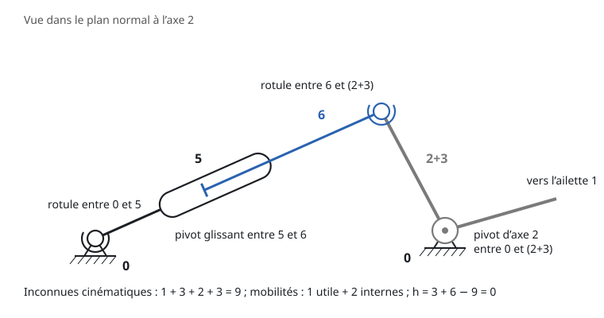
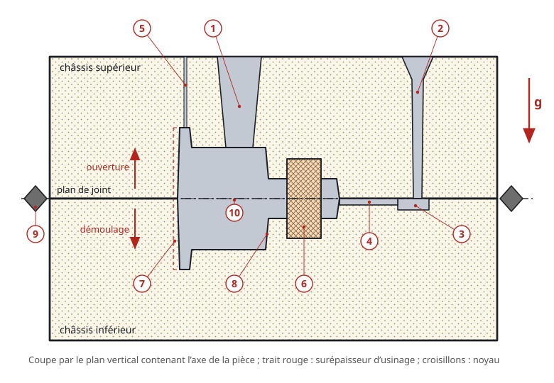
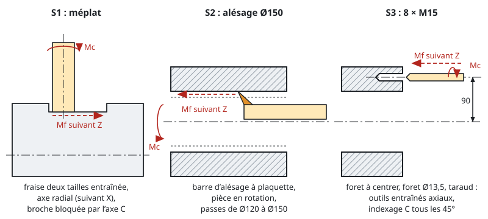
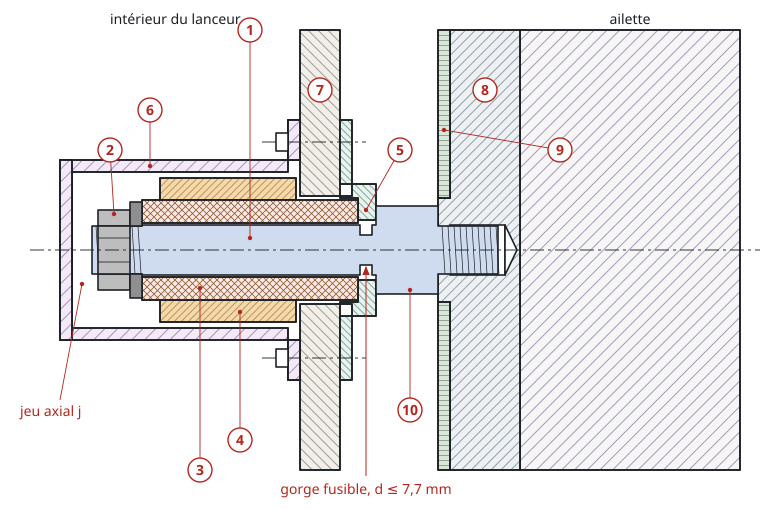
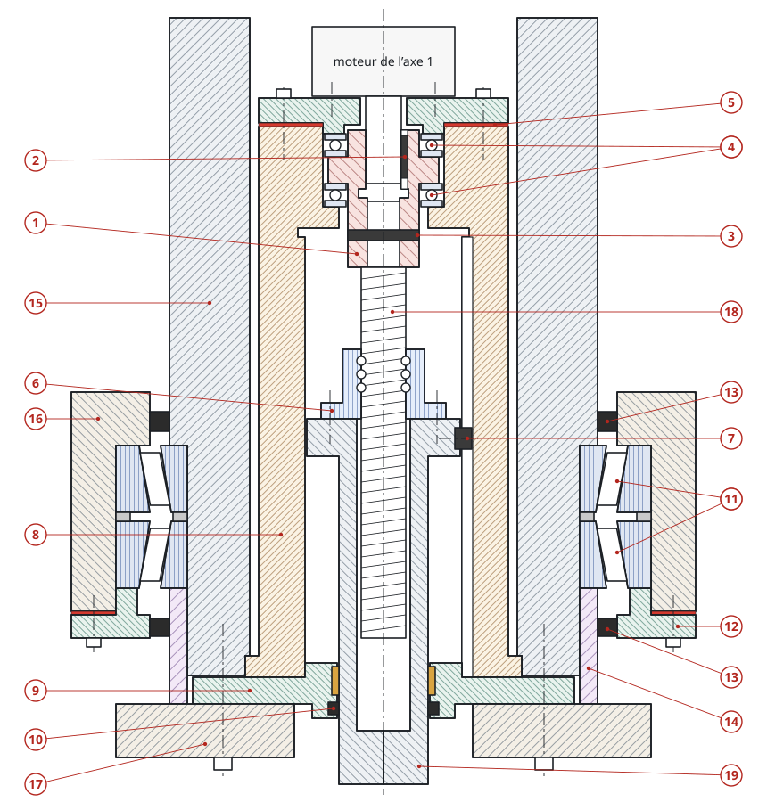

# Banque PT PT — Sciences industrielles C 2024 · Corrigé guidé

*Corrigé rédigé par IA, non officiel. Signalez toute erreur.*

**Rédaction** · modèle exact non renseigné (famille Claude) · effort non renseigné · vitesse non renseignée

Sur les 42 questions du sujet, 41 sont entièrement traitées et une l’est en partie : pour la question IV.7, les cinq fonctions sont conçues, justifiées et représentées par une coupe de principe, mais le tracé à l’échelle sur le dessin réponse A3 du sujet n’est pas reproduit. Les autres réponses graphiques (schéma cinématique II.6, croquis de moulage III.3, schémas d’usinage III.7, montage du Frangibolt IV.1) sont données par des figures originales ; le tableau II.10, les fiches GPS III.16 et la croix de IV.4 sont rendus par des tableaux ou par une description.

## Présentation du sujet

L’épreuve dure six heures, sans calculatrice ; les applications numériques s’appuient sur les valeurs arrondies, les formules et les courbes des ressources 4 et 5. Le support est RETALT1, projet européen de lanceur orbital dont le premier étage revient se poser : quatre ailettes, déployées hors atmosphère puis orientées par des vérins, pilotent la descente.

Le sujet comprend quatre parties indépendantes, 42 questions, quinze documents ressources, un cahier réponse de vingt pages et un dessin réponse au format A3 :

- partie I (7 questions, 15 % de la note) : mécanique d’un lancement, vitesse orbitale, énergie, équation de Tsiolkovski, intérêt de deux étages ;
- partie II (11 questions, 15 %) : équilibre de l’étage en descente, actionneurs, hyperstatisme, couple sur l’axe 2, schéma hydraulique ;
- partie III (17 questions, 30 %) : matériaux, fonderie, usinage, rugosité, traitement thermique, spécifications géométriques ;
- partie IV (7 questions, 40 %) : montage d’un dispositif de séparation Frangibolt, paliers lisses, puis dessin d’un vérin électrique et d’un palier très chargé.

> [!JURY]
> Le rapport juge le système plus complexe et plus atypique que les années précédentes, avec une moyenne en baisse. Il rappelle que beaucoup de réponses se trouvent dans les documents ressources, à lire avant de rédiger, que le principe fondamental de la statique est mal appliqué par de nombreux candidats (bilans d’actions incomplets), et que les valeurs aberrantes non commentées, les démonstrations arrangées et les dessins au tracé trop pâle sont pénalisés.

[Sujet officiel](https://www.banquept.fr/documents/2024/si_c_2024_pt.pdf) · [Rapport du jury](https://www.banquept.fr/documents/ecrit/rapport/2024/rapport_si_c_ecrit_2024.pdf)

## Partie I — Exigences d’une mission de lancement orbital

### Question I.1 — Vitesse d’une orbite circulaire

> [!INDICATION]
> Sur une orbite circulaire parcourue à vitesse constante, l’accélération est purement centripète : écrire le principe fondamental en projection sur la normale.

> [!INDICATION]
> Avec les valeurs arrondies de la ressource 2, le produit $G\,M_T$ et le rayon $R+h$ sont des nombres ronds.

#### Solution

On étudie la charge utile, de masse $m$, dans le référentiel géocentrique supposé galiléen. Sa trajectoire est un cercle de rayon $r=R+h$ parcouru à vitesse constante : l’accélération est centripète, de norme $V^2/r$. La seule force est l’attraction de la Terre (ressource 2). Le principe fondamental de la dynamique, projeté sur la normale, donne

$$m\,\frac{V^2}{R+h}=\frac{G\,m\,M_T}{(R+h)^2}$$

$$\boxed{V=\sqrt{\frac{G\,M_T}{R+h}}}$$

La vitesse ne dépend pas de la masse de la charge. Avec les valeurs d’application numérique de la ressource 2, $G\,M_T=\tfrac{20}{3}\cdot10^{-11}\times6\cdot10^{24}=4\cdot10^{14}\ \mathrm{m^3\,s^{-2}}$ et $R+h=6300+1700=8000\ \mathrm{km}=8\cdot10^{6}\ \mathrm{m}$ :

$$V^2=\frac{4\cdot10^{14}}{8\cdot10^{6}}=5\cdot10^{7}\ \mathrm{m^2\,s^{-2}}$$

$$\boxed{V\approx7{,}1\cdot10^{3}\ \mathrm{m\,s^{-1}}\approx7{,}1\ \mathrm{km\,s^{-1}}}$$

L’ordre de grandeur est le bon : c’est un peu moins que les 7,8 km/s d’une orbite basse, et moins que la vitesse de libération (11,2 km/s).

> [!METHODE]
> Sans calculatrice, garder $V^2=5\cdot10^{7}$ pour la suite : c’est lui qui sert dans l’énergie cinétique. $\sqrt{50}\approx7{,}07$ se retrouve par $7^2=49$.

### Question I.2 — Énergie mécanique à fournir

> [!INDICATION]
> Additionner le gain d’énergie cinétique et le gain d’énergie potentielle entre le sol et l’orbite.

> [!INDICATION]
> L’énoncé impose un champ de pesanteur uniforme : l’énergie potentielle varie de $m\,g\,h$.

#### Solution

La charge part du sol avec une vitesse négligée (la vitesse d’entraînement de la Terre, moins de 0,5 km/s, est ignorée) et arrive à l’altitude $h$ avec la vitesse $V$ de la question I.1. Avec le champ de pesanteur uniforme imposé par l’énoncé ($g=10\ \mathrm{m\,s^{-2}}$), le gain d’énergie mécanique est

$$\boxed{\Delta E_m=\tfrac12\,m\,V^2+m\,g\,h}$$

$$\tfrac12\,m\,V^2=\tfrac12\times10^{4}\times5\cdot10^{7}=2{,}5\cdot10^{11}\ \mathrm{J}$$

$$m\,g\,h=10^{4}\times10\times1{,}7\cdot10^{6}=1{,}7\cdot10^{11}\ \mathrm{J}$$

$$\boxed{\Delta E_m\approx4{,}2\cdot10^{11}\ \mathrm{J}=420\ \mathrm{GJ}}$$

À titre de contrôle, le potentiel newtonien donnerait $G\,M_T\,m\left(\tfrac1R-\tfrac1{R+h}\right)\approx1{,}35\cdot10^{11}\ \mathrm{J}$ pour le terme potentiel, soit un total de $3{,}85\cdot10^{11}\ \mathrm{J}$ : le champ uniforme surestime le résultat d’environ 9 %, sans changer l’ordre de grandeur.

> [!PIEGE]
> La masse est donnée en tonnes et l’altitude en kilomètres : $10\ \mathrm{t}=10^{4}\ \mathrm{kg}$, $1700\ \mathrm{km}=1{,}7\cdot10^{6}\ \mathrm{m}$. Une énergie de quelques centaines de gigajoules doit être annoncée et commentée.

### Question I.3 — Masse de propergol par un bilan d’énergie

> [!INDICATION]
> Convertir l’énergie spécifique en joules par kilogramme et tenir compte du rendement de 60 %.

> [!INDICATION]
> Pour la critique : qu’est-ce que le propergol doit aussi mettre en mouvement, en plus de la charge utile ?

#### Solution

L’énergie spécifique vaut $E_s=7000\ \mathrm{J\,g^{-1}}=7\cdot10^{6}\ \mathrm{J\,kg^{-1}}$. Avec un rendement $\eta=0{,}6$ :

$$m_p=\frac{\Delta E_m}{\eta\,E_s}=\frac{4{,}2\cdot10^{11}}{0{,}6\times7\cdot10^{6}}$$

$$\boxed{m_p\approx1{,}0\cdot10^{5}\ \mathrm{kg}=100\ \mathrm{t}}$$

soit 10 t de propergol par tonne de charge. La ressource 1 annonce 818 t de propergol pour une charge de 14 t, soit près de 60 t par tonne de charge, et une masse totale de 899 t au décollage.

L’écart vient du raisonnement, qui ne compte que l’énergie reçue par la charge utile :

- le propergol doit aussi accélérer et élever la structure (67 t) et surtout le propergol qui n’a pas encore brûlé ;
- l’essentiel de l’énergie libérée part dans l’énergie cinétique des gaz éjectés : la propulsion repose sur un bilan de quantité de mouvement et non sur un simple bilan d’énergie de la charge ;
- le calcul ignore les pertes par gravité pendant la montée, la traînée atmosphérique et les réserves (retour de l’étage, marges) ;
- l’orbite visée par le lanceur réel est plus énergétique que l’orbite à 1700 km étudiée ici.

Le résultat de 100 t est donc une borne très inférieure, et c’est ce qui motive le modèle des questions I.4 à I.7.

> [!JURY]
> Le rapport regrette que des valeurs déraisonnables ne suscitent aucun commentaire. Ici, la comparaison chiffrée avec la ressource 1 (100 t contre 818 t) fait partie de la réponse.

### Question I.4 — Conservation de la quantité de mouvement

> [!INDICATION]
> Écrire la quantité de mouvement du système fermé « fusée et gaz éjectés » aux instants $t$ et $t+\Delta t$.

> [!INDICATION]
> Remplacer la vitesse du gaz par l’expression donnée dans la ressource 3 : les termes en $\Delta M\,\Delta\vec V$ se compensent exactement.

#### Solution

On considère le système fermé constitué de la fusée à l’instant $t$ (masse $M$, vitesse $\vec V$). À l’instant $t+\Delta t$, il se compose de la fusée (masse $M+\Delta M$, vitesse $\vec V+\Delta\vec V$) et du gaz éjecté (masse $-\Delta M>0$, vitesse galiléenne $\vec u=\vec V+\Delta\vec V+\vec V_E$). Le système est isolé, sa quantité de mouvement se conserve :

$$M\,\vec V=(M+\Delta M)(\vec V+\Delta\vec V)+(-\Delta M)\,(\vec V+\Delta\vec V+\vec V_E)$$

Les termes en $\Delta M\,(\vec V+\Delta\vec V)$ s’éliminent :

$$M\,\vec V=M\,\vec V+M\,\Delta\vec V-\Delta M\,\vec V_E$$

$$\boxed{M\,\Delta\vec V=\vec V_E\,\Delta M}$$

Le signe est cohérent : $\Delta M<0$ et $\vec V_E$ est opposé au mouvement, donc $\Delta\vec V$ est dans le sens de $\vec V$.

> [!JURY]
> Le résultat est donné : le jury signale de nombreuses démonstrations arrangées pour retomber sur la formule, sanctionnées dans la note de qualité. Il faut écrire le bilan terme à terme.

### Question I.5 — Équation de Tsiolkovski

> [!INDICATION]
> Passer à la limite : $M\,\mathrm dV=V_E\,\mathrm dM$, puis séparer les variables.

> [!INDICATION]
> Avec $M(t)=M_i-q\,t$, la primitive de $1/(a+b\,x)$ de la ressource 4 donne directement le logarithme.

#### Solution

En projection sur la direction du mouvement et pour des variations élémentaires, la relation de I.4 s’écrit $M\,\mathrm dV=V_E\,\mathrm dM$. Avec $M(t)=M_i-q\,t$, on a $\mathrm dM=-q\,\mathrm dt$ :

$$\mathrm dV=-V_E\,\frac{q}{M_i-q\,t}\,\mathrm dt$$

La ressource 4 donne la primitive de $\dfrac{1}{a+b\,x}$, soit $\dfrac{\ln(a+b\,x)}{b}$, ici avec $a=M_i$ et $b=-q$. Comme $V_E$ et $q$ sont constants, entre $t=0$ (masse $M_i$) et $t=t_f$ (masse $M_f=M_i-q\,t_f$) :

$$V_f-V_i=-V_E\,q\left[\frac{\ln(M_i-q\,t)}{-q}\right]_0^{t_f}=V_E\,\ln\frac{M_f}{M_i}$$

$$\boxed{\Delta V=V_f-V_i=-V_E\,\ln\frac{M_i}{M_f}}$$

Comme $V_E<0$ et $M_i>M_f$, on a bien $\Delta V>0$. Le gain de vitesse ne dépend que du rapport des masses et de la vitesse d’éjection, pas du débit.

### Question I.6 — Vitesses finales des deux configurations

> [!INDICATION]
> Appliquer I.5 entre le décollage et l’épuisement du propergol ; la masse finale est la masse initiale diminuée du propergol brûlé.

> [!INDICATION]
> Pour deux étages, appliquer la relation deux fois : le premier étage vide est largué avant l’allumage du second.

#### Solution

**Configuration A (un étage).** La vitesse initiale est nulle et la masse finale vaut $M_i-M_P=M_s+M_{ch}$ :

$$\boxed{V_A=-V_E\,\ln\frac{M_i}{M_i-M_P}=-V_E\,\ln\frac{899}{81}}$$

**Configuration B (deux étages).** À la fin de la combustion du premier étage, la masse vaut $M_i-M_{P1}$ :

$$V_1=-V_E\,\ln\frac{M_i}{M_i-M_{P1}}=-V_E\,\ln\frac{899}{269}$$

La structure du premier étage ($M_{S1}=50$ t) est alors larguée : le second étage repart de la masse $M_{i2}=219$ t, avec la vitesse $V_1$, et finit à la masse $M_{i2}-M_{P2}=M_{S2}+M_{ch}=31$ t :

$$\boxed{V_B=-V_E\left(\ln\frac{M_i}{M_i-M_{P1}}+\ln\frac{M_{i2}}{M_{i2}-M_{P2}}\right)=-V_E\left(\ln\frac{899}{269}+\ln\frac{219}{31}\right)}$$

> [!PIEGE]
> On ne peut pas additionner les propergols dans un seul logarithme pour la configuration B : la masse change brutalement à la séparation ($269\ \mathrm{t}\to219\ \mathrm{t}$), sans gain de vitesse.

### Question I.7 — Évaluation numérique et intérêt des deux étages

> [!INDICATION]
> Lire les logarithmes sur la courbe de la ressource 5, en décomposant les rapports trop grands avec $\ln(a\,b)=\ln a+\ln b$.

> [!INDICATION]
> Comparer les deux vitesses à masse initiale, masse de propergol et charge utile identiques.

#### Solution

**Configuration A.** $\dfrac{899}{81}\approx11{,}1\approx3{,}33^2$, et la courbe de la ressource 5 donne $\ln3{,}33\approx1{,}2$, d’où $\ln11{,}1\approx2{,}4$ :

$$\boxed{V_A\approx4000\times2{,}4\approx9{,}6\cdot10^{3}\ \mathrm{m\,s^{-1}}}$$

**Configuration B.** $\dfrac{899}{269}\approx3{,}34$ donne $\ln\approx1{,}2$, et $\dfrac{219}{31}\approx7{,}06$ donne $\ln\approx1{,}95$ (lecture de la courbe) :

$$V_1\approx4000\times1{,}2\approx4{,}8\cdot10^{3}\ \mathrm{m\,s^{-1}}$$

$$\boxed{V_B\approx4000\times(1{,}2+1{,}95)\approx12{,}6\cdot10^{3}\ \mathrm{m\,s^{-1}}}$$

(Les valeurs exactes sont 9,63 km/s et 12,65 km/s.)

**Intérêt.** À masse au décollage (899 t), masse de propergol (818 t), masse de structure (67 t) et charge utile (14 t) identiques, la version à deux étages gagne environ 3 km/s, soit 30 % de plus. La raison est que les 50 t de structure du premier étage ne sont plus accélérées pendant la seconde combustion : le rapport de masses du second étage (219/31) est bien plus favorable. Autrement dit, pour une vitesse visée donnée, deux étages demandent moins de propergol ou emportent une charge plus lourde. Dans ce modèle sans gravité ni traînée, la version A atteint 9,6 km/s : une fois retranchées les pertes réelles (de l’ordre de 1,5 à 2 km/s), il reste à peine la vitesse d’une orbite basse. La version B dépasse la vitesse de libération (11,2 km/s) et garde une marge pour ces pertes.

> [!METHODE]
> La courbe $\ln x$ s’arrête à $x=9$ : pour $11{,}1$, écrire $11{,}1=3{,}33\times3{,}33$ ou $11{,}1=9\times1{,}23$ et additionner les lectures.

## Partie II — Descente à contrôle aérodynamique et orientation des ailettes

### Question II.1 — Déploiement et rétropropulsion hors atmosphère

> [!INDICATION]
> Comparer les efforts sur une ailette pendant son déploiement, avec et sans écoulement d’air.

> [!INDICATION]
> Penser à ce que la rétropropulsion change pour la vitesse d’entrée, donc pour l’échauffement et la pression dynamique.

#### Solution

Plusieurs arguments, dont deux suffisent :

- **Efforts de déploiement.** Hors atmosphère, aucune action aérodynamique ne s’exerce sur les ailettes : les moteurs des axes 1 et 2 n’ont à vaincre que l’inertie et les frottements. Dans l’air, à grande vitesse, il faudrait déplier une surface de $3\times5\ \mathrm{m^2}$ contre des efforts de plusieurs centaines de kilonewtons, avec des actionneurs bien plus lourds.
- **Stabilité.** Un déploiement dans l’écoulement, forcément un peu dissymétrique d’une ailette à l’autre, créerait des moments perturbateurs sur un étage qui n’est pas encore pilotable. Les ailettes doivent être déployées, verrouillées (blocage de l’axe 1, indexage de l’axe 2) et vérifiées avant d’être sollicitées.
- **Commande disponible dès l’entrée.** La phase 7 n’est pilotée que par les ailettes : elles doivent être opérationnelles dès les premières couches d’air.
- **Rétropropulsion à l’entrée (phase 6).** Freiner avant les couches denses réduit la vitesse d’entrée, donc la pression dynamique (en $\rho V^2$) et le flux thermique sur la structure et sur les ailettes : on évite un bouclier thermique lourd et on limite les efforts de la phase 7.

### Question II.2 — Angles des ailettes pour un freinage maximal

> [!INDICATION]
> Chaque ailette doit être braquée au maximum ; il reste à choisir les signes.

> [!INDICATION]
> Les composantes horizontales des efforts doivent s’annuler deux à deux (résultante) et ne pas créer de moment autour de $\vec Z$ (roulis).

#### Solution

| $\alpha_1$ | $\alpha_2$ | $\alpha_3$ | $\alpha_4$ |
|:---:|:---:|:---:|:---:|
| $+20°$ | $+20°$ | $-20°$ | $-20°$ |

(ou la solution opposée $-20°,\,-20°,\,+20°,\,+20°$).

**Raisonnement.** L’étage descend : l’air arrive par le bas, suivant $+\vec Z$ par rapport à l’étage.

- *Intensité.* En position de référence ($\alpha=0$), l’ailette est de chant dans l’écoulement et freine très peu. Braquée de $\alpha$, elle reçoit une force normale dont la composante verticale vaut $F_N\sin|\alpha|$, à laquelle s’ajoute $F_A\cos\alpha$ : le freinage croît avec le braquage, il est maximal pour $|\alpha_i|=20°$ sur les quatre ailettes.
- *Résultante horizontale.* Dans le repère de l’ailette $i$, la force normale a une composante horizontale $F_N\cos\alpha$ portée par $\vec X_i$ (direction tangente au fuselage), dans le sens opposé au braquage. Les ailettes A1 et A2 sont diamétralement opposées, de même que A3 et A4, donc $\vec X_1=-\vec X_2$ et $\vec X_3=-\vec X_4$. Pour que les composantes horizontales s’annulent, deux ailettes opposées doivent avoir le même angle dans leur repère propre : $\alpha_1=\alpha_2$ et $\alpha_3=\alpha_4$.
- *Moment de roulis.* Deux ailettes opposées de même angle exercent deux forces tangentielles opposées, à une distance $2r$ l’une de l’autre : c’est un couple autour de $\vec Z$. Pour que l’étage ne parte pas en rotation, la seconde paire doit créer le couple opposé : $\alpha_3=\alpha_4=-\alpha_1$.
- *Tangage.* Les quatre composantes verticales sont égales et placées symétriquement : leur moment par rapport à l’axe de l’étage est nul.

Cette réponse suppose que les repères locaux des quatre ailettes se déduisent de celui de A4 par rotation autour de $\vec Z$, ce que suggère la ressource 7.

> [!JURY]
> Question sans calcul, jugée décevante par le jury : il attend un raisonnement sur la résultante **et** sur le moment créés par chaque configuration extrême, pas seulement « tout à 20° ».

### Question II.3 — Effort normal sur une ailette

> [!INDICATION]
> Descente à vitesse constante : la somme des forces verticales est nulle. Ne pas oublier qu’il y a quatre ailettes.

> [!INDICATION]
> Projeter $\vec F_N$ et $\vec F_A$ sur $\vec Z$ avec $\alpha=20°$ ; la ressource 4 donne $\sin20°=0{,}34$ et $\cos20°=0{,}94$.

#### Solution

On isole l’étage. La descente est verticale à vitesse constante : la résultante des actions extérieures est nulle. En projection sur $\vec Z$ (ressource 7, figure 3), avec le poids $M_F\,g$ vers le bas, la traînée du corps $F_T$ vers le haut et, pour chacune des quatre ailettes braquées à $|\alpha|=20°$, les composantes verticales $F_N\sin\alpha$ et $F_A\cos\alpha$ vers le haut :

$$M_F\,g=F_T+4\left(F_N\sin\alpha+F_A\cos\alpha\right)$$

En posant $F_A=k\,F_N$ ($k=0{,}45$ en subsonique, $0{,}35$ en supersonique) :

$$\boxed{F_N=\frac{M_F\,g-F_T}{4\left(\sin\alpha+k\cos\alpha\right)}}$$

Avec $g=10\ \mathrm{m\,s^{-2}}$, $\sin20°=0{,}34$ et $\cos20°=0{,}94$ :

**Subsonique.** $M_F\,g-F_T=700-150=550\ \mathrm{kN}$ ; $4\,(0{,}34+0{,}45\times0{,}94)=4\times0{,}763=3{,}05$.

$$\boxed{F_{N,\,sub}\approx180\ \mathrm{kN}}$$

**Supersonique.** $M_F\,g-F_T=950-10=940\ \mathrm{kN}$ ; $4\,(0{,}34+0{,}35\times0{,}94)=4\times0{,}669=2{,}68$.

$$\boxed{F_{N,\,super}\approx350\ \mathrm{kN}}$$

On retrouve les valeurs $F_{sub}=180$ kN et $F_{super}=350$ kN de la ressource 11, ce qui valide le bilan.

> [!PIEGE]
> Deux oublis signalés par le jury : le facteur 4 (quatre ailettes) et une partie des actions (la traînée du corps $F_T$ ou la composante $F_A$). Faire le bilan complet avant de projeter.

### Question II.4 — Deux actionneurs pour l’axe 2

> [!INDICATION]
> Comparer, pour chaque phase, l’angle à parcourir et le couple à fournir.

> [!INDICATION]
> Un vérin articulé sur un bras de levier ne balaie qu’un angle limité ; un moteur avec pignon et roue dentée tourne autant qu’on veut mais transmet un couple modeste.

#### Solution

**Déploiement (phase 5) : moteur électrique, pignon et roue dentée.** Il faut une grande course angulaire (90°), effectuée une seule fois, hors atmosphère donc sans effort aérodynamique : seul un faible couple est nécessaire (inertie de l’ailette, frottements). Un moteur électrique compact, réducté par le pignon (4) et la roue d’indexage, convient : il est léger, simple à commander, et sa course n’est pas limitée. Une fois l’indexage enclenché, il n’est plus sollicité.

**Utilisation (phase 7) : deux vérins hydrauliques.** La course est faible ($\pm20°$) mais le couple est très élevé (plusieurs dizaines de kilonewtons-mètres, question II.9) et doit être appliqué rapidement et tenu en permanence pour le pilotage. L’hydraulique offre la meilleure puissance massique, une grande raideur de maintien et une bonne dynamique. Les deux vérins, placés symétriquement, se partagent l’effort et limitent les efforts radiaux sur les paliers de l’axe 2.

Aucun des deux ne ferait bien les deux tâches : un vérin ne peut pas couvrir $90°+2\times20°$ avec un bras de levier correct, et un motoréducteur capable du couple de la phase 7 serait beaucoup trop lourd.

### Question II.5 — Degré d’hyperstatisme avec un seul vérin

> [!INDICATION]
> Recenser les solides et les liaisons de la boucle bâti, corps de vérin, tige, ensemble (2+3).

> [!INDICATION]
> Appliquer $h=m+6\,\gamma-I_c$ avec une seule boucle fermée et une seule mobilité.

#### Solution

Sur la figure 4 de la ressource 9, la chaîne fermée comprend le bâti (0), le corps (5), la tige (6) et l’ensemble (2+3). Les liaisons sont :

- pivot entre 0 et (2+3), d’axe 2 : 1 inconnue cinématique ;
- pivot entre 0 et 5 : 1 ;
- glissière entre 5 et 6 (symbole prismatique de la figure) : 1 ;
- pivot entre 6 et (2+3) : 1.

L’ailette (1), liée à (2+3) par le pivot d’axe 1 bloqué, est en chaîne ouverte et ne change pas le résultat.

Il y a une boucle indépendante ($\gamma=1$, soit 6 équations cinématiques), $I_c=4$ inconnues cinématiques et une mobilité $m=1$ (la rotation de l’axe 2 commandée par le vérin, sans mobilité interne) :

$$h=m+6\,\gamma-I_c=1+6-4$$

$$\boxed{h=3}$$

Contrôle par la statique : $I_s=4\times5=20$ inconnues, $6\times3=18$ équations pour trois solides mobiles, $h=m+I_s-18=3$.

Ce mécanisme est plan (trois pivots d’axes parallèles et une glissière perpendiculaire) : les trois degrés d’hyperstatisme traduisent les conditions de parallélisme des axes des pivots et de perpendicularité de la glissière, nécessaires au montage.

> [!PIEGE]
> Si l’on lit la liaison 5–6 comme un pivot glissant (vérin réel), on a $I_c=5$ et l’on trouve $h=2$. Annoncer la liaison retenue avant le calcul.

### Question II.6 — Schéma rendu isostatique

> [!INDICATION]
> Il faut libérer trois degrés de liberté dans la boucle sans supprimer le mouvement voulu.

> [!INDICATION]
> Penser à la réalité d’un vérin : embouts à rotule et tige cylindrique dans le corps.

#### Solution

On conserve le pivot d’axe 2 entre le bâti et (2+3), qui définit le mouvement voulu, et l’on modifie la branche du vérin :

- rotule entre le bâti (0) et le corps (5) ;
- pivot glissant entre le corps (5) et la tige (6) ;
- rotule entre la tige (6) et l’ensemble (2+3).

**Justification.** Les inconnues cinématiques sont $I_c=1+3+2+3=9$. Les mobilités sont la rotation utile de l’axe 2 et deux mobilités internes sans conséquence (rotation propre du corps et rotation propre de la tige autour de la droite joignant les centres des rotules), soit $m=3$ :

$$h=m+6\,\gamma-I_c=3+6-9$$

$$\boxed{h=0}$$

Le vérin devient une barre biarticulée de longueur variable : il ne transmet qu’un effort porté par la droite des centres des rotules, et aucun défaut de parallélisme entre ses attaches et l’axe 2 ne gêne le montage. C’est aussi la solution technologique habituelle (embouts à rotule, piston cylindrique). Variante minimale : garder la glissière 5–6 avec les deux rotules ($I_c=8$, une seule mobilité interne, $h=0$).

> [!JURY]
> Le jury a vu de nombreux schémas « complètement décorrélés du mouvement souhaité ». Vérifier que la proposition laisse bien la rotation autour de l’axe 2 commandée par l’allongement du vérin.

### Question II.7 — Deux vérins en parallèle

> [!INDICATION]
> Reprendre le décompte en ajoutant une seconde branche identique : une boucle de plus, ses inconnues, ses mobilités internes.

> [!INDICATION]
> Distinguer hyperstatisme des liaisons et répartition des efforts entre deux actionneurs.

#### Solution

Avec la solution de II.6, la seconde branche ajoute une boucle (6 équations), $3+2+3=8$ inconnues cinématiques et deux mobilités internes :

$$h=(1+2+2)+6\times2-(1+8+8)$$

$$\boxed{h=0}$$

Le système reste **isostatique**. Chaque vérin à deux rotules est une barre de longueur libre : il n’impose aucune contrainte géométrique à l’ensemble (2+3), donc le second vérin se monte sans condition dimensionnelle ou de position supplémentaire.

Ce que le second vérin ajoute, c’est un **effort moteur** (redondance d’actionnement), pas une inconnue de liaison. La répartition du couple entre les deux vérins n’est pas fixée par la géométrie mais par la commande : alimentés en parallèle par le même circuit, les deux vérins sont à la même pression et fournissent le même effort.

À l’inverse, avec le schéma initial de la figure 4 (pivots et glissière), un second vérin ajouterait une boucle et seulement trois inconnues cinématiques : $h=1+12-7=6$, le système serait fortement hyperstatique.

### Question II.8 — Position de l’axe 2 sur la corde

> [!INDICATION]
> Écrire le moment autour de l’axe 2 de la force normale dans chacun des deux régimes : les deux centres de pression sont de part et d’autre de l’axe.

> [!INDICATION]
> Le couple à fournir par les vérins est le plus grand des deux moments : il est minimal quand ils sont égaux.

#### Solution

On repère l’axe 2 par sa distance $x$ au bord d’attaque, avec $x=\dfrac{L_c}{2}-d_2$. Les centres de pression sont à $0{,}2\,L_c$ (subsonique) et $0{,}4\,L_c$ (supersonique) du bord d’attaque ; l’axe est placé entre les deux (ressource 11). Les moments à équilibrer autour de l’axe 2 sont :

$$C_{sub}=F_{sub}\left(x-0{,}2\,L_c\right)$$

$$C_{super}=F_{super}\left(0{,}4\,L_c-x\right)$$

Quand $x$ augmente, $C_{sub}$ croît et $C_{super}$ décroît : le plus grand des deux est minimal lorsqu’ils sont égaux.

$$F_{sub}\left(x-0{,}2\,L_c\right)=F_{super}\left(0{,}4\,L_c-x\right)$$

$$x=L_c\,\frac{0{,}2\,F_{sub}+0{,}4\,F_{super}}{F_{sub}+F_{super}}$$

$$\boxed{d_2=\frac{L_c}{2}-x=L_c\,\frac{0{,}3\,F_{sub}+0{,}1\,F_{super}}{F_{sub}+F_{super}}}$$

$$d_2=3\times\frac{0{,}3\times180+0{,}1\times350}{180+350}=3\times\frac{89}{530}$$

$$\boxed{d_2\approx0{,}50\ \mathrm{m}}$$

L’axe 2 est à environ 1,0 m du bord d’attaque, soit un tiers de la corde.

> [!METHODE]
> Minimiser le maximum de deux fonctions monotones de sens contraires revient à les égaler : c’est le même raisonnement que pour équilibrer deux cas de charge sur un appui.

### Question II.9 — Couple maximal des vérins

> [!INDICATION]
> Reporter la position trouvée dans l’un des deux moments.

> [!INDICATION]
> Contrôler avec l’autre régime : les deux valeurs doivent coïncider.

#### Solution

Avec la position optimale, les deux régimes donnent le même couple :

$$C_v=F_{sub}\left(x-0{,}2\,L_c\right)$$

$$\boxed{C_v=\frac{0{,}2\,L_c\,F_{sub}\,F_{super}}{F_{sub}+F_{super}}}$$

$$C_v=\frac{0{,}2\times3\times180\times350}{530}\ \mathrm{kN\,m}$$

$$\boxed{C_v\approx71\ \mathrm{kN\,m}}$$

Contrôle avec $d_2=0{,}50$ m arrondi : $180\times0{,}40=72$ kN·m en subsonique et $350\times0{,}20=70$ kN·m en supersonique. Les deux vérins fournissent ensemble environ 71 kN·m, soit près de 36 kN·m chacun. Ce couple change de signe entre les deux régimes : les vérins doivent être à double effet.

### Question II.10 — Analyse du schéma hydraulique

> [!INDICATION]
> Suivre le fluide : réservoir, filtre, pompe, distributeur, vérin, retour.

> [!INDICATION]
> Dans « 4/3 », le premier chiffre compte les orifices et le second les positions ; regarder ce que relie la case centrale.

#### Solution

| Élément | Réponse |
|---|---|
| **Rôle de la pompe hydraulique à cylindrée variable** | Convertir la puissance mécanique du moteur électrique en puissance hydraulique : elle aspire l’huile du réservoir à travers le filtre et impose un **débit** vers le circuit. La pression n’est pas créée par la pompe, elle résulte de la charge sur le vérin. |
| **Signification de « cylindrée variable »** | La cylindrée est le volume de fluide refoulé par tour d’arbre. Elle est ici réglable (par exemple par l’inclinaison du plateau d’une pompe à pistons axiaux) : à vitesse de moteur constante on règle le débit, donc la vitesse de la tige, sans laminage ni pertes, et on peut l’annuler quand le vérin est à l’arrêt. |
| **Rôle du distributeur** | Préactionneur : il aiguille le débit de la pompe vers l’une ou l’autre chambre du vérin et renvoie l’autre chambre au réservoir, ce qui commande la sortie, la rentrée ou l’arrêt de la tige. |
| **Analyse du choix d’un distributeur 4/3** | Quatre orifices (pression, réservoir, deux chambres) et trois positions : flèches parallèles, flèches croisées, position centrale. Monostable : les ressorts le ramènent au centre sans commande électrique. La case centrale ferme les deux orifices du vérin et relie la pompe au réservoir : l’ailette est **verrouillée hydrauliquement** dans sa position malgré les efforts aérodynamiques, et la pompe débite sans pression (pas d’échauffement). En cas de coupure de la commande, l’ailette reste bloquée. Limite : la commande est en tout ou rien ; un asservissement fin de l’angle demanderait un distributeur proportionnel ou une servovalve. |
| **Rôle du limiteur de pression** | Organe de sécurité monté en dérivation, normalement fermé : il s’ouvre vers le réservoir quand la pression dépasse sa valeur de tarage (vérin en butée, surcharge) et protège ainsi la pompe, les conduites et le vérin. |

> [!JURY]
> Les circuits hydrauliques, peu interrogés auparavant, sont mal maîtrisés selon le rapport. Débit pour la pompe, pression pour le limiteur, aiguillage pour le distributeur : ces trois mots doivent apparaître.

### Question II.11 — Composant à ajouter au circuit fermé

> [!INDICATION]
> Le vérin n’a qu’une tige : comparer le volume d’huile qu’il contient tige sortie et tige rentrée.

> [!INDICATION]
> Un réservoir fermé, plein d’un fluide incompressible, ne peut ni céder ni recevoir ce volume.

#### Solution

Il faut ajouter un **accumulateur hydraulique** (à vessie, à membrane, à piston ou à soufflet métallique, gonflé à l’azote), raccordé à la ligne basse pression, côté réservoir.

**Justification.**

- Le vérin est à simple tige : ses deux chambres n’ont pas la même section. Quand la tige sort, le volume d’huile contenu dans le vérin augmente du volume de tige sorti ; il diminue quand elle rentre. Un réservoir fermé, entièrement rempli d’un fluide incompressible, ne peut pas absorber cette variation : sans volume déformable, le circuit se bloque ou subit une dépression (cavitation de la pompe) puis une surpression.
- Les fortes variations de température rencontrées par l’étage dilatent l’huile : là encore il faut une capacité élastique.
- Dans le vide et en quasi-apesanteur, ni la pression atmosphérique ni la gravité ne gavent l’aspiration de la pompe : la précharge de gaz de l’accumulateur maintient une pression à l’aspiration.

L’accumulateur joue donc le rôle de réservoir pressurisé à volume variable.

> [!JURY]
> C’est la réponse la moins bien réussie de la partie II : le jury attendait un raisonnement sur les volumes, pas une restitution de cours.

## Partie III — Industrialisation de composants du mécanisme d’orientation

### Question III.1 — Critères de choix du matériau

> [!INDICATION]
> Se demander ce que coûte chaque kilogramme embarqué sur un étage de fusée, et ce que subit la pièce pendant un vol.

> [!INDICATION]
> L’étage est réutilisable : que change la répétition des vols ?

#### Solution

Deux critères déterminants :

- **Les performances mécaniques rapportées à la masse** : résistance spécifique $R_e/\rho$ et rigidité spécifique $E/\rho$. Toute masse de structure emportée coûte du propergol (partie I), alors que la pièce transmet les efforts des vérins (couple de l’ordre de 70 kN·m sur l’axe 2).
- **La tenue à l’environnement et à la réutilisation** : larges écarts de température (voisinage des réservoirs cryogéniques, échauffement à la rentrée), vide, vibrations et chocs du lancement, donc tenue en fatigue, ténacité à froid et résistance à la corrosion sur plusieurs vols.

Le coût de la matière compte peu devant ces critères pour une série de dix lanceurs ; l’aptitude à la mise en forme intervient à la question suivante.

### Question III.2 — Aptitudes de fonderie et matériau

> [!INDICATION]
> Suivre le métal : il doit remplir l’empreinte, se solidifier sans se déchirer ni se creuser, et ne pas réagir avec le moule.

> [!INDICATION]
> Chercher un alliage léger de moulage à traitement thermique.

#### Solution

Trois propriétés ou aptitudes attendues pour le moulage :

- une bonne **coulabilité** (fluidité à l’état liquide), pour remplir complètement l’empreinte, y compris la bride mince ;
- un **retrait de solidification modéré** et une faible sensibilité à la **crique à chaud**, pour limiter retassures et fissures aux changements de section (jonction du corps massif et de la chape) ;
- une **température de fusion modérée** et une faible réactivité avec le sable et les gaz (peu d’oxydation, peu de gaz dissous), pour obtenir une pièce saine avec un moule en sable ordinaire.

On peut ajouter l’aptitude au traitement thermique et l’usinabilité des surfaces fonctionnelles.

**Matériau proposé.** Un alliage d’aluminium de fonderie au silicium et au magnésium, **AlSi7Mg0,6** (EN AC-42200), traité T6 (mise en solution, trempe, revenu) : masse volumique de 2,7 kg/dm³, limite d’élasticité de l’ordre de 240 MPa après traitement, très bonne coulabilité grâce au silicium, bonne tenue à la corrosion et à basse température. Il répond aux deux critères de III.1 et c’est un alliage courant des pièces moulées aéronautiques. Un alliage de titane serait plus performant, mais sa réactivité à l’état liquide interdit le moulage en sable classique.

### Question III.3 — Croquis du moulage en sable

> [!INDICATION]
> Chercher le plan de symétrie de la pièce qui évite toute contre-dépouille : la pièce de liaison est une pièce de révolution terminée par une chape plate percée.

> [!INDICATION]
> Placer la masselotte sur la partie la plus massive et l’attaque dans le plan de joint ; le trou de la chape demande un noyau.

#### Solution

La pièce étudiée est la pièce de liaison (2) de la ressource 12 : une bride de Ø250 percée de six trous, un corps massif de révolution et une chape plate traversée par un alésage, pour une hauteur de 270 mm.

Repères de la figure : 1 masselotte ; 2 entonnoir et descente de coulée ; 3 canal d’alimentation ; 4 attaque ; 5 évent ; 6 noyau du trou de la chape et ses portées ; 7 surépaisseur d’usinage ; 8 dépouille et congés ; 9 goujons de centrage des châssis ; 10 axe de la pièce, dans le plan de joint.

**Disposition.** La pièce est couchée : son axe de révolution est dans le plan de joint, qui est le plan médian de la chape (plan de symétrie parallèle aux deux faces de la chape). Chaque demi-empreinte est alors de dépouille naturelle : demi-cylindres du corps, demi-disque de la bride, demi-épaisseur de la chape. Le plan de joint est horizontal et la gravité lui est perpendiculaire, dirigée du châssis supérieur vers le châssis inférieur.

**Habillage de la pièce.**

- surépaisseurs d’usinage (2 à 4 mm) sur les surfaces fonctionnelles : face d’appui de la bride, faces de la chape, alésage de la chape ;
- dépouilles (environ 2°) sur les surfaces perpendiculaires au plan de joint : faces de la bride, extrémité de la chape ;
- congés aux raccordements bride–corps et corps–chape, arêtes arrondies ;
- les six trous de la bride ne viennent pas de fonderie (trop petits), ils seront percés ;
- le modèle est majoré du retrait linéaire de l’alliage (environ 1,2 %).

**Grappe.** Entonnoir de coulée, descente, canal dans le plan de joint, attaque sur l’extrémité de la chape, pièce, masselotte sur le corps (zone la plus massive, solidifiée en dernier), évent au point haut de la bride.

**Moule et outillages.** Deux châssis (supérieur et inférieur) remplis de sable silico-argileux serré, repérés par des goujons de centrage ; un noyau en sable aggloméré, posé verticalement par ses portées, qui réserve le trou de la chape (son axe est perpendiculaire au plan de joint) ; un modèle permanent en deux moitiés (ou une plaque-modèle double face) portant les empreintes des portées du noyau ; une boîte à noyau ; les modèles du système de coulée et de la masselotte.

**Étapes.** Serrage du sable sur chaque demi-modèle, retournement, extraction des demi-modèles perpendiculairement au plan de joint, pose du noyau, fermeture (remmoulage) et lestage du moule, coulée par gravité, solidification, décochage, tronçonnage des attaques, de la masselotte et de l’évent, ébarbage, traitement thermique puis usinage.

> [!JURY]
> Deux reproches du rapport : des croquis sans légende, et des candidats qui se trompent de pièce. Il s’agit bien de la pièce de liaison (2), pas du corps du moyeu, et chaque élément demandé par l’énoncé doit être fléché et nommé.

> [!PIEGE]
> Placer la pièce debout, bride sur le plan de joint, oblige à sortir le trou transversal de la chape par un noyau horizontal dans un seul châssis et place la partie massive loin de toute masselotte commode.

### Question III.4 — Trois défauts de moulage en sable

> [!INDICATION]
> Classer les défauts par cause : contraction du métal, gaz, contraintes de refroidissement.

> [!INDICATION]
> Pour chaque défaut, donner une règle de tracé de la pièce ou un élément de la grappe qui le prévient.

#### Solution

| Défaut typique | Phénomène physique responsable | Règles ou moyens utiles pour l’éviter |
|---|---|---|
| **Retassure** (cavité, ou affaissement de surface, dans les zones massives) | Contraction volumique du métal pendant la solidification : les zones solidifiées en dernier (points chauds) ne sont plus alimentées en liquide. | Masselottes sur les parties massives, solidification dirigée vers elles, épaisseurs régulières, refroidisseurs métalliques, nervures plutôt que masses. |
| **Soufflures et porosités gazeuses** (bulles sphériques) | Gaz emprisonnés : air de l’empreinte, vapeur dégagée par l’humidité du sable et les liants, hydrogène dissous qui se libère à la solidification. | Évents et tirage d’air, sable perméable et peu humide, noyaux étuvés, dégazage du bain, remplissage calme sans turbulence. |
| **Criques et tapures** (fissures à chaud ou à froid) | Retrait à l’état solide contrarié par le moule ou par les différences d’épaisseur : contraintes de traction dans un métal encore peu résistant, concentrées aux angles vifs. | Congés de raccordement, variations d’épaisseur progressives, noyaux et sable capables de céder, refroidissement lent et uniforme, traitement de détente. |

Autres défauts possibles : inclusions de sable (érosion du moule par le jet de métal), malvenues et reprises (métal trop froid, parois trop minces), déformations.

> [!JURY]
> Selon le rapport, les noms des défauts sont souvent connus mais pas le phénomène physique ni le remède. Les trois colonnes comptent.

### Question III.5 — Avantage du modèle perdu

> [!INDICATION]
> Que faut-il faire du modèle permanent avant de couler, et qu’est-ce que cela impose à la forme de la pièce ?

#### Solution

Dans le moulage à modèle perdu (cire perdue, polystyrène gazéifié), le modèle est détruit par fusion ou par gazéification : il n’a pas à être extrait du moule. **Il n’y a donc ni plan de joint, ni dépouille, ni contrainte de démoulage** : on obtient d’un seul bloc des formes complexes, avec contre-dépouilles et cavités, sans noyaux rapportés ni bavure de joint. La précision et l’état de surface sont en outre meilleurs en cire perdue, ce qui réduit les reprises d’usinage.

### Question III.6 — Deux procédés pour un moyeu monobloc

> [!INDICATION]
> La pièce est creuse, de grandes dimensions, et la série est de dix lanceurs : écarter ce qui demande un outillage lourd.

> [!INDICATION]
> Comparer un procédé de moulage et un procédé sans outillage.

#### Solution

**1. Moulage monobloc (en sable avec noyaux, ou à la cire perdue).** Le corps, la pièce de liaison et le support moteur sont coulés d’une seule pièce ; l’alésage central et les allègements viennent de noyaux (ou d’une carapace céramique en cire perdue).

- Avantages : pièce proche des cotes finies, formes creuses et nervurées possibles, peu de matière perdue, suppression des assemblages vissés (masse, contrôle, risque de desserrage), coût d’outillage modéré en sable et compatible avec une série de quelques dizaines de pièces.
- Inconvénients : caractéristiques mécaniques inférieures à celles d’un produit forgé, santé interne à contrôler (radiographie), modèle et boîtes à noyaux à amortir sur peu de pièces, reprise d’usinage de toutes les surfaces fonctionnelles, délai de mise au point de la grappe.

**2. Fabrication additive métallique** (fusion laser sur lit de poudre si le volume de la machine le permet, sinon dépôt de fil ou de poudre sous énergie concentrée).

- Avantages : aucun outillage, donc bien adaptée à dix lanceurs ; grande liberté de forme (optimisation topologique, allègement) ; délai court entre le modèle numérique et la pièce ; modifications faciles.
- Inconvénients : coût et durée de fabrication par pièce élevés, dimensions limitées par la machine, état de surface brut médiocre et contraintes résiduelles (traitement thermique, reprise d’usinage des portées), supports à retirer, qualification du matériau et contrôles exigeants en aérospatial.

Autre possibilité : un lopin forgé usiné dans la masse, qui donne les meilleures caractéristiques mécaniques mais avec un taux de copeaux très élevé et un temps d’usinage long ; le matriçage direct de la forme est exclu pour dix pièces (coût des matrices) et pour une pièce creuse.

### Question III.7 — Trois opérations d’usinage

> [!INDICATION]
> Sur un tour, la pièce tourne pour les surfaces de révolution ; pour un méplat ou des trous excentrés, c’est l’outil qui doit tourner.

> [!INDICATION]
> Pour chaque schéma : nom de l’outil, mouvement de coupe, mouvement d’avance.

#### Solution

- **S1, méplat.** Fraisage avec une **fraise deux tailles** (ou fraise à surfacer) montée sur un porte-outil tournant radial, axe de l’outil suivant X, perpendiculaire au méplat. La broche est indexée et bloquée (axe C). Le mouvement de coupe est la rotation de la fraise ; la trajectoire est une translation suivant Z, la fraise travaillant en bout. La largeur du méplat est couverte par le diamètre de la fraise, ou par une interpolation des axes C et X.
- **S2, alésage intérieur.** Tournage intérieur avec une **barre d’alésage** portant une plaquette. Le mouvement de coupe est la rotation de la pièce ; l’outil se déplace suivant Z (avance), avec des prises de passe suivant X, du Ø120 du brut au Ø150. La pièce étant très longue, l’alésage est repris par les deux extrémités avec une barre antivibratoire.
- **S3, huit trous taraudés M15.** Outils tournants axiaux, parallèles à Z, excentrés de 90 mm (cercle de Ø180) : **foret à centrer**, **foret** de Ø13,5 environ (diamètre d’avant-trou pour un pas de 1,5), puis **taraud** M15 avec avance synchronisée au pas. La trajectoire est une plongée suivant Z puis un retrait ; la broche est indexée de 45° entre deux trous (axe C).

> [!PIEGE]
> Un outil de tournage fixe ne peut réaliser ni un méplat ni des trous excentrés : si l’outil dessiné ne tourne pas, le schéma est faux.

### Question III.8 — Outillages spécifiques sur le tour

> [!INDICATION]
> De quoi a-t-on besoin pour faire tourner l’outil, pour arrêter la broche à un angle précis, et pour soutenir une pièce très longue dont l’extrémité doit rester accessible ?

#### Solution

Sur le tour à commande numérique trois axes (X, Z et C), il faut disposer :

- d’une **tourelle à outils tournants** (postes motorisés), avec des porte-outils radiaux pour la fraise du méplat S1 et axiaux pour les forets et tarauds de S3 ;
- d’une **broche asservie en position (axe C)**, avec frein, pour indexer la pièce : blocage pendant le fraisage, pas de 45° pour les huit trous ;
- d’une **lunette** (fixe ou à suivre) pour soutenir l’arbre, long et lourd : elle remplace la contre-pointe quand l’extrémité doit rester libre (alésage S2, perçage et taraudage S3 en bout) et limite la flexion et les vibrations ;
- d’une **barre d’alésage longue antivibratoire** pour S2, et d’un mandrin adapté au diamètre (mors doux alésés).

> [!JURY]
> Question la moins bien notée de la partie III : le jury attendait explicitement la lunette et la tourelle à postes rotatifs.

### Question III.9 — Avance par tour

> [!INDICATION]
> Relier la vitesse de coupe à la fréquence de rotation de la pièce, puis la vitesse d’avance à l’avance par tour.

> [!INDICATION]
> Attention aux unités : $V_c$ en m/min, $D$ en mm.

#### Solution

La fréquence de rotation de la broche est $N=\dfrac{1000\,V_c}{\pi\,D}$ ($N$ en tr/min, $V_c$ en m/min, $D$ en mm) et la vitesse d’avance vaut $V_f=f\,N$ :

$$\boxed{f=\frac{V_f}{N}=\frac{\pi\,D\,V_f}{1000\,V_c}}$$

$$N=\frac{1000\times60}{\pi\times220{,}66}\approx86{,}6\ \mathrm{tr\,min^{-1}}$$

$$\boxed{f=\frac{18}{86{,}6}\approx0{,}21\ \mathrm{mm\,tr^{-1}}}$$

(Avec $\pi\,D\approx693$ mm, soit $0{,}693$ m par tour.)

### Question III.10 — Hauteur du profil théorique

> [!INDICATION]
> Le profil laissé par l’outil est un arc de cercle de rayon $r_\varepsilon$ dont le centre est à la hauteur $r_\varepsilon$ au-dessus de la surface théorique.

> [!INDICATION]
> Écrire l’équation du cercle, ou passer par l’angle $\theta$ de la figure.

#### Solution

Entre $z=0$ et $z=f/2$, la surface réalisée est l’arc de cercle de rayon $r_\varepsilon$ centré au point de coordonnées $(0,\ r_\varepsilon)$. Un point de cet arc repéré par l’angle $\theta$ vérifie $z=r_\varepsilon\sin\theta$ et $h=r_\varepsilon\,(1-\cos\theta)$, d’où

$$\boxed{h(z)=r_\varepsilon-\sqrt{r_\varepsilon^{\,2}-z^{2}}\qquad 0\le z\le \frac f2}$$

On vérifie $h(0)=0$ : la pointe de l’outil est tangente à la surface théorique.

### Question III.11 — Rugosité totale théorique

> [!INDICATION]
> Le creux est en $z=0$ ; où se trouve la crête entre deux passages successifs de l’outil ?

> [!INDICATION]
> Pour l’ordre de grandeur, $\sqrt{1-x}\approx1-x/2$ donne $R_z\approx f^2/(8\,r_\varepsilon)$.

#### Solution

Le creux le plus bas est en $z=0$ ($h=0$) et la crête, à l’intersection de deux arcs successifs, est en $z=f/2$ :

$$\boxed{R_z=h\!\left(\frac f2\right)=r_\varepsilon-\sqrt{r_\varepsilon^{\,2}-\frac{f^{2}}{4}}\ \approx\ \frac{f^{2}}{8\,r_\varepsilon}}$$

Avec $f=0{,}21$ mm et $r_\varepsilon=0{,}2$ mm : $\sqrt{0{,}04-0{,}0108}\approx0{,}171$, donc

$$\boxed{R_z\approx0{,}029\ \mathrm{mm}\approx29\ \mathrm{\mu m}}$$

(La formule approchée donne 27 µm : elle est peu précise ici car $f$ est du même ordre que $r_\varepsilon$. En arrondissant $f$ à 0,2 mm on trouve 27 µm par la formule exacte.)

Pour diminuer $R_z$ : **réduire l’avance par tour $f$** (baisser $V_f$, ou augmenter $N$) et **augmenter le rayon de bec $r_\varepsilon$** de la plaquette. La vitesse de coupe n’intervient pas dans ce modèle géométrique.

### Question III.12 — Expression de l’écart moyen arithmétique

> [!INDICATION]
> $R_a$ est une moyenne sur la longueur de base : de quelle grandeur, pour que les creux ne compensent pas les pics ?

#### Solution

$R_a$ est la moyenne arithmétique, sur la longueur de base $l$, des valeurs absolues des écarts $H(z)$ du profil par rapport à la ligne moyenne :

$$\boxed{R_a=\frac{1}{l}\int_{0}^{l}\left|H(z)\right|\,\mathrm dz}$$

> [!JURY]
> Seuls 2,2 % des candidats ont écrit cette expression. La valeur absolue est indispensable : sans elle l’intégrale est nulle, par définition de la ligne moyenne.

### Question III.13 — Conformité de la rugosité

> [!INDICATION]
> Dans quelle unité une indication de rugosité est-elle portée sur un dessin ?

#### Solution

Les indications de rugosité sont exprimées en micromètres. La valeur mesurée est $R_a=0{,}007\ \mathrm{mm}=7\ \mathrm{\mu m}$, alors que le dessin de définition (ressource 13) impose $R_a\ 0{,}4$, soit 0,4 µm, sur les portées de roulement de Ø220,66.

$$\boxed{R_a=7\ \mathrm{\mu m}>0{,}4\ \mathrm{\mu m}\ :\ \text{la spécification n’est pas respectée}}$$

L’écart est d’un facteur 17 environ. La valeur mesurée est cohérente avec le profil théorique des questions précédentes (pour des arcs de cercle, $R_a\approx R_z/4$, soit environ 7 µm) : le défaut vient des conditions de coupe et non d’un incident. Même en réduisant l’avance, le tournage n’atteint pas économiquement 0,4 µm : il faut une opération de finition par abrasion.

> [!JURY]
> Le rapport note que l’unité normalisée des indications de rugosité n’est pas connue de tous : comparer 0,007 à 0,4 sans conversion conduit à la conclusion inverse.

### Question III.14 — Procédé de finition

> [!INDICATION]
> Chercher un procédé d’enlèvement de matière par abrasion, applicable à un cylindre extérieur trempé.

#### Solution

**La rectification cylindrique extérieure.** L’outil est une meule : des grains abrasifs très durs (corindon, nitrure de bore cubique) tenus par un liant, qui enlèvent chacun un copeau microscopique. La meule tourne à grande vitesse (de l’ordre de 30 m/s en périphérie) ; la pièce, montée entre pointes ou en mandrin avec lunette, tourne lentement en sens tel que les vitesses s’opposent au contact. La meule balaie la portée par une translation suivant l’axe (rectification en chariotage) ou plonge radialement (rectification en plongée), avec des passes de quelques micromètres à quelques centièmes de millimètre, sous arrosage abondant pour évacuer la chaleur.

Le procédé donne couramment $R_a$ de 0,2 à 0,8 µm et des qualités dimensionnelles IT5 à IT6, compatibles avec la tolérance de Ø220,66 ; il s’applique aux surfaces durcies et se place donc après le traitement thermique de la question III.15. Autres procédés possibles : galetage, superfinition.

### Question III.15 — Durcissement superficiel des portées

> [!INDICATION]
> On veut une surface dure et un cœur tenace, seulement sur deux portées d’un arbre de grande dimension.

> [!INDICATION]
> Décrire le chauffage, la transformation métallurgique, puis le refroidissement.

#### Solution

**Trempe superficielle par induction** (acier de traitement thermique à 0,4 % de carbone environ, par exemple 42CrMo4).

*Phénomène.* Un inducteur parcouru par un courant alternatif de moyenne ou haute fréquence entoure la portée ; il induit dans la pièce des courants de Foucault qui, par effet de peau, se concentrent dans une couche superficielle dont l’épaisseur diminue quand la fréquence augmente. Cette couche est portée en quelques secondes au-dessus de la température d’austénitisation (environ 850 à 900 °C) alors que le cœur reste froid. Un refroidissement rapide transforme l’austénite en **martensite**, constituant très dur.

*Déroulement.* Arbre ébauché avec surépaisseur de rectification ; chauffage de la portée par l’inducteur, l’arbre tournant et l’inducteur défilant le long de la portée ; arrosage immédiat par une douche d’eau ou de polymère qui suit l’inducteur ; revenu de détente vers 180 °C pour diminuer la fragilité ; contrôle de dureté ; rectification finale.

*Résultat.* Une couche de 1 à 3 mm à 55–60 HRC, résistante à l’usure et au matage sous les roulements, avec des contraintes résiduelles de compression favorables en fatigue, sur un cœur resté tenace. Le traitement est local et rapide, il déforme peu une pièce longue.

Variantes thermochimiques : cémentation (enrichissement de la surface en carbone vers 900 °C sur un acier à bas carbone, puis trempe et revenu) ou nitruration (diffusion d’azote vers 520 °C, sans trempe, très faibles déformations).

### Question III.16 — Fiches GPS des trois spécifications

> [!INDICATION]
> Pour chaque fiche : nature de l’élément tolérancé (surface réelle ou axe réel), éléments de référence, forme de la zone, puis contraintes de la zone par rapport aux références.

> [!INDICATION]
> Le modificateur CZ impose une zone commune aux éléments désignés ; pour le système de références, l’ordre des cases donne la référence primaire.

#### Solution

Sur la ressource 13, A désigne l’alésage de Ø155 ± 0,01 d’une extrémité de l’arbre et B la face plane de cette extrémité.

| Rubrique | Perpendicularité 0,1 A | Rectitude Ø0,02 CZ | Localisation Ø0,02 B A (8 × M15) |
|---|---|---|---|
| **Type de spécification** | Orientation | Forme | Position |
| **Élément(s) tolérancé(s)** | Unique : surface réelle nominalement plane, la face d’extrémité de l’arbre | Groupe : les deux lignes médianes réelles (axes réels) des portées cylindriques de Ø220,66 | Groupe : les axes réels des huit taraudages M15 |
| **Élément(s) de référence** | Unique : surface réelle nominalement cylindrique de l’alésage Ø155 | Aucun (les deux mentions sont rayées) | Multiples : la face plane réelle B et la surface cylindrique réelle A de l’alésage Ø155 |
| **Référence(s) spécifiée(s)** | Simple : A, axe du plus grand cylindre inscrit dans l’alésage réel | Aucune | Système ordonné : B primaire, plan tangent du côté libre de la matière à la face réelle ; A secondaire, axe du cylindre associé à l’alésage et contraint perpendiculaire à B |
| **Zone de tolérance** | Simple : espace compris entre deux plans parallèles distants de 0,1 mm | Simple, commune aux deux portées (CZ) : un seul cylindre de Ø0,02 mm | Composée : huit cylindres de Ø0,02 mm |
| **Contraintes de la zone** | Orientation : plans perpendiculaires à la droite A. Position libre | Aucune contrainte par rapport à une référence : le cylindre est libre en position et en orientation | Orientation : axes des cylindres perpendiculaires à B. Position : axes situés sur le cercle théorique de Ø180 centré sur A, à 45° les uns des autres. La rotation d’ensemble autour de A reste libre (pas de troisième référence) |
| **Condition de conformité** | La face réelle doit être tout entière entre les deux plans | Les deux lignes médianes réelles doivent être contenues ensemble dans le même cylindre | Chaque axe réel doit être contenu dans son cylindre |

> [!JURY]
> Le rapport relève des confusions persistantes entre éléments réels, éléments tolérancés et zone de tolérance, et un modificateur CZ mal connu : sans CZ, chaque portée aurait sa propre zone et rien ne lierait les deux portées entre elles.

> [!METHODE]
> Remplir les fiches dans l’ordre du haut vers le bas : on ne parle d’éléments idéaux (plans, droites, cylindres associés) qu’à partir de la ligne des références spécifiées.

### Question III.17 — Besoin fonctionnel de chaque spécification

> [!INDICATION]
> Chercher sur les ressources 10 et 14 quelle pièce vient s’appuyer sur la face B et se centrer dans l’alésage A.

> [!INDICATION]
> Les deux portées de Ø220,66 reçoivent les roulements de la liaison pivot avec le bâti.

#### Solution

- **Perpendicularité de la face d’extrémité par rapport à A.** L’extrémité de l’arbre reçoit le support de l’axe 1 et le vérin électrique (ressource 14) : appui plan sur la face B et centrage court dans l’alésage Ø155. La perpendicularité garantit que l’appui plan et le centrage court sont compatibles (portée correcte de la face, pas de contrainte au serrage des vis) et que l’axe 1, porté par le support, est correctement orienté par rapport à l’axe 2.
- **Rectitude en zone commune des deux portées Ø220,66.** Les deux portées reçoivent les roulements de la liaison pivot entre l’arbre et le bâti, très chargée (plus de 200 kN). La zone commune impose l’alignement des deux portées, c’est-à-dire leur coaxialité, pour que les roulements travaillent sans défaut d’alignement : rotation sans point dur, répartition correcte de la charge, durée de vie.
- **Localisation des huit taraudages M15 par rapport à B et A.** Elle assure la montabilité et l’interchangeabilité de la pièce vissée en bout d’arbre : les huit vis doivent traverser les trous de passage de la pièce rapportée, elle-même mise en position par l’appui plan B et le centrage A, et se visser sans forcer. La tolérance serrée limite aussi le jeu de passage, donc le risque de glissement sous le couple transmis.

## Partie IV — Conception

### Question IV.1 — Montage du dispositif Frangibolt

> [!INDICATION]
> L’effort du cylindre à mémoire de forme doit se refermer sur le goujon seul : entre quelles surfaces du goujon le cylindre doit-il être serré ?

> [!INDICATION]
> Placer la gorge fusible dans la partie tendue, et prévoir ce que devient chaque morceau après la rupture.

#### Solution

Repères de la figure : 1 goujon ; 2 écrou et rondelle ; 3 cylindre en alliage à mémoire de forme ; 4 corps chauffant ; 5 douille d’appui ; 6 capot de retenue ; 7 fuselage ; 8 traverse de renfort ; 9 peau de l’ailette ; 10 collerette du goujon.

**Solution.**

- Le **goujon** (1) est implanté dans la traverse en titane, à travers la peau, jusqu’au serrage de sa **collerette** (10) sur un bossage de la traverse (la peau composite n’est pas comprimée). Son fût traverse le cylindre à mémoire de forme (diamètre intérieur de 13,2 mm) et se termine par un filetage recevant une rondelle et un **écrou** (2), accessibles depuis l’intérieur du lanceur.
- Une **douille d’appui** (5), centrée dans le perçage du fuselage et vissée sur lui, s’intercale entre le cylindre et la collerette. La **gorge fusible** du goujon (diamètre calculé en IV.3) est placée dans l’épaisseur de cette douille, donc entre la collerette et l’écrou.
- Le serrage de l’écrou plaque l’empilement écrou, rondelle, cylindre, fond de la douille et collerette : l’ailette est tirée contre la douille, elle-même fixée au fuselage. L’ailette est ainsi **encastrée** sur le fuselage (appui de la collerette sur la douille, précontrainte du goujon, adhérence ou portée conique pour les efforts transversaux).
- Le Frangibolt est **maintenu en position** par rapport au fuselage : centrage dans le perçage du fuselage, butée sur la douille d’un côté et **capot** (6) vissé de l’autre, avec un jeu axial $j$ qui laisse le cylindre s’allonger librement.

**Fonctionnement.** Chauffé, le cylindre s’allonge : il pousse d’un côté sur l’écrou, de l’autre sur le fond de la douille, qui s’appuie sur la collerette. La boucle d’efforts se referme dans le goujon, entre la collerette et l’écrou : le fond de la douille est simplement comprimé entre deux pièces, et **aucun effort n’est transmis au fuselage ni à l’ailette**. Le goujon, tendu, rompt à la gorge.

**Après la rupture.** La partie filetée et la collerette restent vissées dans la traverse et partent avec l’ailette, que plus rien ne retient contre la douille. Le fût, l’écrou, la rondelle, le cylindre et le corps chauffant restent prisonniers entre la douille et le capot : aucune pièce n’est libre.

**Montage.** Goujon vissé dans la traverse (collerette serrée à la clé) ; douille vissée sur le fuselage ; ailette repliée, le goujon traversant la douille ; depuis l’intérieur du lanceur, mise en place du Frangibolt, de la rondelle et de l’écrou, serrage au couple ; pose du capot.

> [!JURY]
> Un tiers des candidats n’a pas traité ce dessin et beaucoup n’ont pas compris le Frangibolt malgré la ressource 15. Le jury constate aussi que le mot goujon est mal connu : c’est une tige filetée à ses deux extrémités, implantée dans une pièce et recevant un écrou de l’autre côté.

> [!PIEGE]
> Si le cylindre est serré entre l’écrou et le fuselage, ou si la gorge est du mauvais côté de la collerette, l’effort de rupture traverse le fuselage ou l’ailette, ou bien l’ailette reste attachée après la rupture.

### Question IV.2 — Sollicitation de rupture du goujon

> [!INDICATION]
> Le cylindre s’allonge suivant son axe, qui est aussi celui du goujon.

#### Solution

Le cylindre à mémoire de forme s’allonge suivant la cote X et écarte les deux appuis du goujon : le goujon est sollicité en **traction** (extension) suivant son axe. Il rompt dans la section réduite de la gorge, où la contrainte normale est maximale et dépasse la résistance à la rupture $R_m$ du matériau.

### Question IV.3 — Diamètre maximal de la section fusible

> [!INDICATION]
> La rupture doit être certaine : dans quel sens faut-il appliquer le coefficient $k$ à $R_m$ ?

> [!INDICATION]
> Écrire que la contrainte de traction sous l’effort maximal du FC8 dépasse $k\,R_m$.

#### Solution

Le Frangibolt FC8 développe au plus $F_{max}=42\,002$ N (ressource 15). Pour que la rupture soit garantie, la contrainte normale dans la gorge, de diamètre $d$, doit atteindre la résistance majorée $k\,R_m$ :

$$\frac{4\,F_{max}}{\pi\,d^{2}}\ \ge\ k\,R_m$$

$$\boxed{d\ \le\ d_{max}=\sqrt{\frac{4\,F_{max}}{\pi\,k\,R_m}}}$$

$$d_{max}=\sqrt{\frac{4\times42\,002}{\pi\times1{,}5\times600}}=\sqrt{59{,}4}$$

$$\boxed{d_{max}\approx7{,}7\ \mathrm{mm}}$$

On retient par exemple $d=7{,}5$ mm. Il reste à vérifier, hors du cadre de la question, que cette section tient la précontrainte de montage et les efforts du lancement (sa charge de rupture nominale vaut $600\times\pi\times7{,}5^2/4\approx26$ kN).

> [!PIEGE]
> Le coefficient de sécurité sert ici à garantir la rupture, pas la tenue : il multiplie $R_m$. Diviser $R_m$ par $k$ donnerait un diamètre trop grand (9,4 mm) et une rupture incertaine.

### Question IV.4 — Emplacement du système de désengagement

> [!INDICATION]
> Repliée, l’ailette est déjà tenue au fuselage par la liaison pivot d’axe 1, à sa base.

> [!INDICATION]
> Où placer un point de fixation supplémentaire pour que l’effort y soit le plus faible ?

#### Solution

La croix se place **à l’extrémité libre de l’ailette repliée**, c’est-à-dire en haut de la figure, au bout opposé à la charnière d’axe 1, sur la ligne médiane de la largeur de l’ailette, entre la face de l’ailette tournée vers le lanceur et le fuselage (une croix par ailette).

**Justification.**

- L’ailette repliée est déjà liée au lanceur par le pivot d’axe 1, à sa base. Les efforts aérodynamiques du lancement tendent à la déployer, donc à la faire tourner autour de l’axe 1. En plaçant la fixation le plus loin possible de cet axe (près de 5 m), le bras de levier est maximal et l’effort dans le goujon minimal pour un moment donné : c’est ce qui permet de tenir avec un goujon à section réduite.
- Une ailette tenue seulement à sa base se comporterait comme une poutre encastrée–libre de 5 m, très souple : le point de fixation en bout supprime la mobilité restante et limite les vibrations et les débattements pendant le lancement.
- La position médiane évite de solliciter l’ailette en torsion, et le goujon s’implante dans une traverse de renfort en titane, prévue pour reprendre un effort concentré.

### Question IV.5 — Choix de paliers lisses sans collerette

> [!INDICATION]
> Caractériser le mouvement de l’axe 1 : amplitude, vitesse, nombre de cycles, charges et vibrations subies à l’arrêt.

> [!INDICATION]
> Sans collerette : quelle composante d’effort le palier ne reprend-il pas ?

#### Solution

Le mouvement autour de l’axe 1 est une rotation de 90°, lente, effectuée une fois par vol ; le reste du temps la liaison est immobile mais fortement chargée (efforts aérodynamiques transmis par l’ailette, vibrations et chocs du lancement).

- Un **roulement** est mal adapté : sans rotation, la charge repose toujours sur les mêmes éléments roulants, et les vibrations marquent les pistes (faux effet Brinell). Sa capacité statique est limitée par ses contacts ponctuels ou linéiques, et il est encombrant radialement.
- Un **palier lisse** offre un contact surfacique, donc une grande capacité de charge statique et une bonne tenue aux chocs, pour un encombrement radial et une masse très faibles, ce qui compte dans les traverses de l’ailette. Sa faible aptitude aux grandes vitesses et son frottement plus élevé sont sans importance ici. Avec un matériau autolubrifiant, il fonctionne sans graisse, ce qui convient au vide et aux écarts de température. Il est simple, peu coûteux et monté serré dans son logement.

**Sans collerette** : les paliers ne reprennent que des efforts radiaux. Les deux coussinets cylindriques réalisent la liaison pivot par leur portée longue cumulée ; l’arrêt axial est assuré ailleurs (faces des chapes du support, biellette), ce qui évite une surabondance d’appuis axiaux entre les deux traverses et simplifie logements et montage.

### Question IV.6 — Matériaux et dimensionnement des paliers lisses

> [!INDICATION]
> Citer des matériaux de frottement, pas des matériaux de structure.

> [!INDICATION]
> Trois grandeurs : une pression, une vitesse, et leur produit.

#### Solution

**Matériaux usuels** (deux suffisent) : le **bronze** (massif, ou fritté autolubrifiant imprégné), les **composites à base de PTFE** (support en acier, couche de bronze fritté, couche de glissement en PTFE), ou encore des polymères techniques chargés (polyamide, polyacétal, PEEK) et le graphite. L’aluminium n’est pas un matériau usuel de coussinet.

**Critères de dimensionnement**, pour un coussinet de diamètre intérieur $d$ et de longueur $L$ soumis à une charge radiale $F$ :

- la **pression diamétrale** $p=\dfrac{F}{d\,L}\le p_{adm}$ (tenue au matage) ;
- la **vitesse de glissement** $V=\dfrac{\omega\,d}{2}\le V_{adm}$ ;
- le **produit** $p\,V\le(p\,V)_{adm}$, qui borne la puissance dissipée par frottement, donc l’échauffement et l’usure ;
- un rapport $L/d$ compris entre 0,5 et 1,5 environ, pour limiter les effets de bord.

Ici la vitesse est très faible : c’est la pression diamétrale sous la charge maximale qui dimensionne.

> [!JURY]
> Le rapport signale de nombreuses copies proposant des paliers lisses en aluminium, « ce qui n’est pas un matériau courant pour cette fonction ».

### Question IV.7 — Conception du vérin électrique et du palier de l’axe 2

> [!INDICATION]
> Traiter les cinq fonctions une par une, en partant de l’axe : arbre moteur, manchon, vis, écrou, tige, corps, arbre de l’axe 2, bâti.

> [!INDICATION]
> Pour chaque liaison : surfaces de mise en position, moyen de maintien, puis possibilité d’usinage et ordre de montage.

> [!INDICATION]
> Les efforts axiaux de la vis ne doivent pas remonter dans le moteur : c’est le rôle de la liaison plane à éléments roulants.

#### Solution

La figure 5 est une coupe de principe originale, qui reprend la disposition du dessin réponse (moteur en haut, support de l’axe 1 en bas). Elle n’est pas tracée à l’échelle sur le fond A3 du sujet : la question est donc **partiellement traitée** pour ce qui est du tracé.

Repères de la figure : 1 manchon ; 2 clavette parallèle ; 3 goupille ; 4 butées à billes ; 5 cale de réglage ; 6 écrou à billes à bride ; 7 lardon et rainure ; 8 corps du vérin ; 9 chapeau supérieur ; 10 joint de tige et bague de guidage ; 11 roulements à rouleaux coniques ; 12 couvercle et cales ; 13 joints à lèvres ; 14 entretoise ; 15 arbre de transmission de l’axe 2 ; 16 bâti ; 17 support de l’axe 1 ; 18 vis à billes ; 19 tige du vérin.

**1. Liaison entre la vis à billes et l’arbre du moteur (manchon 1).**

- *Arbre moteur – manchon.* Centrage long de l’arbre moteur dans l’alésage du manchon (ajustement glissant H7/g6) et **clavette parallèle** (2) pour le couple. L’arbre moteur reste libre en translation dans le manchon : la position axiale du manchon est donnée par les butées (fonction 2), de sorte que le moteur ne reçoit aucun effort axial.
- *Manchon – vis.* L’extrémité de la vis est tournée en portée cylindrique lisse, centrée dans le second alésage du manchon (H7/g6) et en appui par son épaulement sur la face du manchon ; une **goupille** transversale (3) traverse le manchon et la vis, transmet le couple et arrête la vis dans les deux sens.
- *Fabrication.* Les deux alésages coaxiaux sont tournés dans la même prise ; la rainure de clavette est **mortaisée**, elle débouche à l’entrée de l’alésage et se termine dans une gorge de dégagement d’outil ; le trou de goupille est percé (et alésé) radialement, manchon et vis appairés.

**2. Liaison plane à éléments roulants entre le manchon et l’ensemble corps + chapeau inférieur.**

- Le manchon porte une **collerette** prise entre deux **butées à billes à simple effet** (4) : l’une s’appuie sur le chapeau inférieur, l’autre sur un épaulement intérieur du corps. Les efforts axiaux de la vis sont repris dans les deux sens (tige poussante ou tirante) et renvoyés au corps.
- *Mise en position des éléments roulants.* Les rondelles côté arbre sont centrées sur le manchon, les rondelles côté logement dans l’alésage du corps ; les billes sont tenues par leur cage entre les chemins des rondelles.
- *Précharge.* Une **cale de réglage** (5), pelable ou rectifiée à la demande, entre le chapeau inférieur et le corps, règle la distance entre les deux appuis, donc la précharge des butées au serrage des vis du chapeau.
- *Fabrication.* Les surfaces extérieures du manchon (portées des rondelles, collerette, chanfreins) sont toutes de révolution : un tour deux axes suffit.

Les butées ne guident pas radialement : c’est bien une liaison plane. Le guidage radial de l’ensemble tournant vient de l’arbre moteur d’un côté et de l’écrou à billes de l’autre.

**3. Liaison glissière entre {écrou à billes + tige} et le corps du vérin.**

- *Liaison complète écrou – tige, démontable.* L’**écrou à billes à bride** (6) est centré par un centrage court dans l’alésage de la tête de tige, en appui plan sur celle-ci, et maintenu par des vis.
- *Guidage.* La tête de tige coulisse dans l’alésage du corps (H8/f7) et la tige est guidée, à l’autre extrémité, par une bague dans le chapeau supérieur : deux portées cylindriques éloignées donnent un guidage long.
- *Blocage en rotation.* Un **lardon** (7), pièce parallélépipédique vissée sur la tête de tige, coulisse dans une **rainure** longitudinale du corps, de longueur supérieure à la course.
- *Fabrication du corps.* Alésages et épaulements tournés ; rainure **mortaisée** depuis l’extrémité du corps, débouchante de ce côté, avec une gorge de dégagement à l’autre extrémité.

**4. Liaison encastrement entre le corps du vérin et l’arbre de l’axe 2, par le chapeau supérieur (9).**

- Le corps porte à son extrémité un collet centré dans l’alésage Ø155 de l’arbre (centrage court H7/g6, référence A de la ressource 13) et en appui sur l’épaulement de ce lamage.
- *Mise en position corps – chapeau supérieur.* Centrage court du chapeau dans l’alésage du corps et appui plan sur sa face d’extrémité.
- *Maintien en position démontable.* Les vis qui fixent le support de l’axe 1 dans les taraudages M15 de l’arbre traversent le chapeau : elles pincent le collet du corps entre le chapeau et l’épaulement de l’arbre. Un jeu est réservé entre le chapeau et la face de l’arbre pour garantir le serrage sur le corps. Le corps reprend le couple de réaction du lardon : son arrêt en rotation est assuré par l’adhérence du serrage, complétée par un pion.
- *Étanchéité tige – chapeau.* Un **joint de tige à lèvre** (10), logé dans une gorge du chapeau supérieur et frottant sur la tige rectifiée, complété si besoin par un joint racleur côté extérieur.

**5. Liaison pivot entre l’arbre de transmission de l’axe 2 et le bâti.**

- *Choix.* Deux **roulements à rouleaux coniques** (11) montés en O sur la portée de Ø220,66 : ils acceptent de très fortes charges radiales (plus de 200 kN) combinées à des charges axiales (plus de 20 kN), et le montage en O écarte les centres de poussée, ce qui donne une bonne rigidité vis-à-vis du moment de flexion apporté par l’ailette.
- *Bagues intérieures.* Montées serrées sur l’arbre (la tolérance de la portée, +0,01 à +0,05, donne du serrage), en appui sur l’épaulement de l’arbre d’un côté et arrêtées de l’autre par une **entretoise** (14) poussée par le support de l’axe 1 ; la longueur de l’entretoise, ajustée par cales, règle le jeu ou la précharge du montage.
- *Arrêt axial des bagues extérieures.* Montées glissantes dans le bâti (H7), séparées par une bague entretoise, elles sont prises entre un épaulement du bâti et un **couvercle** (12) vissé, avec cales.
- *Étanchéité.* Deux **joints à lèvres radiaux** (13), l’un dans le bâti, l’autre dans le couvercle, frottent sur des portées lisses de l’arbre et de l’entretoise ; la lubrification se fait à la graisse.
- Le montage symétrique de la seconde portée complète le pivot ; l’un des deux ensembles doit pouvoir glisser dans son logement pour ne pas contrarier la dilatation de l’arbre.

**Montage.** Roulements, entretoises, joints et couvercle sur l’arbre et dans le bâti ; sous-ensemble du vérin préparé sur établi (écrou vissé sur la tige avec son lardon, vis engagée dans l’écrou, puis tige, écrou et vis introduits dans le corps par le côté du collet ; butée inférieure et manchon introduits par le côté moteur ; goupillage du manchon sur la vis à travers un perçage d’accès radial du corps ; butée supérieure, cale, chapeau inférieur, puis moteur claveté et vissé) ; introduction du vérin dans l’arbre par l’extrémité côté support, jusqu’à l’appui du collet ; chapeau supérieur avec son joint ; support de l’axe 1 et vis ; liaison de la tige à la biellette.

> [!JURY]
> Le jury a noté une réelle difficulté sur la liaison plane à éléments roulants : très peu de dessins avec des butées à billes ou à rouleaux, et des efforts rarement repris correctement sur le manchon. Il signale aussi que le mot lardon est mal connu et que beaucoup de formes proposées ne sont pas réalisables par les procédés imposés.

> [!METHODE]
> Sur un dessin d’ensemble, vérifier chaque liaison par trois questions : par quelles surfaces les pièces se positionnent-elles, qu’est-ce qui les maintient, et comment l’outil puis les pièces accèdent-ils. Indiquer les ajustements sur le dessin, comme le demande l’énoncé.

> [!PIEGE]
> Bloquer axialement le manchon à la fois sur l’arbre moteur et par les butées enverrait les efforts de la vis dans les roulements du moteur. Un seul arrêt axial : les butées.

## Bilan

- **Partie I.** Deux modèles se répondent : le bilan d’énergie de la seule charge utile (100 t de propergol) sous-estime grossièrement le besoin, et le bilan de quantité de mouvement (Tsiolkovski) explique pourquoi. À masses identiques, deux étages apportent environ 3 km/s de plus (12,6 contre 9,6 km/s).
- **Partie II.** L’équilibre de l’étage redonne les 180 kN et 350 kN de la ressource 11, à condition de compter les quatre ailettes et toutes les actions. L’axe 2 placé à 0,50 m du centre de la corde égalise les deux régimes, pour un couple d’environ 71 kN·m. Le vérin à deux rotules rend la chaîne isostatique, et un circuit fermé impose un accumulateur.
- **Partie III.** Les réponses de fabrication demandent du vocabulaire précis et des causes physiques : habillage et grappe en fonderie, outils tournants, axe C et lunette en tournage, $R_z\approx29$ µm et $R_a=7$ µm bien au-delà de 0,4 µm, d’où rectification après trempe par induction. Les fiches GPS se remplissent en séparant éléments réels, références et zone.
- **Partie IV.** Le Frangibolt se comprend par sa boucle d’efforts, qui doit se refermer dans le goujon ($d\le7{,}7$ mm). Le dessin final se traite fonction par fonction : mise en position, maintien en position, usinabilité, montage.
- **Points à retenir.** Lire les ressources avant de calculer, annoncer les hypothèses (liaison retenue, convention de signe), commenter les ordres de grandeur, et légender chaque croquis.
