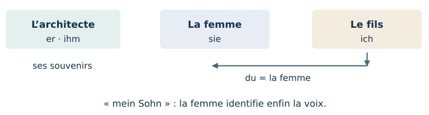

# BEL A/L — Allemand (thème, Lyon) 2024 · Corrigé brut

*Corrigé rédigé par IA, non officiel. Signalez toute erreur.*

**Rédaction** · GPT-6.2 Astra Ultra · vitesse non renseignée · 26 novembre 2026

**Révision** · GPT-6.2 Astra Ultra · vitesse non renseignée · 26 novembre 2026

Éliette Abécassis, *Un couple* (2023). Thème de quatre heures, sans dictionnaire.

[Sujet officiel, p. 10](https://www.ens-lyon.fr/sites/default/files/2024-11/Epreuves%20de%20sp%C3%A9cialit%C3%A9.pdf#page=10) · [Rapport du jury, p. 16–28](https://www.ens-lyon.fr/sites/default/files/2024-11/Allemand%202024%20OK.pdf#page=16)

## Proposition de thème

Er hört schlecht. Die Batterien in seinem Hörgerät sind viel zu schnell leer, und manchmal lässt man sich Zeit, bis man sie ihm auswechselt. Dann erschrickt er, wenn Geräusche auf einmal scharf an sein Ohr dringen, als wäre der Ton zu laut eingestellt und käme als ohrenbetäubender Lärm bei ihm an. Da ist ihm die Stille am Ende lieber. Außer wenn er fernsieht. Die zahllosen Nachrichtensender faszinieren ihn. Sie sind für ihn wie ein Fenster zur Welt, zu dieser Welt, zu der er keinen rechten Zugang mehr hat, es sei denn über seine Erinnerungen. Gern erzählt er von der Zeit, als er mit seinen Entwürfen noch daran mitwirkte, diese Welt zu bauen und sie bewohnbarer zu machen. Eine Schule, ein Rathaus, etliche Häuser, Wohnungen, viele Sanierungen. Und dann die Entwürfe, die nie Wirklichkeit werden. Die Hotels in Island und in Südamerika, die Villen ganz aus Glas, die wahnwitzigen Türme, mit einem einzigen Bleistiftstrich auf dem Zeichenbrett des Architekten errichtet.

Sie spitzt die Ohren. Auch sie hört nicht mehr besonders gut, aber aus Eitelkeit will sie kein Hörgerät tragen. Architekt, ein schöner Beruf. Wie stellt er sich die Häuser vor, die er entwirft? Hat er Visionen? Woher nimmt er seine Anregungen? Mag er das Bauhaus?

Sie bricht ab, als das Telefon klingelt. Langsam zieht sie es aus ihrer kleinen Tasche aus rotem Leder, greift auch nach ihrer Brille und setzt sie auf, um die Tasten zu drücken und den Anruf anzunehmen. »Wo bist du? Ich mache mir Sorgen. Ich habe dich schon mehrmals angerufen, und du bist nicht rangegangen. Du weißt doch, dass du nicht allein rausgehen sollst.«

Sie seufzt und blickt in den Garten. Ein leichter Wind lässt die majestätischen exotischen Bäume und die riesigen Mammutbäume rauschen, die sich wie ein Dach aus jahrhundertealten Schatten über den Garten spannen. Ein Sonnenstrahl dringt durch ihr Laub. Die Luft ist mild, man könnte fast meinen, man sei auf dem Land. Sie legt auf und verstaut das Telefon und die Brille vorsichtig wieder in ihrer Tasche.

»Das war mein Sohn«, erklärt sie. »Er ruft mich zehnmal am Tag an. Als er klein war, hat er hier gespielt. Mit nichts als ein paar Steinchen konnte er hier Stunden zubringen.«

