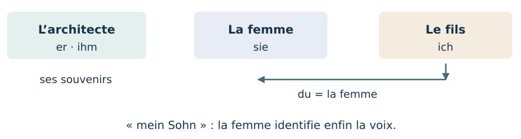

# BEL A/L — Allemand (thème, Lyon) 2024 · Corrigé guidé

*Corrigé rédigé par IA, non officiel. Signalez toute erreur.*

**Rédaction** · GPT-6.2 Astra Ultra · vitesse non renseignée · 26 novembre 2026

**Révision** · GPT-6.2 Astra Ultra · vitesse non renseignée · 26 novembre 2026

Éliette Abécassis, *Un couple* (2023). Thème de quatre heures, sans dictionnaire.

[Sujet officiel, p. 10](https://www.ens-lyon.fr/sites/default/files/2024-11/Epreuves%20de%20sp%C3%A9cialit%C3%A9.pdf#page=10) · [Rapport du jury, p. 16–28](https://www.ens-lyon.fr/sites/default/files/2024-11/Allemand%202024%20OK.pdf#page=16)

Dans le parc, les souvenirs d’architecture d’un homme âgé précèdent une conversation interrompue par le téléphone.

## Deux personnes sur un banc, trois voix

> [!INDICATION]
> Attribuez une voix à chacune des questions du passage. Quand le téléphone sonne, le tutoiement précède l’identification du fils. Une traduction peut garder cet effet sans ajouter de nom au milieu de l’appel.

### Le bruit tel que l’homme l’entend

Le lecteur perçoit le décalage entre l’appareil qui fonctionne mal et la soudaineté des bruits. *Die Batterien … sind viel zu schnell leer* donne le résultat observable. Dans *bis man sie ihm auswechselt*, *sie* reprend le pluriel des piles et *ihm* désigne celui pour qui on les remplace. *Dann erschrickt er* emploie le présent du verbe intransitif *erschrecken* et rend le sursaut. *Als wäre der Ton … und käme …* coordonne deux perceptions supposées au Konjunktiv II.

Le rapport invite à déterminer le cas de chaque relatif par sa fonction. Le nom *Welt* est féminin, mais c’est *Zugang zu* qui donne *zu der* au datif. L’exception introduite par *es sei denn* fait des souvenirs un autre accès au monde. *Mit seinen Entwürfen* restitue le travail de l’architecte. Les fragments nominaux distinguent les constructions réalisées des projets restés sur la planche. Un *Rathaus* est bien un bâtiment municipal.

### Passer de l’écoute aux questions

Avec *Sie spitzt die Ohren*, le sujet change dès le début du deuxième paragraphe. *Aus Eitelkeit* donne le motif de son refus de porter un appareil auditif. Ses questions sur les maisons, les visions, l’inspiration et le Bauhaus restent successives. Les interrogatives allemandes commencent par le verbe quand une réponse par oui ou par non est possible. Les mots interrogatifs imposent un ordre différent dans *Woher nimmt er seine Anregungen?*

Le téléphone et les lunettes n’ont pas la même fonction. Elle sort le premier, prend aussi les secondes, puis les met pour répondre. *Ihre Brille* est un singulier féminin en allemand, donc repris par *sie*. Les verbes de la réplique suivante changent de personne. Dans *ich habe dich … angerufen*, *dich* désigne la femme qui décroche. *Du sollst nicht allein rausgehen* fait entendre la consigne de son proche sans en faire une incapacité physique.

### Des paroles inquiètes au souvenir d’enfance

*In den Garten blicken* dirige le regard vers le jardin. Pour le feuillage, *ein leichter Wind lässt … rauschen* confie l’action au vent et le bruit aux arbres. Le rayon traverse les feuilles avant qu’elle ne range les objets. *In ihrer Tasche verstauen* indique où elle les met à l’abri.

Dans la dernière réplique, *Das war mein Sohn* identifie la voix de l’appel qui vient de finir. Le téléphone appartient toujours au présent, *er ruft mich … an*. Pour l’enfance, *als er klein war* délimite une époque unique, à l’intérieur de laquelle *Stunden zubringen* exprime la durée des jeux répétés. Les cailloux sont le dernier détail de la scène.

## Proposition de thème

Er hört schlecht. Die Batterien in seinem Hörgerät sind viel zu schnell leer, und manchmal lässt man sich Zeit, bis man sie ihm auswechselt. Dann erschrickt er, wenn Geräusche auf einmal scharf an sein Ohr dringen, als wäre der Ton zu laut eingestellt und käme als ohrenbetäubender Lärm bei ihm an. Da ist ihm die Stille am Ende lieber. Außer wenn er fernsieht. Die zahllosen Nachrichtensender faszinieren ihn. Sie sind für ihn wie ein Fenster zur Welt, zu dieser Welt, zu der er keinen rechten Zugang mehr hat, es sei denn über seine Erinnerungen. Gern erzählt er von der Zeit, als er mit seinen Entwürfen noch daran mitwirkte, diese Welt zu bauen und sie bewohnbarer zu machen. Eine Schule, ein Rathaus, etliche Häuser, Wohnungen, viele Sanierungen. Und dann die Entwürfe, die nie Wirklichkeit werden. Die Hotels in Island und in Südamerika, die Villen ganz aus Glas, die wahnwitzigen Türme, mit einem einzigen Bleistiftstrich auf dem Zeichenbrett des Architekten errichtet.

Sie spitzt die Ohren. Auch sie hört nicht mehr besonders gut, aber aus Eitelkeit will sie kein Hörgerät tragen. Architekt, ein schöner Beruf. Wie stellt er sich die Häuser vor, die er entwirft? Hat er Visionen? Woher nimmt er seine Anregungen? Mag er das Bauhaus?

Sie bricht ab, als das Telefon klingelt. Langsam zieht sie es aus ihrer kleinen Tasche aus rotem Leder, greift auch nach ihrer Brille und setzt sie auf, um die Tasten zu drücken und den Anruf anzunehmen. »Wo bist du? Ich mache mir Sorgen. Ich habe dich schon mehrmals angerufen, und du bist nicht rangegangen. Du weißt doch, dass du nicht allein rausgehen sollst.«

Sie seufzt und blickt in den Garten. Ein leichter Wind lässt die majestätischen exotischen Bäume und die riesigen Mammutbäume rauschen, die sich wie ein Dach aus jahrhundertealten Schatten über den Garten spannen. Ein Sonnenstrahl dringt durch ihr Laub. Die Luft ist mild, man könnte fast meinen, man sei auf dem Land. Sie legt auf und verstaut das Telefon und die Brille vorsichtig wieder in ihrer Tasche.

»Das war mein Sohn«, erklärt sie. »Er ruft mich zehnmal am Tag an. Als er klein war, hat er hier gespielt. Mit nichts als ein paar Steinchen konnte er hier Stunden zubringen.«
