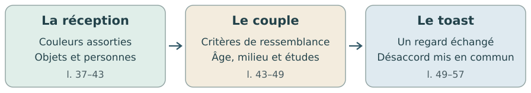

# BEL A/L — Anglais (commentaire et traduction) 2024 · Corrigé guidé

*Corrigé rédigé par IA, non officiel. Signalez toute erreur.*

**Rédaction** · GPT-6.2 Astra Ultra · vitesse non renseignée · 26 novembre 2026

**Révision** · GPT-6.2 Astra Ultra · vitesse non renseignée · 26 novembre 2026

Jonathan Franzen, *The Corrections* (2001). Épreuve commune de six heures. Le commentaire porte sur les deux feuillets. La version commence ligne 41 et finit ligne 57.

[Sujet officiel, p. 4–5](https://www.ens-lyon.fr/sites/default/files/2024-11/Commentaire%20d%27un%20texte%20en%20LVE%20et%20traduction.pdf#page=4) · [Rapport du jury, p. 2–28](https://www.ens-lyon.fr/sites/default/files/2024-11/Anglais%202024%20OK.pdf#page=2)

## Préparer les deux exercices

### Entendre Enid dans une phrase à la troisième personne

> [!INDICATION]
> Chercher la première réserve d’Enid sur ce qu’elle voit et sa manière de la lever. Qui pourrait vérifier que les jeunes mariés rient uniquement par politesse ?

La réserve sur les apparences (l. 23) est aussitôt absorbée par la certitude qu’Enid a trouvé la norme. Le lecteur peut se loger dans ce bref écart. L’expression évaluative *really super* et certains mots en italiques donnent une intonation à une voix qui n’a pourtant pas la parole au discours direct. Essayer de réécrire trois lignes comme une assertion neutre de sociologue. Ce qui disparaît alors, c’est précisément ce qu’il faut commenter, l’empressement de la femme qui classe et la distance que l’écriture rend possible.

### De la couleur de la serviette au choix du conjoint

L’expression *a miracle of niceness* reprend le vocabulaire religieux de la paroissienne. On peut mettre en regard la pelouse qui étouffe le mal (l. 9–10) et la demoiselle d’honneur qui fait taire ses propres préférences (l. 37–39). Entre les deux, le regard de Denise et la réserve de sa mère sur le goût des mariés donnent un visage au désaccord. Le jeu de mots entre les allumettes offertes et tout ce qui doit être assorti culmine dans le jugement sur le couple. Le terme *off-color*, au moment du toast, dérègle à la fois les bienséances et ce système chromatique. Le rapport propose plusieurs plans et demande d’étayer l’ironie par l’onomastique, les rythmes ou le point de vue. [Commentaire du jury, p. 2–14](https://www.ens-lyon.fr/sites/default/files/2024-11/Anglais%202024%20OK.pdf#page=2)

### Commencer au deuxième mariage

La ligne 41 du feuillet contient la fin d’une phrase sur le Sheraton puis l’ouverture de celle qui est à traduire. La version commence avec *She liked a more elegant wedding*. Elle fait alterner l’objet et la qualité associés à *match*. Une même famille française peut relier les couleurs « assorties » aux conjoints « bien assortis ». Le jeu entre le nom d’objet et le verbe résiste en revanche à la traduction. Mieux vaut garder les allumettes, leur inscription, la date et la couleur que chercher un autre cadeau qui faciliterait le calembour. Pour *backgrounds and ages and educations*, il est question du milieu social, de la proximité d’âge et des études.

### Maintenir le regard d’Enid jusqu’au dernier mot

La réception forme une scène habituelle au passé, d’où « il arrivait » et les imparfaits. Le mot *principals* désigne les premiers intéressés, donc les mariés. Il faut entendre dans la prédiction de leur vie future l’assurance d’Enid. L’italique porte sur *knew*. Dans la dernière phrase, le garçon d’honneur fait rire ou rougir, Enid interprète cette réaction dans une parenthèse, Alfred incline la tête et Enid cherche un allié du regard. *While* rattache les gestes à la même scène. « Regard de désapprobation » peut rendre *frown* si l’on préserve ce qui rassure les deux personnes qui l’échangent. [Analyse de la version, p. 14–28](https://www.ens-lyon.fr/sites/default/files/2024-11/Anglais%202024%20OK.pdf#page=14)

## Commentaire

A wedding in Jonathan Franzen’s *The Corrections* is an occasion for looking at other people. What Enid sees from her pew seems to her a reason to believe in the place where she lives. What she would like to see, and her extraordinary capacity for making sure she sees it, gradually become the subject of the scene. The fiction moves from her view of an entire community to a glance exchanged across a room. How does so small a gesture come to carry the weight of her faith?

### Manufacturing a local miracle

The opening makes the experience at once physical and predictable. A “paroxysmal” attachment can apparently be relied on to strike (ll. 1–2). The sober adverb puts a recurrence where the exalted adjective promises an exception. Enid discards three presidents in three brisk insults. The energy of those judgements survives the loss of faith in national politics and finds a much more manageable object in a local congregation. For a disappointed petitioner who never received a miracle in answer to prayer, a room containing two hundred good people provides something close to empirical proof. Where would she sit, one wonders, to conduct the opposite experiment?

Free indirect discourse allows that question to arise without an outside voice asking it. We hear her favourite adjective, “nice”, repeated through friends, their friends and their children (ll. 7–10), as if each repetition supplied independent evidence. The simile of the suburban lawn then does something less reassuring. Its density suffocates whatever fails to belong there. The sentence lets us feel the attraction of a well-kept lawn before we have time to consider what it has taken to maintain one. Even the proper name Root suits girls whose repeated calls at Enid’s back door certify that they have kept faith with their origins.

### The labour behind a perfect match

The bride is built out of remembered performances, from a Halloween costume to a charitable visit. The visit’s duration receives typographical emphasis. Enid even knows that the mother did not have to prompt it. The explanatory parenthesis (ll. 15–17) quietly claims access to motives she cannot have witnessed. A groom then materialises from his appearance, manners, career and parents, as though the checklist could produce the man. The haircut might have come from a menswear advertisement. For all the warmth of her memories, Enid has found a way to love a type. The repeated list of qualities describing his family and the family he hopes to found gives marriage the grammatical form of reproduction.

Denise’s remembered look opens a small breach. Her mother’s quotation marks around “amusement” (l. 28) register her refusal to grant the girl authority as a judge. Yet a turn inward uncovers Enid’s own perfectly discriminating judgement about fabrics and the colour of a dinner jacket. Mother and daughter share the ability to find the spectacle faintly ridiculous. The conflict is worked out within a single heart whose happier part happens also to speak louder. Even that concession serves Enid’s argument. Bad taste becomes evidence of a family’s willingness to put virtue first. Only then does the reader learn just how exacting her requirements of taste can be.

The bridesmaids must surrender their preferences so that dress, napkins, icing and ribbons agree (ll. 37–40). The printed names and date on the free matches give one wedding an air of documentary particularity. Yet even the matches must match. The pun turns a trivial object into a hinge between the colour scheme and a judgement about who should marry whom. A difference in age or build, or a family uncomfortable in an expensive clubhouse, is enough for Enid to predict a life of struggle. The information she has about the couple is extraordinarily slight. The italic stress on her certainty makes the judgement sound all the more final.

### What the frown achieves

A toast threatens to introduce an unscripted voice into the ceremony. Enid has a script even for that. The speaker has a certain sort of chin, has drunk too much and, to her ear, comes from further east. His possible place of origin is an inference from his voice, yet it helps to locate the offence safely outside her own region. Calling the toast “off-color” (l. 50) extends the reach of the colour scheme. A joke can spoil the reception in much the same way as a clashing dress.

Once again a parenthesis supplies the supposedly correct interpretation of someone else’s behaviour. Shut eyes and laughter could signal delight or embarrassment. Enid appropriates them as proof of the couple’s tact. At the edges of her account Alfred offers no audible confirmation, and she has to search the room for it. The concluding “reassuring frown” brings opposing feelings into a single expression. Displeasure becomes reassuring as soon as another face returns it. The opening miracle now has an observable mechanism. To keep goodness unanimous, someone must keep looking, interpret every exception and find at least one other person willing to make the same face.

## Version

Elle aimait qu’une noce plus élégante, célébrée au temple presbytérien de Paradise Valley, trouve son couronnement au club de Deepmire, où jusqu’aux allumettes offertes aux invités (*Dean et Trish · 13 juin 1987*) s’accordaient aux couleurs choisies. Mais l’essentiel était que les mariés eux-mêmes soient bien assortis, qu’ils soient de milieux comparables, d’âges voisins et de formation semblable. Il arrivait, à un mariage donné par des amis moins intimes d’Enid, que la mariée soit plus forte ou nettement plus âgée que son époux, ou encore que la famille du marié vienne d’une petite ville agricole du nord de l’État et se laisse visiblement intimider par l’élégance de Deepmire. Dans ces réceptions-là, Enid plaignait les principaux intéressés. Elle le *savait* bien, leur vie de couple serait difficile dès le premier jour. Le plus souvent, toutefois, la seule fausse note à Deepmire venait d’un toast grivois porté par quelque garçon d’honneur de second plan, souvent un camarade de fac du marié, souvent moustachu ou le menton fuyant, immanquablement empourpré par l’alcool, qui, à l’entendre, ne venait sûrement pas du Midwest mais plutôt de quelque ville plus à l’est, et qui cherchait à briller par une allusion « spirituelle » aux relations sexuelles avant le mariage. Le marié comme la mariée en rougissaient ou riaient les yeux fermés (dans l’esprit d’Enid, s’ils riaient, c’était par délicatesse naturelle, pour que l’indélicat ne s’avise pas de l’indélicatesse de son propos, et nullement parce qu’ils le trouvaient drôle), tandis qu’Alfred penchait la tête comme s’il n’entendait rien et qu’Enid balayait la salle du regard jusqu’à apercevoir un ami avec qui échanger un froncement de sourcils rassurant.
