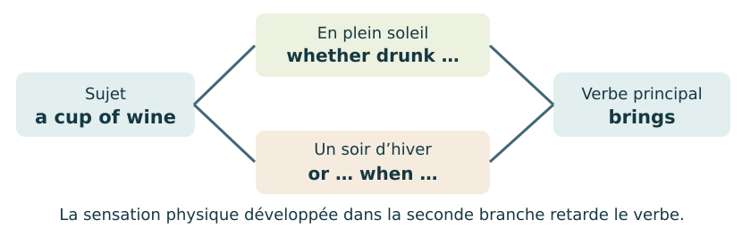

# BEL A/L — Anglais (thème, Lyon) 2024 · Corrigé brut

*Corrigé rédigé par IA, non officiel. Signalez toute erreur.*

**Rédaction** · GPT-6.2 Astra Ultra · vitesse non renseignée · 26 novembre 2026

**Révision** · GPT-6.2 Astra Ultra · vitesse non renseignée · 26 novembre 2026

Marguerite Yourcenar, *Mémoires d’Hadrien* (1951). Thème de quatre heures, sans dictionnaire.

[Sujet officiel, p. 11](https://www.ens-lyon.fr/sites/default/files/2024-11/Epreuves%20de%20sp%C3%A9cialit%C3%A9.pdf#page=11) · [Rapport du jury, p. 29–34](https://www.ens-lyon.fr/sites/default/files/2024-11/Anglais%202024%20OK.pdf#page=29)

## Proposition de thème

It was in Rome, over those long state dinners, that my thoughts would sometimes turn to the relatively recent beginnings of our luxury, to that people of thrifty farmers and frugal soldiers, their bellies full of garlic and barley, whom conquest had suddenly set wallowing in the rich fare of Asia. They devoured those elaborate dishes with all the uncouthness of ravenous peasants. Our Romans gorge themselves on ortolans, drown themselves in sauces and poison themselves with spices. A man like Apicius took pride in the ordering of his courses, that sequence of dishes, sour or sweet, rich or delicate, which gave his banquets their elegant design. One might let that pass if each dish were served on its own, taken on an empty stomach and tasted with due discrimination by a gourmet whose taste buds were unimpaired. But served all in a jumble, in such commonplace, everyday profusion, they produce a loathsome muddle on the diner's palate and in his stomach. There each smell, flavour and texture loses its particular worth and the delight of its own identity. That poor Lucius used to take pleasure in devising choice dishes for me. His pheasant pâtés, with their finely judged proportions of ham and spices, displayed a skill as exact as a musician's or a painter's. What I missed, however, was the unadorned flesh of that beautiful bird. Greece had a surer touch. Its resinated wine, its sesame-studded bread, its fish turned on the grill by the sea, unevenly blackened by the fire and seasoned here and there with the crunch of a grain of sand, satisfied the appetite purely, without hedging the simplest of our joys about with needless ceremony. In some low drinking den in Aegina or Phaleron I have tasted food so fresh that it was still divinely clean for all the tavern boy's dirty fingers, so modest yet so sufficient that it seemed to hold, in the most concentrated form imaginable, some essence of immortality. Meat cooked at dusk after a hunt had that same almost sacramental quality and carried us further back, to the wild beginnings of our peoples. Wine admits us to the volcanic mysteries of the soil and its hidden mineral riches. A cup of Samian wine, whether drunk in the full blaze of the midday sun or, at the other extreme, on a winter evening when weariness lets us feel at once, in the hollow of the diaphragm, its warm descent and its sure, burning passage along our arteries, brings a sensation very nearly sacred and sometimes more than the human mind can bear. […]

