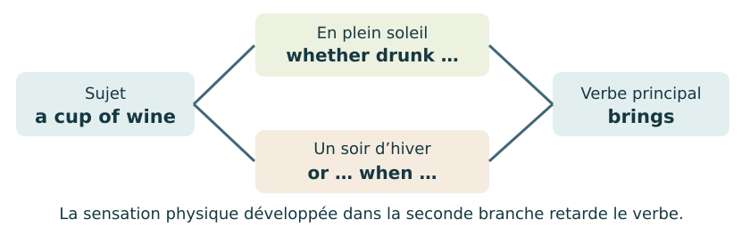

# BEL A/L — Anglais (thème, Lyon) 2024 · Corrigé guidé

*Corrigé rédigé par IA, non officiel. Signalez toute erreur.*

**Rédaction** · GPT-6.2 Astra Ultra · vitesse non renseignée · 26 novembre 2026

**Révision** · GPT-6.2 Astra Ultra · vitesse non renseignée · 26 novembre 2026

Marguerite Yourcenar, *Mémoires d’Hadrien* (1951). Thème de quatre heures, sans dictionnaire.

[Sujet officiel, p. 11](https://www.ens-lyon.fr/sites/default/files/2024-11/Epreuves%20de%20sp%C3%A9cialit%C3%A9.pdf#page=11) · [Rapport du jury, p. 29–34](https://www.ens-lyon.fr/sites/default/files/2024-11/Anglais%202024%20OK.pdf#page=29)

Le passage vient du chapitre « Animula vagula blandula ». L’empereur écrit à Marc Aurèle et met ses souvenirs de table à l’épreuve de ses sens.

## Traduire la voix d’Hadrien

### Retrouver la charpente de la première phrase

> [!INDICATION]
> Dans la longue ouverture, qui réfléchit, qui a conquis, qui mange ? Entourer le verbe principal puis rattacher les participes à leur sujet avant de traduire.

Le présentatif français met Rome au premier plan alors que le souvenir porte sur des repas révolus. *It was in Rome … that my thoughts would sometimes turn* conserve le lieu accentué et la récurrence. *At those long state dinners in Rome I sometimes found myself thinking…* donnerait une attaque moins solennelle. Ce sont les paysans et les soldats qui mangent. Une nouvelle phrase avec *they* permet de reprendre leur geste sans faire du narrateur le sujet d’*engloutissant*. *The rich fare of Asia* désigne les préparations culinaires. Un déplacement dans des cuisines réelles changerait l’image.

### Garder les trois régimes de temps

Le souvenir personnel ouvre le texte au passé. Le pluriel *our Romans* appelle ensuite le présent simple d’habitude pour la série des trois excès. La fierté d’Apicius peut se rendre au passé, l’exemple appartenant au passé d’Hadrien, ou au présent si l’on entend un type humain. Le jury a accepté ces deux lectures. Le nom est bien **Apicius** sur le feuillet. Le français *s’enorgueillir* donne ici un sentiment intérieur, bien rendu par *took pride in*. Chez Lucius, *used to take pleasure* marque une habitude disparue. Avec *I have tasted*, Hadrien rassemble des expériences dont il tire encore une leçon.

### Faire entendre l’exception qu’il concède

*One might let that pass if each dish were served on its own* suspend l’objection sous une condition imaginaire. *It might be forgivable if…* renforcerait le jugement moral. Au début de la phrase suivante, *But served all in a jumble* ramène au repas réel. Le sujet *they* désigne toujours les plats. Faire suivre *produce* de *a loathsome muddle* maintient le complément près du verbe avant d’indiquer où se produit la confusion. Dans le cas de Lucius, l’habileté du cuisinier est sincèrement admirée. *What I missed … was the unadorned flesh* réserve au verbe *miss* le manque d’un goût plus simple.

### Éprouver les images sensorielles

Un grain de sable croque sous la dent. *The crunch of a grain of sand* fait jouer au bruit le rôle inattendu d’un assaisonnement. *The occasional crunch of sand between the teeth* rendrait l’expérience explicite, en perdant le grain singulier et le tour poétique qui en fait un ingrédient. Garder ensemble *purely*, *divinely clean* et *sacramental* permet de suivre la progression du plaisir gustatif vers le sacré. Dans l’évocation de la taverne, *food* commande *it*. Les doigts du garçon sont sales, c’est la fraîcheur de la nourriture qui la garde pure aux yeux d’Hadrien.

### Conduire la dernière période jusqu’à son verbe

Le sujet de la grande proposition est *a cup of Samian wine*. Sa première expansion se dédouble selon l’heure et la saison. Puis le souvenir de la fatigue allonge la seconde branche jusqu’à la chaleur ressentie dans le corps. Le verbe *brings* rattache finalement la coupe à l’expérience du sacré. On peut aussi écrire *To drink a cup of wine from Samos … is to experience something close to the sacred* si l’on maintient les deux circonstances et la sensation physique entre les deux infinitifs. *Sure* qualifie la progression du vin, *burning* sa chaleur. Le jugement final mesure ce que l’esprit humain peut supporter.

## Proposition de thème

It was in Rome, over those long state dinners, that my thoughts would sometimes turn to the relatively recent beginnings of our luxury, to that people of thrifty farmers and frugal soldiers, their bellies full of garlic and barley, whom conquest had suddenly set wallowing in the rich fare of Asia. They devoured those elaborate dishes with all the uncouthness of ravenous peasants. Our Romans gorge themselves on ortolans, drown themselves in sauces and poison themselves with spices. A man like Apicius took pride in the ordering of his courses, that sequence of dishes, sour or sweet, rich or delicate, which gave his banquets their elegant design. One might let that pass if each dish were served on its own, taken on an empty stomach and tasted with due discrimination by a gourmet whose taste buds were unimpaired. But served all in a jumble, in such commonplace, everyday profusion, they produce a loathsome muddle on the diner's palate and in his stomach. There each smell, flavour and texture loses its particular worth and the delight of its own identity. That poor Lucius used to take pleasure in devising choice dishes for me. His pheasant pâtés, with their finely judged proportions of ham and spices, displayed a skill as exact as a musician's or a painter's. What I missed, however, was the unadorned flesh of that beautiful bird. Greece had a surer touch. Its resinated wine, its sesame-studded bread, its fish turned on the grill by the sea, unevenly blackened by the fire and seasoned here and there with the crunch of a grain of sand, satisfied the appetite purely, without hedging the simplest of our joys about with needless ceremony. In some low drinking den in Aegina or Phaleron I have tasted food so fresh that it was still divinely clean for all the tavern boy's dirty fingers, so modest yet so sufficient that it seemed to hold, in the most concentrated form imaginable, some essence of immortality. Meat cooked at dusk after a hunt had that same almost sacramental quality and carried us further back, to the wild beginnings of our peoples. Wine admits us to the volcanic mysteries of the soil and its hidden mineral riches. A cup of Samian wine, whether drunk in the full blaze of the midday sun or, at the other extreme, on a winter evening when weariness lets us feel at once, in the hollow of the diaphragm, its warm descent and its sure, burning passage along our arteries, brings a sensation very nearly sacred and sometimes more than the human mind can bear. […]
