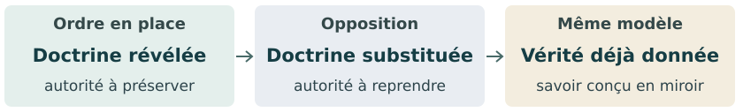

# BEL A/L — Arabe (commentaire et traduction) 2024 · Corrigé guidé

*Corrigé rédigé par IA, non officiel. Signalez toute erreur.*

**Rédaction** · GPT-6.2 Astra Ultra · vitesse non renseignée · 26 novembre 2026

**Révision** · GPT-6.2 Astra Ultra · vitesse non renseignée · 26 novembre 2026

Adonis, *al-Šiʿriyya al-ʿarabiyya* (1985), chapitre consacré à la modernité. Écrit commun, ENS de Lyon et ENS (Paris), six heures. Commentaire en arabe sur l’extrait entier, version française des lignes 18 à 36.

[Sujet officiel, p. 6–7](https://www.ens-lyon.fr/sites/default/files/2024-11/Commentaire%20d%27un%20texte%20en%20LVE%20et%20traduction.pdf#page=6) · [Rapport du jury, p. 2–3](https://www.ens-lyon.fr/sites/default/files/2024-11/Arabe%202024%20OK.pdf#page=2)

## Attribuer les jugements à la bonne voix

> [!INDICATION]
> Marquer les mots qui situent un énoncé « dans cette perspective ». Qu’arriverait-il au sens si l’on attribuait directement à Adonis chaque affirmation sur la vérité ?

Relever deux déplacements. Le premier fait passer de la question de la modernité à celle des instruments qu’on emploie pour l’étudier. Le second rapproche le système en place de l’opposition qui ambitionne de le remplacer. La parenthèse n’efface pas la différence entre leurs doctrines. Elle formule une hypothèse sur la forme commune de leur autorité. Le jury insiste sur les effets de cette sacralisation pour la poésie. La comparaison avec le miroir permet d’expliquer en quoi la théorie de la connaissance limite le travail du poète.

### Suivre le raisonnement jusqu’au dernier point d’interrogation

La version commence à la seconde formulation de l’impasse, ligne 18. Le texte qui prétend embrasser tous les domaines sert aussi de fondement, d’où les deux qualificatifs distincts. Lorsque vient l’allusion au texte sans « associé », le vocabulaire du dogme passe dans l’énoncé critique. Le tour introduisant al-Māwardī annonce le sens d’un propos rapporté, sans guillemets de citation littérale. Enfin, la mesure des temps va dans un seul sens. On juge chaque époque à cette aune, sans soumettre l’étalon lui-même à une mesure historique. Le dernier mouvement applique cette dissymétrie à l’idée de renaissance.

## Commentaire

لا يفتتح أدونيس حديثه عن الحداثة العربية بتعداد ما دخل على الشعر من أشكال جديدة. إنّه يسأل أوّلًا بأيّ أدوات يستطيع الفكر العربي أن يفهم تاريخه. ويترتّب على نقل السؤال من النموذج الغربي إلى بنية المعرفة في التراث اكتشاف عقبة لا يملك مجرّد تغيير الأسماء أن يزيلها. فكيف يبيّن الكاتب أنّ النصّ الذي يُجعل أصلًا لكلّ معرفة يمكن أن يحرم القارئ والشاعر معًا من إمكان الإتيان بجديد؟

تبدأ الحجة بحركة ارتداد على الذات. فالفكر الذي يسائل الحداثة مدعوّ قبل كلّ شيء إلى مساءلة نفسه. وليست الدعوة إلى التحرّر من المقاييس الغربية دعوة إلى التسليم بما ورثه العرب. إنّ الأدوات والقضايا نفسها مطالبة بأن تصبح موضوعًا للنظر. ومن هنا يأتي الالتفات إلى صلة السياسة بالدين. يميّز الكاتب بين نزوع إلى فصلهما ونزوع سلطوي يرى في الدين، بوصفه وحيًا، أساسًا للنظام الاجتماعي وضمانًا لاستقرار الحكم. وفي هذه النظرة تصبح طاعة السلطة شبيهة بالإيمان بها، ويصير الاعتراض عليها ضربًا من الخروج. إنّ انتقال الألفاظ الدينية إلى الحكم السياسي هو أحد وجوه المأزق الذي أراد النصّ تفكيكه.

على أنّ لفظ «المأزق» يعود عندما ينتقل الكاتب إلى خصوم السلطة. فقد يرفض هؤلاء مرجعها الديني ثم يقيمون مذهبهم الوضعي مقامه، فيتغيّر المضمون وتبقى بنية التسليم على حالها. لذلك يضع أدونيس بين قوسين المعارضة التي تطمح إلى الحلول محلّ النظام القائم. يقابل الكاتب بذلك بين موقعين سياسيين متنازعين ثم يسند إليهما الوظيفة نفسها في حراسة النصّ. وما يجمعهما هو افتراض الحقيقة معطاة سلفًا في نصّ مكتمل، واعتبار السلطة قيّمة على هذه الحقيقة. إذا تبنّى المثقف هذا الافتراض اقتصر دوره على النقل والتفسير، وإذا تبنّاه الشاعر انحصر عمله بين التبشير والتعليم من جهة والإفادة والإمتاع من جهة أخرى. وصورة المرآة توضح ما فُقد هنا، إذ لا ينتظر من المعرفة إلا أن تعيد إلى الأصل ما كان فيه منذ البدء.

ثم يعيد أدونيس بناء منطق هذه النظرة من داخلها. إذا استحال على النصّ أن يخطئ وقع الخطأ بالضرورة على من يقرأه. وبما أنّ النصّ لا «شريك» له، وجب في هذا المنطق أن تكون الحقيقة واحدة والمعرفة واحدة. ويستعين الكاتب بمعنى قول للماوردي ليرينا كيف يفضي اقتران الحقيقة بالسلطة إلى الخشية من أنّ تفرّق السلطة قد يهدّد الأمة ذاتها. ليس هذا حكمًا يصدره أدونيس على الأمة، بل نتيجة يستخرجها من مقدمات الفكر الذي يدرسه. ويعين تكرار العبارات المقيِّدة، مثل «في هذا المنظور»، على ضبط المسافة بين صوت المحلّل والصوت الذي يحلّله.

تتّضح في الختام كلفة ذلك على فهم الزمن. فالنصّ ذو تاريخ من حيث النشأة، لكنه في نظر أصحابه مقياس للأزمنة كلّها لا تسري عليه مقاييسها. وعليه تصبح النهضة عودة إلى نقطة سابقة ويغدو الابتعاد عنها انحطاطًا. يضع السؤال الأخير نصّ القائد والمعلّم بجوار النصّ الديني النبوي، فيستعيد المفارقة التي كشفتها المعارضة. وما يترتّب على هذه الحجّة في مجال الشعر أنّ الحداثة تقتضي أن يصبح النصّ قابلًا للنقد وأن يُتاح للقصيدة أن تنتج معرفة لم تكن مودعة من قبل في مرجعها.

## Version

C’est dans cette impasse que se trouve le noyau autour duquel s’édifie la pensée arabe dominante. Qu’elle tienne à l’ordre politique et culturel en place ou à l’opposition, cette pensée repose sur la conviction que la vérité est donnée d’avance, donnée dans un texte de référence complet et définitif. La doctrine religieuse ou idéologique fait office de texte fondateur qui embrasse le tout. Le régime en place, ou celui qui pourrait s’y substituer, à savoir l’opposition qui aspire à prendre sa place, est le pouvoir chargé de le garder. Dans cette conception, la culture en général tient du texte qui transmet et interprète. La poésie en particulier est le texte qui prêche et enseigne ou qui informe et divertit. La connaissance n’est que le reflet, dans un miroir, des vérités contenues dans le texte fondateur qui embrasse le tout.

Dans tous les cas, le défaut n’est jamais dans le texte. Il tient à l’homme qui ne le comprend pas ou qui s’en écarte. Celui-ci contient la vérité et la connaissance. Puisqu’il est un, sans « associé », il faut que la vérité soit une, qu’elle soit sa vérité, et la connaissance une, qu’elle soit sa connaissance. Le texte fait dès lors lui-même autorité. Dans cette perspective, la vérité a toujours été « à l’intérieur » du pouvoir, jamais « au-dehors ». Al-Māwardī dit en substance, à ce propos, que, lorsque la religion (le texte) voit s’évanouir son autorité, sa vérité s’efface. Vérité et pouvoir font donc un. Il s’ensuit que la division du pouvoir, ou sa transformation, signifie la division de la vérité, ou sa transformation. Et l’enjeu dépasse la menace qui pèse sur la vérité et le pouvoir. Il y va de la communauté elle-même.

Dans ces conditions, il est naturel que ce texte soit absolu aux yeux de ceux qui s’en réclament, qu’il n’admette ni substitut ni critique, et qu’on ne puisse le dire passé qu’au regard du moment où il a vu le jour. Il est le foyer où se rencontrent tous les temps. Bien plus, tous les temps se mesurent à lui et lui ne se mesure pas à eux.

Il est naturel aussi, dans cette logique, que la décadence consiste à s’éloigner du texte, à manquer de s’y conformer ou à dévier de la voie qu’il trace, et que renaître consiste à y revenir et à s’y tenir. Dans la pensée arabe, « ancienne » comme « moderne », la renaissance n’a-t-elle pas toujours été retour au texte religieux et prophétique ou au texte du « chef », du « maître » ?
