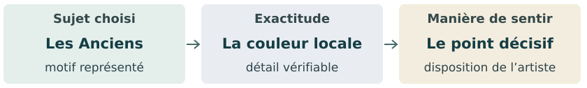

# BEL A/L — Arabe (thème, Lyon) 2024 · Corrigé guidé

*Corrigé rédigé par IA, non officiel. Signalez toute erreur.*

**Rédaction** · GPT-6.2 Astra Ultra · vitesse non renseignée · 26 novembre 2026

**Révision** · GPT-6.2 Astra Ultra · vitesse non renseignée · 26 novembre 2026

Charles Baudelaire, « Salon de 1846 », *Écrits sur l’art* (édition de 1999 citée par le sujet). Thème de l’ENS de Lyon, quatre heures. Le sujet de spécialité interdit tout dictionnaire. La coupure après la question initiale appartient au feuillet.

[Sujet officiel, p. 12](https://www.ens-lyon.fr/sites/default/files/2024-11/Epreuves%20de%20sp%C3%A9cialit%C3%A9.pdf#page=12) · [Rapport du jury, p. 4–5](https://www.ens-lyon.fr/sites/default/files/2024-11/Arabe%202024%20OK.pdf#page=4)

## Conduire la réfutation jusqu’au mot « sentir »

> [!INDICATION]
> Retirer mentalement la dernière phrase et dresser la liste des définitions successives qui échouent. Quel verbe de la première question préparait déjà une lecture du drapeau comme signe ?

L’interrogation initiale admet qu’un mot puisse rester difficile à définir et suppose qu’une génération a pourtant combattu sous une bannière qui avait un sens. En arabe, la question conserve le verbe d’audace et les deux compléments qui mesurent l’effort, sa durée et son emblème. L’adjectif français « positif » renvoie à un sens déterminé. L’ellipse entre crochets appartient au sujet, tout comme le titre interrogatif.

### Faire entendre l’enchaînement des objections

Des groupes indéfinis entrent tour à tour en scène. La vraie difficulté de « tempérament » est de lier la disposition des artistes à celle de leurs sujets. Le jeu sur les Grecs et les Romains exige de conserver l’ordre inversé de la reprise et le passage de l’artiste au personnage qu’il peut créer. On « fait » ici les Anciens en les représentant. Le jury situe l’extrait parmi les textes où Baudelaire définit son esthétique. La pointe sur Raoul Rochette oppose la vérification d’un détail érudit à la force de l’invention. La dernière restriction préserve ensuite le mouvement du français, qui laisse la manière de sentir au bout de sa phrase.

## Proposition de thème

ما الرومانسية؟

قلّ من الناس اليوم من يريد أن يجعل لهذه الكلمة معنًى حقيقيًّا محدّدًا. فهل يجرؤ هؤلاء مع ذلك على الزعم بأن جيلًا بأسره يرضى أن يخوض معركة تدوم سنوات من أجل راية لا ترمز إلى شيء؟ […]

لم يُعنَ بعضهم إلا باختيار الموضوعات، ولم تكن أمزجتهم من طينة الموضوعات التي اختاروها. وظلّ آخرون يؤمنون بقيام مجتمع كاثوليكي فسعوا إلى أن تنعكس الكاثوليكية في أعمالهم. ومن سمّى نفسه رومانسيًّا وجعل من التطلّع إلى الماضي منهجًا له فقد ناقض نفسه. وهناك من صبّوا اللعنات على اليونان والرومان باسم الرومانسية، مع أن في وسع الفنان أن يصوّر الرومان واليونان تصويرًا رومانسيًّا إذا كان هو نفسه رومانسيًّا. وضلّ كثيرون غير هؤلاء في طلب الحقيقة في الفن والطابع المحلّي. فالواقعية كانت موجودة قبل هذه المعركة الكبرى بزمن طويل. ثم إن من يؤلّف مأساة أو يرسم لوحة إرضاءً للسيّد راؤول روشيت يعرّض نفسه لأن يخطّئه أيّ عابر سبيل إذا اتّفق أن يكون أعلم من السيّد راؤول روشيت.

فالرومانسية، على وجه الدقّة، لا تكمن في اختيار الموضوعات ولا في تحرّي الدقّة التامّة في تصوير الواقع، بل في طريقة الإحساس.
