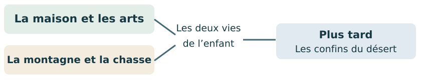

# BEL A/L — Chinois (thème, Lyon) 2024 · Corrigé brut

*Corrigé rédigé par IA, non officiel. Signalez toute erreur.*

**Rédaction** · GPT-6.2 Astra Ultra · vitesse non renseignée · 26 novembre 2026

**Révision** · GPT-6.2 Astra Ultra · vitesse non renseignée · 26 novembre 2026

Henry Bauchau, *Diotime et les lions* (1991). Thème de quatre heures, dictionnaire bilingue autorisé.

[Sujet officiel, p. 13](https://www.ens-lyon.fr/sites/default/files/2024-11/Epreuves%20de%20sp%C3%A9cialit%C3%A9.pdf#page=13) · [Rapport du jury, p. 5–6](https://www.ens-lyon.fr/sites/default/files/2024-11/Chinois%202024%20OK.pdf#page=5)

## Proposition de thème

他那么疼我，我在他面前也敢亲亲热热地放肆几分；要知道，他身边的人对他无不敬重，往往还怕得很。父母看在眼里，又惊讶又高兴。冈比斯跟我话不多，可我们出猎或纵马飞奔时，每逢遇到阻碍，我一看，他准在我身旁。要是我自己应付得来，他就望着我笑，笑容里透着几分逗趣的意味，又满是欣慰。为了看见他这样一笑，我愿意克服心里的恐惧，什么险都敢冒。

就这样，从童年到少女时代之初，我一直过着两种生活。一种日子温和而融洽；我也和我的姐妹一样，学跳舞，学诗，学音乐，母亲也领着我们学做家务。同时我还另有一种生活，父母几乎毫不知情。我整日在外活动，在灌木丛间、林间和沙地上骑马奔驰，还到山里的部族中住上一阵。祖父疼爱我，他自己又狂热地迷恋狩猎和权力，正是这两样把我带到了那里。后来我年纪大一些了，冈比斯不顾母亲反对，带我到沙漠边缘去狩猎；他常在那里跟猛兽搏斗。

