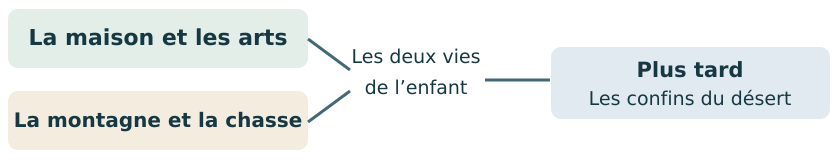

# BEL A/L — Chinois (thème, Lyon) 2024 · Corrigé guidé

*Corrigé rédigé par IA, non officiel. Signalez toute erreur.*

**Rédaction** · GPT-6.2 Astra Ultra · vitesse non renseignée · 26 novembre 2026

**Révision** · GPT-6.2 Astra Ultra · vitesse non renseignée · 26 novembre 2026

Henry Bauchau, *Diotime et les lions* (1991). Thème de quatre heures, dictionnaire bilingue autorisé.

[Sujet officiel, p. 13](https://www.ens-lyon.fr/sites/default/files/2024-11/Epreuves%20de%20sp%C3%A9cialit%C3%A9.pdf#page=13) · [Rapport du jury, p. 5–6](https://www.ens-lyon.fr/sites/default/files/2024-11/Chinois%202024%20OK.pdf#page=5)

Le récit d’apprentissage est conduit à la première personne par Diotime, petite-fille de Cambyse.

## Reconstruire les relations

> [!INDICATION]
> Marquer d’abord les deux objets de l’étonnement des parents, puis les deux causes qui entraînent Diotime vers les montagnes. À chaque fois, écrire les actions avant la réaction qu’elles provoquent.

### Le sourire de Cambyse

La première phrase donne deux raisons à la fois de s’étonner et de se réjouir. 他那么疼我 pose la tendresse de Cambyse, 我在他面前也敢… la hardiesse affectueuse de Diotime. Le respect et la terreur appartiennent à l’entourage. « Si je me débrouillais seule » décrit une expérience répétée. 要是…就… et le 准 de la phrase précédente font attendre le retour du même regard. Le sourire exprime le plaisir amusé de l’adulte ; c’est la fille qui est prête à prendre des risques pour le revoir.

### Deux enfances simultanées

Ainsi clôt la série des souvenirs et ouvre le bilan. 从童年到少女时代之初 donne à la période ses deux extrémités. 一种…同时…另有一种 maintient la simultanéité. Faire du second mode de vie une étape postérieure effacerait le secret que marque 几乎毫不知情. Le français ne précise pas si la sœur est aînée ou cadette. 姐妹 laisse ouverte cette question de rang.

### Des tribus aux confins du désert

La longue relative attribue à deux forces l’entraînement de la narratrice dans les montagnes. 祖父疼爱我 est orienté vers elle ; 狂热地迷恋 a pour objets la chasse et le pouvoir. La reprise 正是这两样 évite une longue proposition chinoise antéposée. La dernière ligne change ensuite de temps, d’espace et de sujet agissant. 后来…不顾母亲反对 maintient le passage à un âge nouveau et la résistance maternelle ; le pronom 他 réserve à Cambyse l’affrontement avec les grands fauves.

## Proposition de thème

他那么疼我，我在他面前也敢亲亲热热地放肆几分；要知道，他身边的人对他无不敬重，往往还怕得很。父母看在眼里，又惊讶又高兴。冈比斯跟我话不多，可我们出猎或纵马飞奔时，每逢遇到阻碍，我一看，他准在我身旁。要是我自己应付得来，他就望着我笑，笑容里透着几分逗趣的意味，又满是欣慰。为了看见他这样一笑，我愿意克服心里的恐惧，什么险都敢冒。

就这样，从童年到少女时代之初，我一直过着两种生活。一种日子温和而融洽；我也和我的姐妹一样，学跳舞，学诗，学音乐，母亲也领着我们学做家务。同时我还另有一种生活，父母几乎毫不知情。我整日在外活动，在灌木丛间、林间和沙地上骑马奔驰，还到山里的部族中住上一阵。祖父疼爱我，他自己又狂热地迷恋狩猎和权力，正是这两样把我带到了那里。后来我年纪大一些了，冈比斯不顾母亲反对，带我到沙漠边缘去狩猎；他常在那里跟猛兽搏斗。
