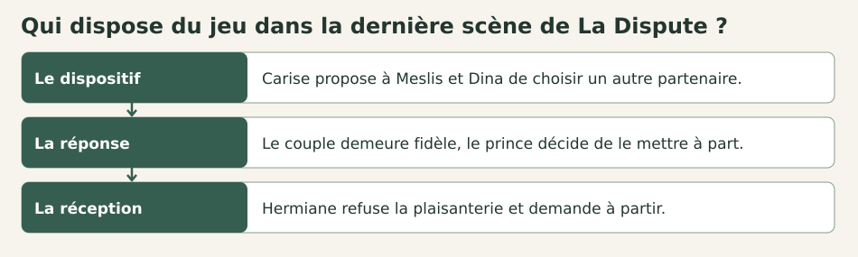
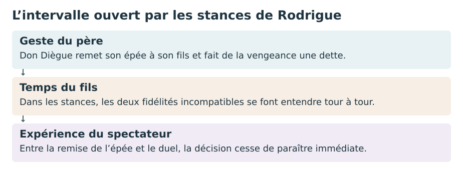
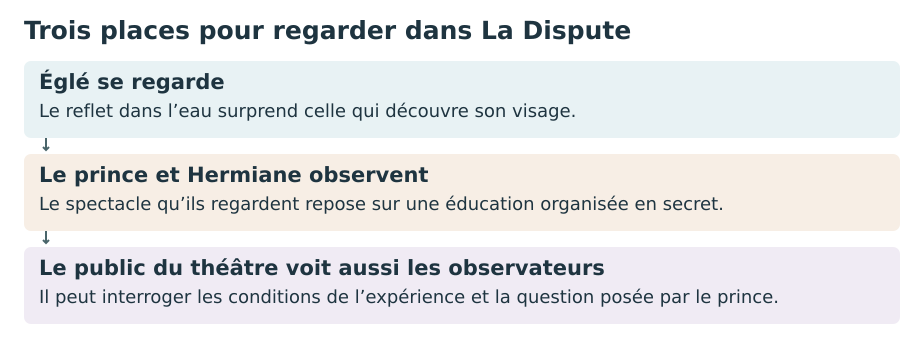
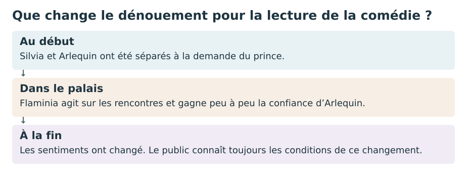

# BEL A/L — Composition française 2024 · Corrigé guidé

*Corrigé rédigé par IA, non officiel. Signalez toute erreur.*

**Rédaction** · modèle exact non renseigné (famille GPT-6) · effort non renseigné · vitesse non renseignée

**Révision** · GPT-6.2 Astra Ultra · vitesse non renseignée

**Révision (tour 2)** · GPT-6.2 Astra Ultra · vitesse non renseignée

**Révision (tour 3)** · GPT-6.2 Astra Ultra · vitesse non renseignée · 26 novembre 2026

## Présentation du sujet

« Jeu social, jeu esthétique, jeu critique, jeu figural, jeu d’interaction, le théâtre se situe en effet dans l’espace vide que lui laisse la cité : il est entre les pièces, entre les rouages de la machine, il en figure le *jeu*, et c’est en cela qu’il permet qu’elle fonctionne. »

Christian Biet et Christophe Triau, *Qu’est-ce que le théâtre ?*, « Conclusion », Folio essais, 2006, p. 930.

Vous discuterez cette analyse en vous référant en particulier aux œuvres au programme.

[Sujet officiel, p. 1](https://www.ens-lyon.fr/sites/default/files/2024-11/Composition%20fran%C3%A7aise.pdf#page=1) · [Rapport du jury, partie écrite, p. 2–7](https://www.ens-lyon.fr/sites/default/files/2024-11/Composition%20fran%C3%A7aise%20et%20explication%20texte%202024%20OK.pdf#page=2)

La composition française commune dure six heures. Le sujet de Christian Biet et Christophe Triau porte sur le théâtre et la cité. Le domaine théâtral se croise ici avec la représentation littéraire et les rapports entre littérature et morale. Le jury invite à mobiliser les cinq œuvres, en tenant compte de leurs formes. *Le Cid* de 1637 est une tragi-comédie, *La Double Inconstance* et *La Dispute* sont deux comédies de Marivaux ; *Le Capitaine Fracasse* et *La Vagabonde* sont des romans où le théâtre est un métier et un objet de représentation. [Sujet officiel](https://www.ens-lyon.fr/sites/default/files/2024-11/Composition%20fran%C3%A7aise.pdf) · [Rapport du jury](https://www.ens-lyon.fr/sites/default/files/2024-11/Composition%20fran%C3%A7aise%20et%20explication%20texte%202024%20OK.pdf) · [Programme 2024](https://www.ens-lyon.fr/sites/default/files/2024-11/bulletin-officiel-n-30-du-27-juillet-2023-Pg-litteraire-session-2024_0.pdf)

## Analyse du sujet

> [!INDICATION]
> Le mot « jeu » a-t-il le même sens lorsqu’il qualifie la pratique d’un comédien et lorsqu’il désigne ce qui existe entre deux pièces d’une machine ?

#### Solution

Un acteur joue devant autrui et selon des conventions. Le plaisir et la distance que ce dispositif rend possibles peuvent faire du spectacle un exercice critique. Dans l’image mécanique, le jeu est l’intervalle grâce auquel deux pièces peuvent bouger l’une relativement à l’autre. Le mot « figurer » ajoute une opération : le théâtre rend visibles, sous une forme construite, les relations de ceux qui vivent ensemble. Enfin, le verbe « permet » avance une thèse forte. Le théâtre contribue à l’activité de la cité qui lui a pourtant réservé en apparence un simple espace de loisir. C’est ce retour du jeu sur la société qu’il faut discuter.

**Éprouver le dernier verbe.** Qui « fonctionne » dans la dernière scène de *La Dispute* ? La cour conserve la maîtrise des lieux, le couple fidèle obtient de rester ensemble, Hermiane interrompt le divertissement. Le même dénouement permet donc de distinguer le succès du dispositif, le sort des participants et le jugement qui s’exerce entre spectateurs. [Marivaux, scène XX](https://fr.wikisource.org/wiki/La_Dispute)

## Problématique

> [!INDICATION]
> Le spectacle dont dépend le prestige d’un prince donne-t-il la même liberté à celui qui l’organise et à celui qui y figure à son insu ?

#### Solution

Comment le théâtre peut-il contribuer à la vie de la cité en ouvrant une distance à l’égard des rôles et des fins que cette même cité lui assigne ? On peut aussi demander qui dispose de la liberté produite par la représentation. L’artiste, les personnages, les commanditaires et les spectateurs n’ont pas toujours les mêmes intérêts.

## Plan détaillé

### Partie I — La représentation desserre un enchaînement habituel

> [!INDICATION]
> Repérer dans une pièce un endroit où l’action s’arrête et où cet arrêt apprend quelque chose au public.

#### Solution

Dans *Le Cid*, l’obligation filiale devient une décision que le vers fait entendre se former. Chez Marivaux, la connaissance du stratagème permet d’écouter à la fois les propos bienveillants de Flaminia et le rôle qu’ils jouent auprès d’Arlequin. Dans le roman de Gautier, les actes du baron hors du spectacle permettent de mesurer la distance entre le comédien et son emploi de fanfaron.

Comparer le rythme de la remise de l’épée et celui des stances. Ce que le père présente comme la suite nécessaire d’un affront devient, dans la durée de la représentation, une décision susceptible d’être jugée.

### Partie II — L’espace de jeu dépend de choix économiques et politiques

> [!INDICATION]
> Qui reste au travail quand les spectateurs viennent se divertir ? Quel personnage voit les préparatifs que la représentation réussie rend invisibles ?

#### Solution

Le changement d’interprète dans la troupe du *Capitaine Fracasse* suppose un ajustement collectif. Le récit à la première personne de Colette fait entrer le lecteur dans la loge de Renée et révèle ce que les spectateurs du music-hall ignorent de son travail. Dans *La Dispute*, le spectacle a pour condition une expérience de longue durée imposée à des enfants. La situation même du public devient une question morale.

### Partie III — Une cité peut aussi fonctionner en laissant place au désaccord

> [!INDICATION]
> Le dénouement de la pièce commande-t-il notre jugement sur ce qui l’a rendu possible ?

#### Solution

Les couples que réunit *La Double Inconstance* peuvent paraître heureux et laisser pourtant ouvertes les questions concernant le pouvoir du prince. La querelle du *Cid* permet ensuite de passer du désaccord possible des spectateurs au débat historiquement attesté sur les bienséances et le plaisir. Chez Colette, enfin, l’institution théâtrale offre à Renée un travail et la possibilité de maintenir une indépendance qui lui importe.

## Références et exemples

Reprendre les stances de Rodrigue pour leur **durée** et leur rythme. Dans *La Dispute*, distinguer la découverte d’Églé et la position d’Hermiane qui regarde. Pour Gautier et Colette, préciser ce que le **récit** rend accessible à un lecteur qui peut suivre la troupe ou la comédienne hors de scène. Ce changement de genre a une valeur argumentative propre.

## Pièges à éviter

> [!JURY]
> Le jury attend l’examen des cinq œuvres du programme et rappelle l’importance de leur diversité. Il suggère de réfléchir au passage de la liberté artistique au fonctionnement de la « machine » sociale. [Rapport de la session](https://www.ens-lyon.fr/sites/default/files/2024-11/Composition%20fran%C3%A7aise%20et%20explication%20texte%202024%20OK.pdf)

> [!PIEGE]
> Réserver l’expression « la cité » à une seule organisation politique antique réduirait indûment la citation. Situer chaque exemple dans la société et le genre littéraire dont il relève.

## Introduction et conclusion rédigées

Dans la composition proposée, l’introduction distingue le prince, Hermiane, les jeunes gens et le public de Marivaux. La conclusion retrouve cette pluralité des places et en tire une réponse sur la possibilité du désaccord.

## Composition proposée

### Introduction

Dans *La Dispute* de Marivaux, le prince invite Hermiane à regarder, sans être vue, de jeunes gens qui vont faire l’expérience de l’amour. Son père les a fait élever séparément pour qu’un spectacle départage, un jour, les hommes et les femmes sur la question de l’inconstance. Une cour se donne donc le plaisir de regarder un monde qui ignore être regardé. Mais au théâtre, un deuxième public, le nôtre, assiste aussi bien aux propos du prince qu’aux premiers étonnements d’Églé. Nous pouvons nous intéresser à une autre question que celle que le spectacle était censé résoudre : qui a le pouvoir de distribuer les places entre ceux qui jouent et ceux qui jugent ? Ce déplacement éclaire la formule de Christian Biet et Christophe Triau. Le théâtre serait possible parce que la cité laisse un espace vacant entre ses institutions. Les acteurs pourraient y faire l’essai de gestes qui, ailleurs, assignent à chacun des devoirs bien réels. Mais de quelle liberté s’agit-il si la société retire précisément de cet écart les moyens de continuer à fonctionner ? Il faut comprendre comment un spectacle acquiert la distance nécessaire pour représenter les relations sociales. Nous examinerons ensuite ce qu’il doit aux pouvoirs qui le rendent possible, avant de nous demander qui peut décider de l’usage qu’un public fera de ce qu’il a vu.

### I. Le temps de jouer permet de voir agir une règle

Sur la scène du *Cid*, Rodrigue pourrait se contenter d’accepter de son père l’épée et le devoir de vengeance. Un tel enchaînement montrerait ce qu’exige l’honneur familial sans faire éprouver au public comment on en vient à lui obéir. Corneille insère entre la demande du père et l’affrontement avec le comte les stances où Rodrigue se découvre à la fois fils de l’offensé et amant de la fille de l’offenseur. La variation de la longueur des vers, le retour du nom de Chimène et les reprises d’une alternative suspendent l’action sans l’abolir. Tout le plaisir du morceau vient de ce que le spectateur peut suivre, dans le rythme même de la parole, le coût d’une décision qui, vue de l’extérieur, passerait pour la simple exécution d’un code. La scène donne une durée et un corps à ce que la transmission d’une épée semblait devoir rendre immédiat. C’est là un premier sens du « jeu » entre les rouages. Une liaison qui paraît nécessaire peut être desserrée assez longtemps pour devenir perceptible.

Chez Marivaux, le moyen est différent. Dans *La Double Inconstance*, Silvia veut retrouver Arlequin. Le prince, qui désire qu’elle le choisisse, dispose d’un palais et d’auxiliaires pour agir sur leurs sentiments. Flaminia fait de sa propre proximité avec Arlequin une pièce essentielle de la manœuvre. Elle lui offre une écoute que rendent plus précieuse les contrariétés qu’il subit par ailleurs. Le spectateur à qui les préparatifs ont été révélés entend donc chaque parole deux fois : comme l’ami entendrait la marque de bienveillance, puis comme le témoin d’une stratégie reconnaît le travail qu’elle accomplit. La comédie n’a pas eu besoin de faire proclamer à un personnage que la puissance peut prendre le langage de l’amitié. Elle nous en a fait entendre la possibilité dans une phrase qui continue de paraître aimable. Appeler le théâtre un « jeu figural », c’est lui reconnaître cette puissance d’intelligence indirecte.

La reprise du même substantif cinq fois avant les deux-points fait passer de la pratique sociale aux rapports entre acteurs et spectateurs. Après les deux-points, le mot en italique ne nomme plus seulement leur activité. Une roue ne transmettrait pas correctement son mouvement si elle était soudée à toutes les pièces voisines. Le théâtre peut ainsi représenter un écart entre fonctions et permettre à la cité de se voir fonctionner. Dans les stances, l’intervalle que le vers ouvre entre l’injonction paternelle et la réponse du fils fait précisément entendre cet écart. Reste à savoir pour qui ce jeu est une liberté.

Le roman de Gautier permet d’observer l’opération depuis les coulisses. Quand le baron de Sigognac prend, après la mort de Matamore, l’emploi de capitaine fanfaron, il faut que ses partenaires et lui trouvent des gestes qui rendent ce personnage immédiatement reconnaissable. L’écart est savoureux entre l’assurance bruyante d’un soldat de comédie et la vaillance dont le comédien se montre capable dans le récit. Le lecteur connaît le gentilhomme qui endosse le costume. Les spectateurs des acteurs ambulants, eux, doivent pouvoir rire d’une figure sans connaître celui qui la joue. Le regard du roman passe d’un côté à l’autre de la représentation et fait mesurer ce que suppose son apparente légèreté : un répertoire partagé, une troupe et l’aptitude de chacun à prêter au rôle des moyens qu’il sache ensuite reprendre.

### II. Qui dispose de l’espace laissé au jeu ?

Une société qui accorde du temps et un lieu à la représentation peut aussi décider qui y paraît et dans quelles conditions. *Le Capitaine Fracasse* donne à lire des déplacements, des étapes et des rencontres dont la représentation est tributaire. Pour le spectateur, le capitaine existe dès son entrée ; pour ses partenaires, il a d’abord fallu résoudre une difficulté de subsistance et d’effectif après la disparition d’un des leurs. Que l’on puisse remplacer un mort dans un emploi comique assure la continuité du spectacle ; cela ne console pas mécaniquement ses compagnons. Une telle différence oblige à donner un sens matériel au mot « laisse ». L’espace disponible pour s’amuser est aussi le lieu de travail de ceux dont dépend le divertissement des autres.

Colette rend sensible à son tour cette inégalité en confiant la narration de *La Vagabonde* à l’artiste elle-même. Renée Néré se prépare dans sa loge. Le miroir à travers lequel elle considère son visage lui renvoie une physionomie qu’il lui faut travailler pour la scène. Le lecteur a pourtant accès, par la première personne, à des hésitations et à une fatigue que le public du music-hall ne paie pas pour voir. La réussite du maquillage et du geste peut précisément consister à les lui dérober. Le livre introduit ainsi une réserve dans l’idée d’un spectacle qui éluciderait les rapports sociaux du seul fait qu’il les représente. Quand l’artiste réussit, les conditions de son travail peuvent devenir encore moins perceptibles. Il faut un autre point de vue, en l’occurrence celui qu’autorise le roman, pour les faire entrer dans le champ.

Cette dissymétrie devient un enjeu éthique dans *La Dispute*. Églé s’arrête devant l’eau où se découvre un visage dont elle ne sait pas encore que c’est le sien. Le public qui connaît le dispositif peut prendre plaisir à reconnaître avant elle le principe du reflet. Cette avance est un ressort comique, mais d’où vient le privilège de ceux qui savent ? Pour pouvoir offrir à Hermiane le spectacle d’un premier regard, il a fallu organiser pendant des années l’ignorance de celle qui regarde. Le prince présente une expérience censée donner accès à la nature humaine. Le spectacle de Marivaux rend visibles les soins extrêmement artificiels que réclame cette prétention. Il est possible de voir dans la même scène la charmante naissance d’une conscience de soi et l’effet d’un pouvoir qui entend régler jusqu’au moment de cette naissance. La machine peut donc fonctionner très bien pour qui commande le spectacle et très mal pour celui auquel on a distribué un rôle sans l’en avertir.

### III. Le fonctionnement de la cité se joue aussi dans le désaccord de ses spectateurs

Dire que le théâtre rend possible le fonctionnement de la société oblige dès lors à préciser ce qu’on attend de celle-ci. Si fonctionner signifie reproduire un ordre en le faisant aimer, le dénouement de *La Double Inconstance* s’y prête. Le prince obtient Silvia, Arlequin a trouvé auprès de Flaminia un nouvel attachement et l’apparente satisfaction des intéressés dispense d’employer ouvertement la force. On peut pourtant quitter la représentation avec un souvenir que ces unions heureuses ne suffisent pas à effacer : au début, la jeune fille avait été séparée d’Arlequin selon la volonté du prince. Toute la différence entre les places tient à ce que le prince pouvait dès le départ organiser les rencontres, tandis que Silvia ne pouvait qu’y répondre. Il n’est nullement indispensable de juger ses nouveaux sentiments faux pour s’interroger sur les conditions qui leur ont permis de naître. Le déroulement de la comédie donne au public de quoi résister à l’interprétation la plus rassurante de son dénouement.

Le dernier échange de *La Dispute* permet de vérifier jusqu’où va ce droit de juger. Lorsque Meslis et Dina apparaissent, Carise invite chacun à se choisir un autre partenaire. Tous deux restent attachés l’un à l’autre. Le prince décide de les placer à part et formule une conclusion générale sur les vertus et les vices des deux sexes. Hermiane refuse pourtant la plaisanterie finale et demande à partir. L’arrivée du couple fidèle retire à l’expérience sa prétention à expliquer universellement l’inconstance. Elle donne aussi au public une décision à apprécier : le prince peut disposer des lieux et tirer sa morale, mais il ne peut régler l’effet de ses paroles ni sur Hermiane ni sur la salle.

Dans la scène XX, la résistance des jeunes gens prend corps dans deux didascalies. Dina jette son bras sur celui de Meslis, puis le prend par-dessous le bras au moment où Carise lui enjoint d’examiner les personnes présentes. Sa réponse, « Tout est vu, allons-nous-en », oppose à l’inspection désirée par la cour un geste dont le sens se passe d’enquête. À la fin, Hermiane dit à son tour « Partons ». Les deux femmes sortent ainsi du jeu par des mots semblables, l’une comme sujet de l’expérience, l’autre comme spectatrice que son spectacle ne satisfait plus.

La suite historique du *Cid* aide à mesurer ce pouvoir des spectateurs. Chimène demande au roi justice contre celui qu’elle aime. L’autorité peut promettre à Rodrigue l’espoir d’une union à venir ; elle ne décide pas à la place du public si le désir de la jeune femme est compatible avec son devoir. La querelle de 1637 transporte une partie de cette difficulté hors de la salle. La conduite accordée à Chimène, le plaisir éprouvé devant la pièce et les règles au nom desquelles on la juge deviennent matière à controverse. Les spectateurs et les lecteurs ne forment pas spontanément une communauté d’opinion. De leur désaccord naissent au contraire de nouveaux discours sur ce qu’on peut leur montrer et sur la légitimité du plaisir qu’ils y prennent. Le fonctionnement dont le théâtre est ici l’une des conditions est une faculté de discussion. Elle s’exerce d’autant mieux que la pièce ne vient pas mettre fin au différend dont elle a donné l’occasion.

Enfin, cette faculté ne se limite pas à un jugement porté après le spectacle. Chez Colette, la relation de Renée avec Maxime rend particulièrement aigu le choix entre deux manières de disposer de son temps et de son corps. L’existence itinérante de l’artiste lui coûte de la fatigue et l’expose aux regards. Pourtant, la possibilité d’exercer un métier et de partir en tournée compte dans la liberté qu’elle entend garder après son divorce. Que le spectacle soit un travail, ce qui semblait d’abord contredire l’idée de sa gratuité, lui ouvre une marge que ne lui offrirait pas forcément la sécurité d’une nouvelle vie de couple. Le récit à la première personne permet de suivre le prix de cette marge sans en faire une victoire assurée pour toutes. La même institution que le public fréquente pour son plaisir peut fournir à celle qui y joue les moyens pratiques de choisir autrement sa vie.

### Conclusion

Une scène prend place dans la cité quand des acteurs, une autorité et un public disposent d’un temps où une épée remise à un fils ou une parole d’amitié peuvent être éprouvées comme les éléments d’une représentation. Mais ce temps a des conditions et des propriétaires provisoires. Le point de vue de la comédienne chez Colette et celui des jeunes gens livrés à l’expérience princière chez Marivaux montrent combien les avantages du jeu sont inégalement partagés. La proposition de Biet et Triau conserve sa force si la cité qui fonctionne peut aussi mettre en discussion les fins qu’elle poursuit. Un dénouement peut contenter la cour et retenir l’attention du public sur le prix de ce contentement. L’intervalle décisif se situe alors entre la place d’où l’on nous invite à regarder et le jugement qu’aucun spectacle, si bien réglé soit-il, ne saurait rendre à notre place.
