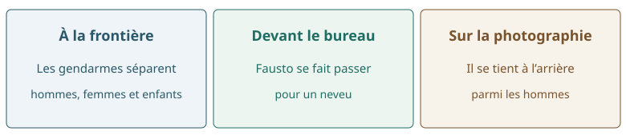

# BEL A/L — Espagnol (commentaire et traduction) 2024 · Corrigé guidé

*Corrigé rédigé par IA, non officiel. Signalez toute erreur.*

**Rédaction** · GPT-6.2 Astra Ultra · vitesse non renseignée

**Révision (tour 1)** · GPT-6.2 Astra Ultra · vitesse non renseignée

Juan Gabriel Vásquez, *Volver la vista atrás* (2021). Épreuve commune de six heures. [Sujet, p. 10–11](https://www.ens-lyon.fr/sites/default/files/2024-11/Commentaire%20d%27un%20texte%20en%20LVE%20et%20traduction.pdf#page=10) · [Rapport du jury, p. 2–14](https://www.ens-lyon.fr/sites/default/files/2024-11/Espagnol%202024%20OK.pdf#page=2)

## Préparer le commentaire et la version

### Rejouer l’entrée dans les bureaux

Repérez trois gestes avant de résumer les événements. Josefina tend son portefeuille tout en regardant ailleurs. Fausto suit de très près les chaussures d’un inconnu. L’officier observe l’employé quand le garçon tend ses billets. Dans chacune de ces scènes, quelqu’un doit interpréter un signe avant de pouvoir agir. Comparez alors le discours sur les valeurs républicaines et les deux phrases de l’officier qui encadrent le pot-de-vin. La seconde a besoin de deux mots, « una excepción », que la première semblait exclure.

### Lire ce que la photo laisse hors champ

Dans la première scène, séparer les hommes des femmes et des enfants annonce le camp. Sur le bateau, Fausto se réjouit d’être parmi les hommes. La place sur l’image prend son sens au regard de cette première distribution. À la fin, le commentaire peut continuer au-delà de la description visuelle. Où se tiennent les conversations ? Combien de temps durent-elles ? Le récit fait entendre, sur le pont et dans les cabines, ce qu’un cliché silencieux ne saurait enregistrer.

### Décisions de version

« Podían permitírselo » reprend la possibilité matérielle de fuir. « Ceux qui en avaient les moyens » conserve ce filtre social. Gardez la répétition de « acaso » avec deux « peut-être » et distinguez « plutôt tôt que tard » de « tôt ou tard », dont le sens serait différent. Le conditionnel « vendrait » situe la vente après la prise de vue. Dès la mise en place des premiers rangs, passez au présent et gardez-le jusque dans les relatives finales. « Comment sera la vie » fait entendre la question des voyageurs depuis ce présent. La traduction commence lorsque les deux familles prennent leur décision, après les retrouvailles fixées à Bordeaux.

## Comentario en español

Tres voces o tres ecos bastan al principio de este pasaje de Volver la vista atrás para abrir una frontera. Al final, una fotografía parece reunir en un mismo encuadre a quienes han conseguido atravesarla. Sin embargo, entre lo que se anuncia y lo que sucede, entre lo que muestra una foto y lo que puede contar un narrador, queda un intervalo decisivo. Vásquez lo aprovecha para seguir muy de cerca el aprendizaje de Fausto y para preguntar qué hace falta, además del valor de un muchacho, para sobrevivir al exilio.

La apertura, repetida como una noticia que aún costara creer, tiene por consecuencia inmediata la separación de las familias (líneas 1–10). El diálogo se llena de preguntas cuya respuesta ignora Fausto. A las malas palabras de Josefina contra los franceses corresponderá el insulto de Mauro. Es una manera rápida de hacer oír el agravio antes de que el relato lo explique. Josefina, en cambio, consigue comunicar lo esencial sin decirlo. Mira al aire y obliga al muchacho a leerle las manos. La cartera que pasa de una mano a otra da a Fausto una responsabilidad adulta que su voz de adolescente todavía delatará.

La puerta de las oficinas es una frontera en miniatura. El mismo chico al que los gendarmes acaban de echar entra en cuanto parece pertenecer a la familia de un desconocido elegante. Fausto lee en la manera de llevar un sombrero una autoridad que los otros también están dispuestos a reconocer. Por un instante la distancia que media entre los zapatos del hombre y los de los hermanos decide su parentesco. La posibilidad de una zancadilla le da a la escena la precisión cómica de una farsa. Y hay dos tíos en el relato que hace Fausto, el que improvisa en francés y el verdadero, el republicano cuya trayectoria invoca ante el oficial. Los ideales compartidos de la República solo le procuran una breve audiencia. La mano con los billetes queda en suspenso hasta que la primera persona del plural que proclamaba imposible la excepción se ofrece a hacerla (líneas 33–42). Ningún comentario moral hace falta para entender la mirada que intercambian los funcionarios.

Al cambiar de escala el relato, cambia también el valor de las distancias. Siberia o Perpiñán, qué más le da a Josefina si ese tren los saca de allí. De Perpiñán no le quedará recuerdo a Fausto. El narrador puede señalar ese hueco y a la vez contar la espera, las cartas y los contactos del tío Felipe que permiten a los presos salir del campo. El muchacho no salva él solo a su familia. Tampoco la reunión de las dos familias en Burdeos garantiza un destino. La frase sobre quienes podían permitirse la huida (línea 56) recupera a escala europea la lección de la cartera. Y el eco de «apestados» lleva ahora pegado a toda la familia el estigma que Mauro denunció a la puerta de las oficinas.

En la descripción de la fotografía tomada por el fotógrafo de a bordo, mujeres y niños vuelven a quedar aparte de los hombres, pero ahora Fausto está orgulloso de ocupar las últimas filas entre estos. Una misma distribución de cuerpos ha cambiado de sentido. El retrato que el fotógrafo les venderá tiene su historia comercial y su modesta materialidad, la de una mano apoyada en el barco o una chaqueta abotonada. El presente descriptivo se prolonga hasta abarcar lo que ningún objetivo podría fijar, desde los brindis y la conversación sobre Europa hasta la pregunta que se hacen de día y de noche. El último nombre propio, el del país que los admite, llega después de la esperanza de volver a España. La respuesta sigue fuera del encuadre. Al devolverles a los exiliados un porvenir todavía incierto, la narración hace algo que no cabría en la fotografía.

## Version française, lignes 56–74

Et ils firent ce que faisaient tous ceux qui en avaient les moyens. Ils s’enfuirent d’Europe. Pour une fois, la décision ne vint pas de l’oncle Felipe. Lui avait la conviction profonde que Hitler perdrait la guerre et l’espoir que Franco tomberait à brève échéance. Les autres n’étaient pas de son avis. Peut-être étaient-ils plus pessimistes, peut-être plus réalistes, ou bien ils avaient tout simplement plus peur. Quelle qu’en fût la raison, cette fois-là ils finirent par l’emporter. C’est ainsi que Fausto retrouva son père après des mois qui parurent des siècles et que cette famille de rouges pestiférés se mit à parcourir les rues de Bordeaux en quête de quelqu’un qui veuille bien les accueillir.

Ils se rendirent dans tous les consulats d’Amérique latine et essuyèrent refus sur refus, jusqu’à ce qu’un pays qu’ils connaissaient mal leur ouvre ses portes. Quelques jours plus tard, ils arrivaient au port sur l’estuaire et posaient aux côtés d’une petite foule de passagers inconnus pour un photographe de bord, un petit homme moustachu qui leur vendrait la photo avant la fin de la traversée. Au premier plan, au plus près de l’objectif, se trouvent les femmes et les enfants, mais aussi un prêtre souriant et un homme en uniforme. Derrière, dans les derniers rangs, veste de drap boutonnée et main posée sur le bateau, apparaît Fausto Cabrera, heureux de se tenir parmi les hommes, dont beaucoup sont espagnols comme lui, qui prennent congé de l’Espagne avec confiance dans leur retour prochain, qui commentent les nouvelles d’une Europe en flammes, qui trinquent à la chance qu’ils ont eue d’échapper à la mort et se demandent jour et nuit, dans les cabines et sur le pont, comment sera la vie, leur nouvelle vie, en République dominicaine.
