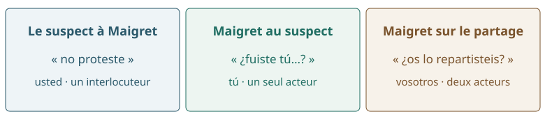

# BEL A/L — Espagnol (thème Lyon) 2024 · Corrigé brut

*Corrigé rédigé par IA, non officiel. Signalez toute erreur.*

**Rédaction** · GPT-6.2 Astra Ultra · vitesse non renseignée

**Révision (tour 1)** · GPT-6.2 Astra Ultra · vitesse non renseignée

Georges Simenon, *Maigret et l’homme du banc* (1953). Thème de spécialité, quatre heures, sans dictionnaire. [Sujet, p. 14](https://www.ens-lyon.fr/sites/default/files/2024-11/Epreuves%20de%20sp%C3%A9cialit%C3%A9.pdf#page=14) · [Rapport du jury, p. 15–24](https://www.ens-lyon.fr/sites/default/files/2024-11/Espagnol%202024%20OK.pdf#page=15)

## Proposition de thème

—No proteste. Yo también creí al principio que era imposible. Louis, en cambio, llevaba semanas estudiando aquella tienda. Antes de irse a comer, los dependientes no se toman la molestia de mirar por los rincones ni detrás de los miles de impermeables para asegurarse de que no quede nadie. A nadie se le ocurre que un cliente vaya a quedarse adrede en la tienda, ¿me entiende?

»Ahí está el truco. El dueño, al marcharse, cierra la puerta con todo cuidado.

—¿Fuiste tú el que se dejó encerrar? ¿Y luego forzaste la cerradura para salir con la caja?

—Se equivoca. Y aquí es precisamente donde la cosa empieza a tener gracia. Aunque me hubieran pillado, no habrían podido condenarme, porque no habría habido prueba alguna contra mí. Vacié la caja, de acuerdo. Después fui al retrete. Junto a la cisterna hay un ventanuco por el que no se podría hacer pasar ni a un niño de tres años. Pero otra cosa es pasar por él un paquete de billetes. El ventanuco da al patio. Y Louis, como por casualidad, pasó por allí y recogió el paquete. Yo, por mi parte, esperé a que volvieran los dependientes y a que hubiera bastantes clientes para que nadie se fijara en mí. Salí con la misma tranquilidad con que había entrado.

—¿Os lo repartisteis?

—Como buenos hermanos. Lo más difícil fue convencerlo. Se había inventado todo aquello por puro gusto, como un artista, por así decirlo. Cuando le propuse dar el golpe, casi se escandalizó. Lo que acabó por decidirlo fue pensar que iba a tener que confesarle a su mujer que estaba sin blanca. Fíjese en que el truco tiene otra ventaja. Me van a condenar por robo, ya que lo confieso, pero ni hubo escalamiento ni se forzó nada, y eso supone una diferencia de por lo menos unos dos años. ¿Me equivoco?

—Luego consultaremos el Código.

—Ya se lo he contado todo. Louis y yo hemos llevado una vida bien agradable, y no me arrepiento de nada.

## Repère de lecture

