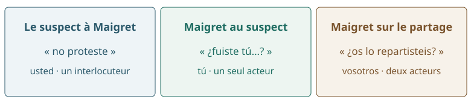

# BEL A/L — Espagnol (thème Lyon) 2024 · Corrigé guidé

*Corrigé rédigé par IA, non officiel. Signalez toute erreur.*

**Rédaction** · GPT-6.2 Astra Ultra · vitesse non renseignée

**Révision (tour 1)** · GPT-6.2 Astra Ultra · vitesse non renseignée

Georges Simenon, *Maigret et l’homme du banc* (1953). Thème de spécialité, quatre heures, sans dictionnaire. [Sujet, p. 14](https://www.ens-lyon.fr/sites/default/files/2024-11/Epreuves%20de%20sp%C3%A9cialit%C3%A9.pdf#page=14) · [Rapport du jury, p. 15–24](https://www.ens-lyon.fr/sites/default/files/2024-11/Espagnol%202024%20OK.pdf#page=15)

## Lecture du passage

### À qui s’adresse chaque réplique ?

> [!INDICATION]
> Relire successivement la première défense du suspect, la question du commissaire sur la serrure et sa question sur le partage. Combien de personnes vise chacun des verbes ?

Le suspect s’adresse à Maigret avec *usted*. On entend cette distance dans *no proteste*, *¿me entiende?* et *fíjese*. Maigret tutoie le suspect seul dans *¿fuiste tú…?*. Lorsqu’il demande *¿os lo repartisteis?*, il continue à ne parler qu’à un interlocuteur présent, mais l’action du partage a deux sujets, Louis et cet interlocuteur. La traduction adopte ici l’usage péninsulaire de *vosotros*. *¿Se lo repartieron?* fonctionnerait dans une variété qui emploie *ustedes* pour plusieurs familiers. Le signe » en tête du second paragraphe laisse la parole au suspect. [Rapport du jury, p. 19–22](https://www.ens-lyon.fr/sites/default/files/2024-11/Espagnol%202024%20OK.pdf#page=19)

### Pourquoi trois plans temporels avant même l’interrogatoire ?

*Llevaba semanas estudiando* fait remonter l’observation de Louis à plusieurs semaines avant l’événement raconté. *Hacía semanas que estudiaba aquella tienda* constitue une variante, avec les deux verbes à l’imparfait. La routine des employés revient au présent *no se toman la molestia*. Pour les faits de la journée, *vacié*, *fui*, *pasó*, *recogió* et *salí* découpent la succession des actions. L’entrée dans la boutique précède la sortie, d’où *había entrado*. L’arrestation et la condamnation imaginaires relèvent d’un autre plan, *aunque me hubieran pillado, no habrían podido condenarme*.

### Quels mots donnent sa voix au suspect ?

*Empieza a tener gracia* marque le plaisir qu’il prend à son récit. Le sujet *la cosa* évite de laisser entendre que c’est Maigret qui devient drôle. Dans l’aveu de Louis à sa femme, *estaba sin blanca* garde le ton familier de la ruine financière. *Estaba a dos velas* produirait un effet voisin. Pour la petite ouverture des toilettes, *ventanuco* suggère l’exiguïté, tandis que *tragaluz* en précise la fonction. *Cisterna* nomme le réservoir. Les trois objets, caisse, paquet, ouverture, sont repris séparément dans la traduction.

### Qui formule l’argument juridique ?

*Por robo* indique le motif de la peine qu’anticipe le suspect. *Hurto* ferait ressortir plus fortement sa distinction entre vol et vol avec recours à la force. Le récit passe ici du langage courant au vocabulaire qu’un prévenu s’approprie. Il conserve *escalamiento* et l’idée d’une fermeture qui aurait été forcée. Le commissaire réserve son jugement dans *luego consultaremos el Código*. L’ajout d’une qualification judiciaire certaine ou d’une peine chiffrée plus précise ferait disparaître l’incertitude que ménage sa réponse. [Rapport du jury, p. 23–24](https://www.ens-lyon.fr/sites/default/files/2024-11/Espagnol%202024%20OK.pdf#page=23)

## Proposition de thème

—No proteste. Yo también creí al principio que era imposible. Louis, en cambio, llevaba semanas estudiando aquella tienda. Antes de irse a comer, los dependientes no se toman la molestia de mirar por los rincones ni detrás de los miles de impermeables para asegurarse de que no quede nadie. A nadie se le ocurre que un cliente vaya a quedarse adrede en la tienda, ¿me entiende?

»Ahí está el truco. El dueño, al marcharse, cierra la puerta con todo cuidado.

—¿Fuiste tú el que se dejó encerrar? ¿Y luego forzaste la cerradura para salir con la caja?

—Se equivoca. Y aquí es precisamente donde la cosa empieza a tener gracia. Aunque me hubieran pillado, no habrían podido condenarme, porque no habría habido prueba alguna contra mí. Vacié la caja, de acuerdo. Después fui al retrete. Junto a la cisterna hay un ventanuco por el que no se podría hacer pasar ni a un niño de tres años. Pero otra cosa es pasar por él un paquete de billetes. El ventanuco da al patio. Y Louis, como por casualidad, pasó por allí y recogió el paquete. Yo, por mi parte, esperé a que volvieran los dependientes y a que hubiera bastantes clientes para que nadie se fijara en mí. Salí con la misma tranquilidad con que había entrado.

—¿Os lo repartisteis?

—Como buenos hermanos. Lo más difícil fue convencerlo. Se había inventado todo aquello por puro gusto, como un artista, por así decirlo. Cuando le propuse dar el golpe, casi se escandalizó. Lo que acabó por decidirlo fue pensar que iba a tener que confesarle a su mujer que estaba sin blanca. Fíjese en que el truco tiene otra ventaja. Me van a condenar por robo, ya que lo confieso, pero ni hubo escalamiento ni se forzó nada, y eso supone una diferencia de por lo menos unos dos años. ¿Me equivoco?

—Luego consultaremos el Código.

—Ya se lo he contado todo. Louis y yo hemos llevado una vida bien agradable, y no me arrepiento de nada.
