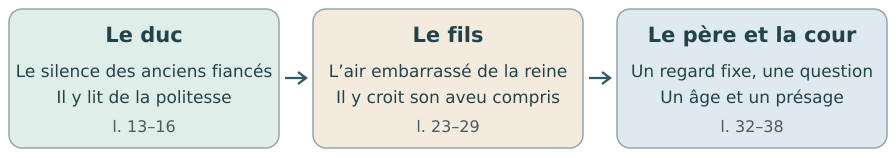

# BEL A/L — Étude de texte français (Lyon) 2024 · Corrigé guidé

*Corrigé rédigé par IA, non officiel. Signalez toute erreur.*

**Rédaction** · GPT-6.2 Astra Ultra · vitesse non renseignée · 26 novembre 2026

**Révision** · GPT-6.2 Astra Ultra · vitesse non renseignée · 26 novembre 2026

César de Saint-Réal, *Dom Carlos, nouvelle historique*. Étude littéraire et stylistique de spécialité, cinq heures.

[Sujet, p. 6–7](https://www.ens-lyon.fr/sites/default/files/2024-11/Epreuves%20de%20sp%C3%A9cialit%C3%A9.pdf#page=6) · [Rapport du jury, p. 2–8](https://www.ens-lyon.fr/sites/default/files/2024-11/Lettres%20Modernes%202024.pdf#page=2)

## Distribuer les perceptions

> [!INDICATION]
> Dessiner deux portes, celle du carrosse et celle de Madrid. À chacune, qui voit ? qui croit comprendre ? quelle certitude le narrateur ajoute-t-il ?

### Identifier les places de chacun

Le chapeau résume le remplacement du fiancé par le père devenu veuf et le mariage célébré par procuration. Il donne au lecteur une information que les personnages ne peuvent défaire. Distinguer les gestes communs aux deux entrevues et les pensées accessibles au seul lecteur. Le titre du fascicule porte la date de 1674. Le rapport indique une première publication en 1672. [Sujet, p. 6–7](https://www.ens-lyon.fr/sites/default/files/2024-11/Epreuves%20de%20sp%C3%A9cialit%C3%A9.pdf#page=6) · [Rapport, p. 5](https://www.ens-lyon.fr/sites/default/files/2024-11/Lettres%20Modernes%202024.pdf#page=5)

### Éprouver les degrés de certitude

Comparer « crut » chez le duc (l. 13), « crut voir » chez Dom Carlos (l. 26–27) et « comme si » (l. 34). Dans le premier cas, l’ampleur réelle de l’embarras dépasse l’explication du témoin. Dans le deuxième, la joie du prince suit l’interprétation d’un air. Dans le troisième, la phrase envisage une intention de la reine. Soulignez ce que la proposition principale établit avant d’isoler l’interprétation qu’elle rapporte. Le même raisonnement permet de rapporter « ne serait pas heureuse » au jugement des assistants.

### Vérifier les mots sur la page

À la ligne 33 le fac-similé imprime « elle se mit à la regarder fixement ». Le nom de Philippe II et sa question sur ses cheveux rendent clair le destinataire du regard. Citer au besoin l’adverbe plutôt que de corriger silencieusement la phrase. Dans la note 3, « ce prince » désigne le roi. Le portrait de Dom Carlos, bien plus tôt, s’ouvrait sur le terme « régulièrement », au sens de « selon les règles de la beauté ». Ces deux petites vérifications empêchent d’attribuer au fils la réplique du père ou de donner au portrait une valeur de fréquence. [Rapport, p. 5–8](https://www.ens-lyon.fr/sites/default/files/2024-11/Lettres%20Modernes%202024.pdf#page=5)

## Commentaire

Deux hommes attendent de rencontrer la reine d’Espagne. Le premier a été son fiancé et l’a perdue. Le second l’a épousée avant de la voir. Saint-Réal donne à ces rencontres successives un même signe observable, le regard qu’Élisabeth laisse se fixer trop longtemps. Le signe vaut un aveu pour Dom Carlos, une offense involontaire pour Philippe II et un mauvais présage pour les assistants. Dans cet extrait de *Dom Carlos*, la nouvelle historique découvre une difficulté propre à l’écriture de l’histoire de cour. Tous ces gens sont des témoins convenablement placés, et pourtant aucun ne voit exactement la même chose. Comment le récit fait-il éprouver l’intimité d’une passion tout en montrant combien son histoire dépend de ceux qui croient la lire ?

### Ce que deux rencontres officielles donnent à voir

La cérémonie produit ses propres mesures du temps. Les « premières civilités » adressées au fils ont leur pendant dans les « premières cérémonies » auprès du père. L’adjectif suppose d’autres gestes réglés dont le lecteur pourrait prévoir la suite. Or deux intervalles deviennent remarquables, le silence qui s’éternise et le regard qui reste fixe. Saint-Réal inscrit la nouveauté de l’événement dans une entorse à l’ordinaire assez légère pour qu’elle ait pu échapper à un témoin moins attentif. « Assez extraordinaire » maintient ensemble la surprise et la réserve d’une relation qui se veut crédible.

Le corps de la reine a pourtant dès l’ouverture franchi un seuil autrement spectaculaire. La structure consécutive de la première phrase subordonne son évanouissement à la violence des sentiments qui se sont élevés en elle. Le pluriel et leur opposition sont attestés, leurs noms restent en suspens. Élisabeth revient à elle juste à temps pour l’apparition publique. Au bout du voyage, l’opération symétrique échouera. La présence de son mari ne pourra la tirer de sa rêverie. L’une des rencontres la ramène à la perception, l’autre la trouve encore absorbée dans le souvenir de ce qu’elle vient de vivre. Le texte établit ainsi le triangle jusque dans la manière dont une femme reprend ou garde l’usage de ses sens.

Le regard du narrateur a sa part de ces délais. Le portrait du prince commence par une réserve sur les proportions de son corps. Le teint et la tête reçoivent ensuite des éloges éclatants. À la suite des yeux « pleins de feu », quelle chute modeste dans la formule où l’on ne saurait le dire « désagréable » ! Cette litote ménage une distance entre la règle d’après laquelle on juge un physique et l’animation qui fait l’attrait d’une personne. Inversement, la beauté de la reine se ramasse dans l’effet qu’elle exerce sur Dom Carlos. Une seule ligne fait passer le prince de l’éblouissement au souvenir d’un droit ancien. Dans « perdu en la perdant », le premier complément évoque tout un bonheur possible, le second désigne une personne singulière. À la joie présente de la voir s’attache d’emblée le calcul de ce que cette vue va lui coûter.

### Une déclaration dont on peut suivre chaque hésitation

Le duc de l’Infantade fait avancer à la fois le cortège et l’action. Deux propositions construites en miroir lui prêtent une explication aussi élégante que raisonnable. Elle attend qu’il parte, il attend qu’elle parte. « Par civilité », « par respect » rendent le délai intelligible dans le code social du duc. La comparaison de la ligne 15 donne toutefois au lecteur une mesure de son erreur. L’embarras est « plus grand qu’il ne pensait ». L’homme qui intervient au nom de la convenance fournit aux intéressés, en les faisant partir, la « commodité » de se regarder dans le carrosse. Les deux infinitifs coordonnés « la considérer et […] se perdre » font tenir dans une occasion pratique la perspective d’une destinée.

L’espace du carrosse se réduit presque aux yeux des voyageurs. Les premières phrases en distribuent soigneusement l’initiative. Le prince regarde et la reine remarque qu’il regarde. Elle éprouve de la douceur à *voir* son ravissement, ce qui lui accorde encore la réserve de réagir à un sentiment venu d’autrui. En quelques lignes passent les verbes considérer, remarquer, voir, observer, regarder. Cette diversité lexicale rend sensible l’effort des personnages pour moduler un geste qui extérieurement reste le même. Le texte attribue ensuite aux yeux leur fatigue, leur violence sur eux-mêmes, puis leur rencontre « par hasard ». Un sujet grammatical qui peut agir tout seul procure aux amants un instant d’innocence. Une fois le contact établi, le récit leur rend la responsabilité douloureuse de ne plus pouvoir l’interrompre.

Le passage aux « fidèles interprètes » convertit l’organe de la vue en organe de parole. « Tout ce qu’il avait à lui dire » désigne un discours complet dont le lecteur ne recevra aucune phrase au discours direct. Les « mille regards » lui donnent une durée et font de l’obstination une qualité perceptible avant même qu’elle ait pu s’éprouver par des actes répétés. Les expansions du cœur « chargé », puis « serré », font sentir quelle pression rend le soulagement nécessaire. À ce point le narrateur introduit une réserve capitale, « il crut voir » (l. 26–27). L’agitation d’Élisabeth est certaine. Le sens que le prince lui prête lui appartient. Sa joie est « sensible », assez vivement éprouvée pour suspendre, quelques moments seulement, la conscience du bonheur de son père. Le lecteur accompagne l’intensité d’une conviction sans se voir promettre l’autorité de ce qu’aurait déclaré la reine.

### La cour tire de justes craintes d’explications inexactes

À Madrid, Élisabeth persiste à observer. Elle fixe désormais le roi, peut-être pour lire dans ses traits s’il a remarqué les siens. La comparaison hypothétique introduite par « comme si » signale une limite du savoir narratif sur le motif même du regard. Car la reine agit « sans songer à ce qu’elle faisait ». Comment donnerait-elle à un tiers une explication qu’elle ne s’est pas encore à elle-même formulée ? Le fils avait cru lire une réponse et en tirait une brève liberté d’esprit. Le père lit, dans un regard dirigé vers lui, une vérification de la couleur de ses cheveux. Le narrateur affirme que cette lecture s’écarte du véritable sujet d’inquiétude. Mais les cheveux blancs touchent bien à la différence de génération grâce à laquelle le premier projet de mariage a pu se renverser. L’erreur du mari fait donc affleurer, par la remarque la plus concrète du passage, une vérité qu’il ignore.

Cette seule question audible, significativement rapportée au discours indirect, devient l’affaire de tous. Le passif « furent prises » laisse d’abord circuler le présage sans lui donner de propriétaire. Puis « on jugea » transforme en opinion commune une conjecture que l’assistance ne saura fonder que sur la différence entre les époux. À l’autre extrémité du passage, ces mêmes observateurs se taisaient par respect. De témoins du silence ils sont devenus producteurs d’une interprétation qui aura valeur de mémoire collective. Le futur dans le passé du mariage qui « ne serait pas heureux » reste encadré par leur jugement. Il fait sentir le poids de l’avenir en gardant la trace du premier moment où quelqu’un crut le discerner.

Saint-Réal peut ainsi donner une histoire à ce dont une chronique conserverait tout au plus les signes extérieurs. Il conduit le lecteur dans les mouvements de la douleur et de la joie tout en lui indiquant, par les verbes de croyance, les comparaisons et les changements d’observateur, qui est en mesure d’en répondre. Le prince, le roi, le duc et la cour ont chacun de bonnes raisons de faire parler les regards. De la part de cette fiction historique, la plus grande précision consiste peut-être à montrer que les raisons d’interpréter un signe sont déjà des événements.
