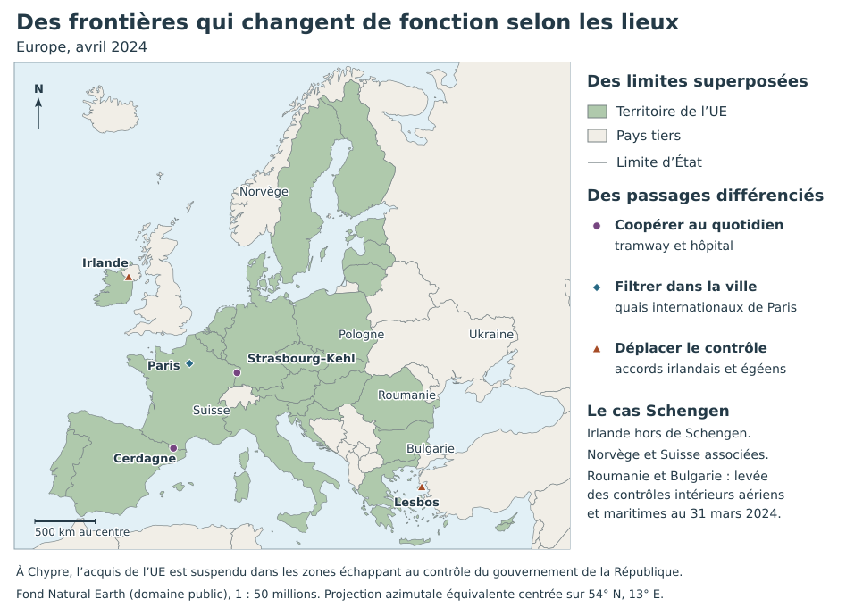
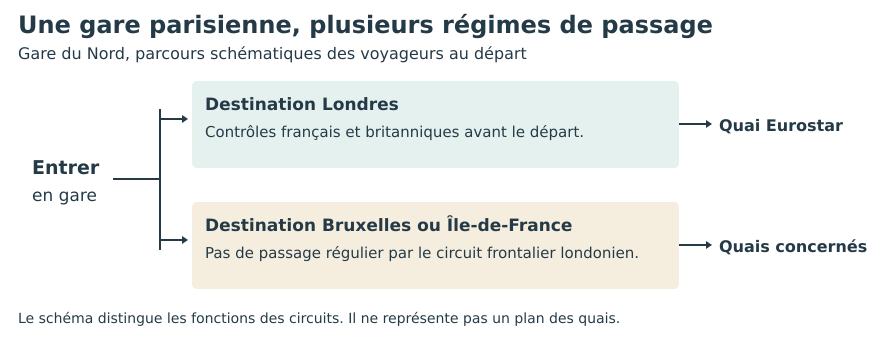
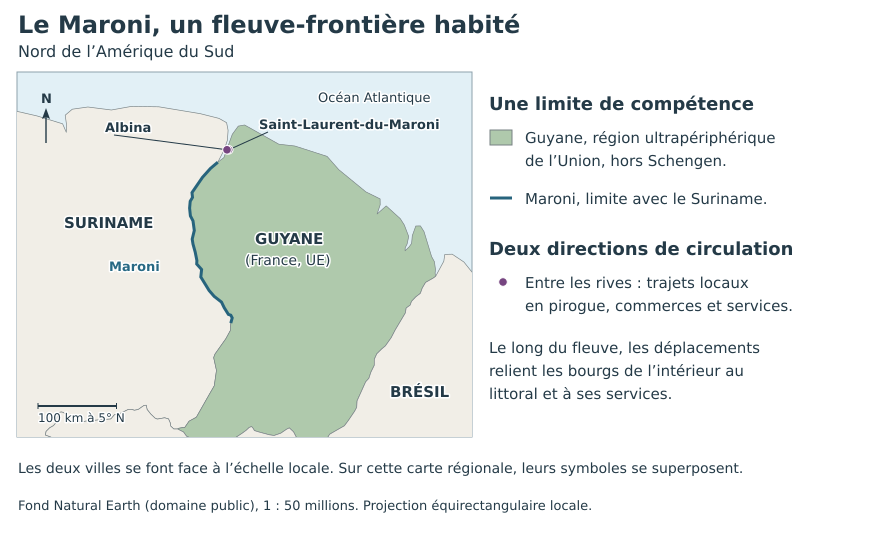

# BEL A/L — Géographie 2024 · Corrigé brut

*Corrigé rédigé par IA, non officiel. Signalez toute erreur.*

**Rédaction** · Modèle : OpenAI Codex (famille GPT-6) · Effort de raisonnement : non renseigné · Mode de vitesse : non renseigné.

**Révision** · Modèle : OpenAI Codex (famille GPT-6) · Effort de raisonnement : non renseigné · Mode de vitesse : non renseigné.

**Problématique** — Comment une organisation qui ouvre certains passages et en déplace d’autres produit-elle des espaces frontaliers aussi différents pour ceux qui les habitent ou les traversent ?

## Introduction

Depuis 2017, un tramway relie Strasbourg à Kehl en franchissant le Rhin. La traversée donne accès à des emplois et à des commerces des deux côtés. Pourtant, le voyageur change d’État au milieu du fleuve, jusque dans les périodes où aucun agent ne lui demande ses papiers. Suivant son statut, il ne dispose d’ailleurs pas des mêmes droits au séjour et au travail que son voisin de rame. Une infrastructure destinée à rendre une frontière moins sensible révèle ainsi les différences qui continuent de la faire vivre.

Au printemps 2024, l’Union européenne rassemble vingt-sept États. Ils conservent leurs territoires et leurs frontières, tout en organisant en commun une partie des conditions du passage. Une frontière désigne une limite entre des ressorts d’autorité et les dispositifs qui en règlent le franchissement. L’espace frontalier s’étend jusqu’aux lieux dont les activités, les modes d’habiter ou les rapports de pouvoir sont transformés par cette limite. Son épaisseur varie selon les pratiques observées. La question embrasse les frontières entre États membres, celles qu’ils partagent avec des pays tiers et les prolongements ultramarins de l’Union. Comment une organisation qui ouvre certains passages et en déplace d’autres produit-elle des espaces frontaliers aussi différents pour ceux qui les habitent ou les traversent ? Il faut situer les limites multiples de l’Union, examiner la manière dont les usages quotidiens recomposent leurs abords, puis suivre les contrôles au-delà de la ligne.

## I. L’intégration européenne superpose plusieurs frontières sur un même territoire

La construction communautaire a dissocié la limite d’État et le lieu de perception des droits de douane. Dans l’union douanière, les marchandises déjà mises en libre pratique peuvent franchir une frontière entre États membres sans y acquitter un nouveau droit de douane. En revanche, la Suisse, au centre du continent, demeure extérieure à l’union douanière de l’UE. À la frontière entre la France et la Suisse, un déplacement individuel dans l’espace Schengen et l’importation d’une marchandise relèvent donc de règles différentes. L’objet qui circule importe autant que l’emplacement de la ligne. À Bâle, les entreprises peuvent organiser leur recrutement dans trois pays, alors que les services douaniers traitent encore des flux de biens. Le contrôle se spécialise et la ville tire parti de la rencontre d’aires de travail, de consommation et de décision distinctes.

Le croquis européen permet de comparer cette situation à celle de l’Irlande, membre de l’Union mais située hors de l’espace Schengen. Dans l’autre sens, la Norvège participe à Schengen sans appartenir à l’UE. Le calendrier compte aussi. Depuis le 31 mars 2024, les contrôles de personnes aux frontières intérieures aériennes et maritimes de la Bulgarie et de la Roumanie avec le reste de l’espace Schengen ont été levés, tandis que les contrôles terrestres y sont encore en place au moment de l’épreuve. Pour un passager venant d’un autre pays de Schengen, prendre l’avion ou passer par la route peut donc changer les conditions du trajet. Une carte qui donnerait une seule couleur à des États supposés entièrement « ouverts » ou « fermés » rendrait cette différence invisible.

L’extension du territoire de l’Union transforme aussi le statut des limites antérieures. Après l’adhésion de la Pologne en 2004, sa frontière avec l’Allemagne devient intérieure à l’UE, puis les contrôles terrestres réguliers de Schengen y sont supprimés en 2007. Plus à l’est, la limite polono-ukrainienne est une frontière extérieure de l’Union. Son avenir politique reste sujet à négociation. L’article 49 du traité sur l’Union européenne permet à un État européen respectant les valeurs de l’Union de demander à y adhérer. Le statut de candidat obtenu par l’Ukraine en 2022 ne lui confère pas les droits d’un membre. Dans le même temps, l’accueil dans l’UE de personnes déplacées d’Ukraine sous le régime de protection temporaire montre qu’une limite extérieure peut permettre une admission rapide à certaines catégories de personnes. La frontière européenne change de position, de durée et d’effet selon la décision que l’on étudie.

## II. Les habitants et les collectivités transforment certaines marges en espaces de vie communs

La possibilité juridique de passer ne suffit pas à produire un territoire transfrontalier. Il faut des trajets réguliers, une destination de l’autre côté et des moyens de transport accessibles. Entre Strasbourg et Kehl, le tramway réunit en une même ligne des quartiers situés de part et d’autre du Rhin. Un habitant peut combiner plusieurs déplacements au cours d’une journée et renoncer à une traversée en voiture. Les habitants, les commerçants et les entreprises donnent ainsi à l’ouvrage une portée qui dépasse celle du pont. Pour autant, maîtriser la langue du lieu de travail, faire reconnaître une qualification ou connaître les règles de remboursement de soins peut demeurer décisif. Le périmètre dans lequel il est facile d’acheter ne se confond pas avec celui dans lequel il est facile de travailler.

La coopération peut même déplacer le centre d’un service public. Le plateau de Cerdagne est partagé entre la France et l’Espagne. Pour des habitants de cette région de montagne, un hôpital situé de l’autre côté de la frontière peut être plus proche qu’un établissement desservi par une longue route du côté national. Ouvert à Puigcerdà en 2014, l’hôpital transfrontalier de Cerdagne organise un bassin de soins franco-espagnol, avec l’appui de l’Union et un groupement européen de coopération territoriale. Le choix d’un site commun se comprend à la fois par le relief et par la taille des populations qui peuvent y accéder. Il oblige aussi les soignants et les administrations à faire fonctionner ensemble plusieurs langues et plusieurs systèmes de santé. Un équipement partagé change l’attractivité du versant voisin à la condition que le patient, puis les professionnels qui assureront son suivi, puissent effectivement s’en servir.

Ces espaces intégrés distribuent inégalement les bénéfices du passage. Près du Luxembourg, franchir la frontière pour occuper un emploi peut procurer un avantage de rémunération, tandis que le logement se trouve dans une commune française, belge ou allemande. Une commune résidentielle peut ainsi devoir aménager des accès, des écoles ou des services pour une population dont une grande part de l’activité se déroule dans l’État voisin. Les trains de l’axe Thionville–Luxembourg et les encombrements routiers soulignent la profondeur de cet espace frontalier. Elle ne se mesure pas par une bande de largeur constante le long du tracé. Elle dépend de la localisation des emplois, des loyers, des liaisons et des horaires. Au sein d’une même famille, le travailleur qui traverse quotidiennement et un proche dépendant de services locaux ne vivent donc pas la même frontière.

Le cas irlandais révèle le coût politique d’un passage redevenu difficile. Le retrait britannique a fait de la limite entre la République d’Irlande et l’Irlande du Nord une frontière extérieure de l’UE. Matérialiser de nouveau cette ligne aurait perturbé des voisinages et des activités économiques tout en remettant en jeu la portée symbolique du passage dans une île marquée par le conflit nord-irlandais. Les arrangements négociés, remaniés par le cadre de Windsor en 2023, organisent des formalités différenciées sur les marchandises arrivant en Irlande du Nord depuis la Grande-Bretagne. La ligne terrestre demeure ouverte et une partie des contrôles se reporte sur les flux maritimes. L’épaisseur frontalière s’étend ici jusqu’aux ports. Sa localisation résulte d’un compromis politique dont les effets diffèrent suivant la destination finale des produits.

## III. Les contrôles forment des espaces discontinus, jusque dans les villes et au-delà de l’Europe

La frontière extérieure peut d’abord être rencontrée loin des marges du continent. À Paris, la gare du Nord est à la fois un nœud urbain ordinaire et un lieu de contrôle pour les voyageurs qui empruntent l’Eurostar à destination de Londres. Des contrôles juxtaposés sont organisés avant l’embarquement. Dans la même gare, le voyageur qui rejoint Bruxelles ou une commune francilienne n’emprunte pas ce circuit. Le schéma de la gare distingue des espaces voisins dont la fonction dépend de la destination et du titre du voyageur. C’est donc par certains lieux de transport et à des moments déterminés du voyage que se matérialise la limite. Les États agissent sur le franchissement en organisant les circulations avant même que le train n’ait quitté la ville.

En Méditerranée, l’espace frontalier prend aussi la forme de lieux d’attente. Les îles grecques de la mer Égée orientale se trouvent à une faible distance de la Turquie. À Lesbos, l’arrivée, l’enregistrement et l’instruction des demandes d’asile donnent à une île touristique une place majeure dans les parcours migratoires. La déclaration UE–Turquie de mars 2016 associe la gestion des arrivées dans les îles à une coopération avec un État extérieur. Le passage maritime peut ainsi être bref par rapport au temps passé à attendre une décision administrative ou à retrouver des proches. Les personnes accueillies participent elles-mêmes à la formation de l’espace frontalier par leurs communications avec d’autres étapes du parcours, les échanges de services et les formes de solidarité qu’elles organisent. Les associations, les municipalités et les services de l’État en font aussi un espace de conflits autour des conditions d’hébergement et d’accès aux services. L’histoire de ces territoires ne se réduit donc pas au décompte des entrées.

Enfin, on ne peut ramener les limites de l’UE à une enveloppe continentale. En Amérique du Sud, la Guyane française appartient à l’UE comme région ultrapériphérique et reste hors de l’espace Schengen. Sa limite avec le Suriname suit le Maroni sur une grande partie de son tracé. Entre Saint-Laurent-du-Maroni et Albina, le fleuve unit des lieux de parenté, de commerce et de services. La pirogue permet des parcours qui s’inscrivent dans l’organisation ancienne des rives. Pour les administrations, cette même traversée revêt la forme d’une sortie ou d’une entrée internationale. Suivant les titres détenus et les démarches qu’ils doivent accomplir, des habitants de rives proches connaissent ainsi des possibilités de mobilité très différentes. Le croquis guyanais montre pourquoi, à l’échelle du bourg, la frontière est à la fois transversale, d’un débarcadère à l’autre, et longitudinale, le long d’un fleuve qui dessert l’intérieur. Les catégories de région ultrapériphérique et de pays et territoire d’outre-mer conduisent d’ailleurs à des cartes différentes. Le Groenland appartient au royaume de Danemark et est associé à l’Union comme pays et territoire d’outre-mer, sans appartenir au territoire de l’Union. La souveraineté d’un État membre ne suffit donc pas pour tracer le contour de l’UE.

## Conclusion

L’intégration européenne sélectionne et redistribue les fonctions des frontières. Elle rapproche les lieux auxquels donnent accès un emploi, un tramway ou un hôpital commun, tout en maintenant des différences juridiques et sociales dont dépendent ces mêmes échanges. Ailleurs, la surveillance du passage s’étend à une gare de centre-ville, à un port ou à des îles où l’attente peut durer. Le territoire frontalier se reconnaît finalement aux relations qu’y produit la limite. Il faut examiner ensemble qui règle le passage, qui s’en sert et jusqu’où ses effets réorganisent la vie des habitants.
