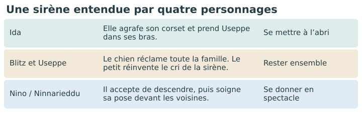

# BEL A/L — Italien (commentaire et traduction) 2024 · Corrigé guidé

*Corrigé rédigé par IA, non officiel. Signalez toute erreur.*

**Rédaction** · GPT-6.2 Astra Ultra · vitesse non renseignée

**Révision (tour 1)** · GPT-6.2 Astra Ultra · vitesse non renseignée

[Sujet officiel](https://www.ens-lyon.fr/sites/default/files/2024-11/Commentaire%20d%27un%20texte%20en%20LVE%20et%20traduction.pdf#page=12) · [Rapport du jury](https://www.ens-lyon.fr/sites/default/files/2024-11/Italien%202024%20OK.pdf#page=2) · [Archives de la session](https://www.ens-lyon.fr/formation/admission/archives-du-concours-lettres-et-sciences-humaines/concours-dentree-session-2024)

Elsa Morante, La storia (1974). Épreuve commune de six heures. Commentaire en italien, pages 12 et 13. De la première annonce des raids à la dernière phrase sur Nino, « meglio che poteva ». Version française. Lignes 1 à 20, de « Con l’avanzare della buona stagione » à « il ragazzo tedesco Gunther era sceso a bere ».

## Lire le sujet

**Comparer les regards**

Les inconnus se regardent dans la ville. Blitz regarde son maître. Ces deux échanges muets encadrent deux effets de l’alerte. L’un laisse la question en suspens, l’autre obtient que personne ne reste seul.

**Retrouver la même personne**

Nino et Ninnarieddu sont deux noms du fils aîné. Le projet prêté à « Ciurcil » relève de son discours. Vérifiez qui parle avant de traiter cette rumeur comme un renseignement sur Rome en guerre.

**Conserver les lieux et le temps**

Le corset se ferme sur le corps. Le refuge se situe au-delà du pâté de maisons. « Tre inverni prima » ramène à une visite antérieure de Gunther. Le second paragraphe de version superpose ces trois échelles.

## Commentaire

La stessa sirena che terrorizza Ida promette al figlio minore una serata di festa. In questa pagina di *La storia* (1974), ambientata a Roma durante la seconda guerra mondiale, Elsa Morante fa udire un segnale pubblico attraverso orecchie diverse, comprese quelle di un cane. Come può la discesa nel rifugio diventare una festa? Dal bollettino allo sguardo di Ida, dalla supplica di Blitz alla recita di Nino, il racconto distribuisce fra i personaggi la paura e il sapere.

Di Roma apprendiamo anzitutto che « veniva risparmiata ». L’imperfetto prolunga la tregua senza garantirne la durata. Al linguaggio dei bollettini, costretti ad ammettere le stragi pur recitando la parte dell’ottimismo, risponde un’informazione muta. Persino gli sconosciuti si guardano negli occhi. La « stessa domanda assurda » non è mai formulata, come se nessuno avesse il diritto di chiedere una certezza. La parentesi dedicata alla « grande folla » segnala anche una differenza materiale. Partire per la campagna è una possibilità delle famiglie possidenti. A chi resta non rimane che interrogare un altro volto o cercare riparo nelle cantine.

La narrazione entra allora « in qualche luogo » della mente di Ida. Lei stessa non sa spiegarsi il piccolo rivolgimento che le rende intollerabili gli allarmi. Al torpore del lavoro e della casa, riassunto nell’ossimoro « estasi negativa », succede una forza che la sorprende. Il paragone della macchina in folle imprime al panico il movimento di una discesa che nessun freno governa. Nel gesto di allacciarsi il busto che contiene i risparmi e di raccogliere il bambino, la paura ha già scelto che cosa salvare. La cantina stessa contiene un passato. Il breve ritorno al giovane Gunther, che vi era entrato a bere tre inverni prima, sovrappone alla funzione pubblica del rifugio una traccia della vicenda privata di Ida.

Chi resta dietro la porta chiusa ha un’altra definizione della salvezza. Blitz protesta andando e venendo fra Nino e l’uscita. Gli occhi castani del cane cercano quelli di Nino come all’inizio si incontravano gli occhi dei passanti. Qui però uno sguardo ottiene risposta. La narratrice traduce in discorso diretto il guaito ostinato, fino a dare al cane la parola decisiva, « tutti ». Per lui anche la salvezza cesserebbe di aver senso se dividesse la famiglia. Quando il ragazzo acconsente, l’allarme cambia valore. La coda diventa una bandierina, l’attesa del guinzaglio ha l’impazienza di un nottambulo che parte per il ballo. E il piccolo Useppe, che prima piangeva per il dolore del cane, inventa per la sirena il nome festoso di « niena ». La guerra arriva ai due amici come un suono al quale possono rispondere nella propria lingua.

È Nino, detto Ninnarieddu, a portare Useppe sulle spalle. Il ritmo della fuga unisce ragazzo, bambino e cane in « tre corpi e un’anima », ma Ida li segue da sola. Attorno a loro si scompone una folla di persone in sottoveste, di bambini smarriti, di donne che gridano. Le detonazioni viste come un bengala e la discesa guardata come una scena comica fanno udire insieme l’intensità del fragore e la risata dell’adolescente. Appoggiato al muro presso l’ingresso, Nino sceglie il suo pubblico. La posa sprezzante è soprattutto per le ragazze del vicinato. Il presunto patto del papa con « Ciurcil », raccontato con la sicurezza di una notizia nota a tutti, prolunga a modo suo il teatro dell’ottimismo dei bollettini.

La festa, avverte un inciso, ha una condizione precisa, la presenza del fratello maggiore. Quel limite impedisce di trasformarla in un idillio. Morante concede ai suoi personaggi il diritto di provare gioia dentro la storia e al lettore la facoltà più scomoda di sentire, nello stesso momento, una risata e un grido.

## Version française

À mesure que la belle saison avançait, les raids aériens sur les villes italiennes se multiplièrent cette année-là, toujours plus violents. Les communiqués militaires avaient beau afficher leur optimisme, ils faisaient état chaque jour de destructions et de massacres. Rome, pourtant, était épargnée. Mais les gens, désormais à bout de nerfs et effrayés par les nouvelles étranges qui couraient partout, commençaient à se sentir moins en sûreté. Les familles fortunées s’étaient installées à la campagne. Ceux qui restaient (et c’était la grande foule), quand ils se croisaient dans la rue, dans les tramways, dans les bureaux, se regardaient en face, même entre inconnus, tous avec la même question absurde au fond des yeux.

Quelque part dans l’esprit d’Ida, en un point qui échappait à sa raison, il se produisit à cette époque un petit bouleversement brutal qui la rendit maladivement sensible aux alertes (qui lui étaient déjà devenues habituelles et la laissaient indifférente) et éveilla soudain en elle une réserve d’énergie presque inconcevable. Pour tout le reste, elle continuait comme auparavant sa vie partagée entre son travail à l’école et les tâches du ménage, dans une sorte d’extase négative. Mais au premier appel de la sirène, une panique désordonnée s’emparait d’elle sur-le-champ, comme une mécanique qui s’emballe en roue libre dans une descente. Qu’elle fût éveillée ou endormie, à n’importe quelle heure, elle agrafait en toute hâte sur elle son corset (où elle gardait toujours ses économies), puis elle prenait Useppe dans ses bras et, avec une force nerveuse qui n’avait rien de naturel, dévalait les étages avec ce poids pour aller chercher son salut dans l’abri. Cet abri, d’ailleurs, pour elle et les autres locataires de son escalier, on l’avait aménagé de l’autre côté du pâté de maisons, dans les locaux de cette cave qui servait de taverne, celle-là même où, trois hivers plus tôt, le jeune Allemand Gunther était descendu boire.
