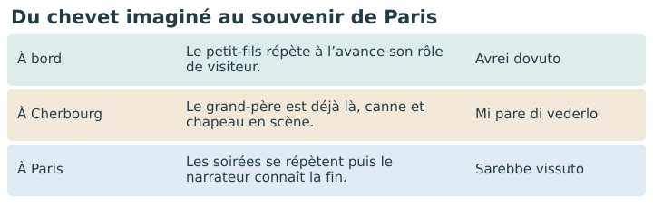

# BEL A/L — Italien (thème Lyon) 2024 · Corrigé brut

*Corrigé rédigé par IA, non officiel. Signalez toute erreur.*

**Rédaction** · GPT-6.2 Astra Ultra · vitesse non renseignée

**Révision (tour 1)** · GPT-6.2 Astra Ultra · vitesse non renseignée

[Sujet officiel](https://www.ens-lyon.fr/sites/default/files/2024-11/Epreuves%20de%20sp%C3%A9cialit%C3%A9.pdf#page=15) · [Rapport du jury](https://www.ens-lyon.fr/sites/default/files/2024-11/Italien%202024%20OK.pdf#page=9) · [Archives de la session](https://www.ens-lyon.fr/formation/admission/archives-du-concours-lettres-et-sciences-humaines/concours-dentree-session-2024)

Amin Maalouf, Samarcande (1989 dans la référence imprimée du sujet). Épreuve de quatre heures. Les trois paragraphes de la page 15, de « C’est en 1895 » à « toute une nouvelle jeunesse ». Les lieux, les artistes, les trois chansons et les deux nombres de la chute font partie du passage.

## Proposition de thème

Fu sul finire dell’estate del 1895 che salpai per il Vecchio Continente. Mio nonno aveva appena festeggiato il suo settantaseiesimo compleanno e aveva mandato lettere strappalacrime tanto a me quanto a mia madre. Voleva vedermi, anche solo una volta, prima di morire. Misi subito da parte gli studi e mi precipitai da lui. A bordo mi preparai alla parte che avrei dovuto recitare, a inginocchiarmi al suo capezzale, a stringergli con coraggio la mano ormai fredda mentre lo ascoltavo mormorare le sue ultime raccomandazioni.

Non ce ne fu alcun bisogno. Il nonno mi aspettava a Cherbourg. Mi pare ancora di vederlo sulla banchina di Caligny, più ritto del suo bastone, con i baffi profumati e il passo allegro, con il cilindro che si sollevava da solo al passaggio delle signore. Una volta seduti a tavola al ristorante dell’Amirauté, mi prese saldamente per il braccio. «Amico mio», mi disse con voluta teatralità, «è appena rinato in me un giovanotto, e gli occorre un compagno».

Feci male a prendere alla leggera le sue parole. Il nostro giro fu un turbine. Avevamo appena finito di cenare al Brébant, da Foyot o dal Père Lathuile e già dovevamo correre alla Cigale, dove si esibiva Eugénie Buffet, al Mirliton, regno di Aristide Bruant, alla Scala, dove si sentiva Yvette Guilbert cantare *Les Vierges*, *Le Fœtus* e *Le Fiacre*. Eravamo due fratelli, baffi bianchi e baffi bruni, stesso portamento, stesso cappello, ed era lui il primo a cui le donne rivolgevano lo sguardo. A ogni tappo di champagne che saltava ne spiavo i gesti, l’andatura, senza mai coglierlo in fallo. Balzava in piedi, camminava svelto quanto me, il bastone era poco più che un vezzo. Voleva cogliere ogni rosa di quella tarda primavera. Sono felice di poter dire che sarebbe vissuto fino a novantatré anni. Altri diciassette anni, tutta una nuova giovinezza.

## Variantes de traduction

À Cherbourg, le quai appartient au port. *Banchina* et *molo* conviennent à cet espace. Le cylindre paraît saluer de son propre mouvement. Une relative italienne lui conserve son autonomie comique. Dans le portrait, *con* introduit les détails vus par le petit-fils.

Même construction temporelle au départ et à la fin, avec une différence de sens. Le jeune voyageur imagine ce qu’il aura à faire. Le narrateur qui se souvient sait combien de temps le grand-père a vécu. Après *sarebbe vissuto*, la courte phrase nominale laisse résonner les dix-sept années de vie.
