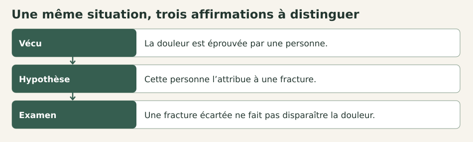

# BEL A/L — Philosophie 2024 · Corrigé brut

*Corrigé rédigé par IA, non officiel. Signalez toute erreur.*

**Rédaction** · modèle exact non renseigné (famille GPT-6) · effort non renseigné · vitesse non renseignée

**Révision (tour 1)** · modèle exact non renseigné (famille GPT-6) · effort non renseigné · vitesse non renseignée

**Révision (tour 2)** · GPT-6.2 Astra Ultra · vitesse non renseignée

**Sujet officiel** · Qu’est-ce que la réalité ?

**Révision (tour 3)** · GPT-6.2 Astra Ultra · vitesse non renseignée

**Révision (tour 4)** · GPT-6.2 Astra Ultra · vitesse non renseignée

**Problématique** — Que faut-il ajouter à la simple représentation possible d’une chose pour dire qu’elle est réelle, y compris lorsque son existence dépend de nos pratiques ?

## Introduction

Un décorateur a peint au fond d’un couloir une porte si convaincante qu’un visiteur tend la main vers la poignée. Lorsqu’il touche le mur, il s’écrie que la porte n’était pas réelle. Rien de ce qu’il a vu ne s’est pourtant évanoui. La poignée brille encore, et son étonnement devant l’image appartient autant à la situation que la peinture. Il lui faut donc préciser ce qu’il retire à cette porte en cessant de la dire réelle. Quelque chose lui était apparu sous une certaine description, et il découvre que la chose nécessaire pour que cette description convienne fait défaut. Mais une définition de la réalité peut-elle se tirer de l’opération par laquelle nous vérifions ce qu’est une chose ? Une porte véritable au bout d’un couloir désert serait réelle sans être soumise à cette épreuve. La question demande ce que c’est, pour quelque chose, d’être réel, jusque dans les cas où rien de matériel ne se donne à toucher. Nous partirons de la différence entre une chose possible et une chose effective. Nous chercherons ensuite ce qui se maintient de cette différence dans l’expérience et, enfin, dans des réalités dont l’existence dépend de nos propres actes.

## I. Ce qu’il manque à la possibilité

Pour remplacer la porte peinte, l’architecte peut faire le dessin exact de la menuiserie à créer. Rien ne l’empêche d’y faire figurer toutes les mesures du vantail, le sens d’ouverture, les gonds et leur résistance au poids de l’ensemble. Chacune de ces précisions répond à la question de savoir quelle porte s’ouvrirait ici. Leur somme ne répond pas à la question de savoir s’il en existe une. Multiplier les propriétés contenues dans un projet nous en donne un concept plus déterminé. Si la dernière mesure ajoutée suffisait à faire exister son objet, il serait inutile de faire venir un menuisier. La réalité fait donc une différence que l’on ne sait pas exprimer en ajoutant un trait quelconque à la liste des traits de la chose.

L’exemple des cent thalers, dans la critique kantienne de la preuve ontologique, donne à cette difficulté une forme particulièrement simple. Cent thalers possibles et cent thalers effectifs ont le même nombre et la même valeur unitaire pour qui en forme le concept. Si la bourse effective contenait un thaler de plus, la somme obtenue ne serait plus celle qu’on avait conçue. Pourtant, celui qui doit payer son créancier se trouve dans des situations très différentes selon qu’il possède les cent thalers ou se borne à les envisager. Kant éclaire ici la différence entre poser un objet et enrichir ce que l’on pense dans son concept. On peut en tirer une première réponse à notre question. Une chose est réelle en tant qu’elle figure effectivement dans une situation dont sa simple description ne suffit pas à décider. La réalité d’un paiement appartient à l’histoire du débiteur et du créancier. Le sens des mots dont on décrit le paiement ne permet pas de le dater ni même d’en affirmer l’existence.

Cette différence se retrouve dans l’usage de la vérité, sans faire des deux termes des synonymes. L’énoncé « il y a une porte au bout du couloir » est faux dans notre exemple, mais cet énoncé prononcé à voix haute est une émission sonore parfaitement réelle. Inversement, le mur existe sans formuler aucune affirmation que l’on pourrait déclarer vraie. La vérité est en jeu lorsque nous demandons si les choses sont telles que nous le disons. En parlant de réalité, nous visons ce qui doit être pris en compte pour répondre à cette demande, y compris lorsqu’aucun énoncé n’a encore été formulé. Cela n’explique pourtant pas comment le mur pourrait nous apprendre que nous nous sommes trompés si tout ce qui nous atteint, poignée et paroi comprises, se présente d’abord comme une apparence.

## II. Une expérience peut en démentir une autre

Il serait tentant d’accorder la réalité à ce que la main rencontre et de laisser à l’œil le domaine de l’illusion. Ce partage se défend mal. Le visiteur pourrait voir la paroi obliquement et découvrir, sans la toucher, la continuité du badigeon au bord de la fausse porte. À l’inverse, les reliefs d’une porte condamnée pourraient lui donner sous les doigts une impression très persuasive. Ce qui compte dans l’expérience n’est donc ni son intensité ni le prestige d’un sens particulier. Dans la première position, le reflet peint et le reflet d’un métal véritable pouvaient donner lieu à une même attente. Lorsqu’on se déplace, ils se comportent différemment. Le visiteur a trouvé un moyen de mettre à l’épreuve ce que sa première perception lui promettait au-delà de ce qu’elle lui donnait.

On comprend dès lors en quel sens une apparence a elle-même une réalité. Le reflet peint, le point de vue du visiteur, son geste et son erreur composent un événement qu’il est possible de décrire. L’impossibilité d’ouvrir la porte n’en rend aucun élément fictif. Ce qu’elle retire est plus précis : le rapport présumé entre la couleur observée et une poignée accessible. Il y a bien une peinture et une méprise, et il n’y a pas de passage. Distinguer ces affirmations revient à reconnaître qu’un phénomène peut être déterminé de plusieurs façons, et que toutes ces façons n’ont pas des suites également compatibles avec la situation. C’est en ce sens que la réalité résiste. La résistance n’a pas besoin de prendre la forme d’un obstacle matériel. Elle peut consister dans l’échec d’une conséquence que nous étions pourtant autorisés à attendre de notre hypothèse.

Une douleur que personne d’autre ne peut éprouver à ma place permet de distinguer la réalité et l’objectivité. Si je souffre du bras alors que l’examen écarte la fracture que je soupçonnais, l’inexistence de cette fracture n’annule pas la réalité de la douleur. Un tiers peut en examiner les manifestations et m’en demander une description, sans que son propre accès du dehors devienne une condition d’existence de ce que je vis. Inversement, l’unanimité de plusieurs témoins placés devant le même décor ne rendrait pas la porte praticable. La possibilité d’accord entre observateurs constitue une norme de certaines enquêtes. Elle ne définit pas, à elle seule, l’effectivité de tout ce dont on parle.

Imaginons que deux médecins excluent l’un après l’autre la fracture supposée. La seconde vérification renforce le jugement sur l’état de l’os. Elle n’ajoute aucun argument pour décider si la douleur est réellement éprouvée. La question du réel demande donc aussi de déterminer sur quoi porte chaque procédure de vérification.

Dans la salle d’attente d’une gare, le cadran de l’horloge s’est arrêté à midi. À midi exactement, il indique l’heure juste. L’indication vraie ne suffit pourtant pas à rendre réel le mouvement que le voyageur prête au mécanisme. Cinq minutes plus tard, un second regard le détrompera. Mais l’horloge était déjà arrêtée au premier regard. L’épreuve ultérieure permet de déterminer quel état de choses existait alors ; elle ne le fait pas advenir rétroactivement. Cet écart explique pourquoi définir le réel par ce que l’on vérifie laisserait précisément de côté ce qui donne à la vérification le pouvoir de nous corriger.

Encore faut-il éviter de définir la chose réelle par la réussite actuelle de nos vérifications. Une digue rompue pendant la nuit peut avoir inondé un village abandonné. L’événement n’a pas attendu le premier témoin pour avoir lieu. Les traces par lesquelles on le reconstituera supposent précisément qu’une eau a coulé selon une histoire dont l’enquête ne choisit pas l’issue. D’autre part, une hypothèse fausse peut longtemps s’accorder avec tout ce que nous avons vérifié. Nous avons donc des raisons de distinguer la réalité et l’objectivité de nos jugements. L’objectivité qualifie un effort pour soumettre ces jugements à des épreuves communicables et susceptibles d’être corrigées. La réalité désigne ce dont il peut y avoir encore quelque chose à apprendre, même contre l’accord de tous à un instant donné. Reste une difficulté. S’il faut que la réalité puisse nous donner tort, doit-elle, pour cela, être absolument indépendante de toute activité humaine ?

## III. Une réalité peut dépendre de nous sans être à notre disposition

Reprenons les cent thalers. Comme pièces ayant cours, ils supposent autre chose que la présence de morceaux de métal dans la bourse. Une autorité a déterminé leur valeur et des partenaires doivent les reconnaître comme moyens de paiement. Une monnaie démonétisée peut subsister comme objet de collection tout en ayant cessé d’être cette monnaie avec laquelle on acquitte aujourd’hui ses achats. Il serait curieux de ne tenir pour réelle que la masse du métal. Le refus bien réel du marchand, précisément à cause du changement de statut de la pièce, deviendrait alors inintelligible. L’institution fait partie de ce qui détermine la situation du possesseur. Il ne peut pas lui restituer sa validité par une décision privée, et les autres ne peuvent la changer qu’en accomplissant des actes dont la portée est réglée. La dépendance à l’égard de pratiques collectives est ici une manière précise d’exister.

Cet exemple permet aussi de mesurer les limites de la formule selon laquelle serait réel tout ce qui a des effets. Un voyageur annule un départ parce qu’il croit, sur la foi d’une rumeur, que le train est supprimé. Son rendez-vous est manqué et le train a circulé. L’effet de la rumeur établit la réalité de sa transmission et de la croyance qui a conduit le voyageur à changer de projet. Il n’établit en rien la suppression du train. De même, vivre dans la crainte d’un créancier imaginaire n’engendre pas une dette envers lui. Pour qu’il y ait effectivement dette, il faut que se soient produits, selon les règles de la pratique en cause, les faits qui mettent quelqu’un en position de devoir quelque chose à un autre. Rechercher ces conditions répond à une autre question que mesurer quelle force une image ou une conviction exerce sur nous.

Nous sommes donc conduits à préciser la première définition. Est réel ce dont les conditions effectives d’existence sont réunies, de telle sorte qu’il y a une différence déterminée entre en tenir compte correctement et se méprendre sur ce qui a lieu. Cette réponse serait vide si elle se bornait à répéter « ce qui existe existe ». Elle indique surtout où chercher la différence. Pour la porte, elle dépend de l’agencement matériel qui ouvre ou ferme un passage. Pour la perception trompée, elle dépend d’une rencontre effective entre un regard et un décor. Pour la dette, elle dépend d’actes et de règles qui obligent plusieurs personnes. Nous ne plaçons pas la matière, le vécu et l’institution dans trois mondes sans communication. Le même visiteur peut reconnaître sa dette envers un décorateur, admirer le faux passage et demander qu’une porte soit percée à cet endroit. S’il confond les conditions propres à ces trois réalités, il cherchera à payer en promettant simplement d’imaginer des pièces ou à corriger une illusion visuelle en contestant l’existence du peintre.

## Conclusion

Le visiteur du début a appris quelque chose de plus déterminé qu’une maxime de défiance envers les apparences. Il sait désormais ce qui rendait son expérience possible et ce qui manquait à la porte qu’il croyait voir. La réalité est l’effectivité qui rend ces deux affirmations inégalement justifiées, alors même que la représentation initiale était la même. L’atteindre suppose souvent un travail de comparaison ou d’enquête. Exister ne consiste pourtant pas à sortir vainqueur d’une épreuve que quelqu’un aurait déjà conduite. Et si certaines réalités dépendent d’une décision humaine, leur statut ne dépend plus ensuite de la façon dont il plaît à chacun de les imaginer. Le créancier qui reçoit la somme due et le voyageur qui laisse passer son train nous le rappellent par deux expériences opposées : se représenter un événement ne suffit jamais à décider où, comment et pour qui il a effectivement eu lieu.
