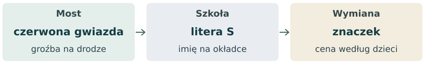

# BEL A/L — Polonais (commentaire et traduction) 2024 · Corrigé brut

*Corrigé rédigé par IA, non officiel. Signalez toute erreur.*

**Rédaction** · GPT-6.2 Astra Ultra · vitesse non renseignée · 26 novembre 2026

**Révision** · GPT-6.2 Astra Ultra · vitesse non renseignée · 26 novembre 2026

Ryszard Kapuściński, *Imperium* (1993). Écrit commun de six heures, ENS de Lyon et ENS (Paris). Commentaire en polonais de l’extrait entier. Version française des lignes 24 à 41.

[Sujet officiel, p. 16–17](https://www.ens-lyon.fr/sites/default/files/2024-11/Commentaire%20d%27un%20texte%20en%20LVE%20et%20traduction.pdf#page=16) · [Rapport du jury sur l’épreuve commune, p. 2–5](https://www.ens-lyon.fr/sites/default/files/2024-11/Polonais%202024%20OK.pdf#page=2)

## Commentaire

W tytule książki Kapuścińskiego wystarcza jedno wielkie słowo, *Imperium*. Tymczasem pierwsze spotkanie z nim ma dla siedmioletniego chłopca bardzo dokładny adres. Rozgrywa się przy moście na drodze do rodzinnego domu w Pińsku. Pamięć dorosłego reportera nadaje wydarzeniom datę i historyczny zasięg, ale ich sens rodzi się najpierw z tego, co potrafi dostrzec dziecko. Ten sam sposób patrzenia, który w scenie przy moście pozwala odczuć ogrom bezradności, w scenie ze znaczkami nieoczekiwanie pozbawia władców części ich powagi.

Koniec września 1939 roku zostaje zapisany w czasie teraźniejszym. Czytelnik mija z rodziną płonące wsie oraz zabite konie, których ciężar trzeba dosłownie usunąć z drogi. Krótkie zdania i pytania o pakunki uchodźców ukazują chaos w ruchu. Matka stanowi w tym tłumie wyjątek. Wie, dokąd prowadzi dzieci, bierze je za rękę, ulica ma nazwę, w oddali widać wieże. Właśnie dlatego pojawienie się marynarzy przy samym moście jest tak dotkliwe. Czerwone gwiazdy pozwalają czytelnikowi rozpoznać siły sowieckie, które wkroczyły do Polski we wrześniu 1939 roku. Dziecku pozostają groty bagnetów, spocone twarze i krzyk. Wyliczenie gestów dzieci kończy się wyciągniętymi ramionami. Droga, którą matka znała tak dobrze, zależy teraz od ludzi nieodpowiadających na jej prośby.

W szkole nowe panowanie sięga alfabetu. Protest ucznia, który chciałby zacząć od pierwszej litery, brzmi rozsądnie. Nauczyciel może jednak pokazać tylko jedną książkę w jednym egzemplarzu, a na okładce widnieje nazwisko Stalina. Pierwsza litera nazwiska dyktuje więc kolejność nauki liter. Chłopiec zapamiętuje szare płótno i pozłotę. Jednocześnie wsłuchuje się w głosy. Nauczyciel mówi z przygnębieniem, Władzio duka, dorośli przy nazwie NKWD niemal milkną. Przejście od „ja” do „my” obejmuje dzieci również w zdaniu o strachu przed zbyt głębokim oddechem. Dawne miejsce zabaw przypomina pole minowe. Przed chwilą widzieliśmy prawdziwą wojnę, teraz jej język pozwala poczuć niewidzialne zagrożenie.

Przedstawiciele NKWD przywożą białe koszule i czerwone chusty, potem rozdają portrety przywódców. Siedmiolatek ocenia siłę instytucji po nowości błękitnych mundurów. Większy znaczek Stalina znajduje równie materialne uzasadnienie. Autor tak grubej książki zasługuje przecież na większy portret. Zdania brzmią jak konsekwentne rozumowanie, a przecież czytelnik widzi, jak łatwo oficjalny kult daje się przełożyć na język rozmiarów. Nakaz noszenia wszystkich znaczków ma z dzieci uczynić małą, zgodną zbiorowość. Niedobór odznak sprawia, że natychmiast powstają prywatne skarby, kradzieże i własne kursy wymiany.

Ostatni targ z Chaimem pozwala usłyszeć ten odrębny język w działaniu. Za Woroszyłowa narrator daje aż trzy inne znaczki. Pociąga go mundur, bo przypomina mu wojnę, której zdążył już doświadczyć. Kalinin zyskuje dzięki podobieństwu do poleskiego dziadka i śladowi uśmiechu na twarzy. Dzieci powtarzają nazwiska, których miały się nauczyć, a jednak nadają im ceny na podstawie swoich pragnień, znajomych twarzy i zasłyszanych opinii. Nie oznacza to, że strach znika. Reportaż pozwala dostrzec obok niego komizm władzy, która dotarła aż do kieszeni uczniów, lecz nie potrafi ustalić, co znajdzie się w nich jutro.

## Version

À l’école, dès la première leçon, nous apprenons l’alphabet russe. Nous commençons par la lettre « s ». Comment ça, par le « s » ? demande quelqu’un au fond de la classe. On devrait commencer par le « a » ! Les enfants, dit le maître d’une voix accablée (il est polonais), regardez la couverture de notre livre. Quelle est la première lettre sur cette couverture ? « S » ! Petrus, qui est biélorusse, sait lire toute l’inscription. Staline, *Les Questions du léninisme*. C’est le seul livre qui nous serve à apprendre le russe et nous n’en avons qu’un exemplaire. Sur la couverture rigide, habillée de toile de lin grise, de grandes lettres dorées.

EN NOUS QUITTANT, LE CAMARADE LÉNINE NOUS A ORDONNÉ, ânonne au premier rang Władzio, si docile et si discret. Mieux vaut ne pas demander qui était Lénine. Nos mères ont toutes déjà eu le temps de nous dire de ne poser aucune question. D’ailleurs, elles auraient même pu se dispenser de nous avertir. Je ne saurais le définir, je ne saurais dire d’où ça venait, mais il y avait dans l’air quelque chose de si angoissant, de si tendu et de si lourd que la ville où nous gambadions autrefois, aussi joyeux que déchaînés, était devenue d’un coup un champ de mines insidieux et dangereux. Nous avions même peur de respirer un peu plus à fond, de crainte de provoquer une explosion.

Tous les enfants feront partie des Pionniers ! Un jour, une voiture pénètre dans la cour de l’école. Des messieurs en descendent, vêtus d’uniformes bleu clair. Quelqu’un dit que c’est le NKVD. Ce que c’est que le NKVD, on ne le sait pas trop, mais il y a une chose de sûre, c’est que, quand les grandes personnes prononcent ce nom, elles baissent la voix jusqu’à chuchoter.
