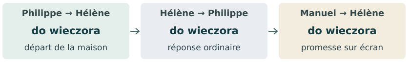

# BEL A/L — Polonais (thème, Lyon) 2024 · Corrigé guidé

*Corrigé rédigé par IA, non officiel. Signalez toute erreur.*

**Rédaction** · GPT-6.2 Astra Ultra · vitesse non renseignée · 26 novembre 2026

**Révision** · GPT-6.2 Astra Ultra · vitesse non renseignée · 26 novembre 2026

Nicolas Mathieu, *Connemara* (2022). Thème de quatre heures, sans dictionnaire.

[Sujet officiel de spécialité, p. 16](https://www.ens-lyon.fr/sites/default/files/2024-11/Epreuves%20de%20sp%C3%A9cialit%C3%A9.pdf#page=16) · [Rapport du jury sur le thème, p. 6–7](https://www.ens-lyon.fr/sites/default/files/2024-11/Polonais%202024%20OK.pdf#page=6)

## Passer de la voix de Philippe à l’agenda d’Hélène

> [!INDICATION]
> Recopier trois fois *do wieczora*, puis noter qui prononce ou écrit chaque occurrence. Le même rendez-vous verbal prend trois valeurs à quelques lignes de distance.

Le départ a coûté à Philippe un poste, des partenaires de jeu et des perspectives. L’accumulation se prolonge avec la question qui met en doute le rétablissement de sa femme. *Czy w ogóle stanęła już na nogi?* emprunte son doute. La phrase sur l’impression d’Hélène nous fait ensuite réentendre sa liste à travers elle. Le rapport du jury suit le déplacement de la perspective du mari vers sa femme. Après le premier *do wieczora*, elle répond à Philippe sur le même ton. Dans le message de Manuel, les deux mots identiques prennent le relief d’une promesse.

### Rendre la province et la langue de la maison

Dans *wrócili na prowincję*, l’accusatif désigne la destination d’un retour. Le jury rappelle que la province française peut comprendre une ville. *Kumple od badmintona* donne une activité partagée à ces copains et prépare le registre de *jej facet*. Aux enfants, Hélène parle par gestes à exécuter. Les infinitifs *myć* et *ubierać się* ont la valeur d’ordres secs. Le changement vers la première personne du pluriel rassemble la mère et les filles qui vont partir. Les cheveux, la démarche, l’escalier et le téléphone forment un seul mouvement dans le regard qui la suit.

### Faire tenir les chiffres dans la phrase

*Szykowała się restrukturyzacja* annonce la réorganisation. La suite *połączona ze zwolnieniami* explicite son incidence sur l’emploi. Le jury propose notamment *plan restrukturyzacji*. Les services dits transverses interviennent auprès de plusieurs unités. *Działy obsługujące całą firmę* rend ce rôle concret. Pour cinq personnes, *uniknąć pięciu zwolnień* place le nombre et le nom au génitif. On pourrait écrire *zapobiec pięciu zwolnieniom* avec le datif. Les cinq cent mille euros sont une économie annuelle possible. *Mogłaby* conserve cette modalité et *euro* garde la même forme après le nombre. Le jury signale également la consonne de *ukłucie*, qui nomme la sensation brève du message amoureux.

### Garder le mordant du dernier rendez-vous

Le discours du chef répète le même verbe familier, *zawalić*. L’absence de guillemets laisse son tic de langage entrer dans le monologue professionnel. Puis l’agenda se réduit aux verbes que l’on se souffle pour se souvenir d’une tâche, *poprosić*, *pamiętać*. La fille du téléphone devient *ta laska*, tandis que *dział zakupów* et *flota pojazdów* appartiennent au vocabulaire d’entreprise. Enfin, la plaisanterie sur les noms imprimés dépend de la hiérarchie. *Płotki*, littéralement de petits poissons, désigne les subalternes, et *wyróżniać się wśród kolegów* les efforts pour sortir du rang parmi ses pairs.

## Proposition de thème

Odkąd wrócili na prowincję, Philippe najwyraźniej uważał, że nikt już nie ma prawa niczego od niego wymagać. Rzucił przecież dla niej świetną posadę w firmie Axa, zostawił kumpli od badmintona i w ogóle zrezygnował z perspektyw, do których nic w tej okolicy nawet się nie umywało. A wszystko dlatego, że jego żona nie wytrzymała. Zresztą czy w ogóle stanęła już na nogi? Ten wymuszony wyjazd wciąż ciążył na nich jak niespłacony dług. Takie w każdym razie miała wrażenie Hélène.

– No to do wieczora – rzucił jej facet.

– Do wieczora.

Potem Hélène zwróciła się do dziewczynek.

– No już, myć zęby, ubierać się i wychodzimy. Muszę jeszcze założyć soczewki. Dwa razy nie będę powtarzać.

– Mamo… – spróbowała Mouche.

Ale Hélène już nie było w pokoju. Spieszyła się, z upiętymi włosami i wypiętą pupą szła po schodach na pierwsze piętro, sprawdzając wiadomości na WhatsAppie. Manuel znów do niej napisał, do wieczora, tak napisał, i znowu poczuła to rozkoszne ukłucie, ten strach ściskający ją w piersi, w którym wracało coś z czasów, kiedy miała piętnaście lat.

Pół godziny później dziewczynki były już w szkole, a Hélène miała niedaleko do biura. Odruchowo przebiegła w myślach dzisiejsze spotkania. O dziesiątej zebranie z ludźmi z Vinci. O czternastej miała oddzwonić do tej laski z Porette, cementowni w Dieuze. Szykowała się restrukturyzacja połączona ze zwolnieniami, a ona miała pomysł, jak przeorganizować działy obsługujące całą firmę i w ten sposób uniknąć pięciu zwolnień. Wyliczyła, że mogłaby im zaoszczędzić blisko pięćset tysięcy euro rocznie, zmieniając strukturę organizacyjną i usprawniając pracę działu zakupów oraz gospodarowanie flotą pojazdów. Erwann, jej szef, mówił jej, tego nie możemy zawalić, to mega ważne, to ma być przykład dla innych, no po prostu nie możemy tego zawalić. No i o szesnastej ta jej słynna prezentacja w ratuszu. Trzeba by jeszcze raz przejrzeć slajdy przed wyjściem. Poprosić Lison, żeby wydrukowała materiały dla każdego uczestnika, dwustronnie, żeby jakiś czepialski ekolog nie dał jej popalić. Pamiętać o osobnej stronie tytułowej z nazwiskiem dla każdego. Znała urzędników, kierowników wydziałów, te wszystkie kliki ważniaków i ludzi wiecznie czymś zaniepokojonych, którzy stanowili kadrę kierowniczą miejskiej administracji. Faceci nie posiadali się z radości, gdy tylko ktoś umieścił ich nazwisko na teczce albo na pierwszej stronie urzędowego dokumentu. Na pewnym etapie tych ich karier, które jakoś utknęły w miejscu, liczyło się już tylko to, żeby odcinać się od płotek i wyróżniać się wśród kolegów.
