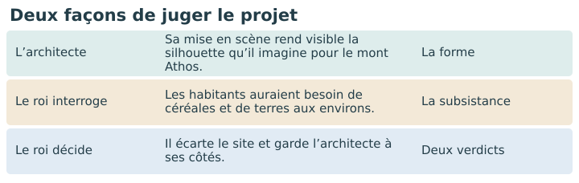

# BEL A/L — Version latine (Lyon) 2024 · Corrigé brut

*Corrigé rédigé par IA, non officiel. Signalez toute erreur.*

**Rédaction** · GPT-6.2 Astra Ultra · vitesse non renseignée

**Révision (tour 1)** · GPT-6.2 Astra Ultra · vitesse non renseignée

[Sujet officiel](https://www.ens-lyon.fr/sites/default/files/2024-11/Epreuves%20de%20sp%C3%A9cialit%C3%A9.pdf#page=3) · [Rapport du jury](https://www.ens-lyon.fr/sites/default/files/2024-11/Latin%202024.pdf#page=2) · [Archives de la session](https://www.ens-lyon.fr/formation/admission/archives-du-concours-lettres-et-sciences-humaines/concours-dentree-session-2024)

Vitruve, De architectura, livre II, préface, 1–3. Écrit de spécialité de quatre heures. Sujet, page 3. Les deux paragraphes du feuillet « Un architecte plein d’audace », de Cum polliciti essent à tua opera sum usurus.

## Version française

Ils lui avaient bien donné leur parole, mais ils tardaient trop, dans l’attente d’un moment propice. Aussi Dinocrate, persuadé qu’ils se jouaient de lui, chercha-t-il en lui-même son recours. Il était en effet de très haute taille, avait le visage agréable et joignait à une grande beauté beaucoup de prestance. Confiant dans ces dons de la nature, il déposa ses vêtements dans son logement, s’enduisit le corps d’huile, se couronna la tête de feuillage de peuplier, couvrit son épaule gauche d’une peau de lion et, une massue dans la main droite, s’avança devant la tribune où le roi rendait la justice. L’étrangeté du spectacle avait détourné l’attention de l’assistance. Alexandre aperçut l’homme. Étonné, il ordonna qu’on lui fît place pour qu’il pût approcher et lui demanda qui il était. « Dinocrate, dit-il, architecte macédonien. Je viens t’apporter des idées et des plans dignes de ta gloire. J’ai en effet donné au mont Athos, dans mon projet, la forme d’une statue d’homme. Dans sa main gauche, j’ai dessiné les remparts d’une très vaste ville, dans la droite une coupe qui recueillerait l’eau de toutes les rivières de la montagne pour que, de là, elle se déverse dans la mer. »

Ravi de la conception du projet, Alexandre demanda aussitôt s’il y avait alentour des terres capables d’assurer l’approvisionnement en blé de cette ville. Quand il eut appris qu’il faudrait nécessairement faire venir les vivres par mer, il reprit la parole. « Dinocrate, je vois combien ton projet est bien agencé et j’y prends plaisir. Mais je me rends compte que, si quelqu’un établissait une colonie en ce lieu, on lui reprocherait son manque de jugement. Un nouveau-né, en effet, ne peut être nourri sans le lait de sa nourrice ni franchir les étapes de sa croissance. De même, une cité ne peut grandir sans des terres et sans leurs produits qui affluent dans ses murs. Sans nourriture en abondance, elle ne peut avoir une population nombreuse, ni la faire vivre sans ressources. Autant je pense que le projet mérite d’être approuvé, autant je juge que l’emplacement doit être écarté. Quant à toi, je veux que tu restes avec moi, car je compte bien faire appel à tes services. »

## Notes de langue et de lecture

**§ 1 · polliciti essent, tardiores**

Polliceor est déponent. La promesse est antérieure au retard. Le comparatif sans second terme signifie ici « trop lents ». Dans ab his se existimans ludi, his désigne les courtisans, se l’architecte, et l’infinitif passif ludi donne le sens de « se jouer de quelqu’un ».

**§ 1 · statura, facie, forma dignitateque**

Ces ablatifs de qualité dessinent d’un trait la taille, le visage, la beauté et la prestance. Confisus s’emploie avec l’ablatif de ce qui inspire confiance. La peau de lion et la massue évoquent Héraclès. La branche de peuplier est portée sur la tête et la peau sur l’épaule gauche.

**§ 1 · ius dicentis, locum dari**

Le participe au génitif singulier s’accorde avec regis. Après iussit, locum est sujet accusatif de l’infinitif passif dari et ei désigne le bénéficiaire. Ut accederet précise le but. L’interrogative indirecte quis esset garde Alexandre pour sujet de la question, Dinocrate pour sujet du verbe au subjonctif.

**§ 1 · cuius manu laeua, quae exciperet**

Le génitif relatif cuius renvoie à la statue. Il faut rétablir manu avec dextra. Le premier quae a pour antécédent pateram et introduit l’usage prévu pour la coupe. Le second quae, neutre pluriel, renvoie à fluminum. Aquam est l’objet d’exciperet. Dans la finale, le sujet sous-entendu de profunderetur est cette même eau.

**§ 2 · qui possent, transmarinis subuectionibus**

La recherche de terres propres à approvisionner la cité se lit dans la relative au subjonctif. Tueri est un déponent de sens actif. La formule non posse est elliptique. Le seul moyen d’approvisionner la ville serait de passer par la mer.

**§ 2 · si qui… fore ut, ut… sic**

Qui a ici valeur indéfinie après si. Fore ut avec le subjonctif passif projette dans l’avenir le blâme qui atteindrait celui qui fonderait la colonie. Ut… sic introduit ensuite la comparaison du nourrisson. Ali est l’infinitif passif de alo et les produits agricoles, fructibus, sont ce qui afflue dans l’enceinte.

**§ 2 · probandam, inprobandum, usurus**

Le féminin probandam reprend formationem, le masculin inprobandum reprend locum. Ces adjectifs verbaux motivent deux décisions distinctes. À la fin, sum usurus exprime l’intention du roi. Utor se construit avec l’ablatif, ici tua opera, « tes services ».
