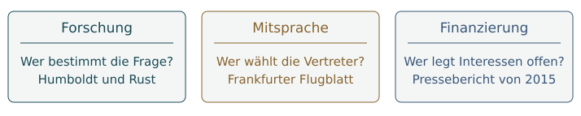

# BEL B/L — Allemand 2024 · Corrigé brut

*Corrigé rédigé par IA, non officiel. Signalez toute erreur.*

**Rédaction** · GPT-6.2 Astra Ultra · vitesse non renseignée · 26 novembre 2026

## Wem gehört die Freiheit der Universität?

Die Aufgabe verlangt einen zusammenhängenden Kommentar zu fünf Dokumenten. Das Gründungskonzept von 1809/10, eine Ministerrede von 1940 und ein Frankfurter Flugblatt von 1967 sind selbst Eingriffe in hochschulpolitische Auseinandersetzungen. Der Pressebericht und die Statistik erlauben dagegen, Interessen und Größenordnungen auseinanderzuhalten.

## Analyse und Kommentar

### Die Schwierigkeit einer freien Wissenschaft

Im Jahr 2015 löst schon der Name eines Hörsaals Unbehagen aus. Kann in einem Hörsaal, der nach einem Unternehmen benannt ist, noch frei geforscht und gelehrt werden? Den unmittelbaren Anlass liefert eine Finanzierungspraxis, den Maßstab entnimmt die Kritikerin Edda Müller ausdrücklich einem zweihundert Jahre alten Bildungsideal. Dessen Bedeutung ist allerdings selbst strittig. Humboldts Berliner Denkschrift, Rusts Wiener Rede, ein Frankfurter Flugblatt, der Bericht der *Zeit* und eine Grafik zur Entwicklung der Studierendenzahlen legen daher eine weitergehende Frage nahe. Wer kann beanspruchen, die Freiheit der Universität zu vertreten, wenn sich ihre staatlichen Rahmenbedingungen, ihre Mitglieder und ihre Geldgeber ändern?

### Humboldt und Rust · Zwei Ansprüche auf das Ganze

Für Humboldt ist die Universität an ihrer geistigen Tätigkeit zu erkennen. In der Schule kann ein Schüler bereits gesicherte Kenntnisse erwerben. An der Hochschule steht auch der Lehrende vor einer offenen Frage. Deshalb existieren beide für die Wissenschaft. In der berühmten Formel von „Einsamkeit und Freiheit“ steckt kein Lob bloßer Absonderung. Wer auf eigene Rechnung etwas entdeckt, kann einen anderen zu eigenen Fragen anregen. Gewollt ist ein Zusammenwirken, dessen Ergebnis vorher niemand festlegt. Der Staat gerät damit in eine eigentümliche Lage. Er soll einen institutionellen Rahmen schaffen und die Universität von der Schule unterscheiden, muss sich aber bei der Festlegung wissenschaftlicher Ziele zurückhalten. Gerade davon verspricht sich Humboldt eine politische Wirkung. Wer selbst urteilen lernt, bildet seinen Charakter und kann entsprechend handeln.

Auch der nationalsozialistische Minister Rust spricht 1940 in Wien vom „lebendigen“ Geist. Er übernimmt ein Wort, das bei Humboldt die Offenheit der Forschung bezeichnete, und erklärt die Spannung zwischen Idee und Wirklichkeit für bereits aufgehoben. Den Beweis sucht er in der veränderten Zusammensetzung der Lehrkörper, dem Einzug der Parteiorganisationen und der Tätigkeit von Hochschullehrern in der Partei. Seine Rede vor einem Publikum im annektierten Österreich gibt die Gleichschaltung als Erwachen der Nation aus. Der Minister beruft sich auf die Öffnung der Hochschultore für „Volksgenossen“. Der rassistische Begriff grenzt aber gerade jene aus, die das Regime aus der Universität vertrieben hat. Am Ende dient eine angeblich europäische Aufgabe des Reiches sogar zur Rechtfertigung seiner Herrschaftsansprüche im Krieg. Während Humboldts Staat auf einen Ertrag hofft, den er nicht anordnen kann, schreibt Rust verbindlich vor, was als Wissenschaft und als ihr Ertrag zu gelten hat.

### Wer gehört zur akademischen Öffentlichkeit?

Die Frankfurter Studierenden von 1967 richten ihre Kritik gegen die westdeutsche Ordinarienuniversität. Mehr als tausend Teilnehmer eines sechsstündigen Teach-ins und Sit-ins fordern öffentliche Beratungen, paritätisch besetzte Gremien und tatsächliche Mitsprache auch in Instituten und Seminaren. Das Flugblatt macht den Unterschied zwischen einer Quote und wirksamer Vertretung an einem präzisen Fall fest. Das Konzil bietet den Studierenden zwanzig Prozent der Sitze an, doch nach der Darstellung der Verfasser wollen die Professoren die studentischen Vertreter selbst auswählen. Wer die Vertreter aussucht, kann auch mit zwanzig Prozent Beteiligung verhindern, dass die Vertretenen zu Wort kommen. Die Versalien, die Wiedergabe der Erklärung der Versammelten und der Aufruf zur Vollversammlung sollen aus Lesern Beteiligte machen. Die „Diktatur der Ordinarien“ ist dabei eine polemische Bezeichnung für die Macht der Lehrstuhlinhaber. Sie benennt eine andere historische Ordnung als die nationalsozialistische Diktatur. Aus Humboldts Gemeinschaft von Lehrenden und Lernenden ergibt sich noch keine Satzung, die beiden Gruppen gleiche Rechte garantiert.

Die statistische Grafik gibt dem Streit um eine akademische Öffentlichkeit eine weitere Dimension. In den ersten Nachkriegsjahrzehnten ist das Hochschulstudium einem vergleichsweise kleinen, überwiegend männlichen Kreis zugänglich. Die Zahl steigt zunächst allmählich, in den siebziger Jahren merklich schneller. Im Wintersemester 1993/94 sind rund 1,87 Millionen Menschen eingeschrieben, 2003/04 etwa 2,02 Millionen, 2013/14 etwa 2,62 Millionen. Hinter diesen Stützpunkten liegen auch Rückgänge und eine erneute starke Zunahme ab Ende der 2000er Jahre. Frauen machen zuletzt annähernd die Hälfte aus. Die obere Fläche bezeichnet die Zahl der Frauen, die obere Begrenzung aber die Gesamtzahl. Zudem bezieht die Reihe ab 1990 die ostdeutschen Länder und Berlin-Ost ein. Der Sprung darf daher nicht allein auf geänderte Bildungsentscheidungen zurückgeführt werden. Die Statistik zeigt, wer studiert, während die Frage, wer verbindlich über die Universität entscheidet, offenbleibt.

### Geld, Öffentlichkeit und wissenschaftliche Entscheidungen

Die Öffnung der Hochschulen wirft die Frage auf, wovon ihre Unabhängigkeit materiell getragen wird. Im Agenturbericht stehen sich dazu keine geschlossenen Lager gegenüber. Die Beispiele eines Aldi-Süd- und eines easyCredit-Hörsaals führen vor, wie sichtbar ein Geldgeber werden kann. Schwerer zu beobachten ist, ob ein bestimmtes Thema überhaupt zur Forschungsfrage wird, weil es sich finanzieren lässt. Das Portal *hochschulwatch.de* hat in zwei Jahren über 10 000 Kooperationen erfasst. Die daneben genannten 1,3 Milliarden Euro bezeichnen den jährlichen Mittelzufluss aus der Wirtschaft. Aus der Zahl der Kooperationen lässt sich der Umfang einer Einflussnahme auf einzelne Ergebnisse nicht berechnen. Auch eine Stiftungsprofessur im weithin positiv bewerteten Bereich der Windenergie kann deshalb eine Frage nach Abhängigkeiten aufwerfen.

Die Studentenvertreterin befürchtet eine Verengung des Studiums auf die Produktion von Arbeitskräften. Der Gewerkschafter Keller nennt dagegen eine Bedingung, unter der die Zusammenarbeit vertretbar ist. Ihr Ertrag darf nicht einseitig den privaten Partnern zufallen. Präsident Hippler befürwortet seinerseits Transparenz, warnt aber vor der allgemeinen Veröffentlichung von Verträgen, die Entwicklungsideen im Wettbewerb entwerten könnte. Wer darf Themen und Methoden bestimmen, wer Ergebnisse veröffentlichen und wer muss seine Geldquellen offenlegen? Mit solchen überprüfbaren Fragen erhält die Berufung auf Humboldt einen institutionellen Sinn. Sie ist besonders dringlich, wenn die Weiterbeschäftigung eines Forschers vom nächsten Drittmittelantrag abhängt.

### Was von Humboldt bleibt

Humboldts Gedanke behält seine Schärfe dort, wo er eine Grenze für jeden Geldgeber und jede politische Instanz zieht. Eine wissenschaftliche Frage muss anders beantwortet werden dürfen, als es der Auftraggeber erwartet. Die übrigen Dokumente erweitern dieses Kriterium. Eine autonome Professorenschaft kann ihre Studierenden von Entscheidungen ausschließen. Umgekehrt garantiert eine hohe Studierendenzahl weder Mitbestimmung noch verlässliche Forschungsbedingungen. Freiheit an der Universität verlangt daher zugleich Distanz zu äußeren Vorgaben und öffentlich begründbare Regeln im Innern. Wer im Namen dieser Freiheit spricht, muss auch darüber Auskunft geben, wem er Mitsprache zugesteht.

## Lesehilfen

### Die Schwierigkeit einer freien Wissenschaft

Wilhelm von Humboldt schreibt 1809/10 über die Organisation der höheren wissenschaftlichen Anstalten in Berlin. Der Agenturbericht vom 18. Februar 2015 in *Zeit online* referiert dagegen mehrere Stimmen. Die Berufung auf Humboldt in den Zeilen 13–16 ist zunächst Edda Müller und ihrer Kritik an wirtschaftlichen Verwertungsinteressen zuzuschreiben.

### Humboldt und Rust · Zwei Ansprüche auf das Ganze

Dokument 1 verbindet Forschung, Lehre und Bildung, besonders in den Zeilen 10–14 und 26–37. Dokument 2 ist eine Ministerrede vom 6. November 1940. Die Aufzählung in den Zeilen 9–19 macht Parteizugehörigkeit und organisatorische Einbindung zu Erfolgszeichen. Der Redner behauptet auch, der Krieg sei Deutschland aufgezwungen worden. Dies gehört zur Rechtfertigungsstrategie des Regimes.

### Wer gehört zur akademischen Öffentlichkeit?

Dokument 3 umfasst die PDF-Seiten 3 und 4. Das Flugblatt berichtet auch vom Streit um das vorläufige Verbot des SDS und um Disziplinarmaßnahmen. Seine Ankündigung einer Diskussion möglicher Streiks ist noch kein Bericht über einen erfolgten Streik. Dokument 5 stammt aus der Hochschulstatistik. Die Einheit ist Tausend. Deutsche und ausländische Studierende sind einbezogen, das letzte Wintersemester ist vorläufig.

### Geld, Öffentlichkeit und wissenschaftliche Entscheidungen

Die Berliner dpa-Meldung trennt staatliche Grundfinanzierung, öffentliche Zuwendungen etwa der DFG und private Mittel. Sie führt Müller, Albert, Keller und Hippler mit unterschiedlichen Positionen an. Der Fall der Windenergie in Flensburg dient Müller gerade dazu, ihre Transparenzforderung unabhängig vom Ruf der jeweiligen Branche zu begründen.

### Was von Humboldt bleibt

Die zeitliche Abfolge belegt keine zwangsläufige Entwicklung von Humboldt zur Massenuniversität. Der Vergleich stützt sich auf drei verschiedene Gegenstände, die sich aus den Quellen bestimmen lassen. Es geht um Forschungsfreiheit, die Verteilung der Entscheidungsrechte und die Zusammensetzung der Studierendenschaft.

Die Bezugnahme auf den NS-Staat wird als historisch situierte Propaganda analysiert. Für die statistische Reihe gilt der Gebietsstand der jeweiligen Erhebung. Für Behauptungen über Kausalität oder den Zugang einzelner sozialer Schichten wären zusätzliche Daten nötig.

## Quellen

[Aufgabenblatt](https://www.ens.psl.eu/sites/default/files/2024_blses_sujet_analyse_commentaire_allemand.pdf) · [Jurybericht](https://www.ens.psl.eu/sites/default/files/2024_bl_rapport_ecrit_allemand.pdf)
