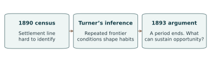

# B/L · Anglais · 10 juin 2024 · Corrigé brut

*Corrigé rédigé par IA, non officiel. Signalez toute erreur.*

**Rédaction** · GPT-6.2 Astra Ultra · vitesse non renseignée

## Using the booklet

Each extract below is a separate possible examination text. The common oral gives you 90 minutes to prepare one document, followed by a 20-minute presentation in English and 10 minutes of questions. The jury expects a thematic commentary grounded in passages from the document. You can introduce a short phrase while discussing it without beginning by reading an extract aloud.

## 1. Ronald Reagan

*Second Inaugural Address* · 21 January 1985 · page 1 of the official booklet.

### Opening

How can an incumbent promise another beginning? Ronald Reagan answers that question at his second inauguration, on 21 January 1985. His first term now has to serve two purposes. It must prove that his programme has worked, yet leave enough work undone to justify extending it. The address turns an economic record into a story about the authority of the people. Its historical analogy, its use of evidence and its definition of citizenship each help the president make that claim.

### A revolution an incumbent can inherit

Reagan opens by recalling the oath he took four years earlier. The repeated occasion lets him invite his audience to compare two Americas, before and after his first election. He then changes the scale of the comparison. In lines 4–7 the beginning of his first administration becomes a continuation of the founding more than two centuries earlier. This striking combination of novelty and continuity gives a partisan programme the authority of an older constitutional principle. The description of government as a servant makes delegated authority sound like an everyday relationship that every citizen understands.

Notice who is allowed to have failed. The political system remains sound while the collective first person assumes responsibility for asking too much of it. A federal president can therefore argue for shifting authority to states, neighbourhoods and individuals without accusing the nation itself of decline. His inaugural audience is asked to share both the original mistake and the credit for correcting it.

### Turning a recovery into a verdict

The economic passage moves from taxes and inflation to employment and a count of consecutive months of growth. A sequence that listeners can picture gives the speech the appearance of a test that has already been passed. The implied causal chain runs from lower rates and stronger incentives to confidence, investment and employment. The evidence actually presented is narrower. An absolute employment record tells the audience nothing on its own about the proportion in work or the distribution of new earnings. A period of growth after a recession cannot by itself identify the cause of that recovery.

That distinction helps explain the confident tone of the transition in lines 15–18. The president first announces what Americans believed and then declares the belief vindicated. Statistical claims are doing ceremonial work. Their function is to make a disputed policy choice sound like a lesson the whole nation has learned through experience. The speaker's promise to make taxation fairer leaves the meaning of fairness open enough to unite listeners with different interests.

### Who will deliver the public good?

The closing movement reaches far beyond the balance sheet. Family, neighbourhood, faith and work join entrepreneurial initiative as sites of national renewal. The sequence that imagines a later historian looking back on these years even supplies the verdict that history ought to deliver. Its future vantage point allows an unfinished presidency to speak in the voice of posterity.

In the final sentences the worker, saver or investor can become someone who heals the sick or feeds the hungry. This is how a case for individual incentives takes possession of a broadly shared language of solidarity. The contrast with foreign totalitarianism, expressed through darkness and sunlight, also gives domestic economic freedom an international moral setting. Yet some federal responsibilities, especially defence, remain highly visible. The important distinction in his argument is between the public functions he considers legitimate and the economic functions he wishes other institutions to perform.

### Conclusion

Reagan resolves the incumbent's dilemma by making the recovery evidence of a principle older than his presidency. The second term can then appear both necessary and faithful. A critical listener can recognise how effectively this construction speaks across party lines while still asking which citizens shared in the recovery, and which public decisions made their opportunities possible.

### Questions from the jury

**Why is the use of “we” more than an expression of unity?**

It distributes blame for excessive expectations and credit for recovery across the same community. Listeners can change course without being placed outside that community. The wording also makes it harder to identify whose preferences the policies actually advance.

**Does the speech advocate the complete withdrawal of government?**

Its priorities are selective. Defence, international leadership and tax legislation require national authority. The dividing line is the speaker’s judgment about the proper tasks of government, and the address seeks consent for that judgment.

## 2. Winston Churchill

*Address at Westminster College, Fulton, Missouri* · 5 March 1946 · page 2 of the official booklet.

The booklet identifies the speech by speaker, place and date. The heading above describes that occasion.

### Opening

The image that closes this extract has overshadowed the question that opens it. At Westminster College in Fulton, Missouri, on 5 March 1946, Winston Churchill asks how the wartime partnership of Britain and the United States could acquire a peacetime purpose. The former prime minister speaks before an American audience after the Allied victory and the foundation of the United Nations. His argument must persuade listeners who might welcome international cooperation yet mistrust an exclusive association. How does he present a privileged partnership as a condition of universal security?

### Giving a political preference the appearance of kinship

The first paragraph begins with two goods that are difficult to oppose, the prevention of war and the growth of international organisation. Churchill makes both depend on an association of English-speaking peoples. The familial language makes a political choice seem an extension of an existing intimacy. The stress on common language and allegedly kindred societies also reaches across the Atlantic from a British speaker to his hosts. Britain gains a way to remain influential in a world in which American resources matter increasingly.

The passage then changes register. General goodwill becomes continued exchanges and institutional cooperation, and Churchill promises material savings. The language of fraternity has helped him introduce proposed commitments that an American audience might otherwise examine as burdens. His repeated references to the Commonwealth and Empire indicate how much territory and how many peoples are folded into an apparently simple family of English speakers. Those peoples do not speak for themselves in this address.

### Anticipating the strongest objection

In lines 15–30 Churchill poses the question an internationalist might put to him. Would an intimate association compromise loyalty to the United Nations? The question gives the objection a public hearing while allowing him to frame and answer it. He cites a number of existing relationships, including Britain's treaty with the Soviet Union and its much older Portuguese alliance. These examples differ historically, but he groups them by function. Particular loyalties, he suggests, have repeatedly coexisted with wider obligations.

A biblical allusion to the many dwellings of a single house gives that constitutional argument a familiar image. Unity need not demand uniform relationships. There is also a limiting condition: such associations must have purposes compatible with the UN Charter. That condition matters because it leaves open precisely the question a sceptic would ask. Who decides whether a strong association is serving a common interest or simply identifying its own interests with those of everyone?

### Moving from conciliation to a divided continent

The concluding paragraphs moderate the accusation before sharpening it. Churchill acknowledges the Soviet experience of invasion and a legitimate desire for security against Germany. He then moves from uncertainty about Soviet intentions to a claim about observable conditions in Europe. The speaker presents this transition as a duty to report facts. The shifts in certainty are persuasive. He can admit that he cannot know another government's mind while describing the European divide as unmistakably real.

The final image makes a long and complicated political border visible in a single descent. Its effectiveness depends on what the earlier passages have prepared. An audience that accepts his description of a divided Europe is more likely to find an enduring Atlantic partnership necessary. In March 1946 this was a proposal in an unsettled postwar order. Reading the later Cold War backwards into the text would erase the uncertainty Churchill himself exploits.

### Conclusion

The famous image gives urgency to a case already built from kinship, precedent and appeals to universal law. Churchill invites the United States to view cooperation with Britain as a public service to a wider international order. The unresolved issue is who gets to define that wider interest, especially in a world still marked by empire.

### Questions from the jury

**Why acknowledge Soviet security concerns?**

It recalls the recent alliance and gives an audience reluctant to resume confrontation an entry point. The concession also helps Churchill present his later assessment as discriminating judgment.

**Was Churchill announcing British government policy?**

He was a former prime minister and a political leader with wartime authority. A speech delivered in the United States could shape debate and test public consent, but the occasion did not give it the force of a treaty or a government decision.

## 3. Frederick Jackson Turner

*The Significance of the Frontier in American History* · 1893 · pages 3–4 of the official booklet.

The jury’s heading shortens the author’s name to “Frederick Turner” and breaks the title across two lines. The title above uses its standard form.

### Opening

A census official describes a difficulty in drawing a line on a map. A historian makes that difficulty the end of an age. Writing in 1893, Frederick Jackson Turner cites the census superintendent's account of settlement in 1890 and uses it to ask where American institutions and character came from. The passage is an argument about how to write national history. Its power lies in a change of scale, in a vivid account of cultural transformation and in a troubling equation between opportunity and land supposedly available for taking.

### Making an administrative observation do historical work

The census quotation describes a pattern of settlement that has become too discontinuous to yield a clear frontier line. Loss of a convenient boundary does not in itself establish the end of a society or the source of its institutions. Turner makes that additional inference in the sentence immediately following the quotation. The official's cautious wording confers authority on the historian's far more ambitious judgment.

A similar shift appears when the narrative moves from a moving line to recurrent beginnings. Expansion does not simply take people farther west. Turner claims that a similar experience of settlement recurs at successive locations, forcing people to adapt inherited institutions. Recurrence gives his explanation its national reach. If the process repeats, places far apart in space and time can be made instances of a single formative experience. Directing the reader away from the Atlantic coast challenges accounts that look chiefly to European origins and the eastern seaboard.

### A landscape becomes an instructor

Around lines 19–26 Turner personifies the environment. The settler exchanges forms of transport, clothing and habits, and the landscape temporarily becomes the subject of the verbs. Turner then reverses their direction as the settler transforms the environment. This staged reversal makes national identity appear to emerge through action. It also gives a public address about institutions an individual protagonist whom listeners can imagine.

Look closely at the canoe and moccasin. Their inclusion supplies evidence of acquired knowledge, although the people from whom that knowledge came scarcely figure as historical agents. Turner’s vocabulary places societies at different supposed stages of development. It lets him interpret cultural borrowing as one phase in the making of a settler nation. An oral commentary can use the objects actually named in the passage to demonstrate what its account brings into view and whose role it obscures.

### An abundance whose disappearance creates a problem

Near the end, the narrative grows older and larger. Columbus and the Constitution become points of reference from which an entire period of American history can be measured. Opportunity comes to seem a longstanding national attribute. The phrase “free land” is essential to that argument. It describes land as accessible from the settler’s standpoint while leaving Indigenous possession, state action and dispossession outside the explanatory frame.

The final movement troubles a wholly triumphant reading. Turner expects habits of restless initiative to survive, but the material conditions he invokes to explain them cannot recur indefinitely. He has made the frontier the source of American distinctiveness at the very moment he declares it closed. The continuation at the top of the fourth printed page completes that sentence. It closes a historical period and implicitly opens a question about the conditions for the next one.

### Conclusion

Turner’s frontier matters here both as an object of study and as a device for organising evidence. It joins local adaptations into a national story and gives that story a clear turning point. Its very economy is also its limitation: a frontier full of prior histories becomes a place from which the settler nation can imagine itself beginning anew.

### Questions from the jury

**Is 1890 the date of the historian's text?**

It dates the census observation Turner quotes. The historical argument is dated 1893. The distinction lets us see that a statistical classification has been converted into an interpretation by a particular author.

**Can the passage be historically revealing if its description of “free land” is disputed?**

Yes. It illustrates how an influential late nineteenth-century interpreter constructed national identity. Its choice of a settler perspective is evidence about that construction, even where its explanation excludes other inhabitants and other causes.

## Sources

[Official booklet for 10 June 2024](https://www.ens.psl.eu/sites/default/files/bl_sujets_oraux_anglais_10062024.pdf) · [Jury report, common English oral](https://www.ens.psl.eu/sites/default/files/2024_bl_rapport_oral_anglais_epreuve_commune.pdf)
