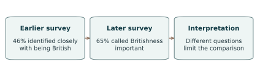

# B/L · Anglais · 12 juin 2024 · Corrigé guidé

*Corrigé rédigé par IA, non officiel. Signalez toute erreur.*

**Rédaction** · GPT-6.2 Astra Ultra · vitesse non renseignée

## Using the booklet

Each extract below is a separate possible examination text. The common oral gives you 90 minutes to prepare one document, followed by a 20-minute presentation in English and 10 minutes of questions. The jury expects a thematic commentary grounded in passages from the document. You can introduce a short phrase while discussing it without beginning by reading an extract aloud.

In preparation, mark the speaker, addressee, date and occasion. Choose three short passages from different parts of the document. For each, identify a linguistic choice, its immediate effect and one historical detail that changes how you read it. Reserve time to rehearse the transition between the three claims and the answer to the opening question.

## 1. Sarah Palin

*Speech at the Republican National Convention* · 3 September 2008 · page 1 of the official booklet.

### Preparing the argument

> [!INDICATION]
> Pair the son in the first half with the service station at the end. Between them, follow the images of the empty stadium. Decide what kind of authenticity each episode asks the audience to accept.

**Language in context.** A “ticket” is the party's joint presidential and vice-presidential candidacy. Convention delegates are the immediate listeners, while the arguments and personal introductions also address a national broadcast audience.

### Opening

Who gets to define political experience? At the Republican National Convention on 3 September 2008, Alaska governor Sarah Palin accepts her place on John McCain's ticket and disputes the credentials of the Democratic presidential nominee, Barack Obama. The convention speech is an introduction to a national electorate as well as a performance before committed delegates. Palin answers doubts about political authority by moving between family testimony, theatrical ridicule and an argument about the size of government.

### Turning private obligations into public credentials

The first paragraphs praise McCain's career and character. Palin places his service alongside her own experience as the mother of a serving soldier. She gives personal names and places and links her son's imminent deployment to the anniversary of 11 September. What could be a general statement about service becomes a claim about who is entitled to evaluate a commander in chief. The candidate invites listeners to take her political judgment seriously because its consequences reach into her own household.

There is a second register in the claim that her family shares the joys and difficulties of any other. She has just been entrusted with an exceptional office of candidacy, yet familiarity is presented as one of her qualifications for it. Motherhood gives a woman candidate a recognisable public voice within this partisan setting. It also narrows what the extract asks us to notice about her experience as a governor. The balance is a rhetorical decision, not evidence that her political career was unimportant.

### Making an opponent's speech into stage scenery

The transition to Obama begins with a concession about his admirable qualities. Almost immediately, the references to his memoirs invite the audience to contrast writing about a life with accomplishing something in public office. The passage then imagines the applause ending and the scenery being taken away after the Democratic convention. Once the props have disappeared, Palin asks, what remains of the programme? The question puts the audience in the pleasurable position of seeing through a spectacle.

There is an instructive irony. Her own memorable sequences of questions, pauses and repeated clauses have also been crafted for a convention stage. This observation does not make the speech self-refuting. It clarifies what the contest is about. Each campaign claims that its own performance gives audiences access to character and that the other side's performance prevents them from seeing it.

### Politics through the family business

In the later lists each issue receives a short statement of danger followed by an attributed response from the opponent. The form leaves little time to distinguish a policy proposal from Palin's account of it. Her return to taxation multiplies categories of taxes, giving a cumulative sense of burden before the audience has heard who would pay each charge and on what terms. A critical presentation should attribute the claims to the speaker.

Her sister's service station then supplies a scale on which the audience can picture a tax debate. This second family story performs a different function from the first. The son establishes the speaker's stake in wartime leadership, while the business owners represent the economic independence she says Washington puts at risk. The family consequently links two parts of the Republican platform that a list of proposals alone might leave disconnected.

### Conclusion

The speech recasts experience as proximity to the risks borne by families, service members and small businesses. Its mixture of affection and mockery distinguishes Palin's public persona from the one she attributes to Obama. The audience is given a vivid means of judging political credibility, though much of the documentary basis for her policy claims remains outside the extract.

### Questions from the jury

**Is McCain speaking in the passage?**

No. Palin speaks as the prospective vice president and uses McCain's record to define the partnership. Keeping the offices distinct explains why she can praise his leadership and attack the opposing presidential candidate herself.

**Why discuss the pronouns used for the opponent?**

The frequent third person creates distance, while relatives and service members are often given names. The naming pattern distributes familiarity unevenly and encourages different standards of sympathy.

## 2. Theodore Roosevelt

*Navy Address, Naval War College, Newport, Rhode Island* · 2 June 1897 · page 2 of the official booklet.

### Preparing the argument

> [!INDICATION]
> Keep the explanation at the level of public ideas and historical rhetoric. Compare the peaceful occupational list with the later language of honour. Explain how the imagined peaceful citizen becomes the subject of a test.

**Language in context.** “Lip loyalty” means professed allegiance without corresponding conduct. “Wantonly” marks aggression presented as arbitrary or unjustified. The moral force of that distinction depends on how the speaker defines honour.

### Opening

Theodore Roosevelt addresses the Naval War College in Newport on 2 June 1897, while serving as Assistant Secretary of the Navy. He has yet to become president. Before a professional audience likely to value naval institutions, he poses a broader political question: can a country that defines itself as peaceful treat military strength as a measure of national virtue? The address answers by appropriating founding authority, selecting lessons from history and turning a policy choice into an examination of character.

### Founding authority and a selective history

The opening invokes Washington and rebukes Americans who profess loyalty to him without acting on his words. The gesture places the listener in an awkward position. Disagreement with Roosevelt can be made to resemble inconsistency with one's own admiration for the founder. The appeal also creates a long historical pedigree for a contemporary dispute over national priorities.

The War of 1812 is then made to serve as an experiment with a clear result. Roosevelt attributes disaster to insufficient preparation and celebrates those episodes which support the reverse inference. His use of exclusive causal language is more revealing than the detail of any encounter. A complicated international conflict becomes an argument with only two imaginable explanatory outcomes, both of which favour the speaker's conclusion. An oral commentary can question this structure of inference without turning into a narrative of the war.

### The peaceful worker and the test of courage

In lines 12–15 the nation appears as merchants, manufacturers, farmers and mechanics. This is an inclusive picture of productive labour across occupations. It reassures listeners that ordinary Americans have neither leisure nor inclination for aggression. The argument then shifts: precisely because their society is prosperous, Americans must prove that wealth has not made them complacent. Economic development functions first as evidence of peaceful intent and then as a possible source of moral weakness.

Roosevelt repeatedly moves between the individual and the nation. Terms such as courage, timidity and self-respect suggest traits normally applied to people. When they are transferred to a public institution, a budgetary or diplomatic disagreement can be felt as a judgment about the listener's personal character. His language about race belongs to a period when racial and civilisational hierarchies often structured claims about national fitness. It needs to be attributed to the speaker and examined as part of his argument.

### Redefining what peace is worth

Arbitration receives a polite opening concession before the speaker casts doubt on its capacity to secure peace. A reference to Nelson borrows British naval prestige for an American nationalist argument. In the striking image near line 30 even the goddess of peace is represented as armed. A position many listeners might regard as a contradiction becomes a personification they can picture.

The closing distinction concerns the moral quality of peace. If some forms of peace are judged dishonourable, then others can be defended only under conditions the speaker sets. The restriction against fighting wantonly remains important to the presentation of American intentions. Yet the extract provides little independent test for deciding what national honour requires. This asymmetry matters in a speech delivered in 1897, on the eve of the Spanish–American War. The later conflict can illuminate the stakes of the debate without becoming an event the speaker has already witnessed.

### Conclusion

Roosevelt's central achievement is rhetorical. The same political preference appears as loyalty to Washington, fidelity to productive Americans and proof of courage. The address is therefore revealing evidence of how arguments about America's international role could be made to turn on ideas of masculinity, civic virtue and national honour.

### Questions from the jury

**Why does the audience matter here?**

At a naval college the question is how an institution justifies itself to a wider society. The address provides a language of civic purpose that its listeners could recognise and repeat beyond the gathering.

**How should the candidate refer to the War of 1812?**

Explain the use Roosevelt makes of it and distinguish that use from an independently demonstrated history of the conflict. The force of the anecdote lies in the certainty of his causal conclusion.

## 3. Labour Party

*Labour Manifesto* · 1945 · page 3 of the official booklet.

### Preparing the argument

> [!INDICATION]
> Distinguish two wars and two peaces. Follow the move from an image of weather to an allegation about concentrated power, then examine what the adjectives add to the final list of social goods.

**Language in context.** “Controls” refers to public direction of economic activity in this passage. The manifesto disputes the identity of the people who would gain freedom if those controls were removed.

### Opening

Winning a war does not automatically mean winning the peace: that distinction organises the British Labour Party's 1945 manifesto extract. Published for an election while the war in Asia was still under way, this is a collective appeal by a party seeking an electoral mandate after participating in the wartime coalition. How does Labour turn collective wartime achievement into an argument for lasting democratic control of the economy? Its answer works through memory, a dispute over freedom and a programme expressed in everyday needs.

### Who won the war, and who lost the earlier peace?

The opening attributes victory to the population's exertions and credits Labour ministers with a record of service since 1940. The manifesto can claim political competence without denying that victory was a collective achievement. Its account of the formation of the wartime government gives the party a distinct part in a history that might otherwise attach primarily to Churchill.

The shift to the aftermath of the First World War gives the 1945 electorate an earlier decision against which to measure itself. The people did the work of winning that war too, but the text says they accepted promises and failed to maintain an interest in the politics of peace. That judgment gives voters responsibility as well as praise. The present contest becomes a chance to correct an earlier choice. The analogy also changes the criterion of victory: employment, housing and lasting security will be the tests once the fighting ends.

### Which interests benefit when controls disappear?

At first the description of interwar slumps as economic storms sounds as though nobody could be responsible. The manifesto immediately redirects attention to the concentration of power. Natural imagery gives way to political causation. Similarly, a postwar boom is presented as potentially profitable for some groups without delivering durable welfare to all. Increased spending and a general improvement in living standards are therefore distinct outcomes.

In lines 19–26 the argument turns on who is free to do what. Labour's critics represent public control as an interference with economic freedom. The manifesto asks listeners to imagine what private actors could do in the absence of public restraints. Their freedom might mean insecurity for everyone else. The repeated description of planning as order allows a party proposing substantial change to speak in the language of stability. Its accusatory language about business and the Conservative press also reveals the partisan work performed by that apparent common sense.

### Testing a programme by its means

Food, work and homes initially form a simple list. The text then adds adjectives. What matters is the quality and quantity of food, the social usefulness of employment and the labour saved in a modern home. Security includes the possibility of education and development for children. These additions specify the future the electorate is asked to visualise, while connecting economic organisation to experiences beyond the factory.

The final paragraphs anticipate the obvious reply that every party wishes people well. They shift the point of comparison from desirable ends to the institutions and powers required to realise them. Labour's explicit identification as socialist is the conclusion of that chain. A democratic mandate would give collective organisation a legitimacy lacking in concentrated private power. The later creation of the National Health Service can help illustrate the subsequent direction of policy, provided one keeps the distinction between the platform in 1945 and what legislation later established.

### Conclusion

Labour makes its bid for authority through a striking combination of warning and specificity. Voters are reminded how economic insecurity followed an earlier victory, then invited to judge who has both the will and the means to build a different settlement. The manifesto's conception of freedom depends on the material conditions in which citizens will actually exercise it.

### Questions from the jury

**Why is the manifesto explicit about socialism at the end?**

The preceding paragraphs have specified the needs and the forces thought to obstruct them. The label now names the means the authors claim are necessary to achieve familiar ends, rather than opening the argument as an unexplained abstraction.

**Does it claim that 1945 is already an entirely postwar moment?**

No. It explicitly notes that the conflict in the East continues. The electorate is being asked to decide the character of peace before the world war has fully ended.

## 4. Gordon Brown

*Speech at a seminar on Britishness, Commonwealth Club, London* · 27 February 2007 · page 4 of the official booklet.

### Preparing the argument

> [!INDICATION]
> Write the wording alongside each percentage. Connect one historical reference to its original context, then ask why the national health service appears after the constitutional sequence.

**Language in context.** “Britishness” is a proposed collective identity, not British citizenship as a legal status. “Multinational” refers here to the constituent nations of the United Kingdom.

### Opening

In a multinational state, what makes a common identity credible? Gordon Brown addresses a London seminar on Britishness on 27 February 2007. He is still Chancellor of the Exchequer. Speaking as a Scottish Labour politician about the United Kingdom, he proposes an identity capable of accommodating several nations and successive waves of migration. He supports it with polling, a selective constitutional history and the experience of a public service. Each kind of evidence makes a different claim on the listener.

### Beginning with the public's own apparent verdict

Brown juxtaposes 46 and 65 per cent to suggest that people increasingly value British identification. Numerical precision gives his opening a democratic authority independent of his own office. Yet the formulations differ: identifying closely as British and judging Britishness important need not mean the same thing. The passage supplies no common questionnaire or sample from which to establish the scale of a change. A careful reader need not dismiss the figures to note how much interpretive work their juxtaposition performs.

Brown goes on to describe invasion, migration, assimilation and exchange across a very long history. A culture formed through movement can be presented as open while retaining a distinctive character. The claim makes ethnic sameness unnecessary. It also leaves a hard political question behind the general language: who decides which practices and institutions express the values everyone is invited to share?

### Weaving a constitutional inheritance

The image of a golden thread connects Magna Carta in 1215, the Bill of Rights in 1689 and later reforms to representative government. It supplies continuity to events involving different groups, institutions and conflicts. In particular, a medieval settlement between a king and barons was not originally a declaration of democratic rights for all. That distance tells us something about the speaker's method. Brown is claiming a usable genealogy for modern liberty.

Institutions named earlier include the monarchy, the BBC and the Church of England. In a speech about the whole United Kingdom, an explicitly English established church also shows how easily a part can stand for a larger, more diverse whole. The assertion of a distinctively British commitment to liberty even extends to a competitive comparison with the United States. A critical commentary can distinguish its rhetorical function from the imprecise suggestion that the American Constitution calls the country the land of liberty.

### From constitutional liberty to care

Brown invokes the bicentenary of the abolition of the British slave trade. This date concerns the 1807 prohibition on the trade, not the immediate abolition of slavery throughout the empire. His choice foregrounds a reform that can be incorporated into a tradition of liberty, while Britain's long involvement in slavery and the contributions of people who resisted it receive less attention. The claim about standing against fascism similarly turns historical experience into an argument about what schools ought to teach now.

The ending offers a different test of national character. In the NHS, care according to need gives fairness an institutional form that citizens encounter in ordinary life. The movement from rights claimed against arbitrary power to a collectively maintained health service broadens the meaning of liberty. It also gives a specifically Labour-inflected answer to a question posed as a national one. Other political traditions may share the language of fairness without drawing the same conclusions about public provision.

### Conclusion

The speech links attachment to common institutions with an identity that can accommodate internal difference. Its persuasiveness lies in moving from a story about the past to a practice people can recognise in the present. The polling comparison, the historical selection and the example of the NHS should therefore be examined as distinct kinds of evidence for Brown’s political vision.

### Questions from the jury

**Why point out the difference between abolishing the slave trade and abolishing slavery?**

It identifies exactly which anniversary Brown invokes and clarifies how a selective national narrative works. It also prevents listeners from attaching the wrong historical achievement to 1807.

**Is Brown prime minister when he delivers the speech?**

The headnote identifies him as chancellor in February 2007. He succeeded Tony Blair later that year. Reading this as a prime ministerial address would change both the occasion and its political implications.

## Sources

[Official booklet for 12 June 2024](https://www.ens.psl.eu/sites/default/files/bl_sujets_oraux_anglais_12062024.pdf) · [Jury report, common English oral](https://www.ens.psl.eu/sites/default/files/2024_bl_rapport_oral_anglais_epreuve_commune.pdf)
