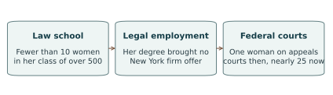

# B/L · Anglais · 13 juin 2024 · Corrigé brut

*Corrigé rédigé par IA, non officiel. Signalez toute erreur.*

**Rédaction** · GPT-6.2 Astra Ultra · vitesse non renseignée

## Using the booklet

Each extract below is a separate possible examination text. The common oral gives you 90 minutes to prepare one document, followed by a 20-minute presentation in English and 10 minutes of questions. The jury expects a thematic commentary grounded in passages from the document. You can introduce a short phrase while discussing it without beginning by reading an extract aloud.

## 1. Franklin D. Roosevelt

*State of the Union Address* · 1935 · page 1 of the official booklet.

### Opening

A president reporting on an emergency is usually expected to say how quickly normal life can return. In his 1935 State of the Union address, Franklin D. Roosevelt questions whether restoring the previous order would be a satisfactory cure. The Great Depression and the first measures of the New Deal form the immediate background. Speaking to Congress and, through it, to a national audience, Roosevelt tries to reconcile institutional continuity with economic change. The argument moves through constitutional legitimacy, a medical account of reform and a distinction between a livelihood and private power.

### Change under an inherited constitution

The opening sentence acknowledges a new order and immediately places it inside the existing constitutional framework. The word “yet” registers an objection before the audience has made it. Economic innovation might otherwise suggest a breach with republican government. Roosevelt establishes continuity at the level of procedure while demanding change in what public institutions are prepared to do.

The early catalogue of benefits moves between farmers, industrial activity, merchants and confidence. The list offers different constituencies a stake in recovery and couples measurable activity with a change in national mood. It is a presidential report, not an independent assessment of the extent of recovery. The international comparison similarly serves a political purpose. Economic and social pressure for change exists elsewhere, but the speaker insists that US representative institutions can respond through their own processes. His case answers both demands for action and fears about how that action might be authorised.

### Why recovery and reform belong together

The convalescent in lines 19–21 provides the most economical statement of the argument. A treatment that removes immediate symptoms while leaving the cause untouched is medically incomplete. By analogy, emergency economic relief can succeed only in part unless underlying weaknesses are addressed. Calling the distinction between reform and recovery misleading makes the New Deal's longer-term ambitions a necessary element of recovery itself.

Elsewhere the president describes measures taking root and being tested in practice. The language of experiment gives the administration permission to revise what has failed. That matters in a speech which otherwise asserts the unity of the programme quite strongly. Roosevelt claims coherence of purpose without claiming that every measure was right at the first attempt. His references to machinery and rapid communication give a reason for this flexibility: inherited, piecemeal remedies have failed to keep pace with an interconnected economy.

### Putting a political limit on private accumulation

The final section narrows the meaning of profit to the exercise of earning a decent living through work. This is a deliberate act of reassurance. An individual who wants security for a family has nothing to fear from the president's defence of ambitious government. The argument then introduces a different consequence of profit: in large concentrations it can give private actors power over public affairs. The relevant question has become political as well as distributive.

The parallel treatment of the overprivileged and the underprivileged invites the audience to see both conditions as distortions of a common society. Roosevelt does not promise equal shares or even equal earnings. He gives a moral priority to security, leisure and a decent life over the accumulation of power. This formulation responds to opposed pressures. An administration attacked as hostile to enterprise can defend a right to profit, while voters suffering from economic insecurity can hear a promise that the ownership of wealth will not determine the whole of public life.

### Conclusion

Roosevelt makes reform a way to restore democratic control over conditions that private citizens cannot master separately. The constitutional frame answers the fear of arbitrary government; the medical image answers the desire for immediate normality; the redefinition of profit answers the fear of an attack on livelihood. Each addresses a different obstacle to consent.

### Questions from the jury

**What changes if the patient in the analogy represents the existing economy?**

Recovery does not mean returning every institution to its previous state. The analogy lets the president argue that repairing a cause may alter the structures in which the symptoms developed.

**Why mention the profit motive in a speech about inequality?**

It reassures readers who equate reform with abolishing private earnings. Roosevelt then isolates the acquisition of disproportionate power as a problem that can be addressed within a mixed economy.

## 2. Ruth Bader Ginsburg

*U.S. Supreme Court Justice Nomination Acceptance Address* · 14 June 1993 · page 2 of the official booklet.

### Opening

On 14 June 1993 Ruth Bader Ginsburg responds to President Bill Clinton's announcement that he will nominate her to the US Supreme Court. A nomination still requires Senate confirmation. This timing explains a delicate feature of the address: Ginsburg must discuss what a judge ought to do without appearing to promise particular decisions. She frames her own career as evidence of institutional change, acknowledges the people who made that change possible and uses other judges' voices to describe the independence her prospective office requires.

### Counting women without making one appointment a conclusion

The opening takes the audience above the level of a single career. A talented woman appearing alone in a senior institution can be treated as an exception. Ginsburg instead sets her nomination beside the presence of Sandra Day O'Connor, changes on the federal courts of appeals and women's increasing share of law school places. The comparisons establish more than one pipeline. Admission to law school, access to employment and appointment to a court are separate thresholds.

Her own experience makes the separation concrete. A law school class of more than five hundred included fewer than ten women; even her degree brought no offer from a New York law firm. Against this history she invokes the protections of Title VII. Her confident image of open doors is a claim about legal and professional change. Becoming formally eligible for a job and receiving a fair opportunity in practice remain distinguishable. An accurate reading also separates the source’s reference to Carter taking office in 1976 from the historical dates: he was elected in 1976 and inaugurated in January 1977.

### Speaking about judging before confirmation

The passage signals explicitly that fuller questions on the judicial role will come later. Ginsburg nonetheless offers more than a polite promise of fairness. Chief Justice Rehnquist supplies an image of deciding a case even when a local crowd dislikes the decision. It is a way of addressing an audience on a celebratory occasion while affirming that popularity cannot be the measure of a judgment.

The next quotation reaches the listeners through several voices. O'Connor cites a lawyer's account of the reminders associated with Justice Holmes. Intellectual honesty about choices, restraint towards a majority's policies and commitment to personal autonomy appear together. These principles can pull in different directions. A constitutional judge has to explain why deference is justified in one case and why protecting a person against the majority is justified in another. Quoting colleagues allows Ginsburg to name that difficulty and model judicial dialogue without prejudging a case. The feminine pronoun in the quotation also makes a woman an ordinary grammatical subject of judicial authority.

### Redistributing the credit for a singular honour

Jane Ginsburg's high school yearbook turns a daughter's seemingly unlikely ambition for her mother into a measure of time. The story is intimate, but it also allows two generations to witness a change in what could plausibly be imagined. Later the speaker credits the civil rights and women's movements, teaching colleagues, fellow judges and family. Personal gratitude becomes an account of the conditions that made individual achievement possible.

A nominee is conventionally singled out by the president. Ginsburg accepts that recognition while resisting the idea that professional access improved through the merit of one exceptional individual alone. Her acknowledgments of people with different roles also reinforce her judicial argument about collegiality. Independence of judgment need not mean intellectual isolation. On this reading, the thanks at the end carry institutional meaning as well as ceremonial grace.

### Conclusion

Ginsburg's address holds together public representation and the duty to decide an individual case on its facts and law. A more inclusive bench can alter whose authority the public sees. That collective significance does not oblige a justice to satisfy a particular constituency. The distinction is essential both to the occasion of nomination and to the judicial ethic the speaker sketches.

### Questions from the jury

**Is Ginsburg presenting herself as the first woman on the Supreme Court?**

No. She expressly acknowledges Sandra Day O'Connor. Ginsburg's argument concerns moving beyond the pattern of one woman at a time in institutions of authority.

**Why quote judges with different profiles on such a personal occasion?**

It locates her understanding of the office inside an institutional conversation. It also helps her describe methods of judgment while leaving questions about future cases for the appropriate constitutional process.

## 3. Nicola Sturgeon

*Address to the Scottish Parliament following her election as First Minister* · 19 November 2014 · pages 3–4 of the official booklet.

### Opening

How can the leader of an independence party claim to govern for citizens who have just voted against independence? Nicola Sturgeon addresses the Scottish Parliament on 19 November 2014, after its members chose her as First Minister. The September referendum had preserved Scotland's place in the United Kingdom. Sturgeon accepts the immediate responsibility of devolved government without abandoning the constitutional aim of the SNP. Her speech turns defeat in a referendum into a resource for participation, constructs a programme of present duties and ends with an account of national time.

### Who belongs to the audience after a divisive vote?

The initial promise extends to every citizen regardless of how they voted. Yes and No supporters retain different constitutional preferences, but wanting a better country is attributed to them both. The distinction is politically useful. Sturgeon need not claim that the losing campaign really won. Instead, she claims a common civic interest broader than either side of the ballot.

The audience expands and contracts throughout the extract. At times the First Minister addresses the presiding officer and members in the chamber. At others, the repeated second person reaches those who live and work across Scotland. The repeated phrase about democracy flourishing takes an event that produced an unwelcome result for her party and makes it evidence of energy that the new government can draw upon. The political problem becomes sustaining participation after a decision, rather than pretending that participation requires permanent agreement.

### The mandate to govern with present powers

The accumulation of phrases beginning with Scotland gives listeners a succession of possible criteria for judging the new administration. Prosperity, equality, business, civic participation and honesty about failure sit alongside one another. A compass makes the list directions for travel rather than a record of accomplishments. The audience is being offered standards against which it might later hold the speaker accountable.

Page 4 turns explicitly to the distinction between powers Sturgeon wants and powers she already possesses. She continues to argue for independence, but acknowledges duties that do not wait on a new constitutional settlement. The NHS and the opportunities of children are examples of what makes constitutional debate tangible. The claim to be a willing ally of other members likewise defines a style of government in the current Parliament. To take disagreement seriously, a commentary should retain the restriction she places on agreement: cooperation occurs where common ground can actually be found.

### Revising an inherited national ending

The Earl of Seafield's remark in Scots, voiced at the union of 1707, gives the ending a sense of bereavement. Sturgeon supplies a different ending to his apparent finality. The Scottish Parliament established again in 1999 becomes the return of an old song after 292 years. The wording makes devolution part of a longer national history. It does not mean that sovereign independence returned in 1999.

The metaphor has another consequence. A restored song could be imagined as a fixed inheritance, but Sturgeon asks for new verses and changes the final invitation into a collective act of writing. A speaker committed to one constitutional future ends with an image that lets listeners imagine participating before they have agreed on that future. One may also hear a limit: unionist members can share the immediate programme without necessarily accepting a historical narrative that treats union as a long silence.

### Conclusion

Sturgeon claims authority by giving two assurances at once. Constitutional disagreement will continue to be voiced, and citizens who voted differently remain entitled to effective devolved government. The speech's most revealing move is to make a shared task available in the present while leaving the terms of a future settlement open to argument.

### Questions from the jury

**Why is 1999 a turning point without being independence?**

A devolved Parliament resumed lawmaking in Scotland under the UK constitutional settlement. Sturgeon makes that institutional change part of a continuing story of political voice.

**What gives the final expression in Scots its rhetorical importance?**

Its sound and its attribution connect the chamber to the moment of union. Sturgeon reuses a phrase that announced an ending to invite further composition and collective political agency.

## 4. Thomas Babington Macaulay

*Speech on the Reform Bill of 1832* · 2 March 1831 · page 5 of the official booklet.

### Opening

On 2 March 1831 Thomas Babington Macaulay urges the House of Commons to support Lord John Russell's electoral reform proposal. The date matters: this is a speech about the measure that would eventually produce the 1832 Reform Act, not a retrospective celebration of an act already passed. Macaulay must persuade legislators who fear that extending representation will threaten the social order. His answer is that timely inclusion can protect hierarchy. To understand that argument we need to examine his test for political membership, his calculation about timing and the urgency of his appeal to his audience.

### Recognising equality while restricting the vote

Macaulay opens with a concession: there are circumstances in which a wide franchise can operate safely. His comparison with the United States rejects the idea that Americans possess some innate political superiority over English people. What differs, he argues, is the social setting. Where wages, work and food are insecure, he fears that distress will shape the political behaviour of working people.

The conditional sentences imagine living conditions he says he wishes the labouring classes enjoyed. Sympathy is made compatible with continued exclusion by framing exclusion as an expedient even for those excluded. His proposed pecuniary qualification attaches political capacity to economic position. The comparison with supposed universal suffrage in the United States must itself be read historically: the American electorate in 1831 was far from universal, with women and many others excluded. The comparison reveals his argumentative standard rather than a complete survey of political rights.

### Changing the franchise to preserve an order

The central lines bring reform and conservation together. The existing system's defenders see alteration as the danger. Macaulay identifies a different risk in preserving rules long after they lose public credibility. A limited extension can bring some interests inside Parliament and make the exclusion of others easier to maintain. His willingness to state this selective purpose so plainly tells us whom he is trying to persuade.

The rapid succession of questions about waiting changes the basis of the debate. It asks less whether the existing arrangements are ideal than whether they can conceivably last until 1860. Each further delay, he predicts, will increase the number, demands and organisation of those dissatisfied. Legislators still have an opportunity to act voluntarily and retain the credit for doing so. Later they may have to concede under pressure. This is a theory about the timing of reform and the political value of agency.

### Making Parliament hear history in the present

The speech's last movement invokes a continental throne falling, an intelligible allusion to the French July Revolution of 1830. A recent example gives immediacy to warnings that might otherwise sound speculative. The series of commands to save the people, the aristocracy and the wider community groups constituencies with conflicting interests inside one threatened order. The speaker invites privileged listeners to understand restraint of their own power as their best means of survival.

At the same time, the people to be saved are described as endangered by their own passions. Macaulay imagines Parliament acting for them and does not give them an equal speaking role. The increasingly urgent sentences and final appeal to the future remorse of those who vote against the bill bring public history down to a member's personal decision. Urgency can loosen resistance to reform while limiting discussion of how far representation ought to extend.

### Conclusion

For Macaulay, selective inclusion makes conservation possible. The address is therefore valuable evidence of the capacity of nineteenth-century parliamentary reform to widen membership and affirm continuing boundaries in the same legislative act. The unresolved question is whether those excluded would accept the distinction between safe and unsafe participants on which his argument depends.

### Questions from the jury

**Is Macaulay arguing for universal male suffrage in Britain?**

No. He allows that a broad franchise may work under some conditions while arguing for a property-related qualification in the England he describes. The reform he supports is deliberately limited.

**How would the argument change if the proposal were already law?**

The questions and urgent imperatives would lose their immediate function. Spoken in 1831, they ask legislators to take responsibility for an outcome still undecided.

## Sources

[Official booklet for 13 June 2024](https://www.ens.psl.eu/sites/default/files/bl_sujets_oraux_anglais_13062024.pdf) · [Jury report, common English oral](https://www.ens.psl.eu/sites/default/files/2024_bl_rapport_oral_anglais_epreuve_commune.pdf)
